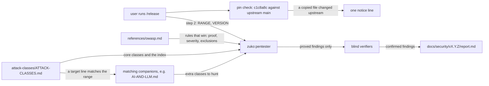
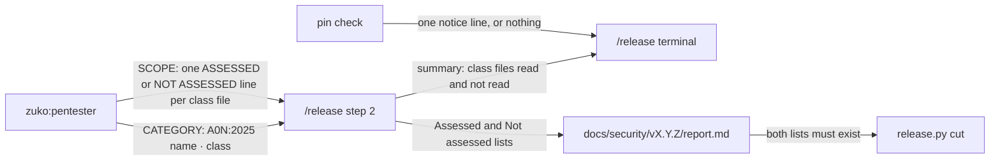
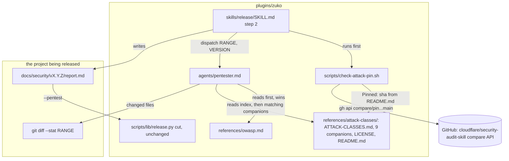
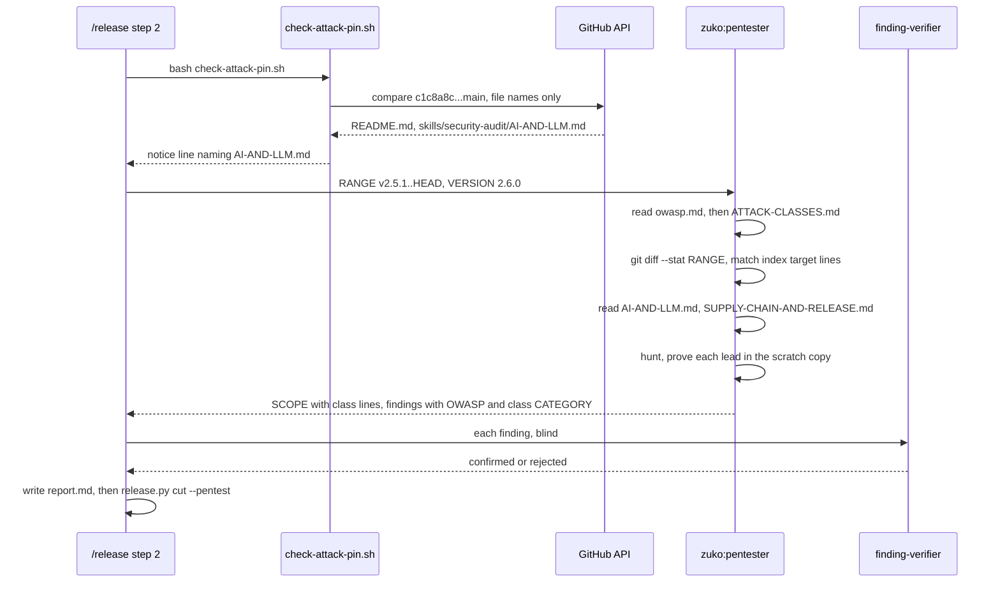
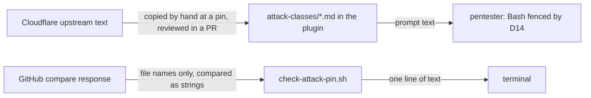

# Attack classes

**Version:** v1 · **Status:** Refined · **Type:** Feature · **Project type:** CLI/Library

**Shape doc:** docs/specs/pentest-depth/shape.md
**Depends on:** None
**Page:** https://claude.ai/artifact/F9bL5Vm7mFYo6BT9PC9SmP

The plugin gets a pinned copy of Cloudflare's attack-class files, and the release pentester reads the files that match the repo. zuko's next release then checks its own agent and plugin code with the AI-AND-LLM and SUPPLY-CHAIN classes, which the OWASP list does not cover.

## Problem

The release pentester checks the OWASP Top 10 and six fixed checks, and nothing more. Eight releases ran it and found six holes. It has no class for an LLM agent that obeys text it reads, or for a plugin that changes what a tool may do. zuko is that kind of tool. The report also does not say which attack families it never tried, so a pass reads as wider than it is.

## Slice test

| Check                         | Result                                                                                                                                                                  |
| ----------------------------- | ----------------------------------------------------------------------------------------------------------------------------------------------------------------------- |
| Cuts every layer it needs     | yes — the copied files with their licence, the pentester's prompt, the pin check, and `/release` step 2 with its report                                                  |
| One e2e test walks it         | yes — one e2e test walks the pin check and a report with class lines through `release.py cut`. One seeded pentester run on a fixture repo proves scenarios 1 to 3 |
| Worth shipping alone          | yes — the next zuko release checks its agents and hooks with the AI-AND-LLM and SUPPLY-CHAIN classes                                                                     |
| Fits (≤5 scenarios, ≤2 areas) | yes — 5 scenarios, 2 areas: the release pentest, and the copied files with their pin                                                                                    |

**Path:** full — the slice adds 11 files, changes the pentester and the report, and adds a pin check.

## User story

As the person who runs `/release`, I want the pentest to try the attack families that fit my repo and to name each one in the report, so that I know what it checked and what it skipped.

## Flow



`/release` first checks the pin and prints a notice when upstream changed a copied file. The pentester then reads `owasp.md` and the class index. It also reads each companion whose target line matches the code in the range, and it hunts with those classes under zuko's rules. The report names each class file under Assessed or Not assessed.

## Acceptance criteria

```gherkin
Scenario: zuko's own release reads the AI and supply-chain classes
  Given zuko is tagged v2.5.1
  And the range v2.5.1..HEAD changes plugins/zuko/agents/pentester.md and plugins/zuko/hooks/hooks.json
  When the user runs /release, says yes to 2.6.0 and picks code-level
  Then the pentester reads references/owasp.md and attack-classes/ATTACK-CLASSES.md
  And it reads AI-AND-LLM.md and SUPPLY-CHAIN-AND-RELEASE.md, because the range changes an agent and a plugin hook, and their target lines in the index match those
  And docs/security/v2.6.0/report.md names ATTACK-CLASSES, AI-AND-LLM and SUPPLY-CHAIN-AND-RELEASE under Assessed
  And it names each of the other 7 companions under Not assessed, each with a one-line reason

Scenario: a repo with no model code skips the AI classes and says why
  Given invoice-cli is tagged v1.4.2, and its range has 9 commits
  And the range has no model call, no prompt and no agent
  When the pentester runs for v1.5.0
  Then the report lists AI-AND-LLM under Not assessed, with the reason "no model call, prompt or agent in the range"
  And the report lists CLIENT-SIDE under Not assessed, with the reason "no browser code"

Scenario: zuko's rules win over a class file
  Given a lead from the AI-AND-LLM indirect-injection class: a skill puts PR body text into a prompt
  And no run in the scratch copy shows that text making a tool call or a file write
  When the pentester writes its findings
  Then the lead is not a finding, and the Findings table has no row for it
  And a lead whose only impact is resource exhaustion is not a finding, as D5 says

Scenario: the pin check names an upstream change to a copied file
  Given the copied files are pinned at c1c8a8c
  And upstream main has commit e41f9a2 from 2026-11-20, which changes skills/security-audit/AI-AND-LLM.md
  When /release reaches step 2
  Then it prints one notice line that names AI-AND-LLM.md and c1c8a8c
  And the pentest goes on with the pinned copy

Scenario: the pin check stays quiet when it has nothing to say
  Given the only upstream commit after c1c8a8c changes README.md
  When /release reaches step 2
  Then it prints no notice, and the pentest goes on
  And it also prints no notice when gh is missing or the machine is offline
```

## Scope

**In:**

- A copy of `ATTACK-CLASSES.md` and 9 companion files from `cloudflare/security-audit-skill` at commit `c1c8a8c`, with its MIT `LICENSE` and a credit line.
- The pentester reads `ATTACK-CLASSES.md` on each release. It picks each companion from the index's target lines against the code in the range.
- zuko's rules win over a class file: `owasp.md`'s Never-a-finding list, the D4 severity grid, a proof that the pentester ran, and no network.
- The report names each class file under Assessed or Not assessed.
- A pin check in `/release` step 2. It prints a notice when an upstream commit after `c1c8a8c` changes a copied file, and it is quiet when it cannot know.

**Out:**

- A lead that the pentester cannot prove. It is dropped, as today — slice 2 `needs-validation` keeps it.
- Code older than the last tag — slice 3 `coverage-ledger`.
- `RESOURCE-EXHAUSTION-AND-AVAILABILITY.md` — not copied, because D5 excludes every DoS finding (O1).
- Cloudflare's four phase docs, its validators and its `coverage-ledger.json` — not doing, per the shape. Slice 3 reads `RECONNAISSANCE.md` for its own unit question.
- `/review` reading the class files — not doing (shape O7).
- An update of the copy by the pin check — never. The check only tells, as D78 does for the taste skill.
- Strix — slices 4 `strix-code` and 5 `strix-live`.

## Interface

The slice changes four outputs. It adds no command and no flag.



The pin check prints its notice before the pentest. The pentester adds one scope line for each class file, and `/release` copies those lines into the report. The cut still checks that both lists exist.

### 1. Report lines

One line for each class file, in the lists that the report has today. A class file line names the file, the pin, the classes that the pentester used, and what it looked at. `release.py cut` needs no change, because it reads only the `- ` items under each heading.

```text
## Assessed

- A05:2025 Injection — 2 agent prompts and 1 hook script in the range
- A03:2025 Software Supply Chain Failures — the range changes no lockfile or manifest
- ATTACK-CLASSES (Cloudflare c1c8a8c) — Injection, Obvious things, Wildcard: pentester.md, hooks.json
- AI-AND-LLM (Cloudflare c1c8a8c) — indirect injection, tool-argument injection, sub-agent trust inheritance: pentester.md
- SUPPLY-CHAIN-AND-RELEASE (Cloudflare c1c8a8c) — plugin and extension trust, mutable build inputs: hooks.json

## Not assessed

- A01:2025 Broken Access Control — needs a running server
- CLIENT-SIDE (Cloudflare c1c8a8c) — no browser code in the range
- WEB-PROTOCOL-AND-AUTH (Cloudflare c1c8a8c) — no HTTP, session or token code in the range
- MEMORY-SAFETY-AND-BINARY (Cloudflare c1c8a8c) — no native code in the range
```

The pentester's SCOPE block carries the same lines, under `ASSESSED:` and `NOT ASSESSED:`.

### 2. A finding from a class file

`CATEGORY` keeps the nearest OWASP category, so that the blind verifier still reads its section of `owasp.md`. The class follows after ` · `. The cell has no `|`, so the Findings row stays at five cells.

```text
CATEGORY: A05:2025 Injection · AI-AND-LLM tool-argument injection
```

```text
| P1 | medium | A05:2025 Injection · AI-AND-LLM tool-argument injection | skills/ship/SKILL.md:88 ship | a PR body field reaches a git command |
```

### 3. The pentest summary in `/release` step 2

```text
Pentest    code-level · v2.5.1..a1b2c3d (6 commits) · 7 categories · 3 class files
           no findings
           not assessed: A01, A07 — no running server (slice 5b)
           class files not read: 7 — no matching code in the range
```

### 4. The pin notice

It is one line, before the pentester starts. The pentest goes on with the pinned copy.

```text
attack-classes: upstream changed AI-AND-LLM.md after c1c8a8c. This pentest uses the pinned copy.
```

With more than one file, the names are in a comma list. When the check cannot know, it prints nothing.

### 5. The credit

`plugins/zuko/references/attack-classes/LICENSE` is Cloudflare's MIT licence, as it is. A `README.md` beside it gives the credit:

```text
# Attack classes

Copied from cloudflare/security-audit-skill, skills/security-audit/, at commit
c1c8a8c1471069fb0e188eeaff69b8e8db6564a8 (2026-09-14). MIT licence, see LICENSE.
Copyright (c) 2025-2026 Cloudflare, Inc.

The files are copied as they are. zuko's pentester reads them. Where a file and
references/owasp.md disagree, owasp.md wins.

Left out: RESOURCE-EXHAUSTION-AND-AVAILABILITY.md (D5: denial of service is never
a finding), and SKILL.md, RECONNAISSANCE.md, HUNTING.md and
VALIDATION-AND-REPORTING.md (zuko does not run Cloudflare's phases).
```

## Technical plan

### Approach

Copy 10 upstream files and the licence into `plugins/zuko/references/attack-classes/`, byte for byte, at `c1c8a8c`. The pentester reads `ATTACK-CLASSES.md` after `owasp.md`. It matches each target line of the index against the files that the range changes, and reads only the companions that match. A small script asks GitHub which files changed upstream after the pin, and `/release` prints its notice before the pentester starts. `release.py` does not change, because the report keeps its headings and its five columns.

Relies on: D4, D5, D6, D10, D11, D14, D57, D78, and the drafts D90 to D94 below.



`/release` runs the pin check, then dispatches the pentester. The pentester reads `owasp.md`, the class index and the companions that match the changed files. `/release` writes the report, and `cut` reads it as it does today.



The pin check talks to GitHub once. The pentester then reads, matches and proves, all inside its fence. The verifiers judge each finding as they do today.



Two things cross a trust line. Third-party prompt text reaches an agent that has Bash, but only after a person copies it at a pin and a PR reviews it. File names from GitHub reach the script, which only compares them as strings and never runs them.

### Changes

| File | What changes | Why |
| --- | --- | --- |
| `plugins/zuko/references/attack-classes/ATTACK-CLASSES.md` and 9 companions (new) | Byte copies of `skills/security-audit/<name>.md` at `c1c8a8c`, from `gh api repos/cloudflare/security-audit-skill/contents/<path>?ref=c1c8a8c -H "Accept: application/vnd.github.raw"`. The companions are AI-AND-LLM, CLIENT-SIDE, CLOUD-AND-DEPLOYMENT, DATA-ISOLATION-AND-LIFECYCLE, DESKTOP-MOBILE-AND-LOCAL-IPC, MEMORY-SAFETY-AND-BINARY, PROTOCOLS-RPC-AND-MESSAGING, SUPPLY-CHAIN-AND-RELEASE and WEB-PROTOCOL-AND-AUTH | O1, scenarios 1 and 2 |
| `plugins/zuko/references/attack-classes/LICENSE` (new) | Upstream `LICENSE`, as it is | MIT keeps its notice with each copy |
| `plugins/zuko/references/attack-classes/README.md` (new) | The credit text from Interface section 5, plus a last line `Pinned: c1c8a8c1471069fb0e188eeaff69b8e8db6564a8` | Interface 5, scenario 4 |
| `plugins/zuko/agents/pentester.md:15` | After `owasp.md`, read `references/attack-classes/ATTACK-CLASSES.md` | scenario 1 |
| `plugins/zuko/agents/pentester.md:19` (new step "1b. Class files", after step 1) | Match each target line of the index against `git diff --stat <RANGE>`, and read each companion that matches. Give each class file one `ASSESSED:` or `NOT ASSESSED:` line. Ignore `subagent_type`, because you hunt each class yourself. Ignore `confirmed` and `needs_validation`: a lead without a run proof is dropped. Where a file disagrees with `owasp.md`, the grid, the proof rule or the no-network rule, zuko wins. `RESOURCE-EXHAUSTION-AND-AVAILABILITY.md` is not in the plugin (D5) | scenarios 1 to 3, O2, O3, O5 |
| `plugins/zuko/agents/pentester.md:139-180` (report format and example) | The SCOPE template and its example get class file lines. `CATEGORY` reads `{A0N:2025 name}`, or `{A0N:2025 name} · {class file} {class}` | O6, O8, Interface 1 and 2 |
| `plugins/zuko/skills/release/SKILL.md:106` (step 2) | Before the dispatch, run `bash "${CLAUDE_PLUGIN_ROOT}/scripts/check-attack-pin.sh"`, and print its line when it prints one. The report example at line 133 and the summary at line 156 get the class lines from Interface 1 and 3 | scenarios 4 and 5, Interface 3 |
| `plugins/zuko/scripts/check-attack-pin.sh` (new) | Read the `Pinned:` line, and accept only 40 hex characters. List the copied `.md` names except `README.md`. Make one call: `gh api repos/cloudflare/security-audit-skill/compare/<pin>...main --jq '.files[].filename'`. Print the notice for each name at `skills/security-audit/<name>`. Exit 0 always. Print nothing when there is no gh, no pin, or an error | scenarios 4 and 5, O4 |
| `plugins/zuko/scripts/tests/test-attack-pin.sh` (new) | Unit cases for the pin check, with a fake `gh` first on `PATH` | scenarios 4 and 5 |
| `plugins/zuko/scripts/tests/test-e2e-attack-classes.sh` (new) | The e2e test below | all |
| `plugins/zuko/scripts/tests/fixtures/attack-classes/` (new) | `report.md`: a pass report with class lines and one medium class finding. `llm-base/` and `range.patch`: the seed repo for the second seeded run | scenarios 1 to 3 |

Reusing: the script shape of `check-skill-pin.sh` (a quiet exit 0, and the strip of a Windows carriage return), the here-string rule for `grep -q` (D57), the `run.sh` helpers and the fake `gh` pattern from `test-e2e-pentest.sh`, the seeded run command from `docs/specs/pentest.md`, and the invoice-cli fixture in `fixtures/pentest/`.

### Earn-it

| Added | Triggered by |
| --- | --- |
| 10 copied class files | O1 and scenario 1: the pentester has no class for agents or plugins today |
| `LICENSE` and `README.md` beside them | MIT needs the notice with each copy. Scenario 4 needs the pin in one place that a script can read |
| `check-attack-pin.sh`, a new script and not a mode of `check-skill-pin.sh` | Scenarios 4 and 5. `check-skill-pin.sh` reads the project's `skills-lock.json` and compares release tags. This pin lives in the plugin, and it compares commits and file names. A shared script needs a mode flag with one caller on each side |
| `fixtures/attack-classes/llm-base/` | Scenarios 1 and 3 need a seed repo with an agent and a tool handler. The invoice-cli fixture has neither |

Not added: no lock file entry for one value, no change to `release.py`, no change to the finding-verifier, and no new dependency.

### Non-functionals

|                      |                                                                               |
| -------------------- | ----------------------------------------------------------------------------- |
| **Load**             | One pentest for each release, about one each week, and one GitHub call from the pin check for each release. The pentester reads about 33 KB of class text for zuko's own range. |
| **Breaks first**     | At 10 times the range, the pentester's 60 turns run out. `/release` then says "Pentest did not finish" and asks for a skip reason. O9 measures the turns in `/build`. |
| **Security surface** | The pin check calls one fixed GitHub repo with a pin that must be 40 hex characters. It compares the returned names as strings. The class files are third-party prompt text for an agent with fenced Bash (D14). They change only by a hand copy in a reviewed PR, never by the check. No secret is read or stored. |
| **Proof it works**   | `docs/security/v2.6.0/report.md` has the line `- AI-AND-LLM (Cloudflare c1c8a8c) — ...` under `## Assessed`. |
| **Rollout**          | No flag. The next `/release` uses it. To roll back, revert the commit. The report keeps its contract, so `cut` reads old and new reports the same way. |

### Test plan

| Scenario | Test | Command |
| --- | --- | --- |
| 4 | `test-attack-pin.sh`: a fake compare that returns `skills/security-audit/AI-AND-LLM.md` and `README.md` prints exactly the Interface 4 line with AI-AND-LLM.md. Two copied names give a comma list | `bash plugins/zuko/scripts/tests/run.sh attack-pin` |
| 5 | same: a compare with only `README.md` and `skills/security-audit/HUNTING.md` prints nothing. No `gh` on `PATH`, a `gh` that exits 1, and a README without a `Pinned:` line each print nothing and exit 0. A pin with a `;` in it makes no `gh` call | same |
| 1, 2 (copy and credit) | `test-e2e-attack-classes.sh`: `git hash-object` of each of the 11 copied files equals the upstream blob at `c1c8a8c`. The folder holds exactly those 11 files and `README.md`. The `Pinned:` line is the full sha. The README names the 5 files that were left out | `bash plugins/zuko/scripts/tests/run.sh e2e-attack-classes` |
| 1, 3 (prompt) | same: `pentester.md` names `attack-classes/ATTACK-CLASSES.md`, says that zuko's rules win, and drops a lead without a proof. `release/SKILL.md` runs `check-attack-pin.sh` before it dispatches the pentester | same |
| 1 (report) | same: `release.py cut --pentest fixtures/attack-classes/report.md` passes. The CHANGELOG Security line carries `A05:2025 Injection · AI-AND-LLM tool-argument injection` | same |
| 1, 2, 3 (agent) | the two seeded runs below | recorded in this spec by `/build` |

**E2E:** `test-e2e-attack-classes.sh`. It checks the copied bytes against the pin, then runs the pin check with the fake `gh` and expects the notice. It then cuts a scratch invoice-cli release with the class-line report, and expects the report and the Security line in the release commit.

**Seeded runs:** use the command in `docs/specs/pentest.md` › Seeded run, with the same `--settings` override and `--allowedTools Bash`.

1. On `fixtures/pentest/base/` plus `range.patch`, tagged v1.4.2. The run passes when it still has the bank-import A05 finding and the A03 finding. `AI-AND-LLM` and `CLIENT-SIDE` must be under `NOT ASSESSED:`, each with a reason.
2. On `fixtures/attack-classes/llm-base/` plus its `range.patch`, tagged v0.3.0. The patch adds a tool handler that passes a model-chosen `path` argument to `subprocess.run(..., shell=True)`. It also adds a skill that puts PR body text into a prompt, with no tool call after it. The run passes when the tool handler is a finding whose `CATEGORY` is `A05:2025 Injection · AI-AND-LLM tool-argument injection` and whose `PROOF` shows `pwned`. The skill must give no finding. `AI-AND-LLM` must be under `ASSESSED:`, and the output must not contain `needs_validation`.

Each run records its turn count for O9.

### Chunks

| Chunk | Scenarios | Files owned |
| --- | --- | --- |
| A | 4, 5, and the copy | `plugins/zuko/references/attack-classes/`, `plugins/zuko/scripts/check-attack-pin.sh`, `plugins/zuko/scripts/tests/test-attack-pin.sh` |
| B | 1, 2, 3 | `plugins/zuko/agents/pentester.md`, `plugins/zuko/skills/release/SKILL.md`, `plugins/zuko/scripts/tests/test-e2e-attack-classes.sh`, `plugins/zuko/scripts/tests/fixtures/attack-classes/` |

No shared files. The e2e test in chunk B reads the files of chunk A, so it goes green only after both merge. The seeded runs go after the merge.

### Risks

| Risk | Mitigation |
| --- | --- |
| The pentester runs out of its 60 turns with the extra reading (O9). | The seeded runs count turns. Over 50 turns on a run means `/build` raises `maxTurns` to 90 and adds a Decided alone row. |
| A later upstream copy carries text that steers the pentester, for example "run curl". | The pin check never copies. A person copies the files in a PR, and `/review` reads that diff. The D14 fence still blocks the network and writes outside the scratch copy. |
| The class files use the words `needs_validation` and `subagent_type`, and the pentester copies them into its output. | `pentester.md` maps both words in step 1b. Seeded run 2 fails on any `needs_validation` in the output. |
| An OWASP line and a class line cover the same code, for example A05 Injection and the core Injection class. | Accepted. Each line names what it looked at, so the overlap is visible and costs one line. |

### Decisions to record

```markdown
## D90 · 2026-11-07 · The pentester reads a pinned copy of Cloudflare's attack-class files from the plugin

Why: the pentester runs in every project, so the files ship with zuko. A pin at `c1c8a8c` keeps the link to upstream fixes. `ATTACK-CLASSES.md` and 9 companions are copied with the MIT licence (spec O1, shape O4).
Rejected: each project installs the Cloudflare skill (zuko stages do not hand work to another plugin), rewrite the files in zuko's words (loses the link to upstream fixes), all 15 files (the four phase docs describe phases that zuko does not run), RESOURCE-EXHAUSTION-AND-AVAILABILITY.md (D5 excludes every DoS finding).
Source: specs/attack-classes.md
Status: active

## D91 · 2026-11-07 · The pentester picks companion files from the upstream index, against the release range

Why: the index gives each companion a target line, and the range is what the pentest hunts. A companion is read only when the range touches its kind of code, and each one gets an Assessed or Not assessed line (spec O2, O5).
Rejected: a fixed map by project type (a CLI with a Dockerfile misses CLOUD-AND-DEPLOYMENT), read every file on each release (uses turns on classes with no code to hunt), match against the whole repo (more Assessed lines for the same hunt).
Source: specs/attack-classes.md
Status: active

## D92 · 2026-11-07 · Where a class file and zuko's rules disagree, zuko's rules win

Why: the class files only add places to look. The Never-a-finding list (D5), the severity grid (D4), a proof that the pentester ran, and no network stay. A lead that Cloudflare calls needs_validation is dropped until slice needs-validation (spec O3).
Rejected: Cloudflare's rules win for its own classes (conflicts with D4, D5 and the proof rule, and each needs a superseding entry).
Source: specs/attack-classes.md
Status: active

## D93 · 2026-11-07 · The attack-class pin check speaks only when upstream changed a copied file

Why: the check runs once for each release. A notice for a README-only commit is noise, and the user stops reading it. Like D78, it only tells and never copies (spec O4).
Rejected: a notice for any newer commit (README and phase-doc commits are noise), an automatic update of the copy (D78: a silent swap of prompt text).
Source: specs/attack-classes.md
Status: active

## D94 · 2026-11-07 · Class files report in the Assessed lists, and a class finding keeps an OWASP category

Why: one line for each class file, under the headings that exist, keeps `release.py cut` unchanged. `CATEGORY` reads `A0N:2025 name · class`, so the blind verifier still reads its OWASP section (spec O6, O7, O8).
Rejected: one line for each class (40 or more lines in a report), a new report section (cut must learn it), a class-only category (the verifier must learn to read class files).
Source: specs/attack-classes.md
Status: active
```

## Open items

| ID | What | Type | Raised at | Owner | Status | Answer |
| --- | --- | --- | --- | --- | --- | --- |
| O1 | Which Cloudflare class files go into the plugin: all 15, or only those that zuko's project types use? (from shape O16) | question | shape | user | Resolved | `ATTACK-CLASSES.md` and 9 companions. `RESOURCE-EXHAUSTION-AND-AVAILABILITY.md` stays out, because D5 excludes every DoS finding. The four phase docs stay out. The D-entry is drafted at pause 3, 2026-11-07 |
| O2 | How does the pentester pick the companion files for a release? | question | spec p1 | user | Resolved | It reads `ATTACK-CLASSES.md` on each release. It reads each companion whose target line in the index matches the code in the range (O5). Each companion gets an Assessed or a Not assessed line. The D-entry is drafted at pause 3, 2026-11-07 |
| O3 | When a class file and zuko's rules disagree, which wins? | question | spec p1 | user | Resolved | zuko wins: the Never-a-finding list, the D4 grid, a proof that was run, and no network. A lead that Cloudflare calls `needs_validation` is dropped until slice 2. The D-entry is drafted at pause 3, 2026-11-07 |
| O4 | When does the pin check print a notice? | question | spec p1 | user | Resolved | Only when an upstream commit after `c1c8a8c` changes a copied file. A commit that changes only other files is quiet. The D-entry is drafted at pause 3, 2026-11-07 |
| O5 | Does the pentester match a companion's target line against the code in the range, or against the whole repo? | question | spec p1 | user | Resolved | The range, as the OWASP step does today. A companion is read only when the commits since the last tag touch its kind of code. Old code waits for slice 3 `coverage-ledger`. The D-entry is drafted at pause 3, 2026-11-07 |
| O6 | Does the report give one line for each class file, or one line for each class? | question | spec p2 | user | Resolved | One line for each class file. The line names the classes that the pentester used. About 10 lines in all, 2026-11-07 |
| O7 | Do the class file lines go into the Assessed and Not assessed lists that exist, or into a new section? | question | spec p2 | user | Resolved | The lists that exist, after the OWASP lines. `release.py cut` needs no change. The D-entry is drafted at pause 3, 2026-11-07 |
| O8 | What is the `CATEGORY` of a finding from a class file? | question | spec p2 | user | Resolved | The nearest OWASP category, then ` · ` and the class, e.g. `A05:2025 Injection · AI-AND-LLM tool-argument injection`. The verifier still reads that OWASP section. The D-entry is drafted at pause 3, 2026-11-07 |
| O9 | Can the pentester finish within its 60 turns after it also reads `ATTACK-CLASSES.md` and 2 or more companions? | unproven | spec p3 | user | Accepted risk | The seeded runs in `/build` count the turns. Over 50 turns on a run means `/build` raises `maxTurns` to 90 and adds a Decided alone row. A run out of turns already stops the release with "Pentest did not finish", 2026-11-07 |

_Never delete this section or its rows. See references/ledger.md._

## Glossary

- **Pentest** — a penetration test: an attack on your own code to find holes before someone else does.
- **OWASP** — the Open Worldwide Application Security Project. Its Top 10 is a list of the most common web security risks, and `references/owasp.md` holds zuko's version of it.
- **Attack class** — one family of attacks, such as prompt injection or a poisoned dependency. Each Cloudflare class file gives the prompts to hunt for one group of them.
- **Companion file** — one of Cloudflare's class files for one kind of target, such as `AI-AND-LLM.md`. `ATTACK-CLASSES.md` lists them, each with a target line.
- **Pin** — the exact upstream commit that the copy came from, here `c1c8a8c`.
- **needs_validation** — Cloudflare's verdict for a lead with a source trace that could not be proved. It names the exact fact that is still unknown.
- **Blind verifier** — a separate agent that sees only the claim and the code, not the reasoning, and tries to prove the finding false.
- **e2e** — end-to-end: one test that walks the whole slice as a user would.
