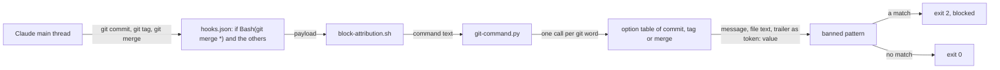
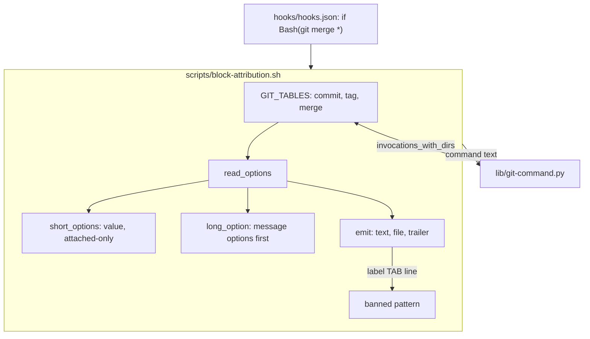
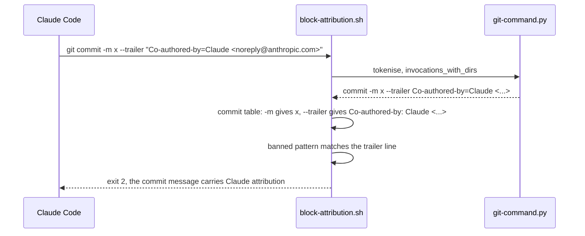

# Attribution trailer

**Version:** v1 · **Status:** Built · **Type:** Bug · **Project type:** CLI/Library

**Shape doc:** docs/specs/guard-leads/shape.md
**Depends on:** None

The attribution guard reads a `--trailer` on `git commit` and `git tag`, and
the message of `git merge`. `hooks.json` sends `git merge` to the guard. This
closes leads v2.6.0 N12 and v2.7.0 N11.

## Problem

`block-attribution.sh` reads `-m`, `--message`, `-F` and `--file` of
`git commit` and `git tag`. git also writes message text from `--trailer`, and
`git merge -m` writes a merge commit message. Neither is read. I ran these
inputs against the real hook on 2026-11-12:

| Input | Exit |
| --- | --- |
| `git commit -m x --trailer "Co-authored-by: Claude <noreply@anthropic.com>"` | 0 |
| `git commit --trailer "Co-authored-by=Claude <noreply@anthropic.com>" -m x` | 0 |
| `git tag -a v2.8.0 -m v2.8.0 --trailer "Co-authored-by: Claude <noreply@anthropic.com>"` | 0 |
| `git merge feat -m "Co-Authored-By: Claude <noreply@anthropic.com>"` | 0 |
| `git merge feat --into-name -m --message "Co-Authored-By: Claude ..."` | 0 |
| `git commit -tm --message "Co-Authored-By: Claude ..."` | 0 |
| `git tag -a v2.8.0 -um --message "Co-Authored-By: Claude ..."` | 0 |
| `git commit -m "x<newline><newline>Co-Authored-By: Claude <noreply@anthropic.com>"` | 2 |

The last three rows are one more gap of one kind. The commit and tag tables
do not know the options that take a value. So `-tm` reads as `-t` and `-m`,
and `-m` takes `--message` as its text. git reads `-t m`, then the message.

git 2.52.0 facts this slice rests on, each run in a scratch repo on
2026-11-12:

- `--trailer "Co-authored-by=Claude"` writes `Co-authored-by: Claude`. git
  takes `=` or `:` as the separator.
- `--trailer "co-authored-by : Claude"` writes `co-authored-by: Claude`.
- `--trailer=...` and `--trai ...` work. git abbreviates long options.
- `git tag --trailer` exists. `git merge --trailer` fails with
  `unknown option`.
- `git merge feat -m msg`, `-F file` and `--mess msg` set the merge message.
- `git commit -tm --message msg` uses the template file `m`, then `msg`.
- `git merge feat --into-name -m --message msg` sets the message `msg`.
- `git -c trailer.cab.key=Co-authored-by commit --trailer "cab: Claude"`
  writes `Co-authored-by: Claude` (O3).

## Slice test

| Check                         | Result                                                                          |
| ----------------------------- | ------------------------------------------------------------------------------- |
| Cuts every layer it needs     | Yes. The guard, its route in `hooks.json`, and the test that runs the real hook |
| One e2e test walks it         | Yes. `test-block-attribution.sh` feeds the real hook a payload for each input   |
| Worth shipping alone          | Yes. It closes v2.6.0 N12 and v2.7.0 N11                                        |
| Fits (≤5 scenarios, ≤2 areas) | Yes. 4 scenarios, 2 areas (scripts, hooks)                                      |

**Path:** light. A bug fix in 3 files, with no new interface, data or
dependency. Pauses 1 and 3 merged, pause 2 skipped.

## Flow



Each git call goes through the option table of its subcommand. The table
gives each value option its value, and prints the message text and each
trailer. The banned pattern then judges the lines.

## Acceptance criteria

```gherkin
Scenario: a trailer on a commit or a tag is read as part of its message
  Given the command git commit -m "fix: round refunds" --trailer "Co-authored-by: Claude <noreply@anthropic.com>"
  When block-attribution.sh judges it
  Then it exits 2 with "the commit message carries Claude attribution"
  And stderr quotes "Co-authored-by: Claude <noreply@anthropic.com>"
  And --trailer=..., --trai ..., --trailer "Co-authored-by=Claude <noreply@anthropic.com>" and --trailer "co-authored-by : Claude" are blocked the same way
  And git tag -a v2.8.0 -m v2.8.0 --trailer "Co-authored-by: Claude <noreply@anthropic.com>" is blocked as the tag message

Scenario: a git merge message is read
  Given the command git merge feat -m "Co-Authored-By: Claude <noreply@anthropic.com>"
  When block-attribution.sh judges it
  Then it exits 2 with "the merge message carries Claude attribution"
  And -m before the branch, --message, --message=, --mess, -F <file> and --file=<file> are blocked the same way
  And git merge feat -F - is blocked with "Give the message with -m"
  And hooks.json routes Bash(git merge *) to block-attribution.sh

Scenario: an option that takes a value takes it
  Given a template file m in the payload cwd
  When block-attribution.sh judges git commit -tm --message "Co-Authored-By: Claude <noreply@anthropic.com>"
  Then it exits 2 with "the commit message carries Claude attribution"
  And git merge feat --into-name -m --message "..." is blocked the same way
  And git tag -a v2.8.0 -um --message "..." is blocked the same way
  And git commit --author -m --message "..." is blocked the same way
  And git commit -u -m "..." and git merge feat -S -m "..." are blocked, because -u and -S take a value only in their own word

Scenario: normal commands still pass
  Given a repo on a feature branch
  When block-attribution.sh judges git commit -m "fix: round refunds" --trailer "Signed-off-by: Jane Doe <jane@example.com>"
  Then it exits 0 and prints nothing
  And --trailer "Co-authored-by: Jane Doe <jane@example.com>" exits 0
  And git merge feat, git merge --no-ff feat -m "Merge branch 'feat'", git merge -s ours feat and git merge -X theirs feat exit 0
  And git commit -t .gitmessage, git commit --author "Jane Doe <jane@example.com>" -m "fix: round refunds" and git tag -a v2.8.0 -u 0xA1B2 -m v2.8.0 exit 0
  And git commit -m "fix: round refunds" -uno exits 0
```

## Scope

**In:**

- `--trailer` of `git commit` and `git tag`, in every spelling that git
  parses: separate, `=`, an abbreviation, and `=` or `:` inside the value.
- `-m`, `--message`, `-F` and `--file` of `git merge`, and a route for
  `Bash(git merge *)`.
- Every option of `git commit`, `git tag` and `git merge` that takes a value,
  from git 2.52.0's `-h` (O2).

**Out:**

- A trailer key that a config sets: `-c trailer.cab.key=Co-authored-by` or
  `.git/config`. Accepted risk (O3).
- `git commit -C <commit>` and `-c <commit>`, which reuse the message of a
  commit that is already made (O5).
- `git commit-tree -m`, `git notes add -m` and `git pull`. They are not
  leads, and Claude does not use them to commit.
- A `git merge` that the `if` route does not send to the hook. The same
  holds for the four routes of today (O4).

## Technical plan

### Approach

All the logic changes in `block-attribution.sh`. The one loop over
`GIT_LABELS` becomes one table for each of `commit`, `tag` and `merge`. Each
table lists the message options, `--trailer` where git has it, and every value
option from git 2.52.0's `-h`. `emit` gets a third kind, `trailer`. It splits
the value at the first `:` or `=`, and prints `token: value`, as git writes it.
`short_options` gets an attached-only kind for `-u` and `-S`, which never take
the next word. `hooks.json` gets one more `if` entry.

Relies on: D31 (a message the guard cannot read blocks), D139 (a path to git
is git), and the drafted entries below.





### Changes

| File | What changes | Why |
| ---- | ------------ | --- |
| `plugins/zuko/scripts/block-attribution.sh:91` | `emit` reads kind `trailer`: split at the first `:` or `=`, strip both parts, print `token: value` | Scenario 1 |
| `plugins/zuko/scripts/block-attribution.sh:111` | `short_options` reads kind `optional`: the rest of the word is its value, and it never takes the next word | Scenarios 3, 4 |
| `plugins/zuko/scripts/block-attribution.sh:166`, `:178` | `GIT_LABELS` becomes `GIT_TABLES`, with the long and short options of `commit`, `tag` and `merge`, built by `git_table`. Message options stay first, so an ambiguous prefix reads as a message | Scenarios 1–4 |
| `plugins/zuko/scripts/block-attribution.sh:298`, `:340` | The label `merge message` offers `-m` in the stdin and unread-file blocks, and gets the settings fix (O7) | Scenario 2 |
| `plugins/zuko/hooks/hooks.json:35` | One entry: `"if": "Bash(git merge *)"`, "Checking the merge message for attribution..." | Scenario 2 |
| `plugins/zuko/scripts/tests/test-block-attribution.sh:278`, `:305`, `:329` | The cases for scenarios 1 to 4. The route check names `Bash(git merge *)`, and the ban-text check names `git merge` | Scenarios 1–4 |
| `plugins/zuko/references/git-naming.md:33` | The list of commands that the hook blocks names `git merge` (O6) | Scenario 2 |

Reusing: `read_options`, `long_option` with `abbreviate`, `read_file`,
`VALUE`, `invocations_with_dirs`, and `run_hook`, `expect_exit` and
`expect_match` in the tests.

### Non-functionals

|                      |                                                                                                   |
| -------------------- | ------------------------------------------------------------------------------------------------- |
| **Load**             | One more table walk for each `git merge`. The hook starts for `git merge` calls too               |
| **Breaks first**     | Nothing new. Each walk is linear in the words of the call                                         |
| **Security surface** | Closes v2.6.0 N12 and v2.7.0 N11. A value option now takes its value, so a walk reads fewer words as options. The new allow-cases and a replay of logged commands check that no normal command blocks |
| **Proof it works**   | `bash plugins/zuko/scripts/tests/run.sh block-attribution` passes, with the new cases              |
| **Rollout**          | No flag. It ships with the next zuko release. Rollback: revert the build commit                  |

### Test plan

| Scenario | Test | Command |
| -------- | ---- | ------- |
| 1. A trailer is read | `test-block-attribution.sh:278` | `bash plugins/zuko/scripts/tests/run.sh block-attribution` |
| 2. A merge message is read | `test-block-attribution.sh:305` | same |
| 3. A value option takes its value | `test-block-attribution.sh:329` | same |
| 4. Normal commands pass | `test-block-attribution.sh` | same |

**E2E:** `test-block-attribution.sh` runs the real hook script on each
payload, as Claude Code runs it, and reads the real `hooks.json` routes.

**Replay:** a scratch script runs each logged Bash command that holds
`git commit`, `git tag` or `git merge` through the hook at the base and at the
build. It lists each command whose exit code changes. The script and its
output stay in the scratchpad, because the logs hold private data.

**Result (2026-11-12):** `run.sh block-attribution` 286 passed, 0 failed.
Before the fix, 47 of the new checks failed. `run.sh ste-voice` 49 passed,
and the other suites that read `hooks.json` pass: `block-pentest-target` 60,
`e2e-release` 31, `load-overview` 33, `scope-pentester-bash` 265,
`shipped-in-pr` 56.

**Replay result (2026-11-12):** 3997 distinct logged commands with a git
`commit`, `tag` or `merge`. 660 hold `git merge`, 127 give `git commit` a
value option, and 5 hold `--trailer`, each inside a quoted probe. 0 change
their exit code: 415 block at the base and the same 415 block at the build.

### Chunks

Single chunk.

### Risks

| Risk | Mitigation |
| ---- | ---------- |
| A value option that the tables do not know still eats the option after it | The tables come from git 2.52.0's `-h`. The tests give `-t`, `-u` and `--into-name` a value that ends in `m` |
| A value option that the tables now know takes a word that git reads as a message option | Each value option comes from `-h`, where git itself takes the next word. Message options stay first for a prefix |
| A trailer with a weird spelling, such as leading spaces, is read in another way than git reads it | The rewrite strips the spaces, so it can only read more text as `Co-authored-by:`, which over-blocks |

### Decisions to record

**D156 · 2026-11-12 · The attribution hook reads `--trailer` of git commit and git tag, and the message of git merge**

Why: leads v2.6.0 N12 and v2.7.0 N11. `git commit --trailer "Co-authored-by: Claude"` and `git merge feat -m "Co-Authored-By: Claude"` passed the hook on 2026-11-12. git writes `key=value` and `key : value` as `key: value`, so the hook prints each trailer that way before the banned pattern judges it.
Rejected: a wider banned pattern with `[:=]` and spaces (it would also judge `co-authored-by=claude` in message prose), reading `--trailer` on `git commit` only (`git tag --trailer` exists in git 2.52.0), a trailer key from config (needs a `git config` read, O3).
Source: specs/attribution-trailer.md
Status: active

**D157 · 2026-11-12 · The attribution hook gives each value option of git commit, git tag and git merge its value**

Why: the commit and tag tables knew only the message options, so `git commit -tm --message "..."` read `--message` as the text of `-m`. The signed message after it passed. `git merge --into-name -m --message` passed the same way. D56 fixed this class for gh.
Rejected: the found cases only (`-u`, `-U`, `--author` and the others fail the same way), merge only (the lesson `an-option-table-lists-every-value-option.md` gives every sibling table the same pass).
Source: specs/attribution-trailer.md
Status: active

## Review

2026-11-12 · 0 raw findings, 0 survived. Clean.

## Open items

| ID | What | Type | Raised at | Owner | Status | Answer |
| -- | ---- | ---- | --------- | ----- | ------ | ------ |
| O1 | git 2.52.0 has `git tag --trailer` too. Read it in this slice? | question | spec p1 | user | Resolved | Yes. The tag table gets `--trailer` with the commit table. Decided under the user's delegation. 2026-11-12 |
| O2 | The commit and tag tables do not know the options that take a value, so `git commit -tm --message` hides a signed message. Fix it here, for commit, tag and merge? | question | spec p1 | user | Resolved | Yes, every value option from git 2.52.0's `-h`, as D56 did for gh. The merge table needs the same list. Decided under the user's delegation. 2026-11-12 |
| O3 | A trailer key that a config sets (`-c trailer.cab.key=Co-authored-by`, or `.git/config`) makes `--trailer "cab: Claude"` write `Co-authored-by: Claude`. It passes | flag | spec p1 | user | Accepted risk | A config key needs a `git config` read for each call, which `config-aliases` adds. The harness writes the literal `Co-Authored-By:` key, and `verify-ship-gates.sh` checks the branch again before the PR. Decided under the user's delegation. 2026-11-12 |
| O4 | `hooks.json` routes by `if: Bash(git merge *)`. I did not check which commands Claude Code's rule sends, such as `git -C dir merge` or `cd x && git merge`. The four routes of today have the same shape | flag | spec p1 | user | Accepted risk | The new route matches the four that exist, and the hook judges whatever reaches it. A change to all routes is its own slice. Decided under the user's delegation. 2026-11-12 |
| O5 | `git commit -C <commit>` and `-c <commit>` reuse the message of a commit. The hook does not read it | flag | spec p1 | user | Accepted risk | That message is already in history: the hook judged it when it was made, or it came from a remote. Decided under the user's delegation. 2026-11-12 |
| O6 | The plan did not name `references/git-naming.md`. Its ban text lists the commands that the hook blocks, and a test pins that list, so it would not name `git merge` | flag | build | user | Decided alone | Chose: add `git merge` to the list, and a check in `test-block-attribution.sh`. Other: leave the list at six commands. Undo: revert the `git-naming.md` line and the check, in `653449a`. 2026-11-12 |
| O7 | The settings fix (`attribution` in `~/.claude/settings.json`) printed only for a commit message. A merge message is the message of a commit that Claude writes | flag | build | user | Decided alone | Chose: print the settings fix for a merge message too. Other: print it for `git commit` only. Undo: drop `*"merge message"*` from the case at `block-attribution.sh:340`. 2026-11-12 |
| O8 | The review handed over no findings, so there was nothing to reproduce or fix | flag | review | user | Decided alone | Chose: record the run as clean and make no code change. Other: run a second review pass in this lane. Undo: drop the `## Review` line, in the review commit. 2026-11-12 |

_Never delete this section or its rows. See references/ledger.md._

## Glossary

- **Trailer** — a `Key: value` line at the end of a commit message, such as `Co-authored-by:`. `git commit --trailer` adds one
- **Value option** — an option that takes the next word, or the rest of its own word, as its value, such as `-t <file>`
- **Attached-only** — an option such as `-S[<keyid>]` that takes a value only in the same word, never from the next word
- **Lead** — a hole that a pentest traced but could not prove
- **Pentest** — a penetration test: an attack on your own code to find holes before someone else does
- **e2e** — end-to-end: one test that walks the whole slice as a user would
