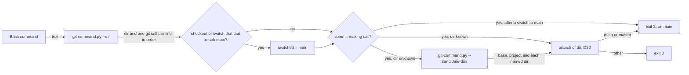
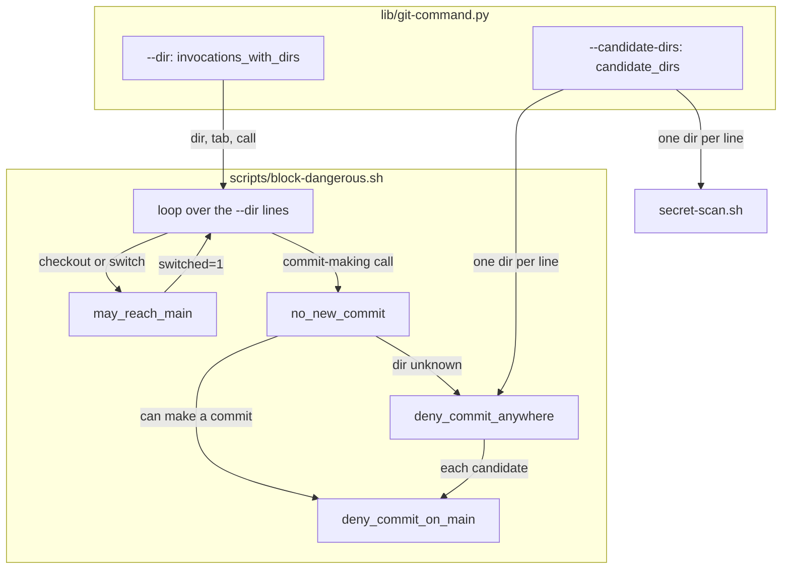
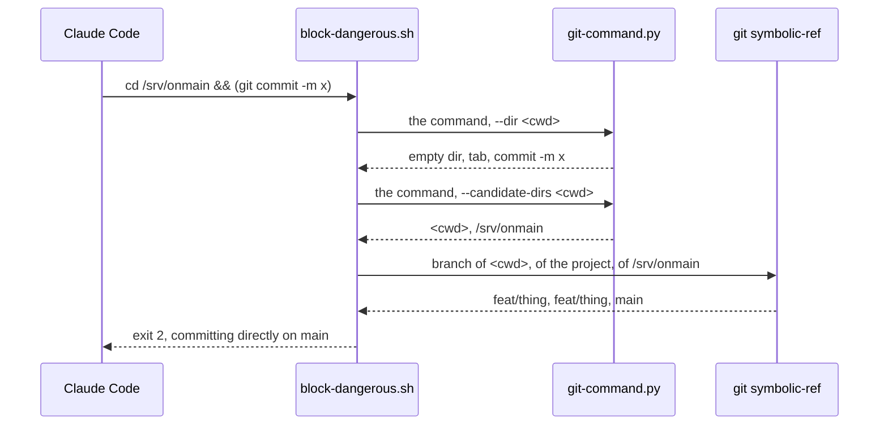

# Branch switch commit

**Version:** v1 · **Status:** Built · **Type:** Bug · **Project type:** CLI/Library

**Shape doc:** docs/specs/guard-leads/shape.md
**Depends on:** main-branch-commits

The commit-on-main guard follows a `git checkout` or `git switch` to `main`
earlier in the same command. It also checks a commit whose directory the
parser cannot know in each directory that the command names.

## Problem

`block-dangerous.sh` judges each commit on the branch of the directory it
runs in (D30). It reads that branch before the command runs. A `git checkout
main` earlier in the same command moves HEAD first, so the commit lands on
`main`. The v2.6.0 pentest listed this as lead N8. A commit whose directory
the parser cannot know is checked only in the start and project dirs. That is
`nested-git-commands` O5, the rest of v2.7.0 S5.

I ran each probe through the real hook on 2026-11-12. The session sat in a
scratch repo on `feat/thing`, with a second scratch repo `<onmain>` on `main`:

| Probe | Exit today |
| --- | --- |
| `git checkout main && git commit -m x` | 0 |
| `git switch main; git commit -m x` | 0 |
| `git checkout main && git merge feat` | 0 |
| `git switch main && git rebase feat` | 0 |
| `cd <onmain> && (git commit -m x)` | 0 |
| `cd <onmain>; git commit -m x` | 0 |
| `cd <onmain> && git commit -m x` | 2 |

The same unknown directory hides a staged secret from `secret-scan.sh`, which
scans the start and project dirs only.

git 2.52.0 facts this slice rests on. I ran each one in a scratch clone on
`feat` on 2026-11-12:

- `git checkout main -- f` and `git checkout main f` restore `f` and stay on
  `feat`.
- `git checkout -b x main`, `git checkout -qby` and `git switch -cz main` move
  HEAD to the new branch, not to `main`.
- `git switch --track origin/main` and `git checkout main` with no local
  `main` both create `main` and move HEAD to it.
- `git checkout -` moves HEAD to the branch before, which can be `main`.
- `git switch --detach main`, `git checkout origin/main` and `git checkout
  refs/heads/main` detach HEAD.
- `git -c alias.co=checkout co main` moves HEAD to `main`.

## Slice test

| Check | Result |
| --- | --- |
| Cuts every layer it needs | Yes. The parser, the two hooks, and the tests that run the real hooks |
| One e2e test walks it | Yes. `test-block-dangerous.sh` feeds the real hook each probe in a scratch repo on a feature branch |
| Worth shipping alone | Yes. It closes lead N8 and the rest of v2.7.0 S5 |
| Fits (≤5 scenarios, ≤2 areas) | Yes. 5 scenarios, 1 area (scripts) |

**Path:** full. The fix touches 5 files, over the light path's 3, and adds a
parser mode. The user delegated each pause decision, so no pause stops.

## Flow



A switch to `main` can only add `main` to the branches the guard checks. The
branch of the directory is still checked, so no call that is blocked today
passes.

## Acceptance criteria

```gherkin
Scenario: a commit after a checkout or switch to main is blocked
  Given the session in a repo on the branch feat/thing
  When block-dangerous.sh judges "git checkout main && git commit -m x" or "git switch main; git commit -m x"
  Then it exits 2 with "Blocked: committing directly on main. Create a branch first."
  And "git checkout main && git merge feat", "git switch main && git rebase feat" and "git checkout -q master && git cherry-pick feat" are blocked the same way
  And "git switch --track origin/main && git commit -m x", "git checkout -B main && git commit -m x" and "git checkout - && git commit -m x" are blocked the same way
  And "git -C /srv/other checkout main && git commit -m x" is blocked, because a switch counts in any directory

Scenario: a checkout that stays off main, or a call that makes no commit, passes
  Given the session in a repo on the branch feat/thing
  When block-dangerous.sh judges "git checkout main && git pull --ff-only"
  Then it exits 0
  And "git checkout -b fix/refund-cap main && git commit -m x" and "git switch -c fix/refund-cap origin/main && git commit -m x" pass
  And "git checkout main -- a.txt && git commit -m x" and "git commit -m x && git checkout main" pass
  And "git switch --detach main && git commit -m x" and "git checkout feat/other && git commit -m x" pass
  And "git checkout -q main && git merge -q --ff-only origin/main && git checkout -q -b docs/x && git commit -m x" passes, because a create option moves HEAD off main
  But "git checkout main && git checkout feat/x && git commit -m x" is blocked, because a plain name can be a path

Scenario: a commit whose directory the parser cannot know is checked in each directory the command names
  Given the session on feat/thing and a second repo onmain on main
  When block-dangerous.sh judges "cd <onmain> && (git commit -m x)"
  Then it exits 2 with "Blocked: committing directly on main"
  And "cd <onmain>; git commit -m x", "pushd <onmain>; git merge feat" and "cd <onmain> && bash -c 'git commit -m x'" are blocked the same way
  And "cd <the dir that holds onmain>; git -C onmain commit -m x" is blocked the same way

Scenario: the secret scan reads the same directories
  Given a staged secret in a worktree wt, and the session in a clean repo
  When secret-scan.sh judges "cd <wt>; git commit -m x"
  Then it exits 2 and names the staged line
  And "cd <wt> && (git commit -m x)" is blocked the same way

Scenario: normal commands still pass
  Given the session on feat/thing
  When block-dangerous.sh judges "cd <feature repo>; git commit -m x" or "cd <feature repo> && (git commit -m x)"
  Then it exits 0
  And "git status && git checkout main && git log -1" and "git switch main && git pull --ff-only && git switch -c feat/next" pass
  And the release commit that cut prepared still passes on main, as in release-commit-guard
```

## Scope

**In:**

- A `checkout` or `switch` line that comes before a commit-making line in the
  `--dir` output, in any directory. A later switch with a create option to a
  branch that is not `main` ends it (O9).
- The branch a switch can reach: the value of `-b`, `-B`, `-c`, `-C`,
  `--create`, `--force-create` or `--orphan`, or else each word that is not an
  option. For `checkout`, a `--` with no create option means path mode, with
  no switch. `--detach`, and `-d` for `switch`, mean no branch.
- A target that can reach `main`: a last `/` part of `main` or `master`, `-`,
  `@{-N}`, or a word with `$`, a backtick, a glob or a brace.
- For a commit-making call with an unknown directory: each directory that a
  `cd`, `pushd`, `-C`, `--git-dir`, `--work-tree`, `GIT_DIR=` or
  `GIT_WORK_TREE=` word names, in both hooks.

**Out:**

- A checkout that the parser prints after the commit, as a nested or alias line
  does: `bash -c 'git checkout main'; git commit -m x` (O3).
- A directory from a variable, such as `cd "$REPO"; git commit` (O5).
- Aliases in `~/.gitconfig` and `.git/config`, such as `git co main`. Slice
  `config-aliases`.
- A commit made on a branch that is not `main` and then pushed to it. Remote
  branch protection is the line for that, as `main-branch-commits` O3 says.

## Interface

No new user command or flag. The changes a caller sees:

| Surface | Before | After |
| --- | --- | --- |
| `block-dangerous.sh` exit and message | exit 0 for each probe in Problem | exit 2, with the message `on_main_why` gives for the subcommand, such as "Blocked: committing directly on main. Create a branch first." |
| `secret-scan.sh` | scans the start and project dirs for an unknown directory | also scans each directory that the command names |
| `git-command.py --candidate-dirs <base>` | not there | prints `<base>`, then each existing directory that the command names, one per line, with no repeat. Exit 3 when the command cannot be parsed, or when it names more than 64 directories |

The plain, `--dir` and `--hidden-words` output do not change.

## Technical plan

### Approach

`block-dangerous.sh` walks the `--dir` lines in order. A new function
`may_reach_main` reads a `checkout` or `switch` line and says whether HEAD
can end on `main` or `master`. After such a line, each commit-making call
that `no_new_commit` does not allow goes to `deny_commit_on_main` with the
branch set to `main`. The check of the directory's own branch still runs
after it. For a call with an unknown directory, `deny_commit_anywhere` checks
each line of a new parser mode, `--candidate-dirs`, with the project dir.
`secret-scan.sh` scans the same list. The mode resolves each named directory
from the base and from each directory found before it.

Relies on: D30, D51, D52, D138, D-NEW-main-branch-commits-1, D-NEW-branch-switch-commit-1, D-NEW-branch-switch-commit-2.





### Changes

| File | What changes | Why |
| --- | --- | --- |
| `plugins/zuko/scripts/block-dangerous.sh:105` | New `may_reach_main <call>`: prints `main` or `master` when HEAD can end on it, exit 2 when a create option moves HEAD to another branch | Scenarios 1, 2 |
| `plugins/zuko/scripts/block-dangerous.sh:144` | `deny_commit_on_main` takes an optional fourth argument, the branch to judge in place of the directory's | Scenario 1 |
| `plugins/zuko/scripts/block-dangerous.sh:168` | `deny_commit_anywhere` also checks each `--candidate-dirs` line, read once for each command | Scenario 3 |
| `plugins/zuko/scripts/block-dangerous.sh:189` | The `--dir` loop sets `switched` after a line that `may_reach_main` passes, clears it on exit 2, and judges each later commit-making call on that branch | Scenarios 1, 2 |
| `plugins/zuko/scripts/lib/git-command.py` | New `candidate_dirs(tokens, base)` and the `--candidate-dirs <base>` mode. The module docstring names it | Scenarios 3, 4 |
| `plugins/zuko/scripts/secret-scan.sh:33` | For a commit with an unknown directory, also scan each `--candidate-dirs` line | Scenario 4 |
| `plugins/zuko/scripts/tests/test-block-dangerous.sh` | The cases for scenarios 1, 2, 3 and 5 | Scenarios 1–3, 5 |
| `plugins/zuko/scripts/tests/test-secret-scan.sh` | The cases for scenario 4 | Scenario 4 |

Reusing: `resolve`, `is_separator` and `tokenise` in `git-command.py`, and
`no_new_commit`, `on_main_why`, `deny_commit_on_main`, `release-commit.py`
and the `run_hook` and `scan` test helpers, unchanged.

### Earn-it

| Added | Triggered by |
| --- | --- |
| `may_reach_main` | Scenarios 1 and 2: `git checkout -b fix/x main` names `main` but does not reach it, and 196 logged commands put a checkout or switch before a commit-making call |
| `--candidate-dirs` | Scenarios 3 and 4: both hooks need the same list, and only the parser's walk knows the words |
| The cap of 64 directories | Risk: each named directory is resolved from each one before it, so a long command could make the hook time out, and a hook that times out lets the call through |

### Non-functionals

| | |
| --- | --- |
| **Load** | `may_reach_main` is a bash loop over the words of each checkout or switch line. `--candidate-dirs` runs once, only for a commit-making call with an unknown directory, with one more `git symbolic-ref` for each directory it prints |
| **Breaks first** | A command that names many directories. The cap of 64 refuses it, and the hook then blocks it as a command it could not check |
| **Security surface** | Closes lead N8 and `nested-git-commands` O5. Each change adds blocks only: the directory's own branch is still checked, and the old candidates stay in the list |
| **Proof it works** | `bash plugins/zuko/scripts/tests/run.sh block-dangerous`: 605 passed, 0 failed. `run.sh secret-scan`: 38 passed, 0 failed. On 2026-11-12 |
| **Rollout** | No flag. It ships with the next zuko release. Rollback: revert the fix commit |

### Test plan

| Scenario | Test | Command |
| --- | --- | --- |
| 1. A commit after a switch to main is blocked | `test-block-dangerous.sh`, "branch-switch-commit" block | `bash plugins/zuko/scripts/tests/run.sh block-dangerous` |
| 2. A checkout that stays off main passes | same file | same |
| 3. An unknown directory is checked in each named one | same file | same |
| 4. The secret scan reads the same directories | `test-secret-scan.sh` | `bash plugins/zuko/scripts/tests/run.sh secret-scan` |
| 5. Normal commands still pass | `test-block-dangerous.sh` | `bash plugins/zuko/scripts/tests/run.sh block-dangerous` |

**E2E:** `test-block-dangerous.sh` runs the real hook script on each payload,
as Claude Code runs it, in a scratch repo on a feature branch with a second
scratch repo on `main`.

**Replay:** each unique logged Bash command goes through the hook at the base
commit and at the fix, in a scratch repo on a feature branch. Each changed
verdict is listed in the ledger (O8).

### Chunks

Single chunk.

### Risks

| Risk | Mitigation |
| --- | --- |
| A normal command now blocks: a switch to `main` in another repo before a commit, or a `cd` into a repo on `main` and back before a commit | The replay counts each new block. The message names the branch, so the fix is to split the command |
| `may_reach_main` reads a branch name wrong and says no | The directory's own branch is still checked, so the call gets today's verdict, not a looser one |

### Decisions to record

```
## D-NEW-branch-switch-commit-1 · 2026-11-12 · A checkout or switch that can reach main makes each later commit-making call in the command count as on main

Why: git moves HEAD before the next call runs, so `git checkout main && git commit` committed on main past the guard (v2.6.0 N8). The switch adds main to the branches checked, and the branch of the directory is still checked, so no call that the guard blocked before now passes. A path checkout such as `git checkout a.txt` on main stays blocked. A later switch with a create option, such as `git checkout -b docs/x`, ends it, because only a create option moves HEAD off main for sure.
Rejected: replace the branch with the switch target (a path checkout or a failed switch after `;` then reads as off main, a new allow), match the directory of the switch to the directory of the commit (`git -C sub` and the start dir share one HEAD, and the strings differ), count a switch printed after the commit (196 logged commands switch first and 50 commit first, such as `git commit && git switch main`).
Source: specs/branch-switch-commit.md
Status: active

## D-NEW-branch-switch-commit-2 · 2026-11-12 · A commit whose directory the parser cannot know is checked in each directory that the command names

Why: `cd <repo on main> && (git commit -m x)` ran on main, and the guard checked only the start and project dirs (nested-git-commands O5). The parser prints each existing directory that a `cd`, `pushd`, `-C`, `--git-dir`, `--work-tree`, `GIT_DIR=` or `GIT_WORK_TREE=` word names, resolved from the start and from each directory found before it. block-dangerous.sh and secret-scan.sh read the same list.
Rejected: block each commit with an unknown directory (`cd sub; git commit` is a normal form), track subshells and `;` in the `--dir` walk (a change to output that six callers share).
Source: specs/branch-switch-commit.md
Status: active
```

## Review

2026-11-12 · 3 raw findings, 3 survived, 3 fixed.

- A10 Mishandling of Exceptional Conditions · `plugins/zuko/scripts/block-dangerous.sh:115` · a checkout's `--` means paths only when a word follows it, so `git checkout main -- && git commit` is blocked · `fb8cb78`
- A10 Mishandling of Exceptional Conditions · `plugins/zuko/scripts/block-dangerous.sh:115` · each word after a switch's `--` is a branch name, so `git switch -- main && git commit` is blocked · `fb8cb78`
- A10 Mishandling of Exceptional Conditions · `plugins/zuko/scripts/block-dangerous.sh:129` · a checkout's create options are `-b`, `-B` and `--orphan` and a switch's are `-c`, `-C`, `--create`, `--force-create` and `--orphan`, so a refused `git checkout -c x` no longer ends the switch to main · `fb8cb78`

## Open items

| ID | What | Type | Raised at | Owner | Status | Answer |
| --- | --- | --- | --- | --- | --- | --- |
| O1 | Does a checkout or switch replace the branch that the guard judges, or add `main` to it? | question | spec p1 | user | Resolved | Decided under the user's delegation: add it. A path checkout such as `git checkout a.txt`, or a switch that fails before a `;`, leaves HEAD where it was, so a replace would let through a commit that the guard blocks today (D-NEW-branch-switch-commit-1). 2026-11-12 |
| O2 | Does a switch in another directory count, such as `git -C /srv/other checkout main && git commit`? | question | spec p1 | user | Resolved | Decided under the user's delegation: yes. `git -C sub` and the start dir share one HEAD, and a string match of the two dirs misses that. The cost is an extra block of a rare form. 2026-11-12 |
| O3 | A checkout that the parser prints after the commit is missed. A nested line, such as `bash -c 'git checkout main'; git commit -m x`, and an inline alias line, such as `git -c alias.co=checkout co main && git commit`, print after the top-level lines. | flag | spec p3 | user | Accepted risk | Decided under the user's delegation: the order of the lines is the only order the hook knows, and a count of every switch in the command would block `git commit && git switch main`, a normal form in 50 logged commands. The leads are the plain forms, which this slice blocks. 2026-11-12 |
| O4 | Which directories does the guard check for a commit whose directory the parser cannot know? | question | spec p1 | user | Resolved | Decided under the user's delegation: the start dir, the project dir, and each existing directory that the command names, in both hooks (D-NEW-branch-switch-commit-2). 2026-11-12 |
| O5 | A directory from a variable, such as `cd "$REPO"; git commit -m x`, cannot be resolved, so it is not in the list. | flag | spec p3 | user | Accepted risk | Decided under the user's delegation: the value is not in the text, as for `$(which git)` in git-spellings O2. The start and project dirs are still checked. 2026-11-12 |
| O6 | A target the text cannot show reads as `main`: `git checkout -`, `git switch -c "fix/$slug"`, `git checkout @{u}`. A commit after one of these is blocked. | flag | spec p3 | user | Accepted risk | Decided under the user's delegation: `-` can be `main`, and a `$` value can hold `main`. The message tells Claude to split the command. The replay counts each new block. 2026-11-12 |
| O7 | Some checkouts that detach HEAD or restore files read as a switch to `main`: `git checkout origin/main`, `git checkout refs/heads/main`, `git checkout main a.txt` with no `--`. A commit after one of these is blocked. | flag | spec p3 | user | Accepted risk | Decided under the user's delegation: a shorter rule has fewer holes, and a commit on a detached HEAD after a checkout of `main` is rare. `git checkout main -- a.txt` passes. 2026-11-12 |
| O8 | The replay ran the 27937 unique logged Bash commands through the parser and the hook at `e8df433` and at the fix, in a scratch repo on `feat/replay`. | flag | build | user | Decided alone | Chose: ship. The plain and `--dir` parser output is the same for all 27937. The hook judged 3538, and 939 verdicts changed: 939 new blocks, 0 new allows. 4 are a plain `git pull` after a switch to `main`, which D-NEW-main-branch-commits-1 blocks on `main`. 935 are a commit with an unknown directory where a named dir is a repo on `main` today. In 931 of them the commit runs in the repo of the leading `cd`, which the session sat in when it ran, so the guard checked that repo before too. The other 4 run their commit in a scratch repo or a repo that is on `main`. The replay reads each dir's branch of today, not of when the command ran. Other: none needed. Undo: none. 2026-11-12 |
| O9 | The first replay also blocked `git checkout -q main && git merge -q --ff-only origin/main && git checkout -q -b docs/x && ... git commit`, which commits on `docs/x`. | flag | build | user | Decided alone | Chose: a later switch with a create option to a branch that is not `main` ends the switch to `main` (`5a87b88`). A plain name does not, because it can be a path. Other: keep the block, which hit 2 logged commands. Undo: revert `5a87b88`. Risk: `git checkout main; git checkout -b x; git commit` passes when `-b x` fails because `x` exists, and the commit then lands on `main`. Claude joins these with `&&`, which stops at the failure. 2026-11-12 |
| O10 | Scenario 4 needs a test in `test-secret-scan.sh`, a file the plan's lane did not list. | flag | build | user | Decided alone | Chose: add three cases there, next to the existing `cd` cases. Other: test `secret-scan.sh` from `test-block-dangerous.sh`. Undo: revert the cases in `a0dab1f`. 2026-11-12 |
| O11 | The review's third finding named `-c` and `-C` on checkout. The same class holds for `--create` and `--force-create` on checkout, and for `-b` and `-B` on switch: git 2.52.0 refuses each one with rc=129 and HEAD stays put. | flag | review | user | Decided alone | Chose: give each subcommand only its own create options, so none of these six ends the switch to `main`, with a test for each. Other: fix only `-c` and `-C` on checkout, as the finding asked. Undo: revert `fb8cb78`. 2026-11-12 |
| O12 | `git checkout -b x -- a.txt` fails with rc=128 (`'a.txt' is not a commit`), and the guard still reads it as a move to `x`. | flag | review | user | Decided alone | Chose: leave it. It is the O9 risk: a create option that can fail. Unlike `checkout -c`, it succeeds for `git checkout -b x --` and `git checkout -b x main --`, and only a `;` after it lets the commit through. Other: read a path after a create option's `--` as a failed call. Undo: none. 2026-11-12 |

_Never delete this section or its rows. See references/ledger.md._

## Glossary

- **Pentest** — the attack that `/release` runs on the code it ships, to find each hole before someone else does.
- **Lead** — a hole that a pentest traced but could not prove.
- **HEAD** — the branch or commit that git is on now. A commit moves the branch that HEAD names.
- **Detached HEAD** — git is on a commit, not on a branch, so a new commit moves no branch.
- **Path checkout** — `git checkout <branch> -- <file>`: it copies a file from the branch and does not move HEAD.
- **Subshell** — a command in `( )`, which bash runs in a copy of the shell. Its `cd` does not last, but its git calls change the repo.
- **Replay** — running real logged Bash commands through the old and the new hook, to count each verdict that changed.
- **e2e** — end-to-end: one test that walks the whole slice as a user would.
