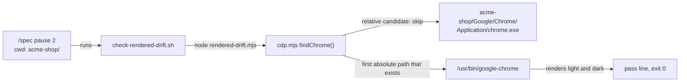
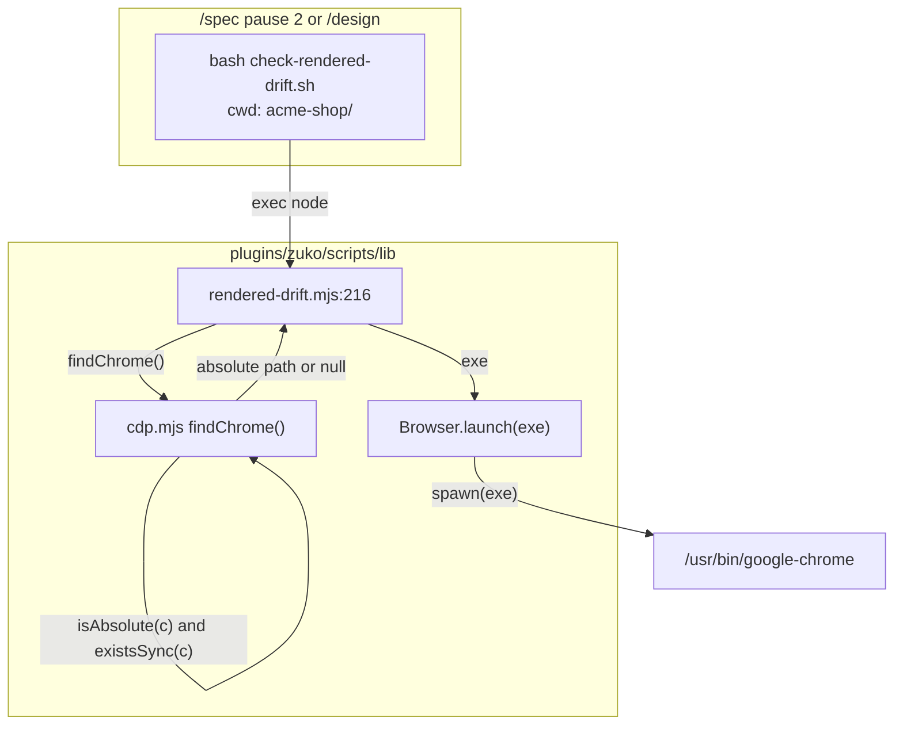
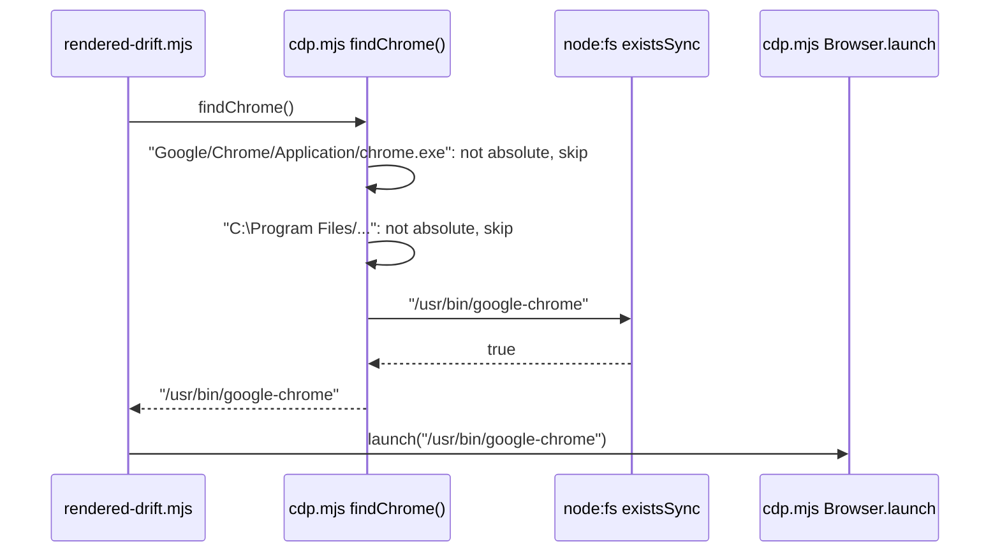

# chrome-lookup

**Version:** v1 · **Status:** Built · **Type:** Bug · **Project type:** CLI/Library

**Shape doc:** docs/specs/os-agnostic-suite/shape.md
**Depends on:** node-lookup

zuko's rendered drift check starts only a browser at an absolute path, never a `chrome.exe` from the project folder. On Linux and macOS, a planted `Google/Chrome/Application/chrome.exe` in a repo then never runs from `/spec` pause 2 or `/design`.

## Problem

`findChrome()` at `cdp.mjs:45` builds three Windows candidates from `PROGRAMFILES`, `PROGRAMFILES(X86)` and `LOCALAPPDATA`. Linux and macOS never set these variables. The fall backs then give relative paths:

| Candidate | Built from | Path on Linux and macOS |
| --- | --- | --- |
| `cdp.mjs:53` | `PROGRAMFILES` unset, fall back `C:\Program Files` | `C:\Program Files/Google/Chrome/Application/chrome.exe` |
| `cdp.mjs:55` | `LOCALAPPDATA` unset, fall back `''` | `Google/Chrome/Application/chrome.exe` |
| `cdp.mjs:64` | `HOME` and `USERPROFILE` unset, fall back `''` | `Applications/Google Chrome.app/Contents/MacOS/Google Chrome` |

`existsSync()` and `spawn()` read a relative path from the current folder. `check-rendered-drift.sh:56` runs Node in the project folder. So a repo with an executable `Google/Chrome/Application/chrome.exe` runs that file at each drift check. The Windows candidates come first, so the planted file wins over a real Chrome in `/usr/bin`.

This session ran it on Linux with Node v24.18.1 on 2026-11-09. With `/usr/bin/google-chrome` installed, `findChrome()` gave `Google/Chrome/Application/chrome.exe`. A `spawnSync()` of that path ran the planted script. On Windows, the hole opens only when `LOCALAPPDATA` is not set and no browser is in Program Files.

The node-lookup review raised this as its O5.

## Slice test

| Check | Result |
| --- | --- |
| Cuts every layer it needs | yes — `findChrome()` in `cdp.mjs` and the drift check that calls it |
| One e2e test walks it | yes — one drift check in a project with a planted `chrome.exe` |
| Worth shipping alone | yes — it closes code execution from a cloned repo on each Linux and macOS machine |
| Fits (≤5 scenarios, ≤2 areas) | yes — 3 scenarios, one area: `plugins/zuko/scripts/lib` and its tests |

**Path:** light — a one-line bug fix in three files, with no new interface, data or dependency. Pauses 1 and 3 are one pause, and pause 2 is skipped.

## Flow



A stage runs the drift check in the project folder, and `findChrome()` skips each relative candidate, so it starts the real Chrome and never the planted file.

## Acceptance criteria

```gherkin
Scenario: a chrome.exe planted in the repo never runs from the drift check
  Given a Linux clone of acme-shop with Chrome at /usr/bin/google-chrome
  And an executable Google/Chrome/Application/chrome.exe in acme-shop that writes planted-ran
  And LOCALAPPDATA and PROGRAMFILES are not set
  When check-rendered-drift.sh renders clean.html with acme-shop as its current folder
  Then acme-shop has no planted-ran file
  And the drift check exits 0 with its pass line

Scenario: findChrome() never gives a relative path, on every OS
  Given acme-shop holds a file at each relative candidate path
  And LOCALAPPDATA, PROGRAMFILES, PROGRAMFILES(X86), HOME and USERPROFILE are not set
  When findChrome() runs with acme-shop as its current folder
  Then it gives an absolute path or null

Scenario: a set CHROME_PATH and the suite do not change
  Given a Linux checkout of zuko
  When bash plugins/zuko/scripts/tests/run.sh runs
  Then CHROME_PATH=/no/chrome still exits 2 with E3, as before
  And the suite has 0 failures
```

## Scope

**In:**

- `findChrome()` skips each candidate that is not an absolute path.
- A check, on every OS, that `findChrome()` gives an absolute path or null when the variables are not set.

**Out:**

- A relative `CHROME_PATH`. The user sets it, so it has the same trust as `SystemRoot` in D133 (O2).
- The vendored `.agents/skills/design-taste-frontend/scripts/lib/cdp.mjs` has the same `findChrome()`. It is upstream code, as node-lookup O2 decided.
- `check-rendered-drift.sh:30` builds a Node path from `PROGRAMFILES`. It runs only when `PROGRAMFILES` is set, so the path is not relative to the project.

## Technical plan

### Approach

The loop at `cdp.mjs:69` adds `isAbsolute(c)` to its test. A relative candidate is then never passed to `existsSync()` or returned. On Linux and macOS, `path.isAbsolute()` gives false for `C:\Program Files/...`, so all three relative candidates drop out. On Windows, `path.win32.isAbsolute()` gives true for `C:\Program Files\...`, so a real install is still found.

Relies on: D105, D133



The drift check runs Node, `rendered-drift.mjs` asks `findChrome()` for a browser, and only an absolute path reaches `spawn()`.



`findChrome()` skips the relative candidates before it reads the disk, and gives the first absolute path that exists.

### Changes

| File | What changes | Why |
| --- | --- | --- |
| `plugins/zuko/scripts/lib/cdp.mjs:69` | The loop tests `isAbsolute(c) && existsSync(c)`. Line 35 imports `isAbsolute` from `node:path`. Lines 6 to 9 name the skip as a change from upstream (D134). | scenarios 1 and 2 |
| `plugins/zuko/scripts/tests/test-e2e-chrome-lookup.sh` | New. On every OS: plant a file at each relative candidate in a scratch `acme-shop`, unset the five variables, and check that `findChrome()` gives an absolute path or null. Off Windows: plant an executable `chrome.exe` in a copy of the `rendered-drift/project` fixture, and run the drift check there, as the Test plan says. On Windows, the drift run prints SKIP with the reason (D105). | scenarios 1 and 2 |
| `CHANGELOG.md` | One `[Unreleased]` `### Security` line: on Linux and macOS, the rendered drift check no longer runs a `chrome.exe` from the project folder. | `/ship` gate |

Reusing: `run.sh`'s `is_windows`, `skip`, `record`, `expect_exit`, `expect_match` and `expect_no_match`; the `rendered-drift/project` fixture; the `node -e "import(...)"` call from `test-e2e-node-lookup.sh:18`.

### Earn-it

| Added | Triggered by |
| --- | --- |
| `test-e2e-chrome-lookup.sh` | Only a real drift check in a planted project proves scenario 1. `test-e2e-rendered-drift.sh` runs in a fixture with no planted file. |
| The every-OS `findChrome()` check in it | The Windows runner finds Chrome in Program Files first, so its drift run never reaches the `LOCALAPPDATA` candidate. Only a direct call proves the Windows `join` gives no relative path. |

### Non-functionals

|                      |                                                                               |
| -------------------- | ----------------------------------------------------------------------------- |
| **Load**             | One `isAbsolute()` call for each candidate, 17 at most, at each drift check. |
| **Breaks first**     | Nothing scales here. A new relative candidate is skipped by the same test. |
| **Security surface** | The drift check runs in an untrusted project folder. After the fix, no path that the project folder controls reaches `spawn()`. `CHROME_PATH`, `HOME` and the Windows variables come from the user's environment. No secrets, no stored data. |
| **Proof it works**   | The `suite` checks on `ubuntu-latest` and `windows-latest` for this PR end with `0 failed`. On `ubuntu-latest`, each `e2e-chrome-lookup` check prints PASS. |
| **Rollout**          | No flag. It ships in the next zuko release. Rollback: `git revert` of the fix commit. |

### Test plan

| Scenario | Test | Command |
| --- | --- | --- |
| 1. A planted chrome.exe never runs | `test-e2e-chrome-lookup.sh`, off Windows. First, a `spawnSync('Google/Chrome/Application/chrome.exe')` from Node in `acme-shop` writes `planted-ran`, so the hole is real on this runner. The test removes that file. Then the drift check on `clean.html`, with `LOCALAPPDATA` and `PROGRAMFILES` unset, exits 0 with its pass line, and `acme-shop` has no `planted-ran`. | `bash plugins/zuko/scripts/tests/run.sh e2e-chrome-lookup` |
| 2. No relative path, every OS | `test-e2e-chrome-lookup.sh`. Off Windows, it plants all three candidates of the Problem table. On Windows, it plants the two without `:` or `\` in the name. Node prints `isAbsolute(findChrome())`, or `null`. The check expects `true` or `null`. | `bash plugins/zuko/scripts/tests/run.sh e2e-chrome-lookup` |
| 3. CHROME_PATH and the suite | The whole suite on Linux. `test-e2e-rendered-drift.sh:74` checks the E3 line for `CHROME_PATH=/no/chrome`. | `bash plugins/zuko/scripts/tests/run.sh` |

**E2E:** `test-e2e-chrome-lookup.sh` in the `suite` check on `ubuntu-latest`, which runs on each PR to `main` (D128). On `windows-latest`, the drift run prints SKIP, and the `findChrome()` check carries the proof.

### Chunks

Single chunk. One line in `cdp.mjs`, one new test file and one CHANGELOG line.

### Risks

| Risk | Mitigation |
| --- | --- |
| A runner with no Chrome in `/usr/bin` makes the drift run exit 2, so scenario 1 proves nothing. | The test records FAIL with the gate's E2 line when the drift check exits 2, as `test-e2e-node-lookup.sh:44` does. |
| On Windows, `isAbsolute('/Applications/...')` gives true, so the macOS candidates are read from the root of the current drive. | Only a project at the root of a drive can put a file there. It was so before this fix, and the fix does not make it worse. |

### Decisions to record

Recorded as D134.

## Open items

| ID | What | Type | Raised at | Owner | Status | Answer |
| --- | --- | --- | --- | --- | --- | --- |
| O1 | The os-agnostic-suite shape does not list this slice. Is it slice 9 of that shape, with a `**Shape doc:**` line here and a row in its Slices table? | question | spec p1 | user | Resolved | Yes. It is slice 9 of os-agnostic-suite, the same kind of fix as exe-lookup and node-lookup, 2026-11-09 |
| O2 | A relative `CHROME_PATH` also reads from the project folder. Is it in this slice? | question | spec p1 | user | Resolved | No. The user sets `CHROME_PATH`, and a project cannot, 2026-11-09 |

_Never delete this section or its rows. See references/ledger.md._

## Glossary

- **Absolute path** — a path from the root of the disk, such as `/usr/bin/google-chrome` or `C:\Program Files\...`. A relative path starts from the current folder.
- **LOCALAPPDATA, PROGRAMFILES** — Windows variables that name the per-user app folder and the Program Files folder. Linux and macOS do not set them.
- **CHROME_PATH** — a variable that the user sets to pick the browser for the drift check. When set, zuko uses it alone.
- **e2e** — end-to-end: one test that walks the whole slice as a user would.
