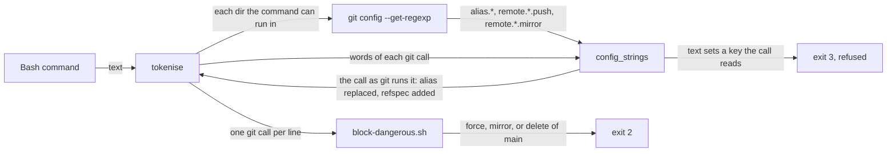
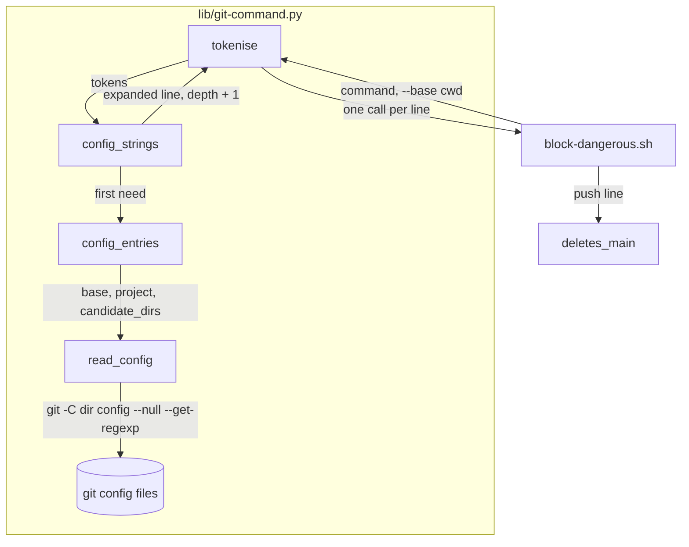
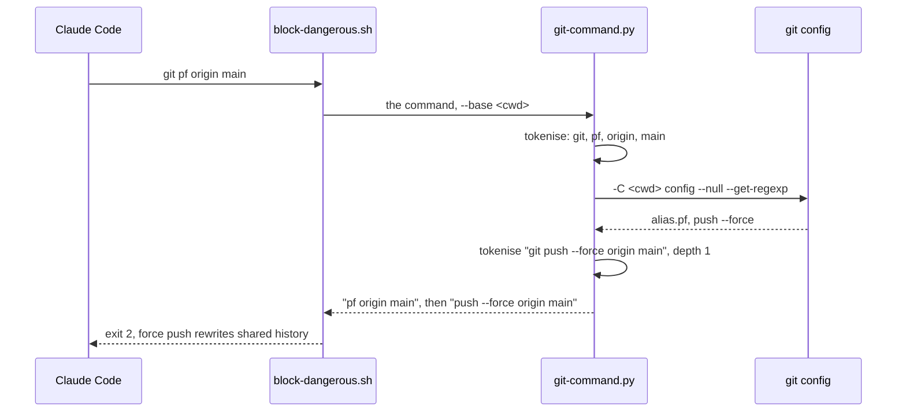

# Config aliases

**Version:** v1 · **Status:** Shipped · **Type:** Bug · **Project type:** CLI/Library

**Shape doc:** docs/specs/guard-leads/shape.md
**Depends on:** branch-switch-commit

The git guards read the aliases and the push settings that git reads from its
config files, and judge the command that git will run. `block-dangerous.sh`
also blocks a push that can delete `main` or `master` on the remote.

## Problem

`git-command.py` reads an alias only when the command sets it with `-c`
(D140). git also reads aliases and each remote's push refspecs from
`~/.gitconfig`, `.git/config` and the system config. An alias or a refspec
saved there by an earlier command changes what a later command does, and the
guards do not see it. The v2.6.0 pentest listed this as lead N9.
`git-spellings` O1 left it to this slice. Shape O6 added the remote delete.

I ran each probe through the real hook on 2026-11-12, in a scratch repo on
`main`:

| Probe | Exit today |
| --- | --- |
| `git pf origin main`, with `alias.pf = push --force` in `.git/config` | 0 |
| `git ci -m x`, with `alias.ci = commit` in `.git/config` | 0 |
| `git -c remote.origin.push=+refs/heads/main:refs/heads/main push origin` | 0 |
| `git push origin`, with `remote.origin.push = +main:main` in `.git/config` | 0 |
| `git config remote.origin.push +main:main && git push origin` | 0 |
| `git push origin :main` | 0 |
| `git push --delete origin main` | 0 |

git 2.52.0 facts this slice rests on. I ran each one in a scratch repo with a
local bare remote on 2026-11-12:

- A `+` refspec in `remote.origin.push` forces `git push origin` and also
  `git push origin main`. It does not change `git push origin HEAD:main`.
- `remote.origin.mirror=true` makes `git push origin` a mirror push, which
  forces each branch.
- `git push --de origin feat`, `git push -d origin feat` and `git push origin
  :feat` each delete `feat` on the remote. `git push origin :` deletes nothing.
- `git config --null --get-regexp` prints each key in lower case, with the
  value after a newline. A key with no `=` has no newline.
- `git -c 'alias.pp=!f() { echo git push "$@"; }; f' pp --force origin main`
  prints `git push --force origin main`.

## Slice test

| Check | Result |
| --- | --- |
| Cuts every layer it needs | Yes. The parser, the hook, and the tests that run the real hook |
| One e2e test walks it | Yes. `test-block-dangerous.sh` feeds the real hook each probe in a scratch repo on `main` |
| Worth shipping alone | Yes. It closes lead N9 and `git-spellings` O1 |
| Fits (≤5 scenarios, ≤2 areas) | Yes. 5 scenarios, 1 area (scripts) |

**Path:** full. The fix is in 3 files, but the parser gets a new `--base`
option and reads new data, git's config. The user delegated each pause
decision, so no pause stops.

## Flow



The parser asks git for the config of each directory that the command can
run in. It adds each git call again as git will run it. The original line
stays, so the guards see both, as D140 does for an inline alias.

## Acceptance criteria

```gherkin
Scenario: an alias in git's config is read as its command
  Given a repo on main whose .git/config has alias.pf = push --force and alias.ci = commit
  When block-dangerous.sh judges "git pf origin main"
  Then it exits 2 with "Blocked: force push rewrites shared history. Ask the user first."
  And "git ci -m x" is blocked with "Blocked: committing directly on main. Create a branch first."
  And an alias pp = push --force in the file that GIT_CONFIG_GLOBAL names makes "git pp origin main" blocked the same way
  And alias.pub = "!git push --force", or "!f() { git push \"$@\"; }; f" with "git pub --force origin main", is blocked the same way
  And a chain alias.a = b, alias.b = push --force makes "git a origin main" blocked the same way
  And "cd <repo> && git pf origin main", run from a repo with no aliases, is blocked the same way

Scenario: a push refspec or mirror flag in git's config is read
  Given a repo on main
  When block-dangerous.sh judges "git -c remote.origin.push=+refs/heads/main:refs/heads/main push origin"
  Then it exits 2 with "Blocked: force push rewrites shared history"
  And with remote.origin.push = +main:main in .git/config, "git push origin" and "git push origin main" are blocked the same way
  And with remote.origin.mirror = true in .git/config, "git push origin" is blocked the same way

Scenario: a command that sets the push config it reads is refused
  Given a repo on main
  When block-dangerous.sh judges "git config remote.origin.push +main:main && git push origin"
  Then it exits 2 with "Blocked: this command could not be checked: the git push reads remote.origin.push"
  And "GIT_CONFIG_COUNT=1 GIT_CONFIG_KEY_0=remote.origin.push GIT_CONFIG_VALUE_0=+main:main git push origin" is refused the same way

Scenario: a push that can delete main or master on the remote is blocked
  Given a repo on main
  When block-dangerous.sh judges "git push origin :main"
  Then it exits 2 with "Blocked: this push can delete main or master on the remote. Ask the user first."
  And "git push --delete origin main", "git push -d origin master", "git push --de origin refs/heads/main" and "git push origin --delete \"$BRANCH\"" are blocked the same way
  And "git push --prune origin main" is blocked the same way, because --prune deletes each remote branch with no local one
  And "git push origin --delete feat/basket" and "git push origin :feat/basket" exit 0

Scenario: normal commands still pass
  Given a repo on main with alias.st = status -sb, alias.lg = log --oneline and alias.log = log --oneline in .git/config
  When block-dangerous.sh judges "git st"
  Then it exits 0
  And "git lg -5", "git log -1", "git push origin main", "git push -u origin feat/thing", "git push origin :" and "git fetch --prune origin" exit 0
  And with remote.origin.push = refs/heads/main:refs/heads/main in .git/config, "git push origin" exits 0
  And on a feature branch, "git ci -m x" exits 0
```

## Scope

**In:**

- The config that `git -C <dir> config --get-regexp` prints in each directory
  that the command can run in: the start dir, the project dir, and each
  directory that `--candidate-dirs` lists. That covers the system file, the
  global file, the repo's `.git/config` and each include.
- Each `alias.NAME` that a git call uses as its subcommand, when the call
  does not set it with `-c`. A chain is read to the depth cap of 3 (D138). A
  `!` alias gets the call's words in place of `$@` and `$*`.
- Each `remote.*.push` value that starts with `+` or `:`, and each true
  `remote.*.mirror`, added to every push call. A plain refspec neither forces
  nor deletes, so it adds nothing. An inline `-c remote.*.push=` or
  `-c remote.*.mirror=` of the call is read in place of the config.
- A refusal when a push runs anywhere in the command, nested ones too, and
  the text has a `remote.*.push` or `remote.*.mirror` key that is not a
  readable `-c` of a git call, a word outside a git call that names a git
  config file, or a `git remote` with `--mirror`.
- A push that deletes `main` or `master`: `:main`, or `main` after
  `--delete`, `-d` or a prefix of `--delete`. A name with `$` or a backtick
  can be `main` too. Each `--prune` push.

**Out:**

- A remote delete of a branch that is not `main` or `master` (O2).
- A `!` alias that reads its words as `$1` or in some other way than `$@` and
  `$*` (O4).
- Config that the text points git to: `HOME=`, `GIT_CONFIG_GLOBAL=`,
  `XDG_CONFIG_HOME=` or `-c include.path=` before a call (O5).
- `secret-scan.sh` and `block-attribution.sh` judge their own start dir with
  the same reads. They are not in this lane (O6).
- `git reset --hard`, `git branch -D` and `git clean -fdx` (shape O6).

## Interface

No new user command. The changes a caller sees:

| Surface | Before | After |
| --- | --- | --- |
| `block-dangerous.sh` | exit 0 for each probe in Problem | exit 2. A force or mirror push from config gives the force-push message. A delete of `main` gives "Blocked: this push can delete main or master on the remote. Ask the user first." |
| `git-command.py` plain and `--dir` output | one line for each git call | also one line for each config alias the call uses, and one for each configured push refspec or mirror flag |
| `git-command.py --base <dir>` | not there | before any mode: the start dir whose config the parser reads. `--dir <base>` and `--candidate-dirs <base>` set it too. With none, the parser's own working directory |
| `git-command.py` exit 3 | an alias the text does not show | also a push key the text sets: "the git push reads remote.origin.push, which this command sets; run the git config first, then the push". A config file the text names: "the git push reads git's config file, which this command names; run that command first, then the push". A `git remote add --mirror`: "the git push reads remote.*.mirror, which git remote add --mirror sets; run the git remote add first, then the push" |

## Technical plan

### Approach

`tokenise` already adds a nested line for each inline alias in
`alias_strings`. That function becomes `config_strings`. It reads the
`-c key=value` pairs of each git call, as before. When it needs config that
the call does not set, it asks `git config` once in each directory that the
command can run in, and caches the answer. For an alias it adds the same
lines as for an inline alias. For a push it adds the call with each
configured refspec at the end, and `--mirror` for a true mirror flag. The
hook's force check then reads the new line. A new `deletes_main` in
`block-dangerous.sh` judges each push line for a delete of `main`.

Relies on: D52 (a command that cannot be parsed is blocked), D138 (nested
lines and the depth cap of 3), D140 (an inline alias is read as one more
line), D152 (the candidate dirs),
D153, D154.





### Changes

| File | What changes | Why |
| --- | --- | --- |
| `plugins/zuko/scripts/lib/git-command.py` | New `read_config(directory)`: the `(key, value)` pairs of `alias.*`, `remote.*.push` and `remote.*.mirror` that `git -C <dir> config --null --get-regexp` prints, cached for each directory. A git that is not there, or a directory git cannot read, gives none. A git that does not answer in 5 s raises `ValueError` | Scenarios 1, 2 |
| `plugins/zuko/scripts/lib/git-command.py` | New `config_entries(tokens)`: `read_config` of the start dir, `$CLAUDE_PROJECT_DIR`, and each of `candidate_dirs(tokens, start)` | Scenario 1, `cd <repo> && git pf` |
| `plugins/zuko/scripts/lib/git-command.py:630` | `alias_strings` becomes `config_strings`. The walk keeps each `-c key=value`. A subcommand with no inline alias takes each config value of `alias.NAME`, except a value whose first word is NAME. A `!` value gets the call's words in place of `$@` and `$*`. For a `push` call, it raises `ValueError` on a push key in the text that is not a readable `-c` of the call. Then it returns, as a second list, the words of the call with each push refspec at the end, and with `--mirror` for a true mirror flag. `tokenise` appends those words with no second parse (O8) | Scenarios 1–3 |
| `plugins/zuko/scripts/lib/git-command.py:970` | `main` takes `--base <dir>` before a mode, and sets the start dir from `--base`, `--dir` or `--candidate-dirs` | Scenarios 1, 2 |
| `plugins/zuko/scripts/block-dangerous.sh:32` | The plain parse passes `--base "$base"` | Scenarios 1, 2 |
| `plugins/zuko/scripts/block-dangerous.sh:41` | New `deletes_main <push call>` and a loop over the push lines that denies a delete of `main` or `master` | Scenario 4 |
| `plugins/zuko/scripts/tests/test-block-dangerous.sh` | The cases for scenarios 1 to 5, in a scratch repo on `main` with its own config, and on a feature branch | Scenarios 1–5 |

Reusing: the option walk and the alias lines of `alias_strings`, `ALIAS_KEY`
for the refusal, `candidate_dirs`, `native_path`, `program.argv` to start
git, `MAX_NESTING`, and `run_hook`, `expect_exit` and `expect_match` in the
tests.

### Earn-it

| Added | Triggered by |
| --- | --- |
| `read_config` and its cache | Scenarios 1 and 2. Only git knows its include rules and file order. The cache keeps it to one `git config` for each directory in each parse |
| `config_entries` over the candidate dirs | Scenario 1: `cd <repo> && git pf` runs with the config of `<repo>` |
| `--base` | Scenarios 1 and 2: the plain parse decides whether the hook checks a push or a commit, and it has no start dir today |
| `deletes_main` | Scenario 4: a delete is a push line with a delete option and a name, two facts that one regex cannot join |

### Non-functionals

| | |
| --- | --- |
| **Load** | One `git config` call for each directory that the command names, once for each parse, only when a git call needs config. On 2026-11-12 the hook took 100 ms for `git status` (90 ms before) and 140 ms for a commit (136 ms before), as a mean of 20 runs |
| **Breaks first** | A command that names over 64 directories. `candidate_dirs` refuses it, so a git call in it is now refused by each caller |
| **Security surface** | Closes lead N9 and `git-spellings` O1. The parser only adds lines and refusals, and keeps every line it printed before. `git config` reads files and runs no program, so a config with `core.fsmonitor` or a hook runs nothing |
| **Proof it works** | `bash plugins/zuko/scripts/tests/run.sh block-dangerous`: 695 passed, 0 failed, 0 skipped. The full `run.sh`: 4393 passed, 1 failed (`program`, fixed in the same commit and then 20 passed), 2 skipped. On 2026-11-12 |
| **Rollout** | No flag. It ships with the next zuko release. Rollback: revert the fix commit |

### Test plan

| Scenario | Test | Command |
| --- | --- | --- |
| 1. A config alias is read | `test-block-dangerous.sh`, "config-aliases" block | `bash plugins/zuko/scripts/tests/run.sh block-dangerous` |
| 2. A config refspec is read | same file | same |
| 3. A set push key is refused | same file | same |
| 4. A delete of main is blocked | same file | same |
| 5. Normal commands still pass | same file | same |

**E2E:** `test-block-dangerous.sh` runs the real hook script on each payload,
as Claude Code runs it, in a scratch repo on `main` with its own config.

**Replay:** each unique logged Bash command goes through the parser and the
hook at the base commit and at the fix. Each changed output is counted in the
ledger (O9).

### Chunks

Single chunk.

### Risks

| Risk | Mitigation |
| --- | --- |
| A user alias with a builtin's name, such as `alias.status = push --force`, now reads as that value. git ignores it, so `git status` is blocked | The guard only adds lines, as D140 does. A value that starts with its own name, such as `alias.log = log --oneline`, adds nothing |
| A config alias with a quote that `shlex.split` cannot close makes each use of that alias refused | git's own split refuses the same value, so the alias does not run either |
| The parse now starts `git config`, so each hook that parses is slower | The cache, and the call only when a git call needs config. The replay measures the cost |

### Decisions to record

```
## D153 · 2026-11-12 · The git parser reads aliases and push settings through git config, in each directory the command can run in

Why: an alias or a remote.*.push refspec saved by an earlier command changed what a later push or commit did, past every git guard (v2.6.0 N9). `git config --get-regexp` in each directory gives the files git reads, with its includes and its order. The parser adds each call again as git runs it, and keeps the call as written, as D140 does. A command that sets a push key it then reads is refused (D52).
Rejected: read ~/.gitconfig and .git/config in Python (misses includes, XDG and the system file), read only the start dir (`cd <repo> && git pf` passes), add a configured refspec only to a push with no refspec (`git push origin main` takes a configured `+main:main` and forces).
Source: specs/config-aliases.md
Status: active

## D154 · 2026-11-12 · A push that can delete main or master on the remote is blocked, and other remote deletes pass

Why: `git push origin :main` and `git push --delete origin main` passed on 2026-11-12 (shape O6). The logs hold 22 commands that delete a remote branch, and the ones that ran were feature-branch cleanups after a merge. A name with `$` can be `main`, and `--prune` can delete any branch, so both are blocked.
Rejected: block each remote delete (it stops the cleanup after each merged PR), leave deletes to remote branch protection (GitHub took a force push to this repo's main on 2026-11-12, so it is not set).
Source: specs/config-aliases.md
Status: active

## D155 · 2026-11-12 · The force-push check reads git's spellings of force, from the text and from git's config, not shell variables

Why: git 2.52.0 forced a bare remote with `-uf`, `--mi` and `origin +main`, and the check read only `--force` and `-f`. bash builds any of those from a brace or glob after the hook reads the text, so a push holding one blocks with its own reason. A `+` refspec or a true mirror flag saved in git's config forced `git push origin` past every guard (v2.6.0 N9), so the parser now adds each one to the push it reads (D153). Config that the same command writes is not there yet when the hook reads it, so a push in that command is refused.
Rejected: blocking `$` and backticks in a push (it would stop `git push -u origin "$(git branch --show-current)"`), keeping config out of the check (`git push origin` force-pushed main with `remote.origin.push = +main:main`). A command hook stops mistakes, not a push written to get past it: config that the text points git to stays a known limit (config-aliases O5).
Supersedes: D34
Source: specs/config-aliases.md
Status: active
```

## Review

2026-11-12 · 4 raw findings, 4 survived, 4 fixed.

- A10 Mishandling of Exceptional Conditions · `plugins/zuko/scripts/lib/git-command.py:840` · the push-config refusal covers a push that an alias or a `bash -c` runs, and a set inside a `bash -c` · `6bb7cbf`
- A06 Insecure Design · `plugins/zuko/scripts/lib/git-command.py:808` · a push after a word that names a git config file, or after `git remote add --mirror`, is refused · `6bb7cbf`
- correctness · `plugins/zuko/scripts/lib/git-command.py:797` · only a config refspec that starts with `+` or `:` is added, so a plain glob refspec no longer blocks each push as a shell glob · `6bb7cbf`
- decisions · `docs/specs/config-aliases.md:298` · D155 supersedes D34, whose Rejected line named the config read · `6bb7cbf`

## Open items

| ID | What | Type | Raised at | Owner | Status | Answer |
| --- | --- | --- | --- | --- | --- | --- |
| O1 | Which config does the guard read: the start dir only, or each directory the command can run in? | question | spec p1 | user | Resolved | Decided under the user's delegation: each directory that `--candidate-dirs` lists, with the project dir, through `git config`, so git's own include rules apply (D153). 2026-11-12 |
| O2 | Which remote deletes are blocked: each one, or `main` and `master` only? | question | spec p1 | user | Resolved | Decided under the user's delegation: `main`, `master`, a name the text cannot show, and each `--prune`. 22 logged commands delete a remote branch, and the ones that ran were feature-branch cleanups after a merge (D154). 2026-11-12 |
| O3 | A command that sets `remote.*.push` before a push that reads it: read the value, or refuse? | question | spec p1 | user | Resolved | Decided under the user's delegation: refuse, as D140 refuses `git config alias.p push && git p`. The refusal tells Claude to run the `git config` first. 3 logged commands name `remote.*.push`, all from this repo's own pentest work. 2026-11-12 |
| O4 | A `!` alias that reads its words as `$1`, or passes them in some other way than `$@` and `$*`, is not followed: `!f() { git push --force origin "$1"; }; f main` reads as `git push --force origin` and is blocked, but a `!` alias whose force comes from a word is not seen. | flag | spec p3 | user | Accepted risk | Decided under the user's delegation: `"$@"` is the common form. A full port of the shell's argument rules is out of proportion for an alias that someone saved by hand. 2026-11-12 |
| O5 | Config that the text points git to, as in `HOME=/x git pf` or `git -c include.path=/x pf`, is not read: the parser reads the hook's own config. | flag | spec p3 | user | Accepted risk | Decided under the user's delegation: the file is not in the text, as for `$(which git)` in git-spellings O2. 2026-11-12 |
| O6 | `secret-scan.sh` and `block-attribution.sh` get the new lines, but from their own working dir, not the payload's cwd, in the parses where they do not pass a start dir. They are not in this lane. | flag | spec p3 | user | Accepted risk | Decided under the user's delegation: `block-dangerous.sh` runs on each Bash call and blocks a commit on `main` for all three. Passing `--base` from the other two is a one-line change for a later slice. 2026-11-12 |
| O7 | Also read `remote.*.mirror`? The shape names `remote.*.push` only. | question | spec p1 | user | Resolved | Decided under the user's delegation: yes. It is the same read, and a true mirror flag makes `git push origin` force each branch. 2026-11-12 |
| O8 | The plan said `config_strings` adds each refspec line as a nested command. A refspec line is a push too, so the next parse added the refspec again, to the depth cap, and every push in a repo with a push refspec was refused. | flag | build | user | Decided alone | Chose: return the refspec lines as words, which `tokenise` appends with no second parse. git gives a refspec to no shell, so there is nothing in it to parse. Other: mark the line so the next parse adds no refspec. Undo: none needed; the fix is in `6bb7cbf`. 2026-11-12 |
| O9 | The replay ran the 27985 unique logged Bash commands through the parser at `185c4eb` and at the fix, in a scratch repo on `feat/replay`, and the 415 that print a push line through both hooks. | flag | build | user | Decided alone | Chose: ship. The plain and `--dir` parser output is the same for all 27985, because no repo the logs name has an alias or a push key in its config. 1 hook verdict changed, a new block: `git push -q origin --delete $bs`, where `$bs` is a branch list that `git branch -r` builds at run time. The text cannot show whether it holds `main` (D154). Other: pass a `$` name after `--delete`. Undo: in `deletes_main`, drop the `$` and backtick case. 2026-11-12 |
| O10 | The review's first finding: the push-config refusal ran only on a call written as `push`, in the same words as the set. `git config remote.origin.push +main:main && bash -c "git push origin"`, the same with `git -c alias.q=push q origin`, and with a config alias `p = push`, each force-pushed main. | flag | review | user | Decided alone | Chose: one refusal over the whole parse. Each nested parse records the set keys and whether a push runs, and the top parse refuses when both hold, so a set inside a `bash -c` is caught too. A readable `-c` of any git call is not a set, so `git -c remote.origin.push=X status && git push origin` now passes, and an inline push key of a call whose alias is a `!` value is a set, because git hands it to the shell's git. Other: pass the outer words into each nested parse. Undo: revert `6bb7cbf`. 2026-11-12 |
| O11 | The review's second finding: `git remote add --mirror=push backup URL && git push backup`, and a `printf` into `.git/config` before a push, name no key. | flag | review | user | Decided alone | Chose: refuse a push in a command with a `git remote` that has `--mirror` or a prefix of it, except `--mirror=fetch`, which writes no mirror flag in git 2.52.0, or with a word outside a git call that has `git/config` or `gitconfig` in it. Other: judge only words that a redirection, `tee`, `sed -i`, `cp` or `mv` writes (too many writers to list). Risk: `cat .git/config && git push origin main` is refused, and `cd .git && printf ... >> config && cd .. && git push` passes. `git add .gitconfig && git push origin feat/x` passes, because the word is in a git call. Undo: revert `6bb7cbf`. 2026-11-12 |
| O12 | The review's third finding: a plain glob refspec in `remote.*.push` put a `*` on the push line, and the hook blocked each push as a shell glob. | flag | review | user | Decided alone | Chose: add only a config refspec that starts with `+` or `:`. A plain refspec neither forces nor deletes, and git 2.52.0 refuses `git push -d origin` with no refspec on its line, so a config refspec never feeds the `--delete` check. Other: skip the glob check on the lines the parser adds (the hook cannot tell them apart). Undo: revert `6bb7cbf`. 2026-11-12 |
| O13 | The review's fourth finding: the config read contradicts D34, whose Rejected line names it, and nothing superseded D34. | flag | review | user | Decided alone | Chose: draft D155, which supersedes D34 and restates the parts that still stand. The user gave full authority over this run's requirements, and the config read is what closes lead N9. Other: change the code to obey D34 and drop the config read, which reopens N9 and scenario 2. Undo: drop D155 and revert `6bb7cbf`. 2026-11-12 |
| O14 | The first three fixes are one commit, not one per finding. | flag | review | user | Decided alone | Chose: one commit, `6bb7cbf`. All three change `config_strings` and share one test block, and the third fix's test needs the first two in place. Other: split them with a rebase, which rewrites the branch. Undo: none needed. 2026-11-12 |
| O15 | Two forms next to the first two findings still exit 0: `bash -c "git config alias.p push" && git p --force origin main`, and `printf '[alias]\n\tp = push --force\n' >> .git/config && git p origin main`. Each is an alias, not a push key, and each passed before this slice too (D140). | flag | review | user | Decided alone | Chose: leave them to a later slice. The fix would record a set alias key, or a named config file, in the same parse state for each git call, not only a push. Other: widen this slice. Undo: none. 2026-11-12 |
| O16 | The review fixes had no replay. The auto mode classifier refused the read of the session logs that O9 used. | flag | review | user | Decided alone | Chose: ship on the tests: `run.sh block-dangerous` 733 passed, and the full `run.sh` 4432 passed, 0 failed, 2 skipped. Risk: a logged push in the same command as a word that names a git config file, now refused (O11). Other: wait for a replay. Undo: none. 2026-11-12 |

_Never delete this section or its rows. See references/ledger.md._

## Glossary

- **Alias** — a git name for another command, saved as `alias.NAME`. A value that starts with `!` is a shell command.
- **Refspec** — the `src:dst` part of a push. A leading `+` forces it, and an empty `src` deletes `dst` on the remote.
- **Mirror push** — a push that makes the remote's branches match the local ones, forcing and deleting as needed.
- **Include** — a config line that makes git read another config file too.
- **Lead** — a hole that a pentest traced but could not prove.
- **Replay** — running real logged Bash commands through the old and the new hook, to count each verdict that changed.
- **e2e** — end-to-end: one test that walks the whole slice as a user would.
