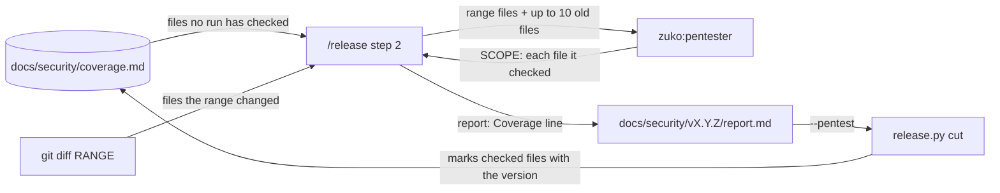
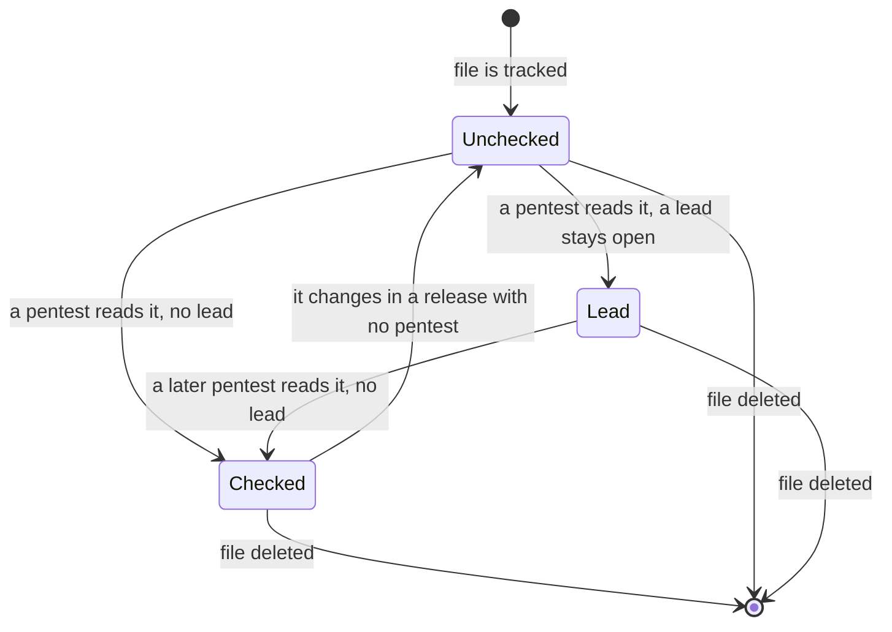
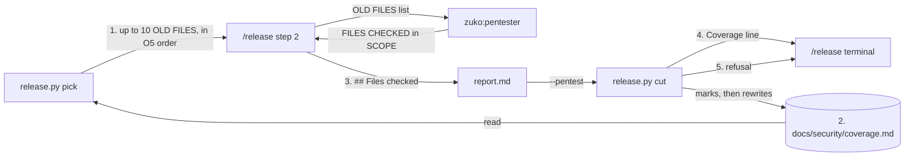
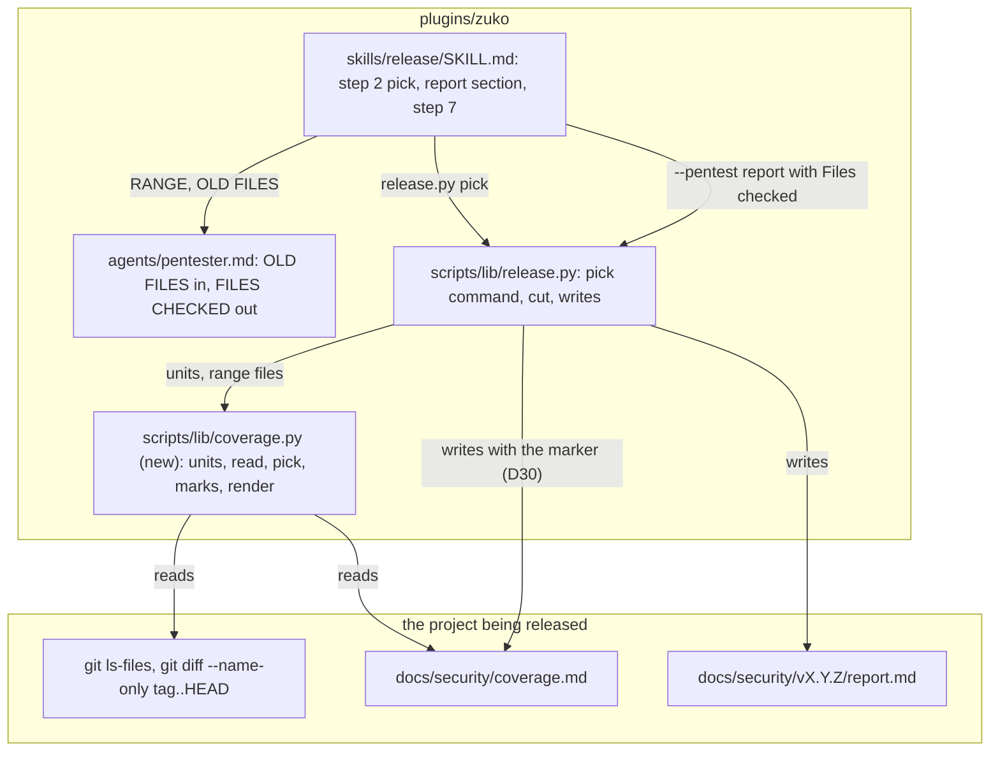
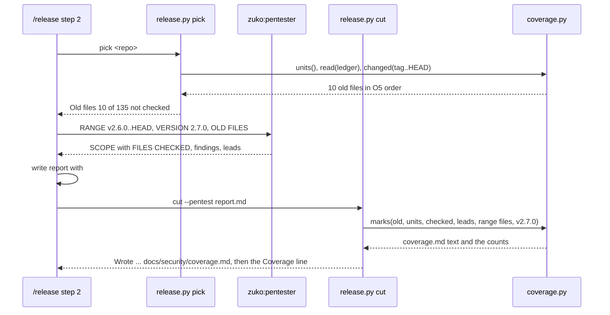

# Coverage ledger

**Version:** v1 · **Status:** Refined · **Type:** Feature · **Project type:** CLI/Library

**Shape doc:** docs/specs/pentest-depth/shape.md
**Depends on:** needs-validation

Each release pentest records the files it checked in a committed coverage ledger. The next release also checks some files that no run has checked yet, so code older than the last tag gets covered over a few releases.

## Problem

The release pentest reads only the commits since the last tag. A file that has not changed since zuko first got a pentest is never read again. zuko has 148 tracked files outside its tests and docs, and nothing records which of them any pentest has read. A release that shipped without a pentest, such as v2.4.2 (D59), left its whole range unchecked, and no later run goes back to it. The report says what this run looked at, but not what no run has ever looked at.

## Slice test

| Check                         | Result                                                                                                                       |
| ----------------------------- | ---------------------------------------------------------------------------------------------------------------------------- |
| Cuts every layer it needs     | yes — `/release` step 2 picks the old files, the pentester checks them, the report says the coverage, and `release.py cut` writes the ledger |
| One e2e test walks it         | yes — one e2e test cuts two releases of a scratch repo in a row and checks the ledger after each                             |
| Worth shipping alone          | yes — the next zuko release checks some of its old files, and the ledger says how many no run has checked                    |
| Fits (≤5 scenarios, ≤2 areas) | yes — 5 scenarios, 2 areas: the release pentest prompts, and `release.py`                                                    |

**Path:** full — the slice adds a committed file that `release.py cut` writes and reads, and it changes the pentester's input.

## User story

As the person who runs `/release`, I want each pentest to also check a few files that no pentest has read yet, so that after a few releases every file has been checked at least once, and I can see how far that has got.

## Flow



`/release` reads the ledger and picks up to 10 files that no run has checked. The pentester checks those files and the files in the range. `cut` marks each checked file in the ledger with the version, and the report says how many files are still unchecked.

## States



A file starts unchecked. A pentest that reads it marks it checked, or keeps it open when a lead stays on it. A change in a release that ships without a pentest puts it back to unchecked.

## Acceptance criteria

```gherkin
Scenario: the first release with a ledger checks 10 old files and seeds the ledger
  Given zuko is tagged v2.6.0, and docs/security has no coverage ledger
  And the range v2.6.0..HEAD changes 3 files under plugins/zuko
  When the user runs /release, says yes to 2.7.0 and picks code-level
  Then the pentester checks the 3 range files and 10 other files that no run has checked
  And cut prints the line "Coverage   13 of 148 files checked by a pentest · 135 not checked"
  And cut writes the ledger with those 13 files marked "v2.7.0", and the other 135 marked unchecked
  And the terminal says that this release started the ledger

Scenario: the next release goes on from where the last one stopped
  Given the ledger has 135 unchecked files after v2.7.0
  And the range v2.7.0..HEAD changes 2 files that v2.7.0 checked
  When the user releases v2.8.0
  Then the pentester checks the 2 range files and the next 10 unchecked files
  And the ledger marks those 12 files "v2.8.0", and 125 files stay unchecked

Scenario: a release without a pentest puts its changed files back to unchecked
  Given plugins/zuko/scripts/lib/fence.py is marked "v2.7.0" in the ledger
  And v2.8.0 ships with --no-pentest "classifier stopped the run", and its range changes fence.py
  When the user releases v2.9.0 with a pentest, and fence.py does not change in v2.8.0..HEAD
  Then fence.py is unchecked in the ledger after v2.8.0
  And the v2.9.0 pentest picks fence.py as an old file before files it checked before

Scenario: a file with an open lead stays on the list
  Given the v2.7.0 report has lead N1 on plugins/zuko/scripts/lib/git-command.py
  When the user releases v2.8.0, and git-command.py does not change
  Then the ledger marks git-command.py "lead in v2.7.0", not checked
  And the v2.8.0 pentest picks git-command.py as an old file

Scenario: a ledger that cut cannot read stops the release
  Given the coverage ledger has a row for a file with the mark "v2.7.0" twice
  When /release runs release.py cut
  Then cut prints "Coverage ledger unreadable: ..." with the line, and writes nothing
  And a missing ledger is not an error: cut starts a new one, and says so
```

## Scope

**In:**

- A committed coverage ledger at `docs/security/coverage.md`, with one row for each tracked file that counts as a unit (O1, O2).
- `/release` step 2 picks up to 10 unchecked files, and the pentester checks them with the range (O3). It picks files with an open lead first, then files a skipped release put back, then never-checked files in path order (O5).
- The report gets a Coverage line, and the terminal summary says the same.
- `cut` marks each file that the pentester checked, and puts a file from a skipped release back to unchecked.
- A file with an open lead stays on the list.
- `cut` refuses a ledger it cannot read, and starts a new one when there is none.

**Out:**

- Cloudflare's coverage units (surface, boundary, subsystem and attack class) and its validator — not doing. The unit is a file (O1).
- A second pass over a file that a run already checked and that has not changed — not doing. The range catches each change.
- A separate `/audit` command for the whole repo — not doing (shape O3).
- Strix runs adding to the ledger — slice 4 `strix-code`.
- Carrying a lead's text into the next report — not doing. The ledger keeps only the mark on the file.

## Interface

The slice adds one file, one `release.py` command and one report section, and it changes two terminal outputs.



`release.py pick` reads the ledger and prints the old files for this release. `/release` hands them to the pentester, and writes each file that it checked into the report. `cut` marks those files in the ledger and prints the Coverage line.

### 1. `release.py pick`

```text
python3 release.py pick <project-dir>
```

It reads `docs/security/coverage.md` and the tracked files, and leaves out each file that the range since the last tag changes, because the range checks those anyway. It prints up to 10 old files in O5 order, one in each line, with the mark that put it on the list. The count in the first line is the files on the list: each `lead in`, `reset in` and `unchecked` unit outside the range. It writes nothing.

```text
Old files  10 of 135 not checked · docs/security/coverage.md
  plugins/zuko/scripts/lib/git-command.py     lead in v2.7.0
  plugins/zuko/scripts/lib/fence.py           reset in v2.8.0
  .agents/skills/design-taste-frontend/SKILL.md  unchecked
  ...
```

With no ledger, the first line reads `Old files  10 of 148 not checked · no ledger yet, cut starts one`. With nothing left to pick, it reads `Old files  0 · every unit is checked`. A ledger it cannot read gives the same refusal as `cut` (section 5) and exit 1.

### 2. The ledger file

`docs/security/coverage.md`, sorted by path, one row for each unit (O2):

```text
# Coverage

**Updated:** v2.7.0 · 2026-11-20
**Units:** 148 · **Checked:** 13 · **Lead:** 1 · **Not checked:** 134

| File | Mark |
| ---- | ---- |
| .agents/skills/design-taste-frontend/SKILL.md | unchecked |
| plugins/zuko/scripts/lib/fence.py | v2.7.0 |
| plugins/zuko/scripts/lib/git-command.py | lead in v2.7.0 |
| plugins/zuko/scripts/lib/release.py | reset in v2.8.0 |
```

| Mark | Means | Counts as |
| --- | --- | --- |
| `vX.Y.Z` | the pentest of that release checked it, with no lead | Checked |
| `lead in vX.Y.Z` | that pentest checked it, and a lead on it is still open | Lead |
| `reset in vX.Y.Z` | it changed in a release that shipped without a pentest | Not checked |
| `unchecked` | no pentest has checked it | Not checked |

`cut` writes the whole file each release. A new tracked file comes in as `unchecked`, and a deleted file goes out.

### 3. The report section and the pentester's input

`/release` gives the pentester an `OLD FILES:` list after `RANGE`. The pentester checks each old file as it checks a range file, with the same categories and class files. Its SCOPE block gets one more line, with every file that it read and hunted, from the range and from the list:

```text
FILES CHECKED: plugins/zuko/agents/pentester.md, plugins/zuko/scripts/lib/fence.py, plugins/zuko/scripts/lib/git-command.py
```

`/release` writes them into the report as a new section after `## Not assessed`, one file in each line:

```text
## Files checked

- plugins/zuko/agents/pentester.md
- plugins/zuko/scripts/lib/fence.py
- plugins/zuko/scripts/lib/git-command.py
```

An old file that the pentester did not reach is not in the list, so it stays on the list for the next release.

### 4. The terminal

The step 2 summary gets one line after `needs validation:`:

```text
           old files: 10 picked, 9 checked
```

`cut` prints the Coverage line after the files it wrote, and the step 7 report repeats it:

```text
Coverage   13 of 148 files checked by a pentest · 135 not checked
Coverage   13 of 148 files checked by a pentest · 135 not checked · ledger started
```

The second form is for the release that creates the ledger.

### 5. The refusals

`cut` and `pick` refuse and write nothing:

```text
Coverage ledger unreadable: line 14: plugins/zuko/scripts/lib/fence.py is listed twice
Coverage ledger unreadable: line 9: the mark "v2.7" is not vX.Y.Z, lead in vX.Y.Z, reset in vX.Y.Z or unchecked
Coverage ledger unreadable: no File and Mark table
Pentest report unreadable: Files checked names plugins/zuko/agents/nobody.md, which git does not track
```

A tracked file that is not a unit, such as a changed spec under `docs/`, is skipped. A report without `## Files checked` is refused as `Pentest report unreadable: no Files checked list`. A skipped pentest (`--no-pentest`) has no report to read: `cut` marks each unit that the range changed as `reset in vX.Y.Z`, and leaves the rest as they are.

## Technical plan

### Approach

A new sibling module, `lib/coverage.py`, owns the unit list, the ledger file and the pick order. `release.py` loads it as it loads `changelog.py` and `decisions.py`. A new `pick` command prints the old files, and `cut` writes `docs/security/coverage.md` with the other release files. The pentester gets an `OLD FILES:` list and returns a `FILES CHECKED:` line. `/release` step 2 runs `pick` before the dispatch, and writes the new report section.

D94 rejected a new report section for the class-file lines. `## Files checked` is a list that `cut` must read to mark the ledger, so it gets its own section, as `## Needs validation` did (D100).

Relies on: D10, D12, D30, D94, D100, D101, D109, D110, D111



`/release` asks `release.py pick` for the old files, and `coverage.py` works them out from git and the ledger. `cut` reads the report's Files checked and Needs validation lists, and writes the new ledger beside the report.



`pick` and `cut` share one module, so the pick order and the marks follow the same rules.

### Changes

| File | What changes | Why |
| --- | --- | --- |
| `plugins/zuko/scripts/lib/coverage.py` (new) | `units(project)`: `git ls-files -z`, minus each path with a `test` or `tests` folder, minus `docs/`, minus a `.md` at the repo root (O2). `read(project)`: `None` with no file; a dict from each path to its mark, or `Refused` with Interface 5's lines. `pick(units, marks, range_files, limit=10)`: O5 order. `marked(...)`: the new marks, by the rules below. `render(...)`: the file of Interface 2, and the counts | scenarios 1 to 5 |
| `plugins/zuko/scripts/lib/release.py:74` | Load `coverage` as `changelog` is loaded | — |
| `plugins/zuko/scripts/lib/release.py:1156` `main` | A `pick <project-dir>` command, with no options, and its line in `USAGE` and the module docstring | Interface 1 |
| `plugins/zuko/scripts/lib/release.py:839` `read_report` | After Needs validation, read `## Files checked`: `- path` lines. Refuse a report without the section, and a path that git does not track. Return the paths and the lead paths (the text before `:` in each `Where`) | scenario 1, 4, Interface 5 |
| `plugins/zuko/scripts/lib/release.py:950` `pentest_verdict` | Keep the checked paths and the lead paths on the `Verdict` | scenarios 1, 4 |
| `plugins/zuko/scripts/lib/release.py:979` `rewritten` | Add `docs/security/coverage.md` from `coverage.render` | scenarios 1 to 3 |
| `plugins/zuko/scripts/lib/release.py:630` `writes` | List `docs/security/coverage.md` with "coverage ledger, N of M checked", so the marker names it and the release commit may stage it (D30) | D30 |
| `plugins/zuko/scripts/lib/release.py:1079` `cut` | Read the ledger before any write, so that a bad ledger writes nothing. Print the Coverage line after `Wrote` | scenario 5, Interface 4 |
| `plugins/zuko/agents/pentester.md:14` and the SCOPE template | `OLD FILES` is given with `RANGE`. Check each old file with the categories and class files of the range. Add the `FILES CHECKED:` line to the SCOPE template and example | Interface 3 |
| `plugins/zuko/skills/release/SKILL.md` step 2 | Run `release.py pick` before the dispatch, print its lines, and give the files as `OLD FILES`. Write `## Files checked` after `## Not assessed`. The summary line `old files: N picked, M checked` | Interface 1, 3, 4 |
| `plugins/zuko/skills/release/SKILL.md` step 7 | The report gets the Coverage line that `cut` printed | Interface 4 |
| `plugins/zuko/scripts/tests/test-coverage.sh` (new) | Unit cases for `pick` and `cut` on scratch repos | scenarios 2 to 5 |
| `plugins/zuko/scripts/tests/test-e2e-coverage-ledger.sh` (new) | The e2e test below | all |
| `plugins/zuko/scripts/tests/fixtures/coverage-ledger/` (new) | `report-v1.5.0.md` and `report-v1.6.0.md`: two pass reports with Files checked lists, and one lead in the first | scenarios 1, 2, 4 |
| `fixtures/pentest/pass.md`, `medium.md`, `fixtures/pentest-live/live-pass.md`, `fixtures/attack-classes/report.md`, `fixtures/needs-validation/report.md`, and the `findings_report` and `leads_report` helpers in `test-release.sh` | Add a `## Files checked` list | every pass report has the section |

The marks that `cut` writes, in this order, for each unit:

1. It keeps its old mark, or `unchecked` when the ledger has no row for it.
2. With `--no-pentest`: each unit that `git diff --name-only <tag>..HEAD` names becomes `reset in vX.Y.Z`. Then stop.
3. Each unit in the range that is not in Files checked becomes `unchecked`, because its new code has no check.
4. Each unit in Files checked becomes `vX.Y.Z`.
5. Each unit with a lead in this report becomes `lead in vX.Y.Z`.

A deleted file has no row. A first release with no tag has the whole tree as its range, so `pick` gives no old files.

Reusing: `git` from `changelog.py`, `Refused` and `unreadable` and `findings_table`'s reading of every line, `listed` for the `- ` items, `report_path`, `writable` and the write loop in `cut`, the marker in `write_marker`, the `load` pattern for sibling modules, and the scratch repo with a fake `gh` from `test-e2e-needs-validation.sh`.

### Earn-it

| Added | Triggered by |
| --- | --- |
| `lib/coverage.py`, a new module | `pick` and `cut` both need the unit list, the read and the order. `release.py` is 1,187 lines, and it already loads `changelog.py` and `decisions.py` this way |
| The `pick` command | O5 and scenario 3. A script gives the same order each run, and a test can predict it. The prompt cannot |
| `## Files checked` in the report | Scenarios 1 and 2. `cut` must know which old files the pentester reached. The SCOPE text is not in the report |
| `docs/security/coverage.md` | O4 and scenario 2: the next release on any clone reads it |

Not added: no flag, no JSON, no hash of each file (the range catches each change), no new dependency.

### Non-functionals

|                      |                                                                               |
| -------------------- | ----------------------------------------------------------------------------- |
| **Load**             | One `pick` and one `cut` each release. zuko has 148 units; `git ls-files` and one `git diff` take well under a second. |
| **Breaks first**     | At 10 times the units, about 1,500, the ledger is 1,500 rows and still fast. Full coverage then takes about 150 releases at 10 a release. Raise the number per release before the format matters. |
| **Security surface** | The ledger is public and names files, not holes. `cut` trusts the report's Files checked only for files that git tracks. A pentester that lists a file it did not read marks it checked: the prompt is the only guard (risk 1). No secret is read or stored. |
| **Proof it works**   | The release commit of the next zuko release carries `docs/security/coverage.md`, and `cut` prints `Coverage   N of 148 files checked by a pentest`. |
| **Rollout**          | No flag. The first release after the installed plugin has this version starts the ledger. To roll back, revert the commits and delete `docs/security/coverage.md`. |

### Test plan

| Scenario | Test | Command |
| --- | --- | --- |
| 1 | `test-coverage.sh`: a scratch repo with no ledger. `pick` prints the "no ledger yet" line and the first 10 units in path order. `cut` with a report that lists 3 range files and those 10 writes the ledger with 13 `v1.5.0` marks, prints the Coverage line with "ledger started", and the marker names `coverage.md` | `bash plugins/zuko/scripts/tests/run.sh coverage` |
| 2 | same: a second cut goes on from the first ledger. The units are the next 10 in path order, and the counts drop by 10 | same |
| 3 | same: a `--no-pentest` cut marks the changed units `reset in v1.6.0`, and the next `pick` lists them before the `unchecked` units | same |
| 4 | same: a report with a lead on `invoice_cli/cli.py:12 main` marks it `lead in v1.5.0`, and the next `pick` lists it first | same |
| 5 | same: a duplicate row, a bad mark, no table, and an untracked path in Files checked each print their refusal and write nothing. `pick` refuses the same ledger with exit 1 | same |
| every pass report | `test-release.sh`: a report without `## Files checked` is refused | `bash plugins/zuko/scripts/tests/run.sh release` |
| prompts | `test-e2e-coverage-ledger.sh`: `pentester.md` has `OLD FILES` and the `FILES CHECKED:` template line. `release/SKILL.md` runs `release.py pick` before the dispatch and writes `## Files checked` | `bash plugins/zuko/scripts/tests/run.sh e2e-coverage-ledger` |

**E2E:** `test-e2e-coverage-ledger.sh`. It checks the two prompts, then cuts two releases of a scratch invoice-cli repo in a row with the two fixture reports. After each cut it reads `coverage.md` on origin and the `pick` output, and expects the marks and counts of scenarios 1, 2 and 4.

**Seeded run:** one pentester run with the command in `docs/specs/pentest.md` › Seeded run, on `fixtures/pentest/base/` plus `fixtures/pentest/range.patch`, tagged v1.4.2, with `OLD FILES: invoice_cli/cli.py, uv.lock`. It passes when `FILES CHECKED:` names both old files and the range files, and the bank-import A05 is still a finding.

### Chunks

| Chunk | Scenarios | Files owned |
| --- | --- | --- |
| A | 1 to 5 | `plugins/zuko/scripts/lib/coverage.py`, `plugins/zuko/scripts/lib/release.py`, `plugins/zuko/scripts/tests/test-coverage.sh`, `plugins/zuko/scripts/tests/test-release.sh`, every report fixture listed in Changes, `plugins/zuko/scripts/tests/fixtures/coverage-ledger/` |
| B | prompts, e2e | `plugins/zuko/agents/pentester.md`, `plugins/zuko/skills/release/SKILL.md`, `plugins/zuko/scripts/tests/test-e2e-coverage-ledger.sh` |

No shared files. Chunk B's e2e test reads chunk A's fixtures and cuts with chunk A's code, so it goes green only after both merge. Chunk B's prompt has more turns of work than last time's chunk B had files, so its builder gets the e2e test first.

### Risks

| Risk | Mitigation |
| --- | --- |
| 1. The pentester lists a file in `FILES CHECKED` that it did not read, and the ledger marks it checked. | The prompt says to list only files it read and hunted. The seeded run checks that the old files appear. A wrong mark costs one file one check; the range still catches each later change. |
| 2. 10 old files push a large range over 60 turns, and the pentest does not finish. | The seeded run counts turns. Over 45 means `/build` drops the number to 5 and adds a Decided alone row. `/release` already handles a pentest that does not finish. |
| 3. Every pass fixture needs the new section, so tests churn again. | Chunk A owns every report fixture and adds the section in one commit. A missed one fails loudly with the refusal. |
| 4. A release that shipped without a pentest before the ledger existed, such as v2.4.2, is not reset. | Its files are `unchecked` in the first ledger anyway, because no ledger marked them. |

### Decisions to record

Recorded as D109, D110, D111. D104 to D108 are taken on `feat/portable-suite`, which is not merged yet.

## Open items

| ID | What | Type | Raised at | Owner | Status | Answer |
| --- | --- | --- | --- | --- | --- | --- |
| O1 | What is one unit in the coverage ledger: a file, a function, or Cloudflare's own recon units? (from shape O15) | question | shape | user | Resolved | A tracked file. `git ls-files` gives the list, a path is stable, and git says when it changed. The D-entry is drafted at pause 3, 2026-11-09 |
| O2 | Which tracked files count as units? zuko has 462 tracked files: 76 in the plugin outside tests, 196 under scripts with the tests, and 64 in the vendored `.agents/skills/`. | question | spec p1 | user | Resolved | Every tracked file except test folders and fixtures (`/tests/`), `docs/`, and `*.md` at the repo root. Prompt files under `plugins/` count, and vendored `.agents/skills/` counts. zuko has 148 units. The D-entry is drafted at pause 3, 2026-11-09 |
| O3 | How many unchecked files does one release add to its pentest? | question | spec p1 | user | Resolved | 10 files each release, so zuko's 148 units take about 15 releases. The D-entry is drafted at pause 3, 2026-11-09 |
| O4 | The ledger is committed, so it is public. It names each file that no pentest has checked yet. Where does it live? | question | spec p1 | user | Resolved | `docs/security/coverage.md`, committed in the release commit. It names files, not holes. The D-entry is drafted at pause 3, 2026-11-09 |
| O5 | In what order does a release pick the unchecked files? | question | spec p1 | user | Resolved | Files with an open lead first, then files that a skipped release put back to unchecked, then never-checked files in path order. The D-entry is drafted at pause 3, 2026-11-09 |
| O6 | What does cut do with a ledger it cannot read? | question | spec p1 | user | Resolved | Refuse and write nothing, as cut does on a bad report. A missing ledger is not an error: cut starts a new one and says so. The D-entry is drafted at pause 3, 2026-11-09 |

_Never delete this section or its rows. See references/ledger.md._

## Glossary

- **Pentest** — a penetration test: an attack on your own code to find holes before someone else does.
- **Coverage ledger** — a record of each unit of code and whether a run has checked it.
- **Unit** — one piece of code that the ledger tracks, such as one file.
- **Range** — the commits since the last release tag, such as `v2.6.0..HEAD`.
- **Lead** — a possible hole that the pentester traced in the code but could not prove with a run.
- **e2e** — end-to-end: one test that walks the whole slice as a user would.
