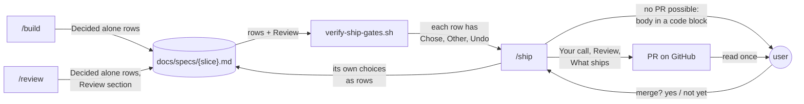
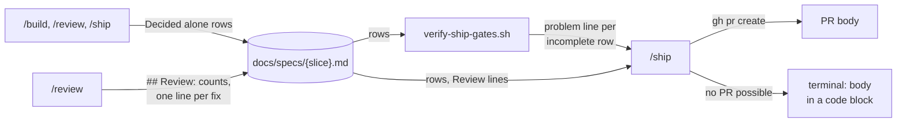
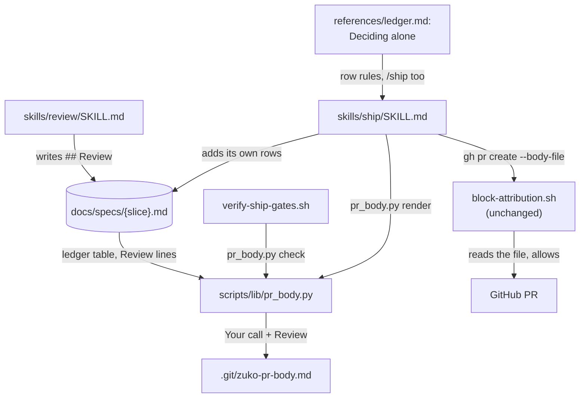
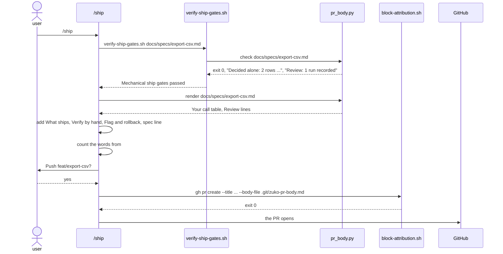

# Decision PR

**Version:** v1 · **Status:** Built · **Type:** Enhancement · **Project type:** CLI/Library

**Shape doc:** docs/specs/ask-up-front/shape.md
**Depends on:** unattended-build

The PR that `/ship` opens starts with each choice made without you, then the
review result, then what ships. You make one informed decision at the merge
question, and the record of each choice stays in the spec.

## Problem

`/ship`'s rule for the PR body lists what ships, the scenarios, how to verify,
the flag and the page link (`skills/ship/SKILL.md:113`). It says nothing about
the choices that `/build`, `/review` or `/ship` made without you.

| Evidence | Source |
| --- | --- |
| PRs 80, 82, 84 and 86 start with a "Your call" table. Claude wrote each one by hand, from memory of the session. | `gh pr view` |
| Those tables hold choices that no spec row records, such as a test left red because `main` fails the same way. | PR 84, PR 86 |
| `/review` prints its findings to the terminal only. A `/ship` in a new session has no record of them. | `skills/review/SKILL.md:156` |
| The bodies were 356 to 550 words, without the bot summary. PR 78, before "Your call", was 240. | `gh pr view` |
| Two of your work repos are on gitlab.com. There `/ship` opens nothing and gives only the link from `git push`. The body is lost. | shape O8 |

## Slice test

| Check | Result |
| --- | --- |
| Cuts every layer it needs | yes. `/review` writes its result into the spec, the ship gate checks the rows, and `/ship` builds the body from both. |
| One e2e test walks it | yes. A contract test reads the `/ship` and `/review` text. The gate test runs `verify-ship-gates.sh` on a fixture spec. |
| Worth shipping alone | yes. The next PR shows each choice made without you, in the same place, also after a new session. |
| Fits (≤5 scenarios, ≤2 areas) | yes. 5 scenarios. Two areas: the ship stage, and the review result that it reads. |

**Path:** full. The PR body is an output format, and the change touches more
than three files.

## User story

As the person who runs zuko, I want the PR to start with each choice made
without me, so that I can read it once and decide at the merge question.

## Flow



`/build`, `/review` and `/ship` write each choice into the spec. The gate
checks each row, and `/ship` builds the body from the spec, not from memory.

## Acceptance criteria

```gherkin
Scenario: The choices made without you come first
  Given the spec export-csv is Built
  And O7 is Decided alone: "Chose: drop the VAT column. Other: add a VAT field to invoices. Undo: put back the old scenario 3, and add the field."
  And O9 is Decided alone: "Chose: store rows in Postgres, as D7 says. Other: supersede D7 through /spec. Undo: git revert 4e1f9a2."
  When /ship opens the PR on github.com
  Then the body starts with "## Your call" and a table with one row for O7 and one for O9
  And each row shows what was chosen, the other choice and how to undo it
  And "## Review" comes next, then "## What ships"
  And the body has 300 words or fewer without the Your call table

Scenario: Nothing was decided without you, in a repo with a PR template
  Given the spec export-csv has no Decided alone row
  And the repo has .github/pull_request_template.md with the headings "## Summary" and "## Testing"
  When /ship opens the PR
  Then the body starts with "## Your call" and the line "Nothing was decided without you."
  And "## Review" comes next, then "## Summary" and "## Testing", filled from the diff

Scenario: The review result survives a new session
  Given /review on export-csv found 7 raw findings, and 4 survived
  And it fixed each one in its own commit
  And it wrote the counts and one line for each fix into the spec's Review section
  When /ship runs in a new session
  Then "## Review" in the body says "7 raw findings, 4 survived, 4 fixed"
  And it has one line for each fix, with its commit

Scenario: /ship cannot open the PR
  Given the origin of the invoices repo is git@gitlab.com:acme/invoices.git
  When /ship has pushed the branch feat/export-csv
  Then it prints the full body in a code block, and the merge request link that git push printed
  And it says that it opened no merge request

Scenario: A row decided alone has no Undo
  Given O7 is Decided alone with "Chose: drop the VAT column. Other: add a VAT field to invoices." and no Undo
  When /ship runs verify-ship-gates.sh
  Then the gate fails and names O7 and the missing "Undo:"
  And /ship opens no PR until O7 has all three parts
```

## Scope

**In:**

- `/ship` builds the PR body in this order: Your call, Review, then what
  ships, how to verify and how to roll back, and the spec link.
- Your call is a table from the spec's `Decided alone` rows. No row → one line.
- `/ship` adds a `Decided alone` row for each choice that it makes alone, as
  `/build` and `/review` do.
- `/review` writes its result into the spec: the counts and one line for each
  fix. `/ship`'s "Review done" gate reads it.
- `verify-ship-gates.sh` fails a `Decided alone` row that lacks Chose, Other
  or Undo.
- A limit on the length of the body without the Your call table.
- With a PR template: Your call and Review go first, then the template's
  headings.
- When `/ship` cannot open the PR, it prints the body for you to paste.
- Contract tests, and new cases in `test-verify-ship-gates.sh`.

**Out:**

- A step that applies a row's Undo for you. You read the Undo and ask for it
  at the merge question, as today. No slice picks it up.
- Opening a GitLab merge request. GitLab was dropped on 2026-09-25 (shape,
  Not doing).
- `/ship` no longer asks before it pushes or merges. Your global rules keep
  both questions (shape, Not doing).
- Rows in specs that shipped before this slice. Their PRs are merged. No slice
  picks them up.

## Interface

The interface is three outputs and the rules that make them. `/ship` writes
the PR body. `/review` writes a Review section into the spec. The ship gate
prints one new problem line for each incomplete row.



Each part of the PR body comes from the spec. `/ship` copies the rows and the
Review lines. It writes only What ships, Verify by hand and Flag and rollback.

### The PR body

Two rows decided alone, no PR template:

````markdown
## Your call

2 things were decided without you. Each one can be undone.

| ID | What | Chose | Other | Undo |
| --- | --- | --- | --- | --- |
| O7 | Scenario 3 said "Then the CSV has the columns number, date, total and VAT". The invoices table has no VAT field. | drop the VAT column. | add a VAT field to invoices. | put back the old scenario 3, and add the field. |
| O9 | The diff stored the export rows in SQLite. D7 says "Use Postgres, not SQLite". | store the rows in Postgres, as D7 says. | supersede D7 through /spec. | git revert 4e1f9a2. |

## Review

2026-10-13 · 7 raw findings, 4 survived, 4 fixed.

- A01 Broken Access Control · `routes/export.py:14` · put back `@login_required` on `export_ledger` · `9c1d2e3`
- A05 Injection · `exporters/ledger.py:31` · `db.run` with `customer` as a parameter · `5b7e0f1`
- correctness · `exporters/ledger.py:52` · `write_rows` writes the header once · `a41c7d8`
- coverage · `invoice_api/auth.py:22` · a test for the roles-lookup-fails path · `e02b9f6`

## What ships

`invoices export --csv ACME-01` writes the customer's ledger as a CSV file.
The columns are number, date and total. Only a signed-in user can export.

## Verify by hand

- `pytest tests/test_export.py` gives 14 passed.
- `invoices export --csv ACME-01` writes `ACME-01-ledger.csv` with 3 columns.

## Flag and rollback

Flag `export_csv`, off by default. Rollback: turn the flag off.

Spec: `docs/specs/export-csv.md` · Page: https://claude.ai/artifact/9hPyHKvyYczFPhbdBpJciM
````

- Your call copies each row's ID, What, Chose, Other and Undo word for word.
  The labels "Chose:", "Other:" and "Undo:" and the date are left out.
- No row decided alone: the heading, then the line "Nothing was decided
  without you." No table.
- Review copies the lines under the spec's `## Review` heading as they are.
- From `## Review` to the end, the body has 300 words or fewer. When it has
  more, `/ship` shortens What ships first. It never cuts a Your call row.

The last line names the spec. It adds the page link only when the spec has a
`**Page:**` line.

With a PR template, Your call and Review come first. The template's headings
come next, in the template's order, filled from the diff. They replace What
ships, Verify by hand and Flag and rollback. The spec line stays last.

### The Review section in the spec

`/review` writes it just above `## Open items`, after it fixes the findings.
It writes one dated line for each run, then one line for each fix:

```markdown
## Review

2026-10-13 · 7 raw findings, 4 survived, 4 fixed.

- A01 Broken Access Control · `routes/export.py:14` · put back `@login_required` on `export_ledger` · `9c1d2e3`
- A05 Injection · `exporters/ledger.py:31` · `db.run` with `customer` as a parameter · `5b7e0f1`
```

A fix line has four parts: the category, `file:line`, the fix in a few
words, and the fix commit. A clean run writes one line:
`2026-10-14 · 3 raw findings, 0 survived. Clean.` A second run adds its own
lines below the first. It never changes or removes a line.

### The gate lines

`verify-ship-gates.sh` reads each `Decided alone` row. One problem line names
each row that lacks a part:

```text
Ship gates FAILED:
- O7  Decided alone row has no "Undo:"
- O9  Decided alone row has no "Other:" and no "Undo:"
- O4  Decided alone row has an empty "Undo:"
```

On a pass it reports what it checked, so a spec with no rows is still a
visible result:

```text
Decided alone: 2 rows, each with Chose, Other and Undo
Decided alone: no rows
```

With no `## Review` section, the gate prints:

```text
- No '## Review' section in the spec. Run /review on this branch first.
```

### When /ship cannot open the PR

On a GitLab origin, or with no `gh` and no GitHub tools, `/ship` prints this
after the push:

`````text
I opened no PR. The origin is gitlab.com, and /ship opens PRs on GitHub only.

Open it from the link that git push printed:
https://gitlab.com/acme/invoices/-/merge_requests/new?merge_request%5Bsource_branch%5D=feat%2Fexport-csv

Title: feat(export): add the CSV export of the ledger

Body, to paste:

````markdown
## Your call
...
Spec: `docs/specs/export-csv.md` · Page: https://claude.ai/artifact/9hPyHKvyYczFPhbdBpJciM
````
`````

The fence around the body has four backticks, so a code block inside the body
does not end it. With no `gh` on a GitHub origin, the first line says "I
opened no PR. Neither gh nor the GitHub tools are available here."

### Choices that /ship makes alone

`ledger.md` › "Deciding alone" gets `/ship`. A row that `/ship` adds has
Raised at `ship`. The choices that PRs 84 and 86 show:

| The choice | What to do |
| --- | --- |
| A test or check stays red, because the base branch fails the same way. | Leave it. Name the test and the base branch in the row. |
| A `feat` or `fix` commit gets no CHANGELOG line. | Say why in the row. |

`/ship` still asks before it pushes and before it merges. It adds each row
before the gate runs, so the gate checks the rows too.

## Technical plan

### Approach

A new script, `scripts/lib/pr_body.py`, reads the spec's ledger and its
Review section. Its `check` command runs inside `verify-ship-gates.sh`. Its
`render` command prints the Your call and Review parts of the body. The rest
of the change is prompt text: `/review` writes the Review section, and `/ship`
writes the other parts and opens the PR with `gh pr create --body-file`.



`/review` and `/ship` write into the spec. `pr_body.py` reads it for the gate
and for the body, and the attribution hook reads the body file before GitHub
gets it.



Relies on: D7 (each confirmed finding is fixed, so survived equals fixed), D20
(the attribution hook reads a `--body-file`), D42 (a `Decided alone` row says
Chose, Other and Undo), D43, and D46 to D50, drafted below.

### Changes

| File | Change | Why |
| --- | --- | --- |
| `plugins/zuko/scripts/lib/pr_body.py` | New. `check <spec>` and `render <spec>`, as the contract below says. | Scenarios 1, 3 and 5. O11. |
| `plugins/zuko/scripts/verify-ship-gates.sh:31` | After the Open items check, run `pr_body.py check`. Exit 0: echo its lines. Any other exit: each line becomes a problem line, as at `:224` for `decisions.py`. | Scenario 5. O6, O9. |
| `plugins/zuko/skills/ship/SKILL.md:16` | Add `references/ledger.md` to the Read line. | `/ship` now adds rows. O4. |
| `plugins/zuko/skills/ship/SKILL.md:85` | The Review done check: "The gate found the spec's `## Review` section. Each fix line names a commit on this branch." | O2, O9. |
| `plugins/zuko/skills/ship/SKILL.md:95` | Add: a choice that `/ship` makes alone gets a row, as `ledger.md` › "Deciding alone" says. Commit the spec, then run the gate again. | O4. |
| `plugins/zuko/skills/ship/SKILL.md:106` | Rewrite "The PR": render into `.git/zuko-pr-body.md`, then the order, the template rule, the 300 words, `--body-file`, and the text for no PR. | Scenarios 1, 2 and 4. O1, O3, O5, O10, O13. |
| `plugins/zuko/skills/ship/SKILL.md:137` | A check that is red on the base branch too: add the row, commit, push, render again and run `gh pr edit --body-file`. | O12. |
| `plugins/zuko/skills/review/SKILL.md:213` | Add: after the fixes, write the `## Review` section as Interface says. Do not put a word in a line that the placeholder check reads as a blank. Commit it as `docs(spec): record the review of {slice}`. | Scenario 3. O2, O8. |
| `plugins/zuko/references/ledger.md:44` | The Status row: "`/build`, `/review` or `/ship` made a choice without the user." | O4. |
| `plugins/zuko/references/ledger.md:50` | Rule 1: "In `/build`, `/review` and `/ship`, a choice made without the user is a `Decided alone` row". | O4. |
| `plugins/zuko/references/ledger.md:132` | "Deciding alone": a sentence for `/ship` and the two table rows from Interface. Raised at is `build`, `review` or `ship`. | O4. |
| `plugins/zuko/scripts/tests/test-pr-body.sh` | New. Unit cases for `check` and `render`. | Scenarios 1, 2, 3 and 5. |
| `plugins/zuko/scripts/tests/test-e2e-decision-pr.sh` | New. The e2e, as the test plan says. | The whole slice. |
| `plugins/zuko/scripts/tests/test-decision-pr.sh` | New contract test of the ship, review and ledger text. | Scenarios 2 and 4, and the text of each. |
| `test-verify-ship-gates.sh:20`, `test-e2e-changelog.sh:37`, `test-e2e-onboard.sh:23`, `test-e2e-naming.sh:21`, `test-e2e-decisions.sh:24`, `test-e2e-readme.sh:43` | Each fixture spec gets a `## Review` section with one run line, above `## Open items`. Commit this before the gate change. | Each one runs the gate. The lesson "a new gate check breaks every fixture". |
| `plugins/zuko/scripts/tests/test-unattended-build.sh:36`, `:48`, `:50` | Match the new ledger text. | They pin the three lines that O4 changes. |

Reusing: the `FENCE` pattern that `decisions.py:45`, `changelog.py:53` and
`glossary.py:27` each copy. The exit codes and the "Usage:" docstring of
`decisions.py`. The fixture setup of `test-e2e-naming.sh`. The hook payload
that `test-block-attribution.sh` sends.

#### The pr_body.py contract

```text
Usage: pr_body.py check  <spec>
       pr_body.py render <spec>
```

- It reads the table under `## Open items` and the lines under `## Review`.
  Both must be outside code fences. A line inside a fence belongs to no
  section, so a table, a run line or a heading in an example does not count.
- A row is `Decided alone` when its sixth cell is exactly that. A cell splits
  on each `|` that has no backslash before it.
- The parts are the text after `Chose:`, `Other:` and `Undo:`. A date at the
  end of Undo is removed.
- A run line in Review starts with a date, then ` · `.
- `check` exit 0 prints `Decided alone: 2 rows, each with Chose, Other and
  Undo`, `Decided alone: 1 row, with Chose, Other and Undo` or `Decided alone:
  no rows`, then `Review: 1 run recorded`.
- `check` exit 1 prints one line for each problem, with no `- `. The gate adds
  it. The problems are a row that lacks a part, a row with an empty part, no
  `## Review` section, a Review section with no run line, and no
  `## Open items` section.
- `render` exit 0 prints Your call and Review as Interface shows. One row says
  "1 thing was decided without you. It can be undone." `render` exit 1 prints
  the `check` problems to stderr and nothing to stdout.
- Exit 2: bad usage, or a spec that cannot be read.

### Earn-it

| Added | Triggered by |
| --- | --- |
| `scripts/lib/pr_body.py` | O11. Scenarios 1 and 5 need the same split of each row. One parser keeps the table and the gate in step. |
| `.git/zuko-pr-body.md` | `gh pr create --body-file` needs a file, and the attribution hook reads it (D20). In the git folder, it never makes the tree dirty for the gate. |

Nothing else is new: no config, flag or dependency.

### Non-functionals

| | |
| --- | --- |
| **Load** | One more `python3` run in the ship gate, about 50 ms. The body is 300 words or fewer, as `wc -w` counts them, plus the Your call table. |
| **Breaks first** | At 10×, 30 rows decided alone make a long table that `/ship` never cuts. The length is then the signal: that build made too many choices alone. |
| **Security surface** | `pr_body.py` reads one spec and prints. It writes nothing. The body holds spec text and Claude's own lines, and the spec is already on the pushed branch. The attribution hook reads the body file before `gh` runs. `gh pr edit` is not hooked (Risks). |
| **Proof it works** | The next real `/ship` after a release prints `Decided alone: N rows, each with Chose, Other and Undo` and `Review: 1 run recorded`. Its PR starts with `## Your call`. |
| **Rollout** | No flag, because this is prompt text and one gate check. Rollback: `git revert` the build commits. Revert the gate commit alone to remove only the check. |

### Test plan

| Scenario | Test |
| --- | --- |
| 1. The choices come first | `test-pr-body.sh`: `render` on two rows gives the exact table, with the labels and the date removed. A `\|` in What stays escaped. `test-decision-pr.sh`: the order and the 300-word rule in `/ship`. |
| 2. No row, with a PR template | `test-pr-body.sh`: `render` with no row gives the one line. `test-decision-pr.sh`: the template rule in `/ship`. |
| 3. Review in a new session | `test-pr-body.sh`: `render` copies the Review lines, and two runs stay in order. `test-decision-pr.sh`: the Review rule in `/review`. |
| 4. No PR possible | `test-decision-pr.sh`: the no-PR text, the four-backtick fence and the GitLab line in `/ship`. |
| 5. A row with no Undo | `test-pr-body.sh`: `check` names the row and each missing part. A row in a code fence is not read. No Review section, and a section with no run line, each fail. |

Commands:

```bash
bash plugins/zuko/scripts/tests/run.sh pr-body
bash plugins/zuko/scripts/tests/run.sh e2e-decision-pr
bash plugins/zuko/scripts/tests/run.sh decision-pr
bash plugins/zuko/scripts/tests/run.sh unattended-build
bash plugins/zuko/scripts/tests/run.sh verify-ship-gates
bash plugins/zuko/scripts/tests/run.sh
```

**E2E:** `test-e2e-decision-pr.sh`. It makes a scratch repo on
`feat/export-csv` with a `Built` spec, rows O7 and O9, and a Review section.
It runs `verify-ship-gates.sh` and expects a pass with both scope lines. It
runs `render` into the body file and compares it word for word. It sends
`gh pr create --body-file` to `block-attribution.sh` as a hook payload and
expects exit 0. Then it removes O7's Undo, commits, and expects the gate to
fail with `- O7  Decided alone row has no "Undo:"`.

The baseline on 2026-10-13 is 2177 passed and 1 failed. The failure is
`test-scope-verifier-bash.sh`, a 20 s timeout that `main` has too.

### Chunks

Single chunk. Order:

1. The six fixture specs get a Review section. Commit, and the suite stays green.
2. `test-pr-body.sh`, then `pr_body.py`.
3. `test-e2e-decision-pr.sh`, then the gate change.
4. `test-decision-pr.sh` and the `test-unattended-build.sh` edits, then the
   ledger, ship and review text.

### Risks

| Risk | Mitigation |
| --- | --- |
| A fix line in Review holds a route parameter in braces, or another word that the placeholder check reads as a blank, and the gate fails the spec. | The review rule names each of those words and says to name the thing in other words (O14). The gate names the line. |
| `--body-file "$(git rev-parse --git-dir)/…"` reaches the attribution hook unexpanded. The hook finds no file and reads no body. | `/ship` runs `git rev-parse --absolute-git-dir` first and passes the literal path. The e2e proves that the hook reads it there and blocks a signed body. |
| `gh pr edit --body-file` has no attribution hook (D20 covers `create`). | `/ship` changes only the Your call part, from the same render. The rest of the file is the one that the hook read at create. |
| A spec built before this slice has no Review section, and its ship fails. | The message says to run `/review`, which writes the section. Every spec in this repo has shipped. |
| `wc -w` counts a `·` or a `\|` as a word. | The limit is defined as `wc -w` counts. 300 by that count is about 260 real words. |
| This session's `/ship` runs the installed 2.3.1, so this slice's own PR is still made by hand. | The proof is the first `/ship` after a release. |

### Decisions to record

Recorded as D46, D47, D48, D49, D50.

## Review

2026-10-13 · 4 raw findings, 3 survived, 3 fixed.

- correctness · `plugins/zuko/scripts/lib/pr_body.py:37` · `sections` puts no line from inside a fence in a section · `7f27f15`
- correctness · `plugins/zuko/scripts/lib/pr_body.py:108` · an empty Chose, Other or Undo is a problem line · `62a43f0`
- correctness · `plugins/zuko/skills/review/SKILL.md:235` · the Review rule names each word that the gate reads as a blank · `78ed5a2`

## Open items

| ID | What | Type | Raised at | Owner | Status | Answer |
| --- | --- | --- | --- | --- | --- | --- |
| O1 | Your work repos on gitlab.com get no PR from `/ship`. Print the PR body for you to paste there? (from shape O8) | question | shape | user | Resolved | Print the body. When `/ship` cannot open the PR, it prints the full body in a code block, and the link that `git push` printed. 2026-10-13 |
| O2 | `/review` prints its findings only to the terminal. Where does `/ship` get the Review section in a new session? | question | spec p1 | user | Resolved | `/review` writes a Review section into the spec: the counts, and one line for each fix with its commit. `/ship` copies it. With no section, the "Review done" gate fails and sends you to `/review`. 2026-10-13 |
| O3 | How long can the PR body be? The last four were 356 to 550 words. | question | spec p1 | user | Resolved | 300 words or fewer, without the Your call table. The table is never cut. `/ship` counts the words before it opens the PR. 2026-10-13 |
| O4 | Which choices go in Your call? PRs 84 and 86 listed choices that `/ship` made, which no spec row records. | question | spec p1 | user | Resolved | Every `Decided alone` row. `/ship` adds a row for each choice that it makes alone, so the spec stays the one record. 2026-10-13 |
| O5 | The repo has a PR template. Where do Your call and Review go? | question | spec p1 | user | Resolved | Your call and Review come first. The template's headings follow in its order, filled from the diff. 2026-10-13 |
| O6 | A `Decided alone` row lacks its Chose, Other or Undo part. What does `/ship` do? (from unattended-build O8) | question | spec p1 | user | Resolved | `verify-ship-gates.sh` fails and names the row and the missing part. `/ship` completes the row and runs the gate again. No PR opens before that. 2026-10-13 |
| O7 | Your call: copy the row's ID, What, Chose, Other and Undo word for word, or reword them as PRs 80 to 86 did? | question | spec p2 | user | Resolved | Copy word for word: ID, What, Chose, Other and Undo. The PR cannot disagree with the spec. 2026-10-13 |
| O8 | The spec's Review section: does a second `/review` run add its lines below the first, or replace them? | question | spec p2 | user | Resolved | A second run adds its own dated line and fix lines below the first. No line is changed or removed. 2026-10-13 |
| O9 | A spec with no `## Review` section: does `verify-ship-gates.sh` fail it, or does `/ship` check by hand? | question | spec p2 | user | Resolved | `verify-ship-gates.sh` fails it: "Run /review on this branch first." The gate fixtures get a Review section first. 2026-10-13 |
| O10 | The PR body today lists the scenarios. Drop them for the spec link, or keep one line for each? | question | spec p2 | user | Resolved | Drop them. The spec line at the end links to them. 2026-10-13 |
| O11 | What reads the `Decided alone` rows: one `pr_body.py` script for the gate and the body, or an awk check in the gate while Claude copies the rows? | question | spec p3 | user | Resolved | One script, `scripts/lib/pr_body.py`. `check` runs in `verify-ship-gates.sh`, and `render` prints Your call and Review. One parser serves both, and a test compares its output. 2026-10-13 |
| O12 | `/ship` adds a row after the PR is open, for a CI check that is red on the base branch too. What happens to the body? | question | spec p3 | user | Resolved | Commit the row and push. Then render the body again and replace it with `gh pr edit --body-file`. 2026-10-13 |
| O13 | The Review lines alone take the body over 300 words. What does `/ship` do? | question | spec p3 | user | Resolved | Shorten What ships and Verify by hand first. Never cut a Your call row or a Review line. When the body is still over 300 words, open the PR and give the count in the reply. 2026-10-13 |
| O14 | `/review`: the Review rule said "Do not put a brace pair in a line". The ship gate's placeholder check also fails a line with a to-do marker or a TBD in brackets, and the rule forbids a change to the line after. | flag | review | user | Decided alone | Chose: the rule names all three words and says to name the thing in other words. Other: make the placeholder check skip the Review section. Undo: git revert 78ed5a2, then skip the Review section in the placeholder check of verify-ship-gates.sh. 2026-10-13 |
| O15 | `/review`: Interface › The gate lines named only a missing part, as `has no "Undo:"`. An Undo with only a date passed the gate, and the PR showed an empty Undo cell. | flag | review | user | Decided alone | Chose: a new problem line, `has an empty "Undo:"`. Other: report an empty part with the approved `has no "Undo:"` line. Undo: in `pr_body.py` read, count an empty part as missing. 2026-10-13 |

_Never delete this section or its rows. See references/ledger.md._

## Glossary

- **Ledger** — the Open items table in a spec. Rows are resolved, never
  deleted.
- **Decided alone row** — a ledger row that `/build`, `/review` or `/ship`
  adds for a choice made without you. Its Answer says Chose, Other and Undo.
- **e2e** — end-to-end: one test that walks the whole slice.
- **PR template** — a file such as `.github/pull_request_template.md` that
  GitHub copies into each new PR body.
- **Merge request** — GitLab's name for a pull request.
