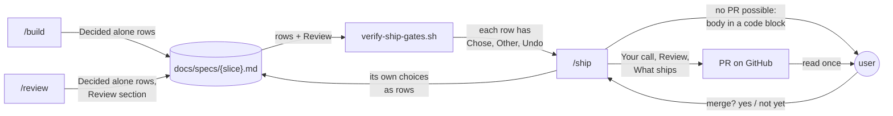

# Decision PR

**Version:** v1 · **Status:** Draft · **Type:** Enhancement · **Project type:** CLI/Library

**Shape doc:** docs/specs/ask-up-front/shape.md
**Depends on:** unattended-build

The PR that `/ship` opens starts with each choice made without you, then the
review result, then what ships. You make one informed decision at the merge
question, and the record of each choice stays in the spec.

## Problem

`/ship`'s rule for the PR body lists what ships, the scenarios, how to verify,
the flag and the page link (`skills/ship/SKILL.md:113`). It says nothing about
the choices that `/build`, `/review` or `/ship` made without you.

| Evidence | Source |
| --- | --- |
| PRs 80, 82, 84 and 86 start with a "Your call" table. Claude wrote each one by hand, from memory of the session. | `gh pr view` |
| Those tables hold choices that no spec row records, such as a test left red because `main` fails the same way. | PR 84, PR 86 |
| `/review` prints its findings to the terminal only. A `/ship` in a new session has no record of them. | `skills/review/SKILL.md:156` |
| The bodies were 356 to 550 words, without the bot summary. PR 78, before "Your call", was 240. | `gh pr view` |
| Two of your work repos are on gitlab.com. There `/ship` opens nothing and gives only the link from `git push`. The body is lost. | shape O8 |

## Slice test

| Check | Result |
| --- | --- |
| Cuts every layer it needs | yes. `/review` writes its result into the spec, the ship gate checks the rows, and `/ship` builds the body from both. |
| One e2e test walks it | yes. A contract test reads the `/ship` and `/review` text. The gate test runs `verify-ship-gates.sh` on a fixture spec. |
| Worth shipping alone | yes. The next PR shows each choice made without you, in the same place, also after a new session. |
| Fits (≤5 scenarios, ≤2 areas) | yes. 5 scenarios. Two areas: the ship stage, and the review result that it reads. |

**Path:** full. The PR body is an output format, and the change touches more
than three files.

## User story

As the person who runs zuko, I want the PR to start with each choice made
without me, so that I can read it once and decide at the merge question.

## Flow



`/build`, `/review` and `/ship` write each choice into the spec. The gate
checks each row, and `/ship` builds the body from the spec, not from memory.

## Acceptance criteria

```gherkin
Scenario: The choices made without you come first
  Given the spec export-csv is Built
  And O7 is Decided alone: "Chose: drop the VAT column. Other: add a VAT field to invoices. Undo: put back the old scenario 3, and add the field."
  And O9 is Decided alone: "Chose: store rows in Postgres, as D7 says. Other: supersede D7 through /spec. Undo: git revert 4e1f9a2."
  When /ship opens the PR on github.com
  Then the body starts with "## Your call" and a table with one row for O7 and one for O9
  And each row shows what was chosen, the other choice and how to undo it
  And "## Review" comes next, then "## What ships"
  And the body has 300 words or fewer without the Your call table

Scenario: Nothing was decided without you, in a repo with a PR template
  Given the spec export-csv has no Decided alone row
  And the repo has .github/pull_request_template.md with the headings "## Summary" and "## Testing"
  When /ship opens the PR
  Then the body starts with "## Your call" and the line "Nothing was decided without you."
  And "## Review" comes next, then "## Summary" and "## Testing", filled from the diff

Scenario: The review result survives a new session
  Given /review on export-csv found 7 raw findings, and 4 survived
  And it fixed each one in its own commit
  And it wrote the counts and one line for each fix into the spec's Review section
  When /ship runs in a new session
  Then "## Review" in the body says "7 raw findings, 4 survived, 4 fixed"
  And it has one line for each fix, with its commit

Scenario: /ship cannot open the PR
  Given the origin of the invoices repo is git@gitlab.com:acme/invoices.git
  When /ship has pushed the branch feat/export-csv
  Then it prints the full body in a code block, and the merge request link that git push printed
  And it says that it opened no merge request

Scenario: A row decided alone has no Undo
  Given O7 is Decided alone with "Chose: drop the VAT column. Other: add a VAT field to invoices." and no Undo
  When /ship runs verify-ship-gates.sh
  Then the gate fails and names O7 and the missing "Undo:"
  And /ship opens no PR until O7 has all three parts
```

## Scope

**In:**

- `/ship` builds the PR body in this order: Your call, Review, then what
  ships, how to verify and how to roll back, and the spec link.
- Your call is a table from the spec's `Decided alone` rows. No row → one line.
- `/ship` adds a `Decided alone` row for each choice that it makes alone, as
  `/build` and `/review` do.
- `/review` writes its result into the spec: the counts and one line for each
  fix. `/ship`'s "Review done" gate reads it.
- `verify-ship-gates.sh` fails a `Decided alone` row that lacks Chose, Other
  or Undo.
- A limit on the length of the body without the Your call table.
- With a PR template: Your call and Review go first, then the template's
  headings.
- When `/ship` cannot open the PR, it prints the body for you to paste.
- Contract tests, and new cases in `test-verify-ship-gates.sh`.

**Out:**

- A step that applies a row's Undo for you. You read the Undo and ask for it
  at the merge question, as today. No slice picks it up.
- Opening a GitLab merge request. GitLab was dropped on 2026-09-25 (shape,
  Not doing).
- `/ship` no longer asks before it pushes or merges. Your global rules keep
  both questions (shape, Not doing).
- Rows in specs that shipped before this slice. Their PRs are merged. No slice
  picks them up.

## Open items

| ID | What | Type | Raised at | Owner | Status | Answer |
| --- | --- | --- | --- | --- | --- | --- |
| O1 | Your work repos on gitlab.com get no PR from `/ship`. Print the PR body for you to paste there? (from shape O8) | question | shape | user | Resolved | Print the body. When `/ship` cannot open the PR, it prints the full body in a code block, and the link that `git push` printed. 2026-10-13 |
| O2 | `/review` prints its findings only to the terminal. Where does `/ship` get the Review section in a new session? | question | spec p1 | user | Resolved | `/review` writes a Review section into the spec: the counts, and one line for each fix with its commit. `/ship` copies it. With no section, the "Review done" gate fails and sends you to `/review`. 2026-10-13 |
| O3 | How long can the PR body be? The last four were 356 to 550 words. | question | spec p1 | user | Resolved | 300 words or fewer, without the Your call table. The table is never cut. `/ship` counts the words before it opens the PR. 2026-10-13 |
| O4 | Which choices go in Your call? PRs 84 and 86 listed choices that `/ship` made, which no spec row records. | question | spec p1 | user | Resolved | Every `Decided alone` row. `/ship` adds a row for each choice that it makes alone, so the spec stays the one record. 2026-10-13 |
| O5 | The repo has a PR template. Where do Your call and Review go? | question | spec p1 | user | Resolved | Your call and Review come first. The template's headings follow in its order, filled from the diff. 2026-10-13 |
| O6 | A `Decided alone` row lacks its Chose, Other or Undo part. What does `/ship` do? (from unattended-build O8) | question | spec p1 | user | Resolved | `verify-ship-gates.sh` fails and names the row and the missing part. `/ship` completes the row and runs the gate again. No PR opens before that. 2026-10-13 |

_Never delete this section or its rows. See references/ledger.md._

## Glossary

- **Ledger** — the Open items table in a spec. Rows are resolved, never
  deleted.
- **Decided alone row** — a ledger row that `/build`, `/review` or `/ship`
  adds for a choice made without you. Its Answer says Chose, Other and Undo.
- **e2e** — end-to-end: one test that walks the whole slice.
- **PR template** — a file such as `.github/pull_request_template.md` that
  GitHub copies into each new PR body.
- **Merge request** — GitLab's name for a pull request.
