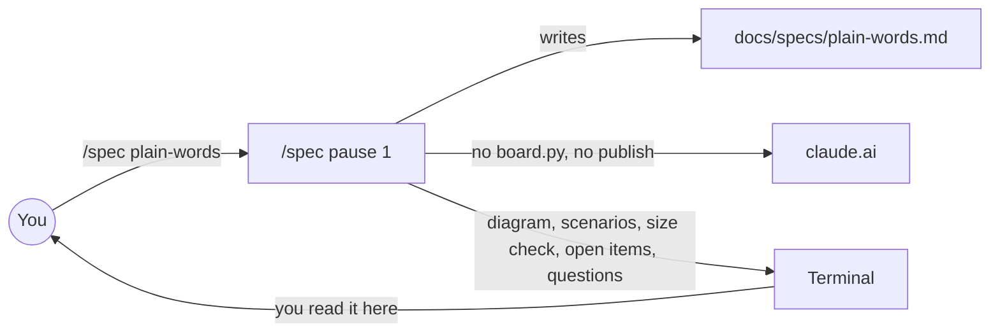
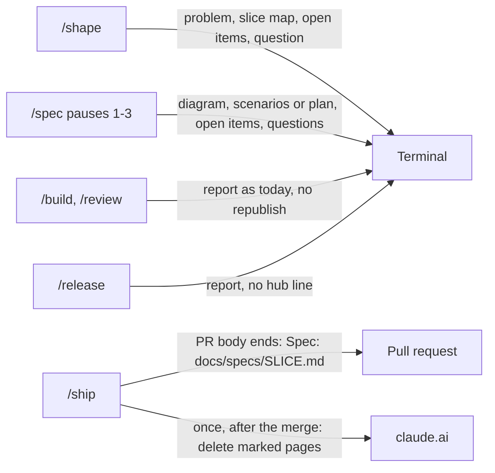
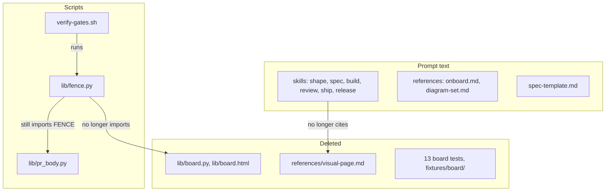
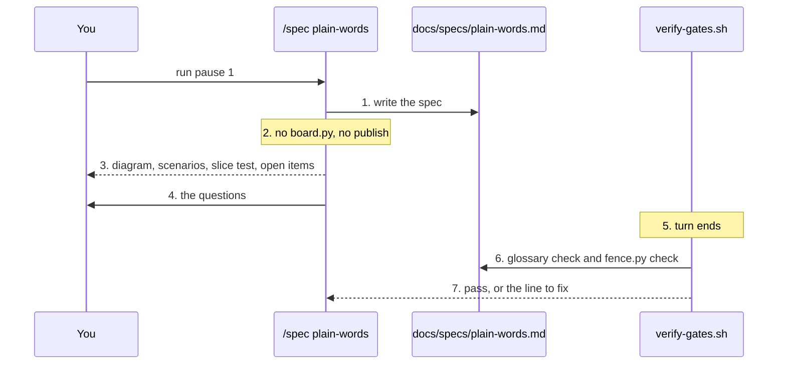

# drop-board

**Version:** v1 · **Status:** Built · **Type:** Enhancement · **Project type:** CLI/Library

**Shape doc:** docs/specs/goal-thread/shape.md
**Depends on:** None

No zuko stage publishes a claude.ai page any more: not the idea board, not the hub, not the spec page. Each stage shows its full stop in the terminal instead, and the 35 pages that exist today are deleted.

**Goal (from the shape):** you keep each idea's goal in sight from `/shape` to `/ship`, and you understand every zuko reply well enough to decide. This slice helps Done when points 1 and 4: it puts the context back into the terminal, where later slices can add the goal.

## Problem

zuko publishes a claude.ai page at the end of `/shape`, at each `/spec` pause, and after `/build`, `/review`, `/ship` and `/release`. The user never opens these pages, and calls them a waste of time and tokens. Since the rule that a pause prints only the board link (D67), the terminal at a pause shows only that link, one diagram and the questions. So the scenarios, the size check and the open items sit on a page that the user does not read.

## Slice test

| Check                         | Result |
| ----------------------------- | ------ |
| Cuts every layer it needs     | yes. The skill steps, the scripts, the tests, and the templates and docs that link to pages. |
| One e2e test walks it         | yes. One contract test reads every skill and reference, runs the fence check without `board.py`, and checks the templates. |
| Worth shipping alone          | yes. Every stage stops spending a publish call, and every pause shows its content in the terminal. |
| Fits (≤5 scenarios, ≤2 areas) | yes. 5 scenarios. Two areas: the skill and reference text, and the scripts with their tests. |

**Path:** full. The change touches many files, and it removes scripts and decisions.

## Flow



You run `/spec plain-words`, and pause 1 writes the spec file. It skips the board script and the publish. It prints the whole stop in the terminal, so you read everything where you already are.

A walk-through, for one real run after this slice ships:

1. You run `/spec plain-words`.
2. zuko writes `docs/specs/plain-words.md`, the same as today.
3. Today it would now run `board.py`, publish a claude.ai page, and print only the link. After this slice it does neither.
4. The terminal shows the flow diagram, the scenarios, the size check and the open items, then the questions. This is the print that zuko already uses today when no board exists.
5. Later, `/ship drop-board` opens its PR. The PR body ends with `Spec: docs/specs/drop-board.md` and no page link.

Analogy: this is like cancelling a newspaper that you never read. The paper stops coming, and the old stack on the porch is cleared away. Where it stops working: a newspaper brings news you cannot get anywhere else, but every fact on the board already lives in the spec files.

## Acceptance criteria

```gherkin
Scenario: a spec pause prints its full stop and publishes nothing
  Given docs/specs/goal-thread/shape.md lists the slice plain-words
  When you run /spec plain-words and it reaches pause 1
  Then no claude.ai page is published and board.py does not run
  And no file is written under docs/specs/.pages/
  And the terminal shows the flow diagram, the 5 scenarios, the size check and the open items before the questions

Scenario: /shape ends with no board and no hub
  Given a repo with OVERVIEW.md at Status Active
  When you run /shape share-reports and it writes docs/specs/share-reports/shape.md
  Then no idea board and no hub page are published
  And the shape has no "**Board:**" line, and OVERVIEW.md gets no "hub page:" link
  And the terminal shows the problem, the slice map and the open items before the last question

Scenario: /ship opens a PR with no page links
  Given docs/specs/drop-board.md is at Status Built and its review is done
  When you run /ship drop-board and it opens the PR
  Then the PR body's last line is "Spec: docs/specs/drop-board.md", with no Page and no Board part
  And the OVERVIEW.md Slices table has the columns Slice, Status and What it does, and no Page column

Scenario: the unclosed-fence check still works without board.py
  Given plugins/zuko/scripts/lib/board.py no longer exists
  And docs/specs/plain-words.md has a code block that opens with three backticks and never closes
  When the turn ends and the spec gate runs
  Then the gate fails, and names docs/specs/plain-words.md and the line where the block opens

Scenario: you choose which old pages go, and zuko deletes them after the merge
  Given the repo links 35 claude.ai pages: 26 spec pages, 3 boards, 1 hub and 5 pages that the living-board specs name in their text
  And your account has 11 pages titled "Idea board"
  When /ship drop-board prepares the PR
  Then it lists those pages as sure, and every other web page in your account as maybe
  And it lists no Design, Design System or Docs artifact
  And you mark each page keep or delete
  And the PR removes the repo's links to the pages marked delete, and keeps the links to the pages marked keep
  When the PR merges
  Then each page marked delete is deleted, and a page that is already gone is reported as gone
```

## Scope

**In:**

- Remove the publish steps from `/shape`, `/spec`, `/build`, `/review`, `/ship` and `/release`.
- Delete `references/visual-page.md`, `scripts/lib/board.py`, `scripts/lib/board.html`, and the board, library, replay and PR card tests with their fixtures.
- Give `fence.py` its own fence helper, so the unclosed-fence check keeps working.
- Remove the `**Page:**` line from the spec template, the board line from the PR body, the Page column from `OVERVIEW.md`, and the `hub page:` link.
- Remove each old `**Page:**` and `**Board:**` line, and put "(page deleted)" in place of each link in the living-board specs. A link to a page marked keep stays.
- Remove the onboarding step that adds `docs/specs/.pages/` to `.gitignore`.
- Retire the board decisions (D62 to D74, D77 and D108) with 15 new entries, D163 to D177.
- Before the PR, list the 35 linked pages and the 11 "Idea board" pages as sure, and the account's other web pages as maybe. Never list a Design, Design System or Docs artifact. You mark each page keep or delete.
- After the PR merges, delete each page marked delete.

**Out:**

- The four-part reply (Goal, Where we are, Your call, Next). cto-brief picks it up.
- The goal line in replies and files. idea-goal picks it up.
- The table of each scenario next to its test, in the PR body. goal-check picks it up.
- New words or wording rules. plain-words picks them up.

## Interface

This slice changes what six stages print, two templates, and the PR body. It adds one step that runs once: the page clean-up at the end of `/ship drop-board`.



Every stage prints to the terminal or the PR, and only the one-time clean-up talks to claude.ai.

### What each stage prints

| Stage | Today | After |
| ----- | ----- | ----- |
| `/shape` end | Board line, slice map, the question | The problem in two sentences, the slice map, the open items, the design-system note when it applies, the question |
| `/spec` pause 1 | Board line, flow diagram, the questions | The flow diagram, the scenarios, the slice test, the open items, the questions |
| `/spec` pause 2 | Board line, interface map, preview link, the questions | The interface map, the preview link and the design system it used, the questions |
| `/spec` pause 3 | Board line, Approach diagram, one line with the spec, the page and the riskiest choice | The Approach diagram, one line with the spec path and the riskiest choice, the ledger, the drafted decisions, "/build is next" |
| `/build`, `/review` | Report, then a republish of the board | Report only |
| `/ship` | PR body ends `Spec: … · Page: … · Board: …` | PR body ends `Spec: docs/specs/{slice}.md` |
| `/release` | Step 6 republishes the hub. The report ends `overview  Release: v2.2.0 · hub page republished` | No step 6. The report ends `overview  Release: v2.2.0` |

### Templates and docs

- The spec template has no `**Page:**` line.
- The OVERVIEW.md Slices table has three columns: `| Slice | Status | What it does |`.
- The OVERVIEW.md `## More` line has no `hub page:` link.
- Onboarding no longer adds `docs/specs/.pages/` to `.gitignore`.

### The one-time clean-up in `/ship drop-board`

Before the PR, `/ship` prints the list. The counts below are rough figures from the account list on 2026-11-26. `/ship` counts again on the day, because new boards still appear.

```text
Old zuko pages. Each page in "Sure" is deleted unless you keep it.
Each page in "Maybe" is kept unless you delete it.

Sure (43): linked from this repo, or titled "Idea board"
   1. Idea board               claude.ai/artifact/6ZvDtf…   docs/specs/living-board/shape.md
   2. Gate card preview        claude.ai/artifact/33X27L…   docs/specs/gate-card.md
  ...
Maybe (58): other web pages in your account
  44. Walking skeleton screens claude.ai/artifact/1bdipn…
  ...
Not listed: 23 Design, Design System and Docs artifacts.

Reply with the numbers to change, such as "keep 2, delete 44-46", or "none".
```

After the merge, it deletes the marked pages, one confirm each, and prints:

```text
Deleted 41 · already gone 1 · kept 2 · could not delete 0
  could not delete: none

Deleted links. Search your other repos for these:
  claude.ai/artifact/6ZvDtf657jw6ohs94cyYvs  Idea board
  ...
```

A page that fails to delete is named with the error, and the step goes on to the next page.

## Technical plan

### Approach

Remove every publish step from the six stage skills, and delete the board code, its reference and its tests. `fence.py` gets its own copy of the one helper that it took from `board.py`. The 35 linked pages and the "Idea board" pages are not code: `/ship drop-board` cleans them up once, by hand from this spec, after the merge.

Relies on: D35 (the Stop hooks judge only the docs this work touched), D76 (the fence check runs in the Stop hook), D163 to D177 (drafted below).



The skills stop citing `visual-page.md`, and `fence.py` stops importing `board.py`. After that, nothing reaches the deleted files, and the spec gate still runs the fence check.



A walk-through of one run after the build:

1. You run `/spec plain-words`, and pause 1 writes `docs/specs/plain-words.md`.
2. The skill has no publish step any more, so `board.py` never runs and nothing goes to claude.ai.
3. The terminal shows the flow diagram, the scenarios, the slice test and the open items.
4. The question prompt follows.
5. The turn ends, and the Stop hook runs `verify-gates.sh`.
6. The gate runs the glossary check, then `fence.py`, which now uses its own fence helper.
7. The gate passes, or it names the line to fix.

Analogy: this is like taking a satellite TV dish off a house. You cut the cable at the wall, and you check that the one plug that shared the cable, here `fence.py`, still has power. Where it stops working: a dish can go back up the next day, but a deleted claude.ai page cannot come back. That is why the pages go only after you mark each one, and only after the merge.

### Changes

| File | What changes | Why |
| ---- | ------------ | --- |
| `plugins/zuko/skills/shape/SKILL.md:160-183` | Delete the idea board and hub publish steps and the Board line. Keep the no-board print: the problem, the slice map, the open items, the design-system note, the question. | Scenario 2 |
| `plugins/zuko/skills/spec/SKILL.md:76-93` | Delete the pause 1 board step and the Board-only print. Keep the print of the diagram, scenarios, slice test and open items. | Scenario 1 |
| `plugins/zuko/skills/spec/SKILL.md:184-197` | Delete the pause 2 board step and the Board-only print. Keep the interface map, the preview link and the design system name. | Scenario 1 |
| `plugins/zuko/skills/spec/SKILL.md:257-285` | Delete "Publish the visual page", the pause 3 board step and the Board-only print. The one line names the spec path and the riskiest choice, with no page link. | Scenario 1 |
| `plugins/zuko/skills/build/SKILL.md:141-144` | Delete the republish of the idea board. | Scenario 1 |
| `plugins/zuko/skills/review/SKILL.md:271-274` | Delete the republish of the idea board. | Scenario 1 |
| `plugins/zuko/skills/ship/SKILL.md:36-38, 75-81, 117, 247` | Delete the hub reason in "take the base first", the hub and board republish, the republish before a reroute, and the hub link in the close-out text. | Scenario 3 |
| `plugins/zuko/skills/ship/SKILL.md:151-154` | The PR body's last line is `Spec: docs/specs/{slice}.md`. Delete the Page and Board parts. | Scenario 3 |
| `plugins/zuko/skills/release/SKILL.md:438, 446-452, 464` | Delete step 6 (the hub page), and make step 7 the new step 6. "Steps 6 and 7 use it" becomes "Step 6 uses it". The report's overview line drops "· hub page republished". | No page is published |
| `plugins/zuko/skills/spec/references/spec-template.md:8` | Delete the `**Page:**` line. | Scenario 3 |
| `plugins/zuko/references/onboard.md:70, 105, 129, 328-331` | Stop reading `**Page:**` lines, drop the Page column from the OVERVIEW template, drop the `hub page:` link, and delete step 7 (ignore the pages folder). Renumber steps 8 and 9 to 7 and 8, with each "step 8" and "step 9" in the file. | Scenario 2 |
| `plugins/zuko/references/diagram-set.md:52-56` | Mermaid renders in the Markdown viewer and on GitHub. Delete the published-page line. | No page is published |
| `plugins/zuko/references/visual-page.md` | Delete the file. | No stage cites it |
| `plugins/zuko/scripts/lib/fence.py:9, 27, 43` | Add its own `closes()`, with the same three lines as `board.py:147-151`, and drop `import board`. | Scenario 4 |
| `plugins/zuko/scripts/lib/board.py`, `board.html` | Delete the files. | Nothing imports them |
| `plugins/zuko/scripts/tests/` | Delete `test-board.sh`, `test-board-dom.sh`, `test-e2e-board.sh`, `test-idea-board.sh`, `test-library.sh`, `test-e2e-library.sh`, `test-replay.sh`, `test-e2e-replay.sh`, `test-pr-card.sh`, `test-e2e-pr-card.sh`, `test-gate.sh`, `test-e2e-gate.sh`, `test-gate-steps.sh` and `fixtures/board/`. | They test only the board |
| `plugins/zuko/scripts/tests/test-shipped-in-pr.sh`, `test-decision-pr.sh`, `test-ascii-terminal.sh`, `test-e2e-utf8-stdio.sh` | Drop the hub, Page, Board, `visual-page.md` and `board.py` checks. Keep every other check. | They check text that this slice changes |
| `plugins/zuko/scripts/tests/test-drop-board.sh` (new) | The contract test, written first. | Scenarios 1 to 4 |
| `OVERVIEW.md` | Drop the Page column and the `hub page:` link. Set the Status of the 6 board rows (idea-board, gate-card, pr-gate, library, replay, slice-name-path) to `Removed`. | Scenario 3 |
| `DECISIONS.md` | `/build` appends the entries drafted below, and flips each old Status line. | D163 to D177 |

Reusing: `pr_body.FENCE`, which `fence.py` already imports. The `section` and `expect_*` helpers in `tests/run.sh`, which the contract test uses as `test-decision-pr.sh` does.

Not changed: `.gitignore` keeps its `docs/specs/.pages/` line, because old local copies still sit in that folder. `docs/security/coverage.md` is not edited: `coverage.py` builds its units from the files that git tracks, so the release after this one drops `board.py`. I read that in `coverage.py:30-35`, but I did not run a cut.

### Earn-it

| Added | Triggered by |
| ----- | ------------ |
| `test-drop-board.sh` | Scenarios 1 to 4. A missed publish step in plain words is the main risk, and only a text check finds it. |
| `closes()` in `fence.py` | Scenario 4. It is three lines, so `fence.py` keeps working with `board.py` gone. |

### Non-functionals

|                      |                                                                               |
| -------------------- | ----------------------------------------------------------------------------- |
| **Load**             | No runtime load. Each stage stop does one less script run and one less publish call. |
| **Breaks first**     | Nothing scales here. |
| **Security surface** | It removes `board.py`, which had a known low A01:2025 issue (`docs/security/v2.5.0/report.md`). The clean-up deletes artifacts in your account, only after you mark each one and confirm each delete. It never lists a Design, Design System or Docs artifact. |
| **Proof it works**   | At the next real `/spec` stop, the reply has no `Board:` line, and your claude.ai artifact count stays the same. |
| **Rollout**          | No flag: this is prompt text and deleted code. `git revert` of the merge brings back the code. A deleted page cannot come back, which is why the clean-up runs only after the merge. |

### Test plan

| Scenario | Test | Command |
| -------- | ---- | ------- |
| 1. A spec pause publishes nothing | `test-drop-board.sh`: no file under `skills/`, `references/` or `agents/` names `board.py`, `visual-page.md`, "idea board", "hub page" or `.pages/` | `bash plugins/zuko/scripts/tests/run.sh drop-board` |
| 2. `/shape` ends with no board and no hub | `test-drop-board.sh`: the shape skill's end has no publish step, and `onboard.md` has no Page column, no `hub page:` link and no pages-folder step | `bash plugins/zuko/scripts/tests/run.sh drop-board` |
| 3. `/ship` opens a PR with no page links | `test-drop-board.sh`: the ship skill's last line is `Spec: docs/specs/{slice}.md`, the template has no `**Page:**`, and OVERVIEW.md's Slices header is `Slice, Status, What it does` | `bash plugins/zuko/scripts/tests/run.sh drop-board` |
| 4. The fence check works without `board.py` | `test-drop-board.sh`: copy `lib/` with no `board.py` to a scratch folder, and run `fence.py check` on a spec with an unclosed block. It names the line. | `bash plugins/zuko/scripts/tests/run.sh drop-board` |
| 5. The page clean-up | By hand in `/ship drop-board`: the printed summary of deleted, gone, kept and failed pages | — |

**E2E:** `test-drop-board.sh`, scenario 4 part. It runs the real `fence.py` with `board.py` absent. The full suite must stay green: `bash plugins/zuko/scripts/tests/run.sh`.

### Chunks

Single chunk. Most of the work is deleting and editing text, and the test edits read the skill text that the same chunk changes.

### Risks

| Risk | Mitigation |
| ---- | ---------- |
| The installed plugin, 2.7.0, still has the publish steps. A session that runs `/ship drop-board` from it would try to republish the hub and the board. | At `/ship drop-board`, skip each publish step by hand, as this spec says. The lesson in `docs/learnings/installed-plugin-lags-the-repo.md` covers why. |
| A publish step written in other words survives, and a stage tries to run a script that is gone. | `test-drop-board.sh` checks for each name and phrase that the steps use today. |
| fix/target-wrappers already holds D160 to D162, and is not merged yet. Another session can take D163 first. | These entries start at D163. `/build` renumbers the drafted entries from the highest D-number in `DECISIONS.md` on the day, as `/build` step 1 says. |
| The clean-up deletes a page that you still use. | "Maybe" pages default to keep. You mark each page, and the Artifact tool asks again before each delete. |

### Decisions to record

Recorded as D163 to D177.

## Review

2026-11-27 · 3 raw findings, 0 survived. Clean.

## Open items

| ID  | What | Type     | Raised at | Owner | Status | Answer |
| --- | ---- | -------- | --------- | ----- | ------ | ------ |
| O1  | 26 old specs have a `**Page:**` line, 3 shapes have a `**Board:**` line, and 5 living-board specs name a page in their text. Once the pages are deleted, these links are dead. What happens to them? | question | spec p1 | user | Resolved | Remove the link lines. In the living-board specs, put "(page deleted)" in place of each link. A link to a page marked keep stays, as O4 says. 2026-11-26 |
| O2  | When does the delete step for the 35 pages run? | question | spec p1 | user | Resolved | After the PR merges, as the last step of `/ship`. If the PR is dropped, the pages stay. 2026-11-26 |
| O3  | zuko also published pages from your other projects. Does the delete step cover them? | question | spec p1 | user | Resolved | The whole account. The 35 linked pages and the 11 "Idea board" pages are listed as sure, and the other web pages as maybe. No Design, Design System or Docs artifact is listed. 2026-11-26 |
| O4  | You decline to delete one page. What happens to its link in the repo? | question | spec p1 | user | Resolved | The user marks each page keep or delete before `/ship` opens the PR. The PR removes only the links to pages marked delete. 2026-11-26 |
| O5  | How does the user mark pages in the clean-up list? | question | spec p2 | user | Resolved | With one reply of numbers. "Sure" pages default to delete and "Maybe" pages default to keep. 2026-11-26 |
| O6  | Other projects' files still link the deleted pages. What happens to those links? | question | spec p2 | user | Resolved | The clean-up prints each deleted page's link, so the user can search the other repos. The files there are not changed. 2026-11-26 |
| O7  | `DECISIONS.md` lets one new entry supersede only one old entry, and `decisions.py` checks the pair. The board has 15 entries: D62 to D74, D77 and D108. How are they retired? | question | spec p3 | user | Resolved | 15 entries. D163 replaces D67, and D164 to D177 each retire one other entry. `decisions.py` checks each pair. 2026-11-26 |
| O8  | The 6 board slices in OVERVIEW.md are Shipped, so the README's Features list still says "each idea gets one claude.ai board". What happens to those rows? | question | spec p3 | user | Resolved | Their Status becomes `Removed`. OVERVIEW keeps them as history, and the README lists only Shipped rows (`readme_block.py:176-180`). `/build` checks that no other reader of OVERVIEW refuses the new status. 2026-11-26 |
| O9  | Scenarios 1 and 2 are prompt text. The contract test proves the text, not what a stage prints. How is the behaviour proven? | unproven | spec p3 | user | Accepted risk | The contract test proves the text. The behaviour is checked by hand at `/spec plain-words` pause 1, after the plugin update: no Board line, and no new artifact. A deleted step cannot be followed, so the risk is low. 2026-11-26 |
| O10 | Four files the plan did not name still said zuko renders or publishes a board: `references/voice.md` ("published pages"), `docs/ARCHITECTURE.md` (the `board.py` part of the scripts row), and the "What it does" text of the Shipped rows unclosed-fence, utf8-stdio and windows-paths in `OVERVIEW.md`, which `README.md` copies. | flag | build | user | Decided alone | Chose: drop the board words from each, re-render the README block, and add "published page" to the words `test-drop-board.sh` searches for. Other: leave them as written when those slices shipped. Undo: `git revert 3e057ad` brings them back with the rest of the slice; to keep only these lines, put back the old text in the four files. 2026-11-27 |
| O11 | Renumbering `/release` step 7 to 6 broke `test-e2e-pentest.sh`, which matched "One yes covers steps 2 to 7". Three other tests (coverage-ledger, needs-validation, strix-code) named "the step 7 report" in their labels. | flag | build | user | Decided alone | Chose: change each to step 6. Other: keep the old numbers and leave a gap at step 6 in the skill. Undo: put back "7" in the four test files and "### 7. Report" in `release/SKILL.md`. 2026-11-27 |
| O12 | The plan named no commit type. `refactor` and `docs` commits add no CHANGELOG line and propose no release (D3), so the installed plugin would keep publishing. | flag | build | user | Decided alone | Chose: `feat:` for 3e057ad, so `/release` proposes a minor version. Other: `feat!:` for a major version, because the board is a feature that goes away. Undo: reword the squash subject to `feat!:` when `/ship` opens the PR. 2026-11-27 |

_Never delete this section or its rows. See references/ledger.md._

## Glossary

- **e2e** — end-to-end: one test that walks the whole slice as a user would.
- **Contract test** — a test that reads the skill text and checks that a rule is written there.
- **Idea board** — the claude.ai page that `/shape` published for one idea, republished by every stage.
- **Hub page** — the claude.ai page that listed every idea and linked to its board.
- **Spec gate** — the check script that runs on shape and spec files when a turn ends.
- **D67** — the entry in `DECISIONS.md` that says a pause prints only the board link, one diagram and the questions.
