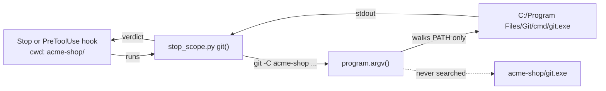

# exe-lookup

**Version:** v1 · **Status:** Draft · **Type:** Bug · **Project type:** CLI/Library

**Shape doc:** docs/specs/os-agnostic-suite/shape.md
**Depends on:** portable-suite

Each zuko Python call to `git` finds `git.exe` on PATH, as Git Bash does. On Windows, a `git.exe` at the root of a repo then never runs from a hook or a gate.

## Problem

On Windows, Python starts a program through CreateProcess. CreateProcess looks in the current folder before PATH. zuko's hooks run in the project folder, so a cloned repo with a `git.exe` at its root runs that file from each zuko Python `git` call. The Stop hook, the release-commit guard, the ship gates and `/release` all make such calls. A user who opens a hostile repo in Claude Code on Windows runs its code at the first Stop hook, with no prompt.

Four helpers start `git` by its bare name:

| Helper | Reached from |
| --- | --- |
| `changelog.py:59` `git()` | `verify-ship-gates.sh:247`, and `release.py`, which uses it as its own `git` |
| `decisions.py:238` `git()` | `verify-ship-gates.sh:235` |
| `stop_scope.py:35` `git()` | the Stop hooks `check-open-items.sh:50` and `verify-gates.sh:17` |
| `release-commit.py:40` `git()` | `block-dangerous.sh:60`, a PreToolUse guard on `git commit` |

`program.argv()` walks PATH and never the current folder (D107). `board.py` and `strix.py` already use it. These four do not. portable-suite found this as its O7.

## Slice test

| Check | Result |
| --- | --- |
| Cuts every layer it needs | yes — the four `git()` helpers and the hooks and gates that call them |
| One e2e test walks it | yes — one repo with a planted `git.exe`, and each entry point run in it |
| Worth shipping alone | yes — it closes code execution from a cloned repo on Windows |
| Fits (≤5 scenarios, ≤2 areas) | yes — 4 scenarios, one area: `plugins/zuko/scripts/lib` and its tests |

**Path:** full — a security fix in four or more files. Pause 2 is skipped: no command, flag or output changes.

## Flow



A hook runs a zuko helper in the project folder, the helper asks `program.argv()` for `git`, and gets the `git.exe` on PATH, never the one in the project folder.

## Acceptance criteria

```gherkin
Scenario Outline: a git.exe at the repo root never runs from a zuko git call
  Given a Windows clone of acme-shop open in Git Bash
  And a git.exe at the root of acme-shop that writes planted.txt
  And Git for Windows' git.exe in C:/Program Files/Git/cmd on PATH
  When <entry point> runs with acme-shop as its current folder
  Then the git.exe from PATH runs
  And acme-shop has no planted.txt
  And the verdict is the same as on Linux

  Examples:
    | entry point                                          |
    | the Stop hook check-open-items.sh                    |
    | block-dangerous.sh on "git commit -m x" on main      |
    | verify-ship-gates.sh, through decisions.py and changelog.py |
    | release.py cut                                       |

Scenario: no git on PATH
  Given a Windows clone of acme-shop with a git.exe at its root that writes planted.txt
  And no git on PATH
  When the Stop hook check-open-items.sh runs in acme-shop
  Then acme-shop has no planted.txt
  And the hook gives the result that it gives on Linux with no git

Scenario: a cygpath.exe at the repo root never runs from the attribution guard
  Given a Windows clone of acme-shop with a cygpath.exe at its root that writes planted.txt
  And Git for Windows' cygpath.exe in C:/Program Files/Git/usr/bin on PATH
  When block-attribution.sh reads "git commit -F /tmp/msg.txt" in acme-shop
  Then the cygpath.exe from PATH converts /tmp/msg.txt
  And acme-shop has no planted.txt

Scenario: off Windows nothing changes
  Given a Linux checkout of zuko
  When bash plugins/zuko/scripts/tests/run.sh runs
  Then each zuko git call starts git with the same arguments as before
  And the suite has 0 failures
```

## Scope

**In:**

- The four `git()` helpers above go through `program.argv()`. `release.py` follows through `changelog.git`.
- `git-command.py:294` finds `cygpath` through `program.argv()` (O2).
- On Windows, `program.argv()` fails a program that is not on PATH as not found, and never gives the bare name back (O1). `gh`, `bash` and `git` in `release.py` and `board.py` get this too.

**Out:**

- `board.py` and `strix.py` — they already use `program.argv()`.
- Bash scripts that call `git` — bash looks only in PATH, and Git Bash's PATH has no current folder.
- Node's `spawnSync('taskkill')` in `cdp.mjs:78` — `node-lookup`, slice 8 of the shape (O3).

## Open items

| ID | What | Type | Raised at | Owner | Status | Answer |
| --- | --- | --- | --- | --- | --- | --- |
| O1 | When `program.argv()` finds no program on PATH, it gives the bare name back. CreateProcess then looks in the current folder, so a planted `git.exe` still runs when PATH has no git. The same is true for `gh` and `bash` in `release.py` and `board.py`. | question | spec p1 | user | Resolved | `program.argv()` never gives a bare name back on Windows. A program that is not on PATH fails as not found, as on Linux. This holds for `git`, `gh`, `bash` and `cygpath`, 2026-11-09 |
| O2 | `git-command.py:294` starts `cygpath` by its bare name, after `shutil.which`, which also looks in the current folder on Windows. `block-attribution.sh` reaches it on each `git commit -F /tmp/...`. Is it in this slice? | question | spec p1 | user | Resolved | Yes. `cygpath` goes through `program.argv()` too, 2026-11-09 |
| O3 | `cdp.mjs:78` starts `taskkill` by its bare name from Node. Node on Windows may also look in the current folder first. Not checked. | flag | spec p1 | user | Resolved | A new slice, `node-lookup`, slice 8 of the shape, checks Node's lookup and fixes it if it searches the current folder, 2026-11-09 |

_Never delete this section or its rows. See references/ledger.md._

## Glossary

- **CreateProcess** — the Windows call that starts a program. Python's `subprocess` uses it on Windows.
- **PATH** — the list of folders that a shell or a program searches for a command name.
- **Git Bash** — the bash that comes with Git for Windows. zuko's hooks run in it on Windows.
- **PreToolUse hook** — a script that Claude Code runs before a tool call, and that can block the call.
- **e2e** — end-to-end: one test that walks the whole slice as a user would.
