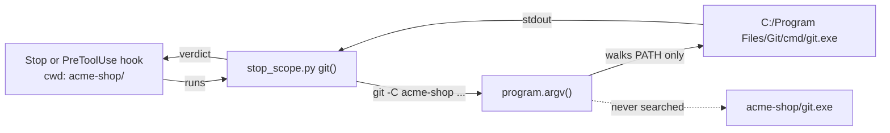
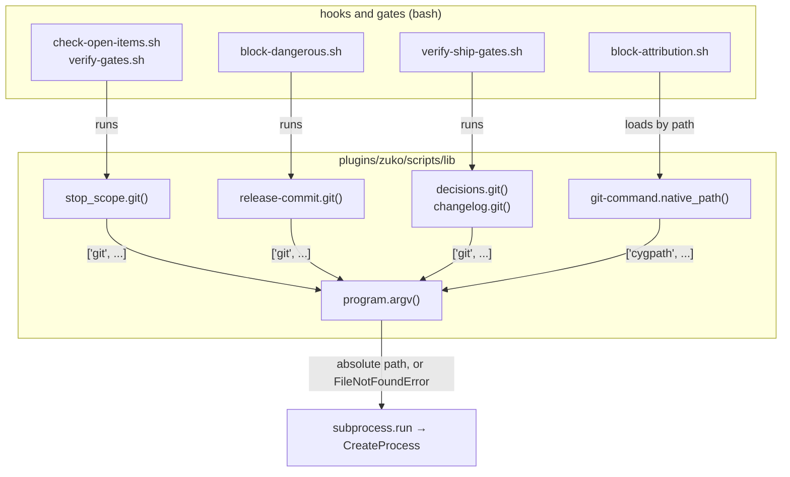
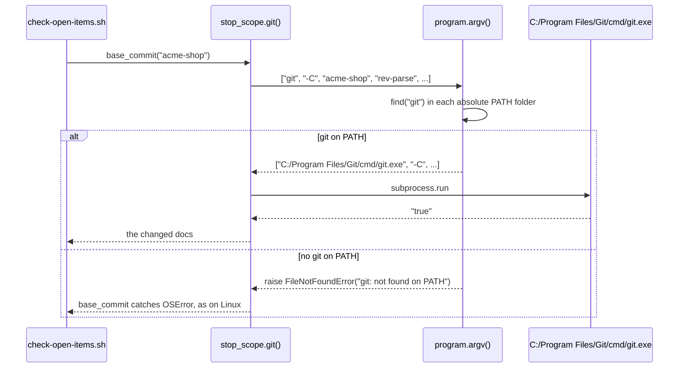

# exe-lookup

**Version:** v1 · **Status:** Built · **Type:** Bug · **Project type:** CLI/Library

**Shape doc:** docs/specs/os-agnostic-suite/shape.md
**Depends on:** portable-suite

Each zuko Python call to `git` finds `git.exe` on PATH, as Git Bash does. On Windows, a `git.exe` at the root of a repo then never runs from a hook or a gate.

## Problem

On Windows, Python starts a program through CreateProcess. CreateProcess looks in the current folder before PATH. zuko's hooks run in the project folder, so a cloned repo with a `git.exe` at its root runs that file from each zuko Python `git` call. The Stop hook, the release-commit guard, the ship gates and `/release` all make such calls. A user who opens a hostile repo in Claude Code on Windows runs its code at the first Stop hook, with no prompt.

Four helpers start `git` by its bare name:

| Helper | Reached from |
| --- | --- |
| `changelog.py:59` `git()` | `verify-ship-gates.sh:247`, and `release.py`, which uses it as its own `git` |
| `decisions.py:238` `git()` | `verify-ship-gates.sh:235` |
| `stop_scope.py:35` `git()` | the Stop hooks `check-open-items.sh:50` and `verify-gates.sh:17` |
| `release-commit.py:40` `git()` | `block-dangerous.sh:60`, a PreToolUse guard on `git commit` |

`program.argv()` walks PATH and never the current folder (D107). `board.py` and `strix.py` already use it. These four do not. portable-suite found this as its O7.

## Slice test

| Check | Result |
| --- | --- |
| Cuts every layer it needs | yes — the four `git()` helpers and the hooks and gates that call them |
| One e2e test walks it | yes — one repo with a planted `git.exe`, and each entry point run in it |
| Worth shipping alone | yes — it closes code execution from a cloned repo on Windows |
| Fits (≤5 scenarios, ≤2 areas) | yes — 4 scenarios, one area: `plugins/zuko/scripts/lib` and its tests |

**Path:** full — a security fix in four or more files. Pause 2 is skipped: no command, flag or output changes.

## Flow



A hook runs a zuko helper in the project folder, the helper asks `program.argv()` for `git`, and gets the `git.exe` on PATH, never the one in the project folder.

## Acceptance criteria

```gherkin
Scenario Outline: a git.exe at the repo root never runs from a zuko git call
  Given a Windows clone of acme-shop open in Git Bash
  And a git.exe at the root of acme-shop that is not Git
  And Git for Windows' git.exe in C:/Program Files/Git/cmd on PATH
  When <entry point> runs with acme-shop as its current folder
  Then the git output that it reads comes from the git.exe on PATH
  And the verdict is the same as on Linux

  Examples:
    | entry point                                          |
    | the Stop hook check-open-items.sh                    |
    | block-dangerous.sh on "git commit -m x" on main      |
    | verify-ship-gates.sh, through decisions.py and changelog.py |
    | release.py cut                                       |

Scenario: no git on PATH
  Given a Windows clone of acme-shop with a git.exe at its root that is not Git
  And no git on PATH
  When stop_scope.py asks git for its version in acme-shop
  Then the call raises FileNotFoundError for git, with "not found on PATH"
  And the git.exe at the root of acme-shop does not run

Scenario: a cygpath.exe at the repo root never runs from the attribution guard
  Given a Windows clone of acme-shop with a cygpath.exe at its root that is not cygpath
  And Git for Windows' cygpath.exe in C:/Program Files/Git/usr/bin on PATH
  When block-attribution.sh reads "git commit -F /tmp/msg.txt" in acme-shop
  Then the cygpath.exe from PATH converts /tmp/msg.txt to a C:/ path

Scenario: off Windows nothing changes
  Given a Linux checkout of zuko
  When bash plugins/zuko/scripts/tests/run.sh runs
  Then each zuko git call starts git with the same arguments as before
  And the suite has 0 failures
```

## Scope

**In:**

- The four `git()` helpers above go through `program.argv()`. `release.py` follows through `changelog.git`.
- `git-command.py:294` finds `cygpath` through `program.argv()` (O2).
- On Windows, `program.argv()` fails a program that is not on PATH as not found, and never gives the bare name back (O1). `gh`, `bash` and `git` in `release.py` and `board.py` get this too.

**Out:**

- `board.py` and `strix.py` — they already use `program.argv()`.
- Bash scripts that call `git` — bash looks only in PATH, and Git Bash's PATH has no current folder.
- Node's `spawnSync('taskkill')` in `cdp.mjs:78` — `node-lookup`, slice 8 of the shape (O3).
- The project folder on `sys.path` in each `python3 -c` and `python3 -` hook — `hook-import-path` (O5).

## Technical plan

### Approach

Each of the five bare calls goes through `program.argv()`, which already walks PATH and skips the current folder (D107). `argv()` then stops giving a bare name back on Windows. A program that is not on PATH raises `FileNotFoundError` from inside the `subprocess.run(...)` line, so each caller's own `except` runs, as when Linux has no such program.

Relies on: D107, D118, D119 (drafted below)



Each hook runs a helper, each helper hands its argument list to `program.argv()`, and only an absolute path reaches CreateProcess.



On the main path, the Stop hook asks `stop_scope.py` for its base commit, and `program.argv()` gives it the absolute path of the `git.exe` on PATH.

### Changes

| File | What changes | Why |
| --- | --- | --- |
| `plugins/zuko/scripts/lib/program.py:31` | On Windows, `argv()` raises `FileNotFoundError(ENOENT, "not found on PATH", name)` for a program that is not on PATH, and for a `#!` script when bash is not on PATH. A found file that cannot be read gives `[found] + args[1:]`. No path out gives the bare name back. The docstring says so. | O1, scenario 2 |
| `plugins/zuko/scripts/lib/changelog.py:59` | `git()` passes its list through `program.argv()`. Load `program.py` by its path (O6). `release.py` uses `changelog.git`, so its git calls follow. | scenario 1, rows 3 and 4 |
| `plugins/zuko/scripts/lib/decisions.py:238` | Same. | scenario 1, row 3 |
| `plugins/zuko/scripts/lib/stop_scope.py:35` | Same. | scenario 1, row 1; scenario 2 |
| `plugins/zuko/scripts/lib/release-commit.py:40` | Same. | scenario 1, row 2 |
| `plugins/zuko/scripts/lib/git-command.py:291` | `native_path()` drops the `shutil.which("cygpath")` test and starts `program.argv(["cygpath", "-m", "--", path])` in its `try`. `FileNotFoundError` is an `OSError`, so a missing cygpath still gives the path back. Load `program.py` by its path, as `release-commit.py:30` loads `git-command.py`. Drop `import shutil`. | O2, scenario 3 |
| `plugins/zuko/scripts/tests/test-program.sh:64` | Change the three checks that expect `args` back: not on PATH and no bash now raise, and an unreadable file gives its found path. Add one check that each of the five helpers hands `subprocess.run` an absolute program path when `os.name` is `"nt"`. Add one check that each `subprocess.run([` in `lib/*.py` goes through `program.argv(`. | scenarios 1 to 4, on every OS |
| `plugins/zuko/scripts/tests/test-e2e-exe-lookup.sh` | New. Windows only; it prints SKIP with the reason elsewhere (D105). It plants a copy of Git Bash's `/usr/bin/echo.exe` as `git.exe` and as `cygpath.exe` at the root of a scratch `acme-shop`. Then it runs each entry point there, as the Test plan says. | the e2e |
| `CHANGELOG.md` | One `[Unreleased]` line: on Windows, zuko's hooks and gates no longer run a `git.exe` or a `cygpath.exe` from the project folder. | `/ship` gate |

Reusing: `program.find()` and `program.argv()`; `release-commit.py`'s `spec_from_file_location` load; `run.sh`'s `is_windows`, `skip`, `expect_match` and `narrow_path`; the `HOME` and `GIT_CONFIG_NOSYSTEM` setup from `test-stop-scope.sh`.

No module may `import program`. `block-attribution.sh:28` and the scope hooks load `git-command.py` from `python3 -`, and tests load `release.py` the same way. Those processes have the current folder first on `sys.path`, so a `program.py` at the root of the repo would load instead (O6).

### Earn-it

| Added | Triggered by |
| --- | --- |
| `test-e2e-exe-lookup.sh` | Only a real CreateProcess on Windows proves scenarios 1 to 3. The Linux checks prove what `argv()` returns, not where Windows looks. |
| The `subprocess.run([` check in `test-program.sh` | Risk: a sixth bare call added later opens the same hole, and no Linux test would see it. |

### Non-functionals

|                      |                                                                               |
| -------------------- | ----------------------------------------------------------------------------- |
| **Load**             | A Stop hook makes about 5 git calls. Each call now does one PATH walk: at most 5 `isfile` checks in each PATH folder, about 100 on a 20-folder PATH. Off Windows, nothing changes. |
| **Breaks first**     | Nothing scales here. A new bare `subprocess.run([...])` in `lib/` fails the `test-program.sh` check on every OS. |
| **Security surface** | Hooks and gates that Claude Code runs in an untrusted project folder. `argv()` trusts PATH and PATHEXT, and skips each empty or relative PATH entry. It trusts nothing in the project folder. No secrets, no stored data. |
| **Proof it works**   | The `windows-suite` job on `feat/exe-lookup` ends with `0 failed`, and each `e2e-exe-lookup` check prints PASS, not SKIP. |
| **Rollout**          | No flag. It ships in the next zuko release. Rollback: `git revert` of the fix commit. |

### Test plan

| Scenario | Test | Command |
| --- | --- | --- |
| 1. A git.exe at the repo root never runs, row 1 (Stop hook) | `test-e2e-exe-lookup.sh`: `acme-shop` has a changed spec at `Refined` with an Open row. With the PATH git, `check-open-items.sh` exits 2. The planted `git.exe` echoes its arguments back, so `stop_scope.py` sees no work tree and the hook exits 0. | `bash plugins/zuko/scripts/tests/run.sh e2e-exe-lookup` |
| 1, rows 2 to 4 (`release-commit.py`, `decisions.py`, `changelog.py`, `release.py`) | `test-e2e-exe-lookup.sh`: each helper's `git(acme-shop, "--version")` prints `git version`, not `-C acme-shop --version`. `test-program.sh`: each helper hands an absolute path to `subprocess.run`. | `run.sh e2e-exe-lookup`, then `run.sh program` |
| 2. No git on PATH | `test-e2e-exe-lookup.sh`: with `narrow_path` and no git, `stop_scope.git()` raises `FileNotFoundError` and prints nothing from the planted file. `test-program.sh`: `argv()` raises for a name not on PATH. | `run.sh e2e-exe-lookup`, then `run.sh program` |
| 3. A cygpath.exe at the repo root never runs | `test-e2e-exe-lookup.sh`: `native_path("/tmp/msg.txt")` gives a `C:/` path, not `-m -- /tmp/msg.txt`. | `run.sh e2e-exe-lookup` |
| 4. Off Windows nothing changes | The whole suite on Linux; `test-program.sh` "off Windows, the command is given back unchanged". | `bash plugins/zuko/scripts/tests/run.sh` |

**E2E:** `test-e2e-exe-lookup.sh` in the `windows-suite` job, after the branch is pushed: `gh workflow run windows-suite.yml --ref feat/exe-lookup`, then `gh run watch`. On Linux it prints SKIP, and the `test-program.sh` checks carry the proof there. Its first check runs a bare `git` from Python in the scratch repo and expects the planted copy, so each run proves the hole is real on that runner (O7).

### Chunks

Single chunk. Six small edits and one new test file, and `test-program.sh` covers all five helpers.

### Risks

| Risk | Mitigation |
| --- | --- |
| `feat/windows-paths` also edits `decisions.py:336` and `stop_scope.py:106`. | It merged as #135 before this build, and the rebase onto it had no conflict. |
| A copy of `echo.exe` outside `/usr/bin` may not start, because it needs `msys-2.0.dll` from `/usr/bin`. Then the planted file proves nothing. | O4. The red run before the fix shows the planted `git.exe` ran. |
| A Windows user whose git is on a relative PATH entry only now gets "git: not found on PATH". | D107 already skips relative entries for `gh` and `bash`. Git for Windows puts absolute folders on PATH. |

### Decisions to record

Recorded as D118, D119.

## Review

2026-11-09 · 0 raw findings, 0 survived. Clean.

## Open items

| ID | What | Type | Raised at | Owner | Status | Answer |
| --- | --- | --- | --- | --- | --- | --- |
| O1 | When `program.argv()` finds no program on PATH, it gives the bare name back. CreateProcess then looks in the current folder, so a planted `git.exe` still runs when PATH has no git. The same is true for `gh` and `bash` in `release.py` and `board.py`. | question | spec p1 | user | Resolved | `program.argv()` never gives a bare name back on Windows. A program that is not on PATH fails as not found, as on Linux. This holds for `git`, `gh`, `bash` and `cygpath`, 2026-11-09 |
| O2 | `git-command.py:294` starts `cygpath` by its bare name, after `shutil.which`, which also looks in the current folder on Windows. `block-attribution.sh` reaches it on each `git commit -F /tmp/...`. Is it in this slice? | question | spec p1 | user | Resolved | Yes. `cygpath` goes through `program.argv()` too, 2026-11-09 |
| O3 | `cdp.mjs:78` starts `taskkill` by its bare name from Node. Node on Windows may also look in the current folder first. Not checked. | flag | spec p1 | user | Resolved | A new slice, `node-lookup`, slice 8 of the shape, checks Node's lookup and fixes it if it searches the current folder, 2026-11-09 |

| O4 | The Windows test plants a copy of Git Bash's `/usr/bin/echo.exe` as `git.exe`. Assuming that it starts from a folder outside `/usr/bin`, through `msys-2.0.dll` on PATH. Nobody has run it. | unproven | spec p3 | poc | Accepted risk | The red Windows run before the fix shows that the planted file ran. If the copy does not start, `/build` picks another stand-in, 2026-11-09 |
| O5 | `python3 -c` and `python3 -` put the current folder first on `sys.path`. Each hook that runs them, such as `block-dangerous.sh:6`, imports `json` from the project folder first. A `json.py` at the repo root then runs at each Bash call, on every OS. Checked on Linux with a planted `shlex.py`. | flag | spec p3 | user | Resolved | A new slice, `hook-import-path`, outside this shape. It is specced next, with its own review, 2026-11-09 |

| O6 | The Changes table said "Add `import program`" to `changelog.py`, `decisions.py`, `stop_scope.py` and `release-commit.py`. `test-e2e-pentest-live.sh` loads `release.py` from `python3 -`, so `import program` failed there, and it would load a `program.py` from the current folder. | flag | build | user | Decided alone | Chose: each of the five modules loads `program.py` by its path, as `release.py`'s `load()` does, and a `test-program.sh` check plants a `program.py` in the current folder. Other: `import program`, with `lib/` put on `sys.path` by each host. Undo: revert c74e4e4 in part, back to `import program` in those four files, 2026-11-09 |
| O7 | The Test plan said "run the job once before the fix", red first. The `windows-suite` job needs a push of `feat/exe-lookup`, and only the user approves a push. | flag | build | user | Decided alone | Chose: the e2e's first check runs a bare `git` from Python and expects the planted copy, so every run shows the hole. The Windows job has not run yet. A dry run on Linux, with the OS guard off, passed the Stop hook and the four helper checks. Other: push before the fix and run the job red. Undo: push the branch and run `gh workflow run windows-suite.yml --ref feat/exe-lookup`, 2026-11-09 |

| O8 | Scenario 2 said "Then the call fails with "git: not found on PATH"". `argv()` raises `FileNotFoundError(ENOENT, "not found on PATH", "git")`, which prints `[Errno 2] not found on PATH: 'git'`, as the Changes table says. | flag | review | user | Decided alone | Chose: scenario 2 now says the call raises `FileNotFoundError` for git, with "not found on PATH". Other: change the message to "git: not found on PATH". Undo: put back the old scenario 2, and give `argv()` that message, 2026-11-09 |

_Never delete this section or its rows. See references/ledger.md._

## Glossary

- **CreateProcess** — the Windows call that starts a program. Python's `subprocess` uses it on Windows.
- **PATH** — the list of folders that a shell or a program searches for a command name.
- **Git Bash** — the bash that comes with Git for Windows. zuko's hooks run in it on Windows.
- **PreToolUse hook** — a script that Claude Code runs before a tool call, and that can block the call.
- **sys.path** — the list of folders that Python searches for a module on `import`.
- **PATHEXT** — the Windows list of file extensions, such as `.EXE`, that a command name can have.
- **e2e** — end-to-end: one test that walks the whole slice as a user would.
