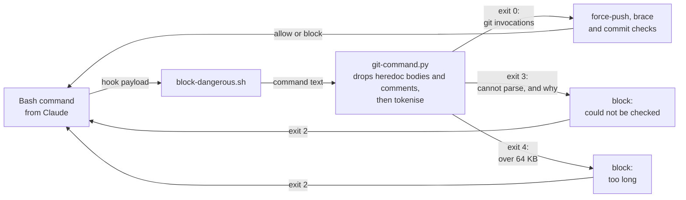
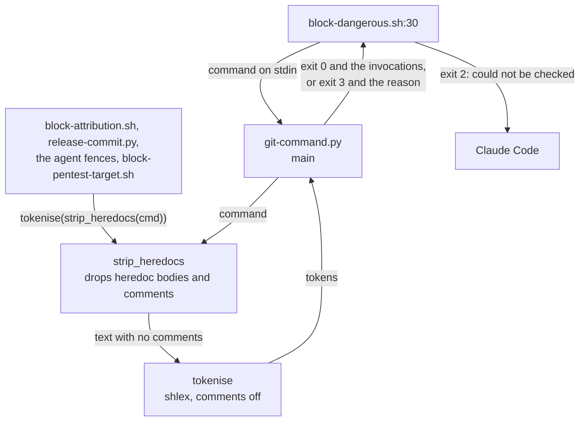
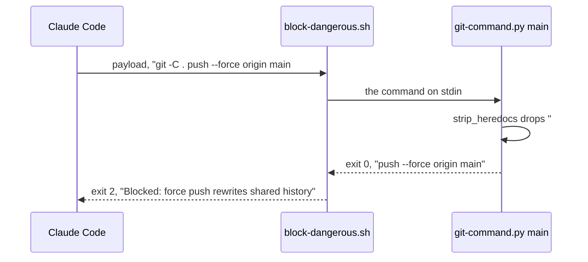

# Fail closed parse

**Version:** v1 · **Status:** Shipped · **Type:** Bug · **Project type:** CLI/Library

**Depends on:** None

The shared command parser reads `#` comments as bash reads them, and
`block-dangerous.sh` blocks a command that the parser cannot read. A comment,
an unclosed quote or an unclosed heredoc can no longer hide a force push or a
commit on main from the guards.

## Problem

`block-dangerous.sh` lets a force push or a commit on main through when a
comment or a broken line is near it. Each row was run on `main` at `780d238`
(v2.4.0), in a scratch repo on `main`:

| Command | `git-command.py` | `block-dangerous.sh` | bash |
| --- | --- | --- | --- |
| `git -C . push --force origin main # it's fine` | exit 3, "unbalanced ' quote" | exit 0 | runs the push |
| `echo x#; git -C . push --force origin main` | exit 0, prints nothing | exit 0 | runs the push |
| `# write it with <<EOF`, then `git -C . commit -m 'add the export'`, then a heredoc `cat <<EOF`, `notes`, `EOF` | exit 0, prints nothing | exit 0 | commits on main |
| `git -C . push --force origin main`, then `cat <<EOF` and `release notes`, with no closing `EOF` | exit 3, "heredoc EOF is never closed" | exit 0 | runs the push, with a warning |

There are two causes:

- **The parser does not use bash's comment rule.** In bash, `#` starts a
  comment only at the start of a word, and a comment opens no quote and no
  heredoc. The heredoc pass (`openers_in`, `git-command.py:63`) reads quotes
  and `<<` inside a comment. Python's `shlex` starts a comment at any `#`, so
  `echo x#;` loses the rest of its line.
- **On exit 3, `block-dangerous.sh` checks the raw text**
  (`block-dangerous.sh:38`). The raw patterns miss `git -C . push --force`
  and `git -C . commit`. The fallback assumed that bash cannot run a command
  that the parser refuses. That is false. bash runs each line before an
  unclosed quote, and it runs an unclosed heredoc to the end of the text.

`secret-scan.sh` falls back to the raw text in the same way, so these commands
also commit without a secret scan. The agent fences (`scope-verifier-bash.sh`,
`scope-pentester-bash.sh`) refuse `#` before they parse (lesson
comments-can-swallow-the-separator), so they are not open to this.

How often the parser refuses a real command: this machine's recorded Claude
Code sessions hold 9,504 Bash commands (2026-10-13). The parser refuses 11.
6 of them have an apostrophe in a comment. The other 5 have a quote inside
`"$( … )"` or inside a multi-line string, which the parser reads differently
from bash.

## Slice test

| Check | Result |
| --- | --- |
| Cuts every layer it needs | yes. The shared parser, and the guard that blocks on its answer. |
| One e2e test walks it | yes. Real hook payloads sent to `block-dangerous.sh`, one for each scenario. |
| Worth shipping alone | yes. A comment or a broken line can no longer take a force push or a commit on main past the guards. |
| Fits (≤5 scenarios, ≤2 areas) | yes. 5 scenarios. One area: the shared parser and `block-dangerous.sh`. |

**Path:** light. A bug fix in three files, with no new data or dependency.
Its one new block message is like the one tokenise-linear added. Pauses 1
and 3 are one pause, and pause 2 is skipped.

## Flow



## Acceptance criteria

```gherkin
Scenario: A comment with an apostrophe no longer hides a force push
  Given the main thread runs "git -C . push --force origin main # it's fine"
  When block-dangerous.sh reads the hook payload
  Then it exits 2 with "Blocked: force push rewrites shared history"

Scenario: A # inside a word is part of the word, as in bash
  Given the main thread runs "echo x#; git -C . push --force origin main"
  When block-dangerous.sh reads the hook payload
  Then it exits 2 with "Blocked: force push rewrites shared history"

Scenario: A heredoc named in a comment opens nothing
  Given a repo on main
  And the main thread runs "# write it with <<EOF", then "git -C . commit -m 'add the export'", then "cat <<EOF", "notes" and "EOF", each on its own line
  When block-dangerous.sh reads the hook payload
  Then it exits 2 with "Blocked: committing directly on main"

Scenario: A command the parser cannot read is blocked
  Given the main thread runs "git -C . push --force origin main", then "cat <<EOF" and "release notes", with no closing "EOF"
  When block-dangerous.sh reads the hook payload
  Then it exits 2 with "Blocked: this command could not be checked: heredoc EOF is never closed"

Scenario: A comment that bash ignores does not block a command
  Given the main thread runs "# Check what's on the branch", then "git status"
  When block-dangerous.sh reads the hook payload
  Then git-command.py exits 0 and prints "status", where today it refuses the command
  And block-dangerous.sh exits 0
```

## Scope

**In:**

- `git-command.py` uses bash's comment rule. An unquoted `#` at the start of a
  word starts a comment, which ends at the end of the line. A comment opens
  no quote and no heredoc. A `#` inside a word, as in `x#`, `$#` or
  `${#name}`, is part of the word. A backslash at the end of a line joins the
  next line to the word, so a `#` at the start of that line is inside the
  word, as in bash.
- Where the parser cannot tell whether a `#` starts a comment, it reads the
  `#` as text. It refuses the command when that text holds a quote, a
  backtick, a heredoc or a line continuation (O5).
- `block-dangerous.sh` blocks each command that the parser cannot read: exit
  3, or any exit other than 0 and 4. The message gives the parser's reason.
  The raw-text patterns are removed.
- New cases in `test-block-dangerous.sh` for scenarios 1 to 5.

**Out:**

- The raw-text fallbacks in `secret-scan.sh` and `block-attribution.sh`. They
  stay. `block-dangerous.sh` runs on every Bash call, so its block covers
  them, as it does for the 64 KB limit (D51). No slice picks them up.
- Reading `$'it\'s'`, `$((1 << 2))`, and quotes inside `"$( … )"` as bash
  reads them (O2). They stay refused, and are now blocked. No slice picks them
  up.
- An attribution check on `gh pr edit`. The slice pr-edit-attribution picks it
  up next.

## Technical plan

### Approach

Two changes. First, the pass that drops heredoc bodies (`strip_heredocs`,
`git-command.py:93`) also drops comments. It already knows the quote state,
which is what tells a comment from a `#` in a string. `tokenise` then turns
off `shlex`'s own comments, so a `#` inside a word stays in the word. Second,
`block-dangerous.sh` blocks on each parser exit other than 0, with the reason
that the parser printed.





Relies on: D31 (the commit guards fail closed on a payload they cannot read),
D51 (the parser refuses a command over 64 KB), and D52 and D53, drafted here.

### Changes

| File | Change | Why |
| --- | --- | --- |
| `plugins/zuko/scripts/lib/git-command.py:63` `openers_in`, `:93` `strip_heredocs` | The walk drops an unquoted `#` at the start of a word, and the rest of its line, and reads no quote or `<<` there. A word starts at the start of the text, after a space or a tab, after a newline that no backslash escapes, and after one of `;&\|(<>`. Not after `)`: bash keeps `#` in the word after `$(date)` (O3). A `#` right after `)`, or at a word start after `${`, `$'`, a backtick or a `$(` in double quotes, is unclear: it is read as text, and the walk refuses the command when the text after it holds a quote, a backtick, `<<` or a line continuation (O5). A backslash and a newline join two lines, so the character before the backslash decides whether a `#` after the newline starts a word. The module docstring's exit 3 line, and the `MAX_COMMAND_CHARS` comment at `:44`, say what exit 3 now means. | Scenarios 1, 3 and 5. |
| `plugins/zuko/scripts/lib/git-command.py:117` `tokenise` | `lex.commenters = ""`. | Scenario 2. |
| `plugins/zuko/scripts/block-dangerous.sh:16` | Keep the parser's stderr. Exit 4 keeps its message. Any other exit that is not 0 blocks: "Blocked: this command could not be checked: " and the parser's reason, then "bash runs the lines before a broken quote or heredoc. Close it, or put the text in a file, then run it again." The `else` branch with the raw patterns goes, so `subject` is always the parsed invocations. The comment above it says why. | Scenario 4. O1. |
| `plugins/zuko/scripts/tests/test-block-dangerous.sh` | Scenarios 1 to 5 as hook payloads, in a scratch repo on `main`. Parser cases: `${#name}`, `$#`, `a;#b`, and a backslash and a newline before `#b`, each read as bash reads it. | All. |

Reusing: `openers_in`'s quote state, `run_hook` and the scratch repo in
`test-block-dangerous.sh`, and the exit-4 block at `block-dangerous.sh:32`.

Before the review, run every recorded Bash command on this machine through the
old and the new parser, on the machine only, and never commit the commands.
Give the count that each refuses, and explain each command whose invocations
change.

### Earn-it

No new layer, option or dependency.

### Non-functionals

| | |
| --- | --- |
| **Load** | One more check for each character in the pass that already reads each character. No new parse. |
| **Breaks first** | A command that bash runs but the parser cannot read is blocked: about 5 in 9,504 past commands. The message says what to change. |
| **Security surface** | The guards' input is Claude's command text. Each command that the parser cannot read is blocked, not judged on its raw text. No secret and no stored data. |
| **Proof it works** | `run.sh block-dangerous` passes, with the four rows of the Problem table as cases that block. |
| **Rollout** | No flag. Rollback: `git revert` the fix commits. |

### Test plan

| Scenario | Test |
| --- | --- |
| 1. Apostrophe in a comment | `test-block-dangerous.sh`: the payload, exit 2 and the force-push message. |
| 2. `#` inside a word | `test-block-dangerous.sh`: the payload, exit 2 and the force-push message. |
| 3. Heredoc in a comment | `test-block-dangerous.sh`: the payload in the scratch repo on `main`, exit 2 and the commit-on-main message. |
| 4. Cannot parse | `test-block-dangerous.sh`: the payload, exit 2 and "could not be checked: heredoc EOF is never closed". An unbalanced quote also exits 2. |
| 5. A comment does not block | `test-block-dangerous.sh`: `git-command.py` exits 0 and prints `status`; the hook exits 0. |

```bash
bash plugins/zuko/scripts/tests/run.sh block-dangerous
bash plugins/zuko/scripts/tests/run.sh
```

**E2E:** `test-block-dangerous.sh` sends a real hook payload for each scenario
to the real `block-dangerous.sh`.

### Chunks

Single chunk. The tests first, then `git-command.py`, then
`block-dangerous.sh`.

### Risks

| Risk | Mitigation |
| --- | --- |
| A command that bash runs but the parser cannot read is blocked. | About 5 in 9,504 past commands. The message names the reason and says to close the quote or heredoc, or to put the text in a file. |
| The new comment rule reads a `#` differently from bash, and hides a command. | Each rule follows bash, and each is tested with a second command after the `#`. Where the walk cannot tell, it reads the `#` as text, or refuses the command (O5). The replay of the recorded commands lists each command whose invocations change. |
| A guard other than `block-dangerous.sh` passes a command that the parser cannot read. | `block-dangerous.sh` runs on every Bash call with no `if`, so its block stops the call for all guards. |

### Decisions to record

Recorded as D52, D53.

## Review

2026-10-13 · 2 raw findings, 2 survived, 2 fixed.

- A10 Mishandling of Exceptional Conditions · `plugins/zuko/scripts/lib/git-command.py:102` · a `#` after `$(` in double quotes, `${`, `$'` or a backtick is read as text, or the command is refused · `6c5f99d`
- correctness · `plugins/zuko/scripts/lib/git-command.py:62` · a `#` right after `)` is read as text, or the command is refused, so `(true)# <<EOF` no longer hides a line · `6c5f99d`

## Open items

| ID | What | Type | Raised at | Owner | Status | Answer |
| --- | --- | --- | --- | --- | --- | --- |
| O1 | A command that the parser cannot read, such as an unclosed quote or heredoc: block it, or keep the raw-text check? About 5 in 9,504 past commands would be blocked. | question | spec p1 | user | Resolved | Block it. `block-dangerous.sh` blocks it with the parser's reason, because bash runs the lines before the break. 2026-10-13 |
| O2 | Also teach the parser `$'it\'s'`, `$((1 << 2))` and quotes inside `"$( … )"`, so they are not blocked? | question | spec p1 | user | Resolved | No. They stay blocked: 5 in 9,504 past commands, and each block says what to change. 2026-10-13 |
| O3 | The plan said a word starts after one of `;&\|()<>`. bash keeps `#` in the word after `$(date)`, so with `)` the parser read `echo $(date)#; git push --force origin main` as a comment and hid the push. After a subshell's `)`, bash starts a comment. | flag | build | user | Decided alone | Chose: `)` is not a word break, so a `#` after any `)` is read as text, which reads too little as a comment, never too much. Other: count `)` as a word break, as the plan said. Undo: add `)` to `WORD_BREAKS` in `git-command.py`, and drop the `$(date)#` case from `test-block-dangerous.sh`. 2026-10-13 |
| O4 | `/build` found a race outside this slice. `printf '%s\n' "$x" \| grep -qE` under `pipefail` gives 141 when `grep` exits before `printf` writes its last line, and the `if` reads that as no match. bash's `printf` writes a pipe one line at a time. With `printf` paused 0.3 s after its first line, v2.3.1's `block-dangerous.sh` passed `git push --force origin main; git status` (exit 0). `secret-scan.sh:23` exits 0 the same way. One full-suite run on this branch most likely failed a check this way. | flag | build | user | Decided alone | Chose: leave it out of this slice, because no scenario needs it. Other: fix it here, with `grep -qE … <<<"$x"` in each guard. Undo: run /zuko:debug on it, or spec a slice with /spec. 2026-10-13 |
| O5 | `/review`: O3 said a `#` after `)`, read as text, "reads too little as a comment, never too much". That was false: `(true)# <<EOF` opened a heredoc that hid the next line. And after `${`, `$'`, a backtick or a `$(` in double quotes, the parser's quotes are not bash's, so a `#` that it read as a comment could be quoted text in bash: `echo "$(echo " # it's ")"; git push --force origin main` passed, where v2.4.0 blocked it. | flag | review | user | Decided alone | Chose: such a `#` is unclear. It is read as text, and the parser refuses the command when the text after it holds a quote, a backtick, `<<` or a line continuation. No recorded command is newly refused. Other: follow `${`, `$'`, backticks and `$(` in double quotes as bash does, the other answer to O2. Undo: git revert 6c5f99d, then spec the fuller parser through /spec. 2026-10-13 |

_Never delete this section or its rows. See references/ledger.md._

## Glossary

- **Heredoc** — the `<<'EOF' … EOF` block that gives a command a long body
  from inside the command text.
- **Fail closed** — a guard that cannot check a command blocks it.
- **Raw-text check** — a pattern match on the whole command as typed, used
  when the parser cannot split it into commands.
- **shlex** — Python's library that splits a command into words the way a
  shell does. It does not do everything bash does.
- **e2e** — end-to-end: one test that walks the whole slice.
