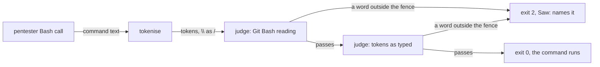
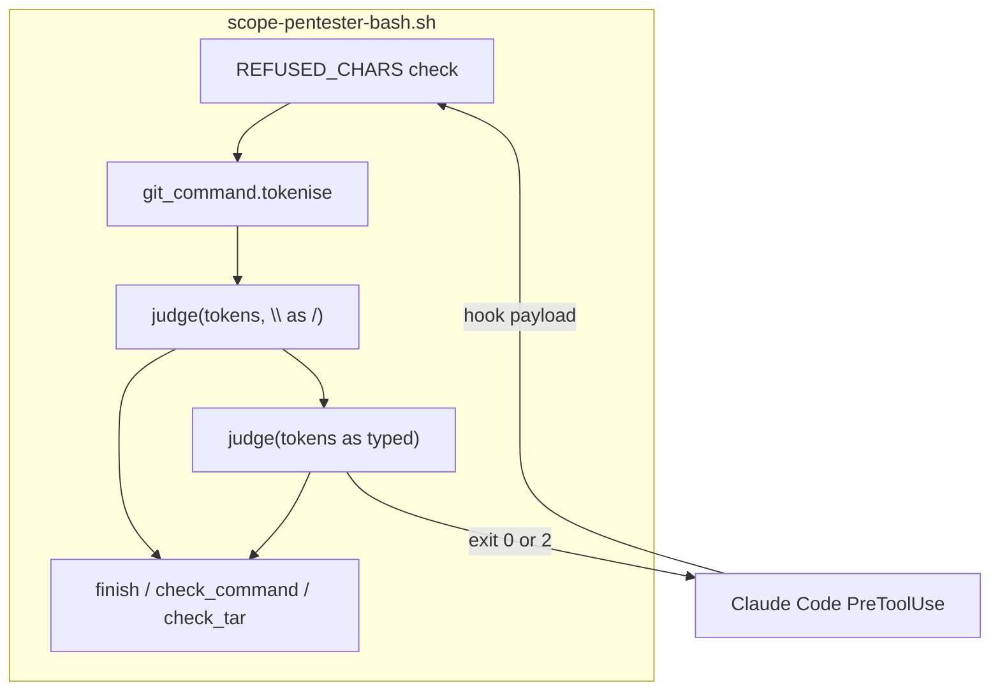
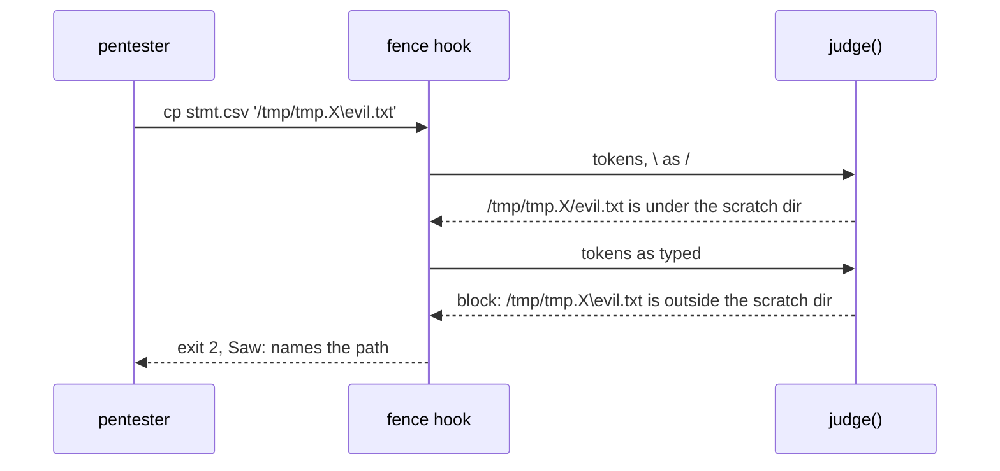

# Fence backslash

**Version:** v1 · **Status:** Built · **Type:** Bug · **Project type:** CLI/Library

**Depends on:** None

The pentester fence judges each command twice: once with `\` read as `/`, as
Git Bash reads it, and once as typed, as bash on Linux and macOS reads it. A
write to `<scratch>\x` no longer gets past the fence. Found by the v2.6.0
pentest (P1).

## Problem

`scope-pentester-bash.sh` folded every `\` to `/` in each token before it
judged the command (`cce247e`, #126). The fold is right for Git Bash, which
takes `\` as a separator. On Linux and macOS, `\` is part of a file name. So
the fence judged `/tmp/tmp.Qm81Zx0aPl/evil.txt` and allowed it, while bash
wrote `/tmp/tmp.Qm81Zx0aPl\evil.txt`, a file next to the scratch dir in
`/tmp`.

`/debug` reproduced it on 2026-11-09, on `ad8c4af` (v2.6.0). The fence
allowed each of these four commands:

| Command                                                 | Where bash on Linux writes          |
| ------------------------------------------------------- | ----------------------------------- |
| `cd $S && cp stmt.csv '$S\evil.txt'`                    | `/tmp/tmp.Qm81Zx0aPl\evil.txt`      |
| `cd $S && echo x > '$S\evil.txt'`                       | `/tmp/tmp.Qm81Zx0aPl\evil.txt`      |
| `git log --oneline > '$S\evil.txt'`                     | `/tmp/tmp.Qm81Zx0aPl\evil.txt`      |
| `tar -x -C '$S\evil' -f x.tar`                          | members under `/tmp/tmp.Qm81Zx0aPl\evil` |

`$S` is `/tmp/tmp.Qm81Zx0aPl`, a dir that `mktemp -d` made.

```
 cp stmt.csv '/tmp/tmp.X\evil.txt'
        |
        v
 fence folds \ to /  -->  '/tmp/tmp.X/evil.txt'  -->  under scratch? yes  -->  allowed
        |
        v
 bash on Linux writes  -->  /tmp/'tmp.X\evil.txt'   (outside the scratch dir)
```

## Slice test

| Check                         | Result                                                                    |
| ----------------------------- | ------------------------------------------------------------------------- |
| Cuts every layer it needs     | Yes. The one loop that reads each token, and its test                     |
| One e2e test walks it         | Yes. `test-scope-pentester-bash.sh` feeds the real hook a real payload     |
| Worth shipping alone          | Yes. It closes pentest P1                                                 |
| Fits (≤5 scenarios, ≤2 areas) | Yes. 5 scenarios, 1 area (scripts)                                        |

**Path:** light. A bug fix in 2 files, with no new interface, data or
dependency. Pauses 1 and 3 merged, pause 2 skipped.

The fix is already on `fix/fence-backslash` as `a0fdba5`, made by `/debug`
before this spec. `/build` checks it against this spec.

## Flow



Each command goes through the old check first, unchanged, and then through
the same check on the words as typed. It runs only when both pass.

## Acceptance criteria

```gherkin
Scenario: a copy to a backslash sibling of the scratch dir is blocked
  Given the pentester's scratch dir is /tmp/tmp.Qm81Zx0aPl
  When it runs cd /tmp/tmp.Qm81Zx0aPl && cp stmt.csv '/tmp/tmp.Qm81Zx0aPl\evil.txt'
  Then the hook exits 2
  And the Saw: line says the path is outside the scratch dir

Scenario: a redirection to a backslash sibling is blocked, in the scratch copy and in the repo
  Given the same scratch dir
  When it runs cd /tmp/tmp.Qm81Zx0aPl && echo x > '/tmp/tmp.Qm81Zx0aPl\evil.txt'
  Or it runs git log --oneline > '/tmp/tmp.Qm81Zx0aPl\evil.txt' in the repo
  Then the hook exits 2
  And the Saw: line names the redirection

Scenario: tar into a backslash sibling is blocked
  Given the same scratch dir
  When it runs tar -x -C '/tmp/tmp.Qm81Zx0aPl\evil' -f x.tar in the repo
  Then the hook exits 2
  And the Saw: line says the -C dir is outside the scratch dir

Scenario: a backslash that is not a path still runs
  Given the same scratch dir
  When it runs cd /tmp/tmp.Qm81Zx0aPl && grep -rn 'a\.b' plugins/zuko/scripts
  Or it runs cd /tmp/tmp.Qm81Zx0aPl && printf 'a\nb\n' > /tmp/tmp.Qm81Zx0aPl/out.txt
  Then the hook exits 0

Scenario: every Git Bash escape that the fence blocked before is still blocked
  Given the 7 backslash and drive-path cases in test-scope-pentester-bash.sh
  When the hook judges each one
  Then each exits 2 with the same Saw: line as on ad8c4af
```

## Scope

**In:** the token loop in `scope-pentester-bash.sh`, moved into `judge()` and
run on both readings, and the test cases above.

**Out:**

- Pentest v2.6.0 P2, S1 and S2. P2 is the planned taste-skill bump. S1 and S2
  are in the vendored taste skill under `.agents/`, so their fix belongs
  upstream or in a later slice.
- The 14 Strix leads. N5 to N7 are in this file, but each one is a separate
  rule of the fence, and D14 says the fence stops commands, not code. Each
  needs its own `/debug` first.

## Technical plan

### Approach

The token loop at the end of the checker becomes `judge(tokens)`
(`scope-pentester-bash.sh:422`). It resets the scratch dir and walks the
statement, as the loop did. The script calls it twice
(`scope-pentester-bash.sh:470`): first on the tokens with `\` as `/`, which is
the old check, and then on the tokens as typed. `block()` exits 2, so a
command passes only when both calls return.

Relies on: D14 (the fence stops commands, not code), D97 (the fence compares
paths with POSIX rules on every OS), and D134.





### Changes

| File                                                          | What changes                                                                                       | Why            |
| ------------------------------------------------------------- | -------------------------------------------------------------------------------------------------- | -------------- |
| `plugins/zuko/scripts/scope-pentester-bash.sh:422`            | The token loop moves into `judge()`, which resets `scratch`. The script calls it on both readings  | Scenarios 1–5  |
| `plugins/zuko/scripts/tests/test-scope-pentester-bash.sh:210` | Four `blocks` cases for a `\` sibling of the scratch dir, and one `allows` for `printf 'a\nb\n'`   | Scenarios 1–4  |

Reusing: `finish()`, `check_command()`, `check_tar()`, `under()` and
`under_any_scratch()`, unchanged; the test file's `blocks` and `allows`
helpers.

### Non-functionals

|                      |                                                                                                              |
| -------------------- | ------------------------------------------------------------------------------------------------------------ |
| **Load**             | One hook call per pentester Bash call. The second pass doubles the `git ls-files` calls for a tracked script |
| **Breaks first**     | Nothing at 10×. Each pass is linear in the tokens                                                             |
| **Security surface** | Closes pentest P1. The fence trusts no token; the second pass can only add blocks, never allows              |
| **Proof it works**   | `bash plugins/zuko/scripts/tests/run.sh scope-pentester-bash` passes, with the four new `blocks` cases        |
| **Rollout**          | No flag. It ships with the next zuko release. Rollback: revert `a0fdba5`                                      |

### Test plan

| Scenario                                  | Test                                                       | Command                                                       |
| ----------------------------------------- | ---------------------------------------------------------- | ------------------------------------------------------------- |
| 1. `cp` to a `\` sibling is blocked       | `test-scope-pentester-bash.sh:212`                         | `bash plugins/zuko/scripts/tests/run.sh scope-pentester-bash` |
| 2. A redirection to a `\` sibling         | `test-scope-pentester-bash.sh:213`, `:214`                 | same                                                          |
| 3. `tar -C` a `\` sibling                 | `test-scope-pentester-bash.sh:215`                         | same                                                          |
| 4. A backslash in text still runs         | `test-scope-pentester-bash.sh:217`, `:218`                 | same                                                          |
| 5. The old Git Bash escapes stay blocked  | `test-scope-pentester-bash.sh:203`–`209`, unchanged        | same                                                          |

**E2E:** `test-scope-pentester-bash.sh` runs the real hook script on each
payload, as Claude Code runs it, with a real `mktemp -d` scratch dir.

### Chunks

Single chunk.

### Risks

| Risk                                                                                     | Mitigation                                                                                  |
| ---------------------------------------------------------------------------------------- | ------------------------------------------------------------------------------------------- |
| On Windows, an absolute path typed with `\` inside the scratch dir, such as `'/tmp/tmp.X\sub'`, now blocks | The Saw: line names the path. The pentester writes `/`, which Git Bash reads the same way (O1) |
| A later edit runs only one of the two passes                                             | Scenarios 1–3 fail on the folded pass alone, and scenario 5 fails on the as-typed pass alone |

### Decisions to record

Recorded as D134.

## Review

2026-11-10 · 0 raw findings, 0 survived. Clean.

## Open items

| ID  | What                                                                                                                                       | Type | Raised at | Owner | Status | Answer |
| --- | ------------------------------------------------------------------------------------------------------------------------------------------ | ---- | --------- | ----- | ------ | ------ |
| O1  | On Windows, an absolute path typed with `\` inside the scratch dir, such as `'/tmp/tmp.X\sub'`, now blocks, though Git Bash keeps it inside | flag | spec p1   | user  | Accepted risk | The block names the path, and the pentester writes `/`, which Git Bash reads the same way. The fence stays the same on every OS (2026-11-09) |

_Never delete this section or its rows. See references/ledger.md._

## Glossary

- **e2e** — end-to-end: one test that walks the whole slice as a user would.
- **Fence** — the PreToolUse hook that limits which commands the pentester may run, and where it may write.
- **Fold** — rewriting a string into one form before a compare, here `\` to `/`.
- **Git Bash** — the bash that ships with Git for Windows. It takes both `\` and `/` as path separators.
- **Pentest** — the security test `/release` runs on the code it ships; its findings are numbered P1, P2, …
- **Scratch dir** — the throwaway copy of the repo, made with `mktemp -d`, where the pentester may write.
