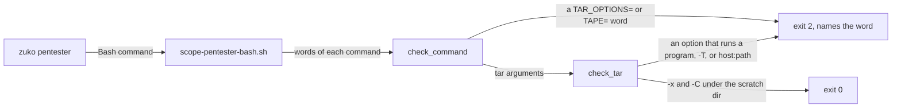
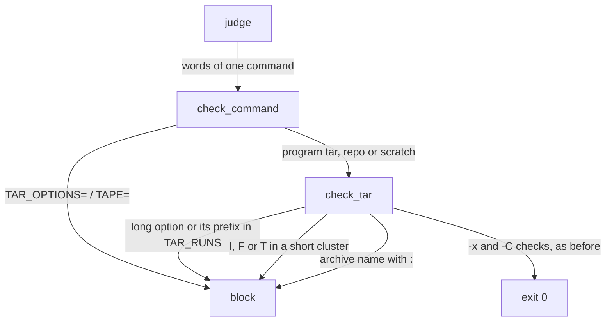

# Fence tar exec

**Version:** v1 · **Status:** Shipped · **Type:** Bug · **Project type:** CLI/Library

**Shape doc:** docs/specs/guard-leads/shape.md
**Depends on:** None

The pentester fence blocks a `tar` with an option that runs a program, in the
repo and in the scratch copy. It closes v2.6.0 N5 and v2.7.0 N2.

## Problem

The fence lets the pentester run `tar -x -C <scratch>` in the real repo, so
that it can unpack `git archive` into its scratch copy. `check_tar` checks only
`-P`, the extract flag and the `-C` target. GNU tar has options that run a
program, and the fence does not read them. I ran these as agent_type
`zuko:pentester`, from the repo, against the hook at `3c11930` on 2026-11-12:

| Input after `git archive HEAD \| tar -x -C <scratch>` | Exit |
| --- | --- |
| (nothing) | 0, and must stay 0 |
| `--to-command=sh` | 0 |
| `--checkpoint=1 --checkpoint-action=exec=id` | 0 |
| `-I id`, `--use-compress-program=id`, `-xIid` | 0 |
| `-F id`, `--to-com sh` | 0 |
| `TAR_OPTIONS=--to-command=sh tar -x -C <scratch>` | 0 |

Each one runs a program in the real repo, outside the fence. D14 lets code run
only inside the scratch copy.

GNU tar 1.34 facts this slice rests on, from `tar --help` and a run on
2026-11-12:

- `--to-c=cat` and `--checkpoint-=exec=...` run: tar takes a unique prefix of
  a long option. `--to` and `--checkp` fail as ambiguous.
- `--use=PROG` and an attached `-xIPROG` run PROG.
- `-T FILE` reads options from FILE unless `--verbatim-files-from` is given.
- `--rsh-command=/usr/bin/ssh` is the default, so `-f host:path` runs ssh.

## Slice test

| Check | Result |
| --- | --- |
| Cuts every layer it needs | Yes. The fence and its test file, which runs the real hook |
| One e2e test walks it | Yes. `test-scope-pentester-bash.sh` feeds the real hook each payload |
| Worth shipping alone | Yes. It closes the only lead in which a fenced agent runs a program in the real repo |
| Fits (≤5 scenarios, ≤2 areas) | Yes. 5 scenarios, 1 area (scripts) |

**Path:** light. A bug fix in 2 files, with no new interface, data or
dependency. Pauses 1 and 3 merged, pause 2 skipped.

## Flow



## Acceptance criteria

```gherkin
Scenario: a long tar option that runs a program is blocked
  Given the pentester runs from the repo
  When it sends git archive HEAD | tar -x -C /tmp/tmp.Qm81Zx0aPl --to-command=sh
  Then the fence exits 2, and the Saw line names --to-command
  And --checkpoint=1 --checkpoint-action=exec=id is blocked the same way
  And --use-compress-program=id, --info-script=id, --new-volume-script=id, --rsh-command=id and --rmt-command=id are blocked the same way
  And --to-command sh, with the program as the next word, is blocked the same way
  And the prefixes --to-com=sh, --checkpoint-=exec=id and --use=id are blocked the same way

Scenario: a short tar option that runs a program is blocked
  Given the pentester runs from the repo
  When it sends git archive HEAD | tar -x -C /tmp/tmp.Qm81Zx0aPl -I id
  Then the fence exits 2, and the Saw line names -I
  And -Iid, -xIid and -F id are blocked the same way
  And tar xI id -x -C /tmp/tmp.Qm81Zx0aPl is blocked, because tar reads a first word with no dash as options

Scenario: tar options from outside the arguments are blocked
  Given the pentester runs from the repo
  When it sends TAR_OPTIONS=--to-command=sh tar -x -C /tmp/tmp.Qm81Zx0aPl
  Then the fence exits 2, and the Saw line names TAR_OPTIONS
  And TAPE=host:x tar -x -C /tmp/tmp.Qm81Zx0aPl is blocked the same way
  And tar -x -C /tmp/tmp.Qm81Zx0aPl -T /tmp/tmp.Qm81Zx0aPl/list is blocked, because the list can hold options
  And tar -x -C /tmp/tmp.Qm81Zx0aPl -f host:x.tar is blocked, because a remote archive runs ssh

Scenario: the same rule holds in the scratch copy
  Given the pentester runs cd /tmp/tmp.Qm81Zx0aPl first
  When it sends cd /tmp/tmp.Qm81Zx0aPl && tar -xf x.tar --to-command=sh
  Then the fence exits 2
  And cd /tmp/tmp.Qm81Zx0aPl && export TAR_OPTIONS=--to-command=sh is blocked the same way
  And cd /tmp/tmp.Qm81Zx0aPl && TAR_OPTIONS=--to-command=sh && tar -xf x.tar is blocked the same way
  And export TAR_OPTIONS+=--to-command=sh, and printf -v TAR_OPTIONS ... && export TAR_OPTIONS, are blocked the same way

Scenario: a normal extract still passes
  Given the pentester runs from the repo
  When it sends git archive HEAD | tar -x -C /tmp/tmp.Qm81Zx0aPl
  Then the fence exits 0
  And tar -xv -C /tmp/tmp.Qm81Zx0aPl --checkpoint=1 exits 0
  And git archive --format=tar.gz HEAD | tar -xz -C /tmp/tmp.Qm81Zx0aPl exits 0
  And tar -x -C /tmp/tmp.Qm81Zx0aPl --file=- --to-stdout exits 0
  And cd /tmp/tmp.Qm81Zx0aPl && tar -xf x.tar exits 0
```

## Scope

**In:**

- The GNU tar long options `--to-command`, `--checkpoint-action`,
  `--use-compress-program`, `--info-script`, `--new-volume-script`,
  `--rsh-command`, `--rmt-command` and `--files-from`, with `=` or with the
  value as the next word, and each prefix of them that is not an exact name
  of a harmless option (`--checkpoint`, `--file`).
- The short options `-I`, `-F` and `-T`, alone, attached or in a cluster.
- An archive name with a `:` after `-f`, `--file=` or `--file`.
- A first tar word with no dash, which tar reads as old-style options.
- A `TAR_OPTIONS` or `TAPE` word anywhere in a command: `NAME=`, `NAME+=`,
  the bare name, or `-vNAME`.
- The same rule in the repo and in the scratch copy (O1).

**Out:**

- Code that the pentester runs in its scratch copy, such as
  `git config core.fsmonitor`. D14 lets it run (shape O5).
- bsdtar's own options on macOS. Not checked (O4).
- A `NAME=value` in front of `git` in the repo (O5).

## Technical plan

### Approach

The change is in `check_tar` in `scope-pentester-bash.sh`. A new walk of the
tar arguments reads each long option, its prefix, and each short cluster, and
blocks a refused option. `check_command` blocks a `TAR_OPTIONS=` or `TAPE=`
word before it judges the program, so the rule also covers `export`. Both
modes call `check_tar` already, so the scratch copy gets the same rule.

Relies on: D14 (the fence stops commands, not code), D32 (a tool whose
arguments run a program is not allowed), and the drafted entry below.



### Changes

| File | What changes | Why |
| --- | --- | --- |
| `plugins/zuko/scripts/scope-pentester-bash.sh:282` | `check_tar` walks its arguments. A `--NAME` is refused when NAME, or a prefix of it, is in a new `TAR_RUNS` tuple and is not `--checkpoint` or `--file`. A short cluster is walked letter by letter, with tar's value letters (`gCTXfFLbHVIKN`) ending the cluster; `I`, `F` or `T` blocks. The `-f`/`--file` value is blocked when it has a `:` | Scenarios 1–4 |
| `plugins/zuko/scripts/scope-pentester-bash.sh:337` | `check_command` blocks a word that starts with `TAR_OPTIONS=` or `TAPE=` | Scenarios 3, 4 |
| `plugins/zuko/scripts/tests/test-scope-pentester-bash.sh` | A block-case through the real hook for each probe and form above, and allow-cases for normal extracts | Scenarios 1–5 |

Reusing: `block`, `check_word`, `run_hook`, `blocks` and `allows` in the test.

### Earn-it

| Added | Triggered by |
| --- | --- |
| `TAR_RUNS` and the short-cluster walk | Scenarios 1 and 2. A prefix and an attached value cannot be read by a name compare |

### Non-functionals

| | |
| --- | --- |
| **Load** | One more walk of the tar words, only for a `tar` command |
| **Breaks first** | Nothing new |
| **Security surface** | Closes v2.6.0 N5 and v2.7.0 N2. The change only adds blocks, and only for `tar` and two env names |
| **Proof it works** | `bash plugins/zuko/scripts/tests/run.sh scope-pentester-bash` passes with the new cases |
| **Rollout** | No flag. It ships with the next zuko release. Rollback: revert the fix commit |

### Test plan

| Scenario | Test | Command |
| --- | --- | --- |
| 1–5 | `test-scope-pentester-bash.sh` | `bash plugins/zuko/scripts/tests/run.sh scope-pentester-bash` |

**E2E:** `test-scope-pentester-bash.sh` runs the real hook script on each
payload, as Claude Code runs it, with agent_type `zuko:pentester`.

**Result (2026-11-12):** `run.sh scope-pentester-bash` 322 passed, 0 failed. Before the fix, the 24 new block-cases failed (48 checks) and the 8 new allow-cases passed. `run.sh e2e-pentest` 49 passed, `e2e-hook-import-path` 28 passed, `e2e-guard-paths` 15 passed.

**Review fixes (2026-11-12):** before the fix, the 11 new block-cases failed (22 checks) and the 4 new allow-cases passed. After it, `run.sh scope-pentester-bash` 348 passed, 0 failed; `e2e-pentest` 49, `e2e-hook-import-path` 28 and `e2e-guard-paths` 15 passed.

No replay of logged commands: the change does not touch `git-command.py` or
`block-dangerous.sh`, and the fence acts only for the pentester.

### Chunks

Single chunk.

### Risks

| Risk | Mitigation |
| --- | --- |
| A file name with `I`, `F` or `T` attached to a value letter, such as `-xfIndex.tar`, is read as its value, not as `-I` | The cluster walk stops at the first value letter, as GNU getopt does |
| A tar option that runs a program and that this list does not name | The list comes from `tar --help` for GNU tar 1.34. A new tar option is a new lead |

### Decisions to record

**D142 · 2026-11-12 · The pentester fence refuses each tar option that runs a program, in the repo and in the scratch copy**

Why: `--to-command`, `--checkpoint-action` and `-I` run a program in the real
repo (v2.6.0 N5, v2.7.0 N2). In the scratch copy, the fence already blocks a
shell and a pipe into one, and `--to-command=sh` is the same thing.

Rejected: refuse only `--checkpoint-action=exec`, not the other actions. The
pentester needs none of them, and one name is less code than a parse of the
action. Rejected: let the options run in the scratch copy under D14. D14 lets
code under test run, not a shell that the fence never sees.

## Open items

| ID | What | Type | Raised at | Owner | Status | Answer |
| -- | ---- | ---- | --------- | ----- | ------ | ------ |
| O1 | Block the tar options in the scratch copy too, or only in the repo, as the shape says? | question | spec p1 | user | Resolved | Both. The scratch copy blocks a shell already, and `--to-command=sh` is one. Decided under the user's delegation. 2026-11-12 |
| O2 | Refuse every `--checkpoint-action`, or only `exec=`? | question | spec p1 | user | Resolved | Every one. The pentester needs none, and a name check has no parse to get wrong. Decided under the user's delegation. 2026-11-12 |
| O3 | Also refuse `-T` lists, `TAR_OPTIONS`, `TAPE` and a remote `-f host:path`? They are not in the shape's list | question | spec p1 | user | Resolved | Yes. Each one gives tar an option or runs ssh, and the pentester needs none. Decided under the user's delegation. 2026-11-12 |
| O4 | macOS ships bsdtar. I did not run bsdtar, so its own options are not checked | flag | spec p1 | user | Accepted risk | The long names, `-I` and `TAR_OPTIONS` are blocked whatever the tar. bsdtar is not installed here. Decided under the user's delegation. 2026-11-12 |
| O5 | The fence does not check a `NAME=value` in front of `git` in the repo, so an env var that makes git run a program may pass. Not run | flag | spec p1 | user | Accepted risk | Not a tar option and not a pentest lead. Reported for a later slice. Decided under the user's delegation. 2026-11-12 |
| O6 | Scenario 4 named `export TAR_OPTIONS=` only. A bare `TAR_OPTIONS=x` in the scratch copy returned before any word check | flag | build | user | Decided alone | Chose: check `TAR_OPTIONS=` and `TAPE=` before the bare-assignment return, and add the case to scenario 4. Other: check only the words of a command with a program. Undo: move the check below `if program is None` in `check_command`. 2026-11-12 |
| O7 | Review F1: tar reads a first word with no dash, such as `xI id`, as old-style options, so the dashed checks missed `I`, `F`, `T`, `P` and `f host:path` | flag | review | user | Decided alone | Chose: block any first tar word with no dash, so every form the pentester needs keeps its dash. Other: expand the old-style word into dashed options and judge those. Undo: drop the first-word check at the top of `check_tar`. 2026-11-12 |
| O8 | Review F2: `export TAR_OPTIONS+=...` and `printf -v TAR_OPTIONS ...` then `export TAR_OPTIONS` set the variable with no `TAR_OPTIONS=` word | flag | review | user | Decided alone | Chose: block a word that is `TAR_OPTIONS` or `TAPE`, alone, with `=` or `+=`, or after `-v`. This also blocks a harmless `unset TAR_OPTIONS`. Other: track which shell variables a command sets and exports. Undo: put back the `startswith(("TAR_OPTIONS=", "TAPE="))` check in `check_command`. 2026-11-12 |

_Never delete this section or its rows. See references/ledger.md._

## Review

2026-11-12 · 2 raw findings, 2 survived, 2 fixed.

- A01 Broken Access Control · `plugins/zuko/scripts/scope-pentester-bash.sh:333` · block a first tar word with no dash, which tar reads as old-style options (`tar xI id -x -C <scratch>` ran `id`) · `4a2e06c`
- A01 Broken Access Control · `plugins/zuko/scripts/scope-pentester-bash.sh:387` · block `TAR_OPTIONS` and `TAPE` set through `+=`, `printf -v` or a bare `export NAME` · `4a2e06c`

## Glossary

- **GNU tar** — the tar program on Linux. macOS ships a different one, bsdtar
- **Short cluster** — several one-letter options in one word, such as `-xzf`. A letter that takes a value takes the rest of the word, or the next word
- **Unique prefix** — GNU tar runs `--to-c` as `--to-command`, because no other long option starts with `--to-c`
- **Old-style options** — tar's first word with no dash, such as `xf a.tar`. Each letter is an option, and a letter that takes a value takes the next word
- **Remote archive** — an archive name such as `host:path`. tar reads it over ssh
