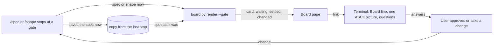

# Gate card

**Version:** v1 · **Status:** Draft · **Type:** Feature · **Project type:** CLI/Library

**Shape doc:** docs/specs/living-board/shape.md
**Depends on:** idea-board

At each `/spec` pause and at the end of `/shape`, the idea board shows a gate card: what waits for your approval and why, what is settled so far, and what changed since the last stop. The terminal then prints only the board link, one ASCII picture and the questions.

## Problem

The pain of the living-board idea is worst at a pause. At each `/spec` pause the terminal prints a diagram, the scenarios, the slice test and the open items, and the spec behind them is 2,000 to 5,400 words. The user cannot see what changed since they last looked, or what they already agreed to. So they approve without following, or ask Claude to recap. The idea board shows where each slice stands, but it does not say what waits for the user now.

## Slice test

| Check                         | Result                                                                                                  |
| ----------------------------- | ------------------------------------------------------------------------------------------------------- |
| Cuts every layer it needs     | yes: the `/spec` and `/shape` pause steps, the copy kept at each stop, `board.py`, and the board page   |
| One e2e test walks it         | yes: render a fixture idea at pause 1, change the spec, render at pause 2, and check the card each time |
| Worth shipping alone          | yes: the user sees what waits for them and what changed at every pause, with no other slice shipped     |
| Fits (≤5 scenarios, ≤2 areas) | yes: 5 scenarios; the stage skills and the board builder                                                |

**Path:** full — it adds a new part to the board page and changes what the terminal prints at each pause.

## User story

As the person who approves each zuko pause, I want the board to show what waits for me, what I already agreed to and what changed since I last looked, so that I approve with confidence instead of asking Claude for a recap.

## Flow



At each stop, the stage gives `board.py` the spec as it is now and the copy from the last stop. The board shows the card, the stage saves a new copy, and the terminal prints the link, one picture and the questions. A change from the user brings the stage back to the same gate, and the next card shows that change.

## Acceptance criteria

```gherkin
Scenario: the first pause of a slice shows its gate card
  Given docs/specs/pr-gate.md has just been written, with 4 scenarios and 3 Open rows
  And no copy of pr-gate.md from an earlier stop exists
  When /spec pr-gate stops at pause 1
  Then the board's card for pr-gate reads "Waiting for you: pause 1, scope and acceptance"
  And it says why: "Approve to go on to the interface"
  And it lists the 3 Open rows, each with its question
  And its "Changed" part reads "First stop for this slice"
  And the terminal prints "Board: <url>", the Flow diagram in ASCII, then the question prompt

Scenario: a later pause shows what changed since the last stop
  Given pr-gate was approved at pause 1 with 4 scenarios
  And pause 2 has added the Interface section and Open rows O4 and O5, and resolved O1 to O3
  When /spec pr-gate stops at pause 2
  Then the card's "Settled" part shows pause 1 approved, with the names of its 4 scenarios and its Scope In line
  And its "Changed" part shows "Added: Interface", "New rows: O4, O5" and "Resolved: O1, O2, O3"

Scenario: a change asked at a pause shows on the next card
  Given pr-gate is stopped at pause 1
  When the user types "drop scenario 4, PRs from forks are out of scope"
  And /spec edits the spec and stops at pause 1 again
  Then the card's "Changed" part shows "Removed scenario: a PR from a fork" and "Changed: Scope"
  And nothing else is listed as changed

Scenario: /shape shows its gate card
  Given /shape has just written docs/specs/living-board/shape.md with 5 slices and no Open rows
  When /shape stops to ask which slice to spec first
  Then the board shows the card "Waiting for you: pick the first slice"
  And it names the recommended slice, idea-board, and why
  And the terminal prints "Board: <url>", the slice map in ASCII, then the question prompt

Scenario: no copy of the last stop exists
  Given pr-gate is at pause 2 and the copy from pause 1 was lost, because the session moved to another machine
  When /spec continue pr-gate stops at pause 2
  Then the card's "Changed" part reads "No copy of the last stop on this machine, so changes cannot be shown"
  And the "Waiting" and "Settled" parts show as usual
```

## Scope

**In:** one gate card on the board for each slice at a `/spec` pause, and one for a shape at the end of `/shape`; its three parts: waiting, settled, changed; the copy of the spec or shape kept at each stop; the shorter terminal print at a pause that has a board.

**Out:**

- A spec with no `**Shape doc:**` line has no board, so it gets no card. Its pauses print to the terminal as today. The board for those specs is **library**'s question (shape O8).
- The PR card at `/ship`: **pr-gate**.
- Answering a question on the board page itself. Answers stay in the terminal prompt.
- Stepping back through older stops: **replay**.

## Open items

| ID | What | Type | Raised at | Owner | Status | Answer |
| --- | --- | --- | --- | --- | --- | --- |
| O1 | "What changed since the last pause" needs the spec as it was at the last stop, but the spec is not committed between pauses. Where does that copy come from? (from shape O6) | question | shape | user | Resolved | Each stop saves `docs/specs/.pages/{slice}-last.md` (a shape: `{idea}-shape-last.md`). It is git-ignored, so it lives on this machine only, and scenario 5 covers a missing copy, 2026-10-26 |
| O2 | What does the "Changed" part list: a summary by section, scenario and ledger row, or a full line diff? | question | spec p1 | user | Resolved | A summary: sections added, removed or changed; scenarios added, removed or changed, by name; ledger rows new or resolved, 2026-10-26 |
| O3 | What does the "Settled" part list for each approved pause? | question | spec p1 | user | Resolved | Each approved pause with its parts: pause 1 the scenario names and the Scope In line, pause 2 the interface parts. Then a count of answered rows that links to the Answers panel, 2026-10-26 |
| O4 | With a board, the terminal at a pause prints only the Board line, one ASCII picture and the questions. The scenarios, slice test and Open rows leave the terminal. Is that right? | question | spec p1 | user | Resolved | Yes. The board carries the detail, and the question prompt still asks every Open row, 2026-10-26 |
| O5 | The spec file does not record an approval. After the user approves pause 1, the board still shows pause 1 waiting until pause 2 stops and republishes. | flag | spec p1 | user | Accepted risk | The next stop republishes, usually within minutes. An approval field in the spec would be one more thing for every gate to read, 2026-10-26 |

## Glossary

- **Board** — the claude.ai page for one idea, rebuilt from its shape, specs and decisions.
- **Gate card** — the part of the board that says what waits for your approval and why.
- **Stop** — each time `/spec` or `/shape` halts to ask the user. A pause can have several stops when the user asks for changes.
- **Ledger** — the Open items table in a spec or shape.
- **e2e** — end-to-end: one test that walks the whole slice as a user would.
