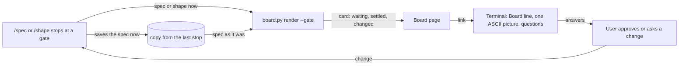
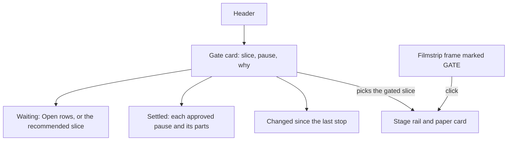
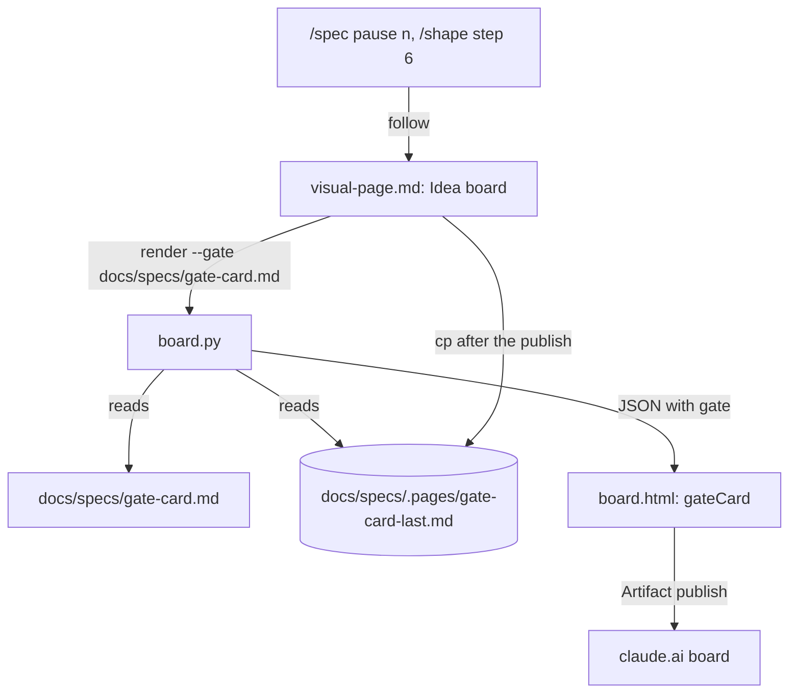
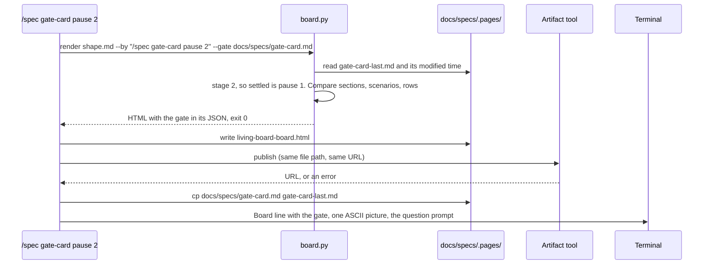

# Gate card

**Version:** v1 · **Status:** Shipped · **Type:** Feature · **Project type:** CLI/Library

**Shape doc:** docs/specs/living-board/shape.md
**Depends on:** idea-board

At each `/spec` pause and at the end of `/shape`, the idea board shows a gate card: what waits for your approval and why, what is settled so far, and what changed since the last stop. The terminal then prints only the board link, one ASCII picture and the questions.

## Problem

The pain of the living-board idea is worst at a pause. At each `/spec` pause the terminal prints a diagram, the scenarios, the slice test and the open items, and the spec behind them is 2,000 to 5,400 words. The user cannot see what changed since they last looked, or what they already agreed to. So they approve without following, or ask Claude to recap. The idea board shows where each slice stands, but it does not say what waits for the user now.

## Slice test

| Check                         | Result                                                                                                  |
| ----------------------------- | ------------------------------------------------------------------------------------------------------- |
| Cuts every layer it needs     | yes: the `/spec` and `/shape` pause steps, the copy kept at each stop, `board.py`, and the board page   |
| One e2e test walks it         | yes: render a fixture idea at pause 1, change the spec, render at pause 2, and check the card each time |
| Worth shipping alone          | yes: the user sees what waits for them and what changed at every pause, with no other slice shipped     |
| Fits (≤5 scenarios, ≤2 areas) | yes: 5 scenarios; the stage skills and the board builder                                                |

**Path:** full — it adds a new part to the board page and changes what the terminal prints at each pause.

## User story

As the person who approves each zuko pause, I want the board to show what waits for me, what I already agreed to and what changed since I last looked, so that I approve with confidence instead of asking Claude for a recap.

## Flow



At each stop, the stage gives `board.py` the spec as it is now and the copy from the last stop. The board shows the card, the stage saves a new copy, and the terminal prints the link, one picture and the questions. A change from the user brings the stage back to the same gate, and the next card shows that change.

## Acceptance criteria

```gherkin
Scenario: the first pause of a slice shows its gate card
  Given docs/specs/pr-gate.md has just been written, with 4 scenarios and 3 Open rows
  And no copy of pr-gate.md from an earlier stop exists
  When /spec pr-gate stops at pause 1
  Then the board's card for pr-gate reads "Waiting for you: pause 1, scope and acceptance"
  And it says why: "Approve to go on to the interface"
  And it lists the 3 Open rows, each with its question
  And its "Changed" part reads "First stop for this slice"
  And the terminal prints "Board: <url>", the Flow diagram in ASCII, then the question prompt

Scenario: a later pause shows what changed since the last stop
  Given pr-gate was approved at pause 1 with 4 scenarios
  And pause 2 has added the Interface section and Open rows O4 and O5, and resolved O1 to O3
  When /spec pr-gate stops at pause 2
  Then the card's "Settled" part shows pause 1 approved, with the names of its 4 scenarios and its Scope In line
  And its "Changed" part shows "Added: Interface", "New rows: O4, O5" and "Resolved: O1, O2, O3"

Scenario: a change asked at a pause shows on the next card
  Given pr-gate is stopped at pause 1
  When the user types "drop scenario 4, PRs from forks are out of scope"
  And /spec edits the spec and stops at pause 1 again
  Then the card's "Changed" part shows "Removed scenario: a PR from a fork" and "Changed: Scope"
  And nothing else is listed as changed

Scenario: /shape shows its gate card
  Given /shape has just written docs/specs/living-board/shape.md with 5 slices and no Open rows
  When /shape stops to ask which slice to spec first
  Then the board shows the card "Waiting for you: pick the first slice"
  And it names the recommended slice, idea-board, and why
  And the terminal prints "Board: <url>", the slice map in ASCII, then the question prompt

Scenario: no copy of the last stop exists
  Given pr-gate is at pause 2 and the copy from pause 1 was lost, because the session moved to another machine
  When /spec continue pr-gate stops at pause 2
  Then the card's "Changed" part reads "No copy of the last stop on this machine, so changes cannot be shown"
  And the "Waiting" and "Settled" parts show as usual
```

## Scope

**In:** one gate card on the board for each slice at a `/spec` pause, and one for a shape at the end of `/shape`; its three parts: waiting, settled, changed; the copy of the spec or shape kept at each stop; the shorter terminal print at a pause that has a board.

**Out:**

- A spec with no `**Shape doc:**` line has no board, so it gets no card. Its pauses print to the terminal as today. The board for those specs is **library**'s question (shape O8).
- The PR card at `/ship`: **pr-gate**.
- Answering a question on the board page itself. Answers stay in the terminal prompt.
- Stepping back through older stops: **replay**.

## Interface

**Preview:** https://claude.ai/artifact/33X27Ls4EvaLo7UDVU5fi1. It is built from the real `living-board` board, and its five buttons show one state per scenario. The buttons exist only in the preview.



The card sits between the header and the stage rail, and it opens the board on the gated slice. Its three columns read from left to right: what waits, what you already agreed, and what moved since you last looked.

**The card**

An amber frame, in the board's existing colours. It shows only on a render made at a stop. A render by `/build`, `/review` or `/ship` has no card.

| Part | What it shows | From |
| --- | --- | --- |
| Head | `◈ Waiting for you`, then `<slice> · Pause <n> · <name>`, then one line on how to approve | The stop |
| Waiting | `Waiting · <n> open`, then each Open row: its ID, its type and its What. With no Open row: `No open rows. Only the approval waits.` At pause 3, then `To approve with /build:` and each drafted D-entry's ID and title. At `/shape`, first `Recommended: <slice>.` with its Why this order cell | The spec's or shape's ledger; the shape's Slices table |
| Settled | One line per approved pause: `P1 ✓`, then the scenario names and the `**In:**` line; `P2 ✓`, then the bold lead-ins and `###` headings under `## Interface`. Then `<n> answered rows · see Answers`. With nothing approved: `Nothing approved yet for this slice.` | The spec |
| Changed | `Changed since pause <n>, <date> <time>`, then one line per change, each with a tag: `added`, `removed` or `changed` for a `##` section or a scenario; `new row`; `resolved` or `accepted risk` for a row that left Open | The spec against its last-stop copy |
| Filmstrip | The gated slice's frame gains a `GATE` tag | The stop |

The pause names and the approve lines:

| Stop | Name | How to approve |
| --- | --- | --- |
| Pause 1 | scope and acceptance | Approve in the terminal to go on to the interface. |
| Pause 2 | the interface | Approve in the terminal to go on to the technical plan. |
| Pause 3, and the light path's one pause | technical and ship plan | Run /build to approve. /build records the drafted decisions. |
| `/shape` | Pick the first slice | Answer the question prompt in the terminal to start /spec on a slice. |

The Changed part has three fixed messages:

- No copy at pause 1, or at the light path's one pause: `First stop for this slice.`
- No copy at pause 2 or 3 of the full path: `No copy of the last stop on this machine, so changes cannot be shown.`
- A copy that matches: `Nothing changed since the last stop.`

**The copy**

After the board is published, the stage copies the file as it is to `docs/specs/.pages/<slice>-last.md`. At `/shape`, the copy is `docs/specs/.pages/<idea>-shape-last.md`. The file's modified time gives the date in `Changed since`. The copy is git-ignored, like every file in `.pages/`.

**The terminal**

At a stop with a board, the terminal prints three things and nothing else before the prompt:

```
Board: https://claude.ai/artifact/6ZvDtf657jw6ohs94cyYvs  ·  gate: pause 1 of gate-card

<one ASCII picture>

<the question prompt>
```

The picture is the Flow diagram at pause 1, the Interface map at pause 2, the Approach architecture at pause 3, and the slice map at `/shape`. When the publish fails, the line is the localhost line from `visual-page.md`, then the same picture and prompt.

## Technical plan

### Approach

`board.py render` gains an optional `--gate <file>`, where the file is the spec or shape at the stop. With it, `board.py` reads the copy at `docs/specs/.pages/<name>-last.md` and compares it with the file. It then adds a `gate` object to the JSON, which `board.html` draws as the card. The stage publishes the board, then copies the file over the old copy. `visual-page.md` › "Idea board" holds the new steps. `/spec` and `/shape` pass `--gate` and print the shorter terminal output.

Relies on: D23 (ASCII in the terminal, Mermaid in pages), D41 (the last question approves a pause), D50 (one parser for spec rows), D62 (a script renders the board; Claude only publishes it), D63 (claude.ai page, localhost fallback). Drafted below: D65, D66, D67.



The stage runs `board.py` with `--gate`. `board.py` compares the spec with its last-stop copy and puts the card into the page. After the publish, the stage overwrites the copy.



The copy is written after the publish, also when the publish fails. The stop took place, and the localhost board shows the same card.

**How the script builds the gate**

| Part | Rule |
| --- | --- |
| Which stop | `--gate` names the shape given to `render`: a shape gate. `--gate` names `docs/specs/<name>.md` for a slice of the shape: a slice gate at `stage()` 1, 2 or 3, and a `Refined` spec counts as pause 3. Any other stage, or a spec that is not a slice of the shape: no card, and the board renders as before |
| Waiting | The ledger rows whose Status is `Open`: ID, Type and What. At pause 3, also the `## D<n> · <date> · <title>` lines inside the fences under `### Decisions to record` (O6). At a shape gate, the first slice in the table that is not Shipped, with its `Why this order` cell |
| Settled | Each pause below the current one that the spec has reached. Pause 1: the `Scenario:` names in the fence under `## Acceptance criteria`, and the `**In:**` line of `## Scope`. Pause 2, only when `## Interface` exists: its `###` headings and its lines that are only a bold lead-in. On the light path (`**Path:** light`), nothing is settled. Then the count of rows that `answers()` returns. A shape gate counts its rows that are not `Open` |
| Changed | No copy: `first` at pause 1, a shape or the light path's one pause, `missing` at pause 2 or 3. A copy: compare each `##` section, fences included, by its lines with blank lines dropped and spaces squeezed. Text above the first `##` is not compared, so a Status change is not news. `## Acceptance criteria` is compared by scenario name, and `## Open items` by row: a new ID is `new row`, and a row that left `Open` is tagged with its new Status. Nothing differs: `none` |
| Since | The copy's own `stage()` and its modified time, as `pause 1, 2026-10-26 14:02` |

### Changes

| File | What changes | Why |
| --- | --- | --- |
| `plugins/zuko/scripts/lib/board.py:77` | `slice_rows` also returns the `Why this order` cell | Scenario 4 |
| `plugins/zuko/scripts/lib/board.py` (new functions after `answers`, `:218`) | `raw_sections` (sections with fence lines kept), `scenarios`, `ledger` (ID to Status, Type and What), `settled`, `changed` and `gate`. `gate` returns the JSON object of the Interface section, or `None` | Scenarios 1 to 5 |
| `plugins/zuko/scripts/lib/board.py:244` | `board(shape, by, gate=None)` adds `"gate"` to the data | Scenarios 1 to 5 |
| `plugins/zuko/scripts/lib/board.py:310` | `main` takes `render|data <shape.md> --by <text> [--gate <file>]`. A `--gate` file that cannot be read: exit 2, as for a spec today. The usage text and the docstring name `--gate` | Scenarios 1 to 5 |
| `plugins/zuko/scripts/lib/board.html:135`, `:224`, `:297` | The card's CSS, a hidden `<section id="gate">` above the rail, and `gateCard(DATA.gate)` after `renderIdea`, taken from the preview without its state buttons. Every value goes through `esc()`. The `GATE` tag on the frame uses `CSS.escape` in its selector | The Interface section |
| `plugins/zuko/references/visual-page.md:94` | Step 1: at a stop, add `--gate <file>`. A new step after the publish: copy the file to `docs/specs/.pages/<name>-last.md`, also when the publish failed. Step 5: at a stop, the terminal line reads `Board: <url>  ·  gate: pause <n> of <slice>` | Scenarios 1 to 5 |
| `plugins/zuko/skills/spec/SKILL.md:76`, `:159`, `:230` | Each pointer passes `--gate docs/specs/<slice>.md` | Scenarios 1, 2, 3, 5 |
| `plugins/zuko/skills/spec/SKILL.md:80`, `:163`, `:234` | Each "Then stop": with a board, print the Board line, the one ASCII picture for this pause, then the prompt. Pause 3 keeps the spec path and the riskiest-choice line (O6). With no board, print as today | O4, scenarios 1 to 3 |
| `plugins/zuko/skills/shape/SKILL.md:160`, `:164` | The pointer passes `--gate docs/specs/<idea>/shape.md`, and the copy is `<idea>-shape-last.md`. "Then, in the terminal" with a board: the Board line, the slice map in ASCII, the design-system note when it applies, then the prompt | Scenario 4 |

Reusing: `pr_body.sections`, `pr_body.FENCE`, `pr_body.ROW` and `pr_body.CELL` (`scripts/lib/pr_body.py:33`); `board.stage`, `board.closes`, `board.cells`, `board.answers` and `board.blob`; `esc()` and `pick()` in `board.html`; the helpers in `scripts/tests/run.sh`.

### Earn-it

| Added | Triggered by |
| --- | --- |
| `--gate` on `render` and `data` | Scenarios 1 to 5. Without it, a `/build` render would show a stale card |
| The last-stop copy | Scenarios 2, 3 and 5; O1 |
| `raw_sections` | `pr_body.sections` drops fence lines, so a changed scenario or diagram would not show as changed |

### Non-functionals

|                      |                                                                               |
| -------------------- | ----------------------------------------------------------------------------- |
| **Load**             | One compare at each stop, between two files of up to about 40 KB. The idea-board spec is 33 KB. This adds well under a second to a render |
| **Breaks first**     | At 10×, a 400 KB spec: the compare is still linear, line by line. A long "Changed" list is the real limit, and it is one line per section, scenario or group of rows |
| **Security surface** | Called by Claude at a stop. It reads two Markdown files in the repo. Every value reaches the page through `blob()` and `esc()`, the same path as today. No secrets. The copy is git-ignored, so it never reaches a commit |
| **Proof it works**   | The terminal line `Board: https://claude.ai/artifact/…  ·  gate: pause 2 of gate-card`, and the card on the board |
| **Rollout**          | No flag: it ships with the next zuko release. Rollback: revert the merge. The old `.pages/*-last.md` files stay and are not read |

### Test plan

| Scenario | Test | Command |
| --- | --- | --- |
| 1 first pause | `test-gate.sh`: a fixture spec at pause 1 with no copy gives `pause: 1`, its 3 Open rows, no settled pauses and `first` | `bash plugins/zuko/scripts/tests/run.sh gate` |
| 2 a later pause | `test-gate.sh`: a pause 2 spec against its pause 1 copy gives settled pause 1 with 4 scenario names and the In line, `added: Interface`, `new row: O4, O5` and `resolved: O1, O2, O3` | `bash plugins/zuko/scripts/tests/run.sh gate` |
| 3 a change at a pause | `test-gate.sh`: a copy with one more scenario and another Scope gives exactly `removed` for that scenario and `changed: Scope`. A Status-line change gives `none` | `bash plugins/zuko/scripts/tests/run.sh gate` |
| 4 /shape | `test-gate.sh`: `--gate` on the shape gives kind `shape`, the first slice that is not Shipped, and its Why this order cell | `bash plugins/zuko/scripts/tests/run.sh gate` |
| 5 no copy | `test-gate.sh`: a pause 2 spec with no copy gives `missing` | `bash plugins/zuko/scripts/tests/run.sh gate` |
| No card | `test-gate.sh`: no `--gate`, or `--gate` on a Built spec, gives `"gate": null` | `bash plugins/zuko/scripts/tests/run.sh gate` |
| Stage steps | `test-gate-steps.sh`: `visual-page.md` has the `--gate` step and the copy step after the publish, the three `/spec` pointers and the `/shape` pointer pass `--gate`, and each "Then stop" names the shorter print | `bash plugins/zuko/scripts/tests/run.sh gate-steps` |
| The page script | `test-board-dom.sh`: a gate with `` in an Open row's What shows as text, and the card is above the rail | `bash plugins/zuko/scripts/tests/run.sh board-dom` |
| Nothing broke | The board tests that exist | `bash plugins/zuko/scripts/tests/run.sh board` and `bash plugins/zuko/scripts/tests/run.sh e2e-board` |

**E2E:** `scripts/tests/test-e2e-gate.sh` walks the slice in one fixture repo. It renders the shape gate and copies the shape. It writes `pr-gate.md` at pause 1, renders it and copies it. It edits the spec as a user change asks, and renders a second stop at pause 1. It adds an Interface section, resolves rows, and renders pause 2. Then it deletes the copy and renders pause 2 again. Each step checks the gate in the `data` JSON. The real publish and the terminal print are checked by hand at the next `/spec` pause.

### Chunks

| Chunk | Scenarios | Files owned |
| --- | --- | --- |
| A | 1 to 5, the script and page | `scripts/lib/board.py`, `scripts/lib/board.html`, `scripts/tests/test-gate.sh`, `scripts/tests/test-e2e-gate.sh`, `scripts/tests/test-board-dom.sh` |
| B | 1 to 5, the stage steps | `references/visual-page.md`, `skills/spec/SKILL.md`, `skills/shape/SKILL.md`, `scripts/tests/test-gate-steps.sh` |

### Risks

| Risk | Mitigation |
| --- | --- |
| Claude forgets the copy step, so every stop says `First stop` or `missing` | `test-gate-steps.sh` checks that the step is in `visual-page.md`, after the publish. The card says plainly that it has no copy, so the gap shows and is not hidden |
| A scenario is renamed, and shows as one removed and one added | Accepted: the names are the user's words, and a rename is a change worth seeing |
| The copy is from an older round of the same pause, after a session crashed before the copy step | The "since" text names the copy's pause and time, so an old copy is visible |
| Two sessions on the same slice overwrite each other's copy | One user, one session per slice in practice. The card names the time of the copy it read |

### Decisions to record

Recorded as D65, D66, D67.

## Review

2026-10-26 · 5 raw findings, 4 survived, 4 fixed.

- correctness · `plugins/zuko/skills/spec/SKILL.md:85` · the short pause print names the failed-publish line too · `876f420`
- correctness · `plugins/zuko/scripts/lib/board.py:380` in `gate` · a Refined spec at a stop gets the pause 3 card · `39a755a`
- correctness · `plugins/zuko/scripts/lib/board.py:380` in `gate` · no copy at the light path's one pause is a first stop · `7fdca48`
- correctness · `plugins/zuko/scripts/lib/board.py:319` in `settled` · nothing settled at the light path's one pause · `7fdca48`

## Open items

| ID | What | Type | Raised at | Owner | Status | Answer |
| --- | --- | --- | --- | --- | --- | --- |
| O1 | "What changed since the last pause" needs the spec as it was at the last stop, but the spec is not committed between pauses. Where does that copy come from? (from shape O6) | question | shape | user | Resolved | Each stop saves `docs/specs/.pages/<slice>-last.md` (a shape: `<idea>-shape-last.md`). It is git-ignored, so it lives on this machine only, and scenario 5 covers a missing copy, 2026-10-26 |
| O2 | What does the "Changed" part list: a summary by section, scenario and ledger row, or a full line diff? | question | spec p1 | user | Resolved | A summary: sections added, removed or changed; scenarios added, removed or changed, by name; ledger rows new or resolved, 2026-10-26 |
| O3 | What does the "Settled" part list for each approved pause? | question | spec p1 | user | Resolved | Each approved pause with its parts: pause 1 the scenario names and the Scope In line, pause 2 the interface parts. Then a count of answered rows that links to the Answers panel, 2026-10-26 |
| O4 | With a board, the terminal at a pause prints only the Board line, one ASCII picture and the questions. The scenarios, slice test and Open rows leave the terminal. Is that right? | question | spec p1 | user | Resolved | Yes. The board carries the detail, and the question prompt still asks every Open row, 2026-10-26 |
| O5 | The spec file does not record an approval. After the user approves pause 1, the board still shows pause 1 waiting until pause 2 stops and republishes. | flag | spec p1 | user | Accepted risk | The next stop republishes, usually within minutes. An approval field in the spec would be one more thing for every gate to read, 2026-10-26 |
| O6 | Pause 3 has no question to approve: `/build` approves it, with the drafted D-entries. If the terminal prints only the Board line, a picture and the prompt, the drafted entries leave the terminal. Where do they show? | question | spec p3 | user | Resolved | At pause 3, the card's Waiting column lists each drafted entry's title. The terminal also keeps the spec path and the riskiest-choice line. The full entries stay in the spec, 2026-10-26 |
| O7 | The spec did not say what the "since" text reads at a shape gate. | flag | build | user | Decided alone | Chose: `the last stop, <date> <time>`. Other: `pause <n>`, but `stage()` on a shape always gives 1. Undo: change the `where` line in `gate()` in `board.py`. 2026-10-26 |
| O8 | The Changed rule names only "new row" and "left Open". A row deleted from the ledger, or an Open row whose What was edited, is not listed. | flag | build | user | Decided alone | Chose: list only those two, as the spec says. Other: also list deleted rows and edited Open rows. Undo: add both cases to `changed()` in `board.py` and to `test-gate.sh`. 2026-10-26 |
| O9 | Pause 2 with a board printed only the Board line, the Interface map and the prompt (D67), so a web UI slice lost its preview link, which the board does not carry. | flag | build | user | Decided alone | Chose: the pause 2 print lists the preview link as item 3, when the slice has a preview. Other: three items only, as D67 words it. Undo: `git revert` the commit "keep the preview link in the pause 2 print with a board". 2026-10-26 |
| O10 | O6 named the spec path and the riskiest choice for the pause 3 line; the old line also had the page link. | flag | build | user | Decided alone | Chose: keep the page link in that line. Other: spec path and riskiest choice only. Undo: drop "the page link" from item 3 of pause 3 in `skills/spec/SKILL.md` and from `test-gate-steps.sh`. 2026-10-26 |
| O11 | `test-idea-board.sh` and `test-pause-questions.sh` pin the old pointer and pause 1 sentences word for word, so the new text had to fit around them. | flag | build | user | Decided alone | Chose: `--gate` sits in a sentence before each board pointer, and pause 1 keeps its no-board print first, then the board print. Pauses 2 and 3 put the board print first. Other: loosen those two tests and use one order at all three pauses. Undo: change the two pinned checks, then move the text. 2026-10-26 |
| O12 | Review: the gate rule gave no card to a `Refined` spec, so a second stop at pause 3 after a change lost its card. | flag | review | user | Decided alone | Chose: `board.py` treats a `Refined` spec at a stop as pause 3, and the rule in "How the script builds the gate" says so. Other: have `/spec` set `Refined` only after the last stop. Undo: `git revert 98763f4 39a755a`. 2026-10-26 |
| O13 | Review: the light path's one pause read as pause 3, so Settled claimed pause 1 was approved and a missing copy read as lost. | flag | review | user | Decided alone | Chose: `board.py` reads the `**Path:** light` line: nothing settled, and no copy is a first stop. The Interface and the gate rules say so. Other: keep the rule as approved. Undo: `git revert 7fdca48`. 2026-10-26 |
| O14 | The plan did not name `plugins/zuko/scripts/tests/test-idea-board.sh`, but it pins the `/shape` Board list item word for word, and the review fix for the failed-publish line changed that item. | flag | review | user | Decided alone | Chose: update that one check to the new item text. Other: keep the old item text in `/shape` and leave the failed-publish case out of its list. Undo: `git revert 876f420` and the test commit after it. 2026-10-26 |

## Glossary

- **Board** — the claude.ai page for one idea, rebuilt from its shape, specs and decisions.
- **Gate card** — the part of the board that says what waits for your approval and why.
- **Stop** — each time `/spec` or `/shape` halts to ask the user. A pause can have several stops when the user asks for changes.
- **Ledger** — the Open items table in a spec or shape.
- **D-entry** — one numbered entry in `DECISIONS.md`: a choice, why, and what was rejected.
- **Git-ignored** — listed in `.gitignore`, so git never tracks or commits the file.
- **e2e** — end-to-end: one test that walks the whole slice as a user would.
