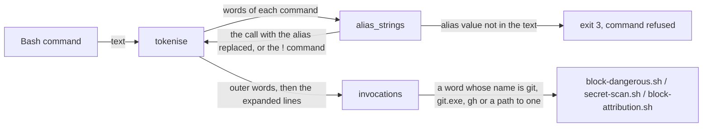
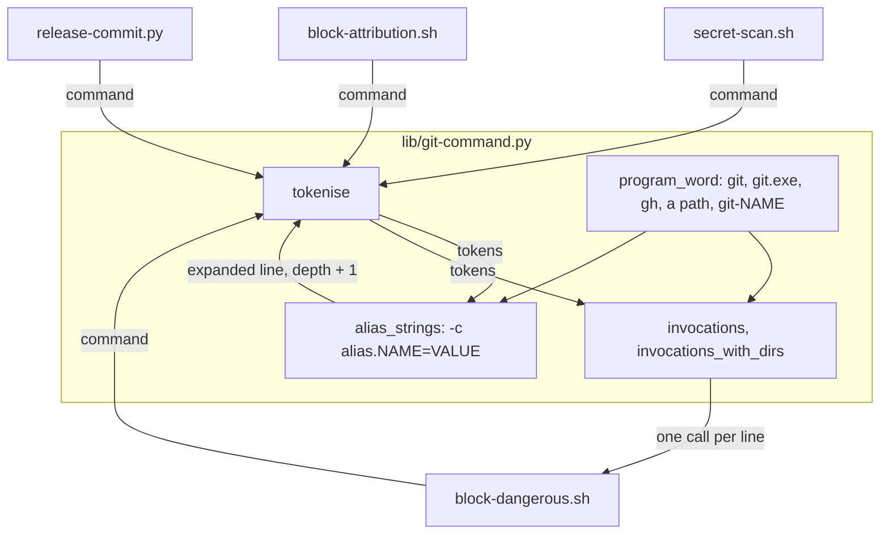
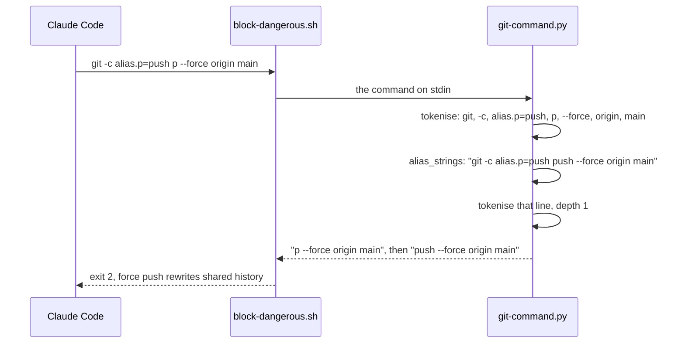

# Git spellings

**Version:** v1 · **Status:** Refined · **Type:** Bug · **Project type:** CLI/Library

**Depends on:** nested-git-commands

The shared git parser reads a path to git or gh as the program, and reads an
inline `-c alias.NAME=VALUE` as the command it runs. It refuses an alias whose
value the text does not show. This closes the rest of v2.7.0 S5 that
`nested-git-commands` left to this slice.

## Problem

`git-command.py` starts a git call only at a word that is exactly `git`. bash
runs git from other words too. I ran 16 spellings against the real
`block-dangerous.sh` on 2026-11-11. 14 of them exit 0 with a force push to
`main`:

| Spelling | Exit |
| --- | --- |
| `/usr/bin/git push --force origin main`, `./git`, `~/bin/git` | 0 |
| `git.exe push ...`, `"/c/Program Files/Git/cmd/git.exe" push ...` | 0 |
| `/usr/libexec/git-core/git-push --force origin main` | 0 |
| `git -c alias.p=push p --force origin main` | 0 |
| `git -c 'alias.p=!git push --force origin main' p` | 0 |
| `git --config-env alias.p=X p --force origin main` | 0 |
| `GIT_CONFIG_COUNT=1 GIT_CONFIG_KEY_0=alias.p GIT_CONFIG_VALUE_0=push git p ...` | 0 |
| `git config alias.p push && git p --force origin main` | 0 |
| `$(which git) push ...`, `"$(command -v git)" push ...`, `G=git; $G push ...` | 0 |
| `\git push ...`, `'git' push ...` | 2 |

The commit-on-main, secret-scan and attribution guards read the same parser,
so each spelling also hides a commit on `main`, a staged secret or a signed
commit. `/usr/bin/gh pr create --body "Co-Authored-By: Claude"` gets past the
attribution guard in the same way.

git 2.52.0 facts this slice rests on, each run in a scratch repo on
2026-11-11:

- `git -c alias.a=b -c 'alias.b=log --oneline -1' a` runs `log`: aliases chain.
- `git -c alias.status='log' status` runs `status`: git ignores an alias that
  has the name of a builtin.
- `git -c 'alias.e=!echo ran' e one two` prints `ran one two`: a `!` alias is
  a shell command, and git adds the arguments after it.
- `git --config-env alias.q=X q` and `--config-env=alias.q=X` both run the
  value of `$X`.
- `git -c alias.P=status p` runs `status`: alias names ignore case.
- `git -calias.p=status p` fails with `unknown option`: `-c` takes its value
  only as the next word.

## Slice test

| Check                         | Result                                                                               |
| ----------------------------- | ------------------------------------------------------------------------------------ |
| Cuts every layer it needs     | Yes. The parser, and the guard tests that run the real hooks                         |
| One e2e test walks it         | Yes. `test-block-dangerous.sh` feeds the real hook a real payload for each spelling  |
| Worth shipping alone          | Yes. It closes the `/usr/bin/git` and `git -c alias.*` parts of v2.7.0 S5            |
| Fits (≤5 scenarios, ≤2 areas) | Yes. 5 scenarios, 1 area (scripts). With config-file aliases it was 6 (O1)           |

**Path:** light. A bug fix in 3 files, with no new interface, data or
dependency. Pauses 1 and 3 merged, pause 2 skipped.

## Flow



`tokenise` finds each git call that uses an inline alias. It adds the call
again with the alias replaced, after a newline, and parses that line too. The
original line stays, so the guards see both. `invocations` then starts a call
at any word whose last path part is `git`, `git.exe`, `gh` or `gh.exe`.

## Acceptance criteria

```gherkin
Scenario: a path to git or gh is read as the program
  Given the command /usr/bin/git push --force origin main
  When block-dangerous.sh judges it
  Then it exits 2 with "force push rewrites shared history"
  And ./git, ~/bin/git, git.exe and "C:/Program Files/Git/cmd/git.exe" followed by push --force origin main are blocked the same way
  And /usr/libexec/git-core/git-push --force origin main is blocked the same way
  And /usr/bin/git commit -m "fix: round refunds" in a repo on main is blocked as a commit on main
  And /usr/bin/gh pr create --title "fix: round refunds" --body "Co-Authored-By: Claude" is blocked by block-attribution.sh

Scenario: an inline alias is read as its command
  Given the command git -c alias.p=push p --force origin main
  When block-dangerous.sh judges it
  Then it exits 2 as a force push
  And git -c alias.P=push p --force origin main is blocked the same way
  And git -c alias.a=b -c "alias.b=push --force" a origin main is blocked the same way
  And git -c alias.status=log status, which git runs as status, exits 0
  And git -c alias.c=commit c -m "fix: round refunds" in a repo on main is blocked as a commit on main
  And git -C <the main repo> -c alias.c=commit c -m "fix: round refunds", run from a repo on a feature branch, is blocked as a commit on main

Scenario: a shell alias is read as a nested command
  Given the command git -c 'alias.p=!git push --force origin main' p
  When block-dangerous.sh judges it
  Then it exits 2 as a force push
  And git -c 'alias.p=!git push' p --force origin main is blocked the same way, because git adds the arguments after the ! command

Scenario: an alias whose value the text does not show is refused
  Given the command git --config-env alias.p=PUSH p --force origin main
  When block-dangerous.sh judges it
  Then it exits 2 with "this command could not be checked"
  And --config-env=alias.p=PUSH is refused the same way
  And GIT_CONFIG_COUNT=1 GIT_CONFIG_KEY_0=alias.p GIT_CONFIG_VALUE_0=push git p --force origin main is refused the same way
  And git config alias.p push && git p --force origin main is refused the same way
  And git -c "alias.p=$PUSH" p origin main is refused the same way
  And git --config-env alias.p=PUSH status exits 0, because no call runs p

Scenario: text stays text, and the standard forms still pass
  Given a repo on main
  When block-dangerous.sh judges grep -rn git-commit docs/
  Then it exits 0
  And cat plugins/zuko/scripts/lib/git-command.py exits 0
  And git -c alias.st=status st exits 0
  And git -c core.pager=cat log --oneline -5 exits 0
  And /usr/bin/git status exits 0
  And /usr/bin/git commit -m "fix: round refunds" on a feature branch exits 0
```

## Scope

**In:**

- A word whose last path part is `git`, `git.exe`, `gh` or `gh.exe`, in any
  case for `.exe`, with `/` or `\` as the path separator.
- A word with a `/` or `\` whose last part is `git-NAME`: git's dashed form,
  read as `git NAME`.
- `-c alias.NAME=VALUE` among git's own options, for the call whose
  subcommand is NAME, with chains to the depth cap of 3 (D138).
- A `!` alias: its command, with the call's arguments after it, as a nested
  command.
- A refusal when a git call's subcommand is NAME and the text has `alias.NAME`
  in a word that is not a readable `-c alias.NAME=VALUE` of that call. A value
  with `$` or a backtick is not readable.

**Out:**

- An alias saved in `~/.gitconfig` or `.git/config` by an earlier command, and
  a `gh alias set` alias: a later slice `config-aliases` (O1).
- A command word made by a substitution or a variable: `$(which git)`,
  `"$(command -v git)"`, `$G`. Accepted risk (O2).
- The `git checkout main && git commit` part of S5: the planned slice
  `branch-switch-commit`.
- A bare `git-push` with no `/`, found on a PATH that holds git's libexec
  folder (O6).
- The 11 Strix leads under Needs validation in the v2.7.0 report.

## Technical plan

### Approach

The change is in one file, `lib/git-command.py`. `invocations` and
`invocations_with_dirs` start a call at a new `program_word(token, program)`
test in place of `token == program`. `tokenise` gets a third source of nested
lines, `alias_strings(tokens)`, next to `quoted_substitutions` and
`shell_strings`. For a plain alias, the nested line is the same command with
the alias word replaced by the split value. So `sudo`, `GIT_DIR=`, `-C` and the
other aliases stay on the line, and the next parse expands a chain. For a `!`
alias, the nested line is its shell command and the call's arguments. That
line starts with a `cd` that the walk cannot resolve, so the guards check every
directory that the commit could use. An alias that the text does not show
raises `ValueError`, and each caller already blocks that (D52).

Relies on: D51 (each nested parse stays under the 64 KB limit), D52 (a
command the parser cannot read is blocked), D138 (nested lines and the depth
cap of 3), and the drafted entries below.





### Changes

| File | What changes | Why |
| ---- | ------------ | --- |
| `plugins/zuko/scripts/lib/git-command.py` | New `program_word(token, program)`: the arguments that a call starts with, or None. The name is the part after the last `/` or `\`, with a `.exe` of any case dropped. It returns `[]` when the name is `program`. For git and a word with a separator, it returns `[NAME]` when the name is `git-NAME` | Scenarios 1, 5 |
| `plugins/zuko/scripts/lib/git-command.py:747`, `:781` | `elif token == program:` becomes `elif program_word(token, program) is not None:`, and `args` starts as its result | Scenario 1 |
| `plugins/zuko/scripts/lib/git-command.py` | New `alias_strings(tokens)`. It walks the commands of `tokens` as `shell_strings` does (`:558`). For each git word it walks git's own options as `subcommand_args` does (`:630`), and collects each `-c alias.NAME=VALUE`, with NAME in lower case. Subcommand NAME with a value gives the nested line. A plain value gives `shlex.join` of the words before the alias word, then `shlex.split(VALUE)`, then the words after it. A `!` value gives `cd "$GIT_PREFIX" && ` with the command and `shlex.join` of the arguments | Scenarios 2, 3 |
| `plugins/zuko/scripts/lib/git-command.py` | In `alias_strings`, raise `ValueError` when subcommand NAME has no readable value and a word of the text matches `alias.NAME` (case ignored). That word can be a `--config-env` value, a `GIT_CONFIG_KEY_n=` prefix or a `git config` argument. A value with `$` or a backtick is not readable | Scenario 4 |
| `plugins/zuko/scripts/lib/git-command.py:612` | `nested` also takes `alias_strings(tokens)`. The module docstring and the `invocations` docstring name the new words and the alias lines | Scenarios 2–4 |
| `plugins/zuko/scripts/tests/test-block-dangerous.sh` | The cases for scenarios 1 to 5, in the scratch repo on `main` and on a feature branch | Scenarios 1–5 |
| `plugins/zuko/scripts/tests/test-block-attribution.sh` | `/usr/bin/gh pr create` with a Claude co-author body is blocked | Scenario 1 |

Reusing: `shell_strings`' command walk, `subcommand_args`' option walk and
`GLOBAL_OPTIONS_WITH_VALUE`, the nested path in `tokenise` with
`MAX_NESTING`, `resolve` returning None for a path with `$`, and
`run_hook`, `expect_exit` and `expect_match` in the tests.

### Earn-it

| Added | Triggered by |
| ----- | ------------ |
| `program_word` | Scenario 1. Two loops test the program word, and scenario 5 needs one rule for both |
| `alias_strings` | Scenarios 2 to 4. shlex gives the words, and only a walk of git's own options can tell an alias definition from a commit message |

### Non-functionals

|                      |                                                                                                                       |
| -------------------- | --------------------------------------------------------------------------------------------------------------------- |
| **Load**             | One more walk of the tokens for each Bash call. A reparse happens only for a call that uses an inline alias           |
| **Breaks first**     | Nothing new. A chain of aliases stops at the depth cap of 3 (D138), so each command is parsed at most 4 times         |
| **Security surface** | Closes the `/usr/bin/git` and `git -c alias.*` parts of v2.7.0 S5. It only adds lines and refusals, and keeps every line the old parser printed. The verifier fence refuses `$` and only allows `--no-pager` and `-P` before the subcommand, so the change does not touch it. The pentester fence and `block-pentest-target.sh` see more lines and can only block more |
| **Proof it works**   | `bash plugins/zuko/scripts/tests/run.sh block-dangerous` and `run.sh block-attribution` pass, with the new cases      |
| **Rollout**          | No flag. It ships with the next zuko release. Rollback: revert the build commits                                      |

### Test plan

| Scenario | Test | Command |
| -------- | ---- | ------- |
| 1. A path to git or gh is read | `test-block-dangerous.sh`, `test-block-attribution.sh` | `bash plugins/zuko/scripts/tests/run.sh block-dangerous`, then `run.sh block-attribution` |
| 2. An inline alias is read | `test-block-dangerous.sh` | `bash plugins/zuko/scripts/tests/run.sh block-dangerous` |
| 3. A shell alias is read | `test-block-dangerous.sh` | same |
| 4. A hidden alias is refused | `test-block-dangerous.sh` | same |
| 5. Text stays text | `test-block-dangerous.sh` | same |

**E2E:** `test-block-dangerous.sh` runs the real hook script on each payload,
as Claude Code runs it, in a scratch repo on `main`.

**Replay:** a scratch script runs each Bash command from the local session
logs through the `origin/main` parser and the new one. It lists each command
whose exit code or output changes. Each new block must be a real git call by a
path or an alias. The script and its output stay in the scratchpad, because
the logs hold private data. Then the full suite:
`bash plugins/zuko/scripts/tests/run.sh`.

### Chunks

Single chunk.

### Risks

| Risk | Mitigation |
| ---- | ---------- |
| A word that is a path to a file named `git`, or a script path such as `tools/git-commit`, now starts a call. On `main` that blocks a real command | Only a word with a subcommand that a guard matches can block. The replay over real commands finds each new block before ship |
| An alias value that git splits in a different way from `shlex.split` | `shlex.split` raises on a quote it cannot close, and that is a refusal. git's own split joins quotes the same way for the values that the tests use |
| The `!` alias line and the lines after it lose their known directory | Unknown means the guard checks both the start and the project directory (D52's path). It can only block more |

### Decisions to record

```markdown
## D139 · 2026-11-11 · The git guards read a path to git or gh as the program, and git's dashed form only with a path

Why: the v2.7.0 pentest proved S5: `/usr/bin/git push --force origin main` passed every git guard, and `/usr/libexec/git-core/git-push` did too. bash runs the same program for each path, so the parser tests the last path part, with `.exe` dropped, for git and gh in one helper.
Rejected: a list of known install paths (misses `./git` and each new install), the dashed form for every `git-NAME` word (`grep -rn git-commit docs/` on `main` would block as a commit), git only (`/usr/bin/gh pr create` passes the attribution guard the same way).
Source: specs/git-spellings.md
Status: active
```

```markdown
## D140 · 2026-11-11 · An inline git alias is read as one more line, and an alias the text does not show is refused

Why: the v2.7.0 pentest proved S5: `git -c alias.p=push p --force origin main` passed every git guard. The parser adds the call again with the alias replaced, and keeps the original line, because git ignores an alias with a builtin's name. An alias set by `--config-env`, `GIT_CONFIG_KEY_n`, `git config` or a `$` value has no value in the text, so the command is refused (D52).
Rejected: replace the call by its expansion (`git -c alias.push=status push --force` would read as `status --force` and pass), let a hidden alias through (`git config alias.p push && git p --force` passes), read `~/.gitconfig` and `.git/config` aliases now (a hook runs `git config` on each call, and the slice fails Fits: later slice config-aliases).
Source: specs/git-spellings.md
Status: active
```

## Open items

| ID | What | Type | Raised at | Owner | Status | Answer |
| -- | ---- | ---- | --------- | ----- | ------ | ------ |
| O1 | An alias saved in `~/.gitconfig` or `.git/config` (`git pf`, with pf = push --force) also passes. Covering it needs the hook to run `git config` on each call. In this slice, a later slice, or accepted risk? | question | spec p1 | user | Resolved | A later slice, `config-aliases`. With it, this slice has 6 scenarios and fails Fits. 2026-11-11 |
| O2 | A command word made by a substitution or a variable (`$(which git) push --force`, `G=git; $G push --force`) passes. Refuse each `$` command word, or accept? | question | spec p1 | user | Accepted risk | The value is not in the text, as for `eval "$X"` in nested-git-commands O3. A refusal would also block `"$PYTHON" x.py` and `$EDITOR file`. 2026-11-11 |
| O3 | An alias whose value the text does not show (`--config-env`, `GIT_CONFIG_KEY_n`, `git config alias.p push && git p`, `-c "alias.p=$X"`): refuse, or let through? | question | spec p1 | user | Resolved | Refuse. block-dangerous.sh says the command could not be checked (D52). 2026-11-11 |
| O4 | `/usr/bin/gh pr create` with a Claude co-author body passes the attribution guard. Include gh paths here? | question | spec p1 | user | Resolved | Include. One rule for git and gh, and one test in `test-block-attribution.sh`. 2026-11-11 |
| O5 | shlex drops quotes, so the parser cannot tell `-c 'alias.p=!f() { git push "$@"; }; f'` (bash keeps the `$`) from `-c "alias.p=$X"` (bash expands it). This slice refuses each alias value with `$` or a backtick, so the common `!f() { ...; }; f` alias form is refused too | flag | spec p1 | user | Accepted risk | Claude rarely writes an inline shell alias, and the refusal names the fix: split the command. Reading the raw quotes adds code to the part of the parser that broke most in #146 and #147. 2026-11-11 |
| O6 | git's dashed form is read only in a word with a path separator. A bare `git-push --force origin main` passes, but it runs only when git's libexec folder is on PATH. It is not on PATH on this Linux machine. I did not check Git for Windows | flag | spec p1 | user | Accepted risk | Reading every `git-NAME` word would block `grep -rn git-commit docs/` on `main` as a commit. 2026-11-11 |

_Never delete this section or its rows. See references/ledger.md._

## Glossary

- **Alias** — a git name for another command, set as `alias.NAME` in git's config or with `-c` for one call. A value that starts with `!` is a shell command
- **Builtin** — a subcommand that git has in its own program, such as `push`, `commit` or `status`
- **Dashed form** — `git-push` in place of `git push`: the program that git runs for a subcommand, kept in git's libexec folder
- **libexec** — the folder that holds the programs a tool runs for itself, not for the user, such as `/usr/libexec/git-core`
- **shlex** — Python's standard module that splits a command line into words as a shell does, without running it
- **e2e** — end-to-end: one test that walks the whole slice as a user would
