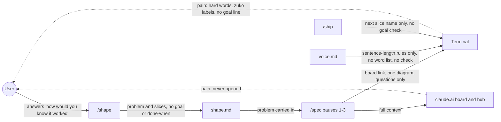
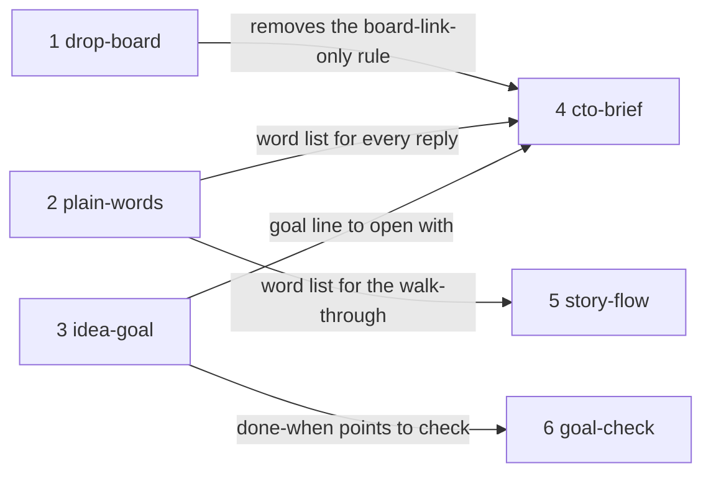

# Goal thread

**Project type:** CLI/Library · **Status:** Shaped

## Problem

The user loses an idea's goal as it moves from `/shape` to `/spec` to `/build`: between slices, at spec pauses, and after a slice ships. Each stage gives its context as long terminal replies in hard words and zuko labels, or as a claude.ai board that the user never opens, and each new open question or assumption reads as the idea drifting.

## Goal

**Locked:** 2026-11-26, by the user after the read-back.

You keep each idea's goal in sight from `/shape` to `/ship`, and you understand every zuko reply well enough to decide.

Done when:

1. **Goal shown everywhere.** Each reply from `/shape` to `/ship`, and the top of each shape and spec, shows the goal line and its points.
2. **Goal checked at ship.** `/ship` and `/status` say which points are met, and which slice still owes each one.
3. **Plain words in files.** The word check passes on each shape and spec: no zuko label used alone, no listed metaphor and no listed hard word.
4. **You follow a real idea.** On the next real idea, you read each reply to the end and can say what it decided, with no re-explaining. You judge this point.

## Today

A real example, from the ask-up-front idea:

1. In October the user shaped ask-up-front. The user wanted to understand what zuko asks and what it decides.
2. Slice 2, ste-voice, was meant to make zuko's writing plain.
3. At its pause, the spec asked "how do we prove that zuko follows STE?". It recommended "no check script, a person checks it at the next stop", and the user approved.
4. The slice shipped with the STE sentence rules only, not the word list.
5. Six weeks later the replies were still hard to read, and nobody had checked. Nothing in `shape.md` held the goal, so nothing showed that the slice missed it.

This cost the user in three ways: approvals given without understanding, a slice built wrong (ste-voice), and time spent asking where things stood.

The goal is like a destination that you tell a taxi driver once, at the start. After that the driver talks only about lanes and turns. You hear each turn, but you cannot tell whether you are still going to the right place.

## Slices

| # | Slice | Completes | What ships | Why this order |
|---|-------|-----------|-----------|----------------|
| 1 | drop-board | supports 1 and 4 | No stage publishes the idea board, the hub or the spec page. `board.py`, `board.html` and their tests go. D62 to D77 and D108 are superseded. The PR body loses its board line, and OVERVIEW.md loses its Page column. All 35 published pages are deleted, with a confirm for each page. | Saves time and tokens at every stage on its own. It removes D67, the rule that a pause prints only the board link, so the later slices change fewer steps. |
| 2 | plain-words | 3 | `voice.md` gets a zuko word list. A zuko label is never used alone: the reply says what it means first. Metaphors and odd meanings are replaced with literal words, and plain swaps replace hard words. A check runs right after Claude saves a shape or spec, so Claude fixes a line before the user reads it. When the user's own STE copy is found outside the repo, the gate also flags words that STE does not approve. This supersedes D37 and part of D38. | The user's clearest pain. Every later plan is then written in the new words. |
| 3 | idea-goal | 1, with cto-brief | `/shape` writes a `## Goal`: one line, then two to four "Done when" points from the user's own answer. Each slice row names the points that it completes. `/spec` copies the goal in, or asks for one at pause 1 when there is no shape. Every stage's reply opens with the goal line and the points. Because the goal is fixed, `/shape` asks with no question limit. It locks the goal only when three tests pass: Claude can tell the idea back as a story with a real example, each Done when point has a yes-or-no test, and the user answers "yes, that's it" to the read-back. The goal is fixed: no answer at a pause changes it. A check fails a new shape or spec with no Goal, and an old shape passes with "Goal: none, older shape". | The goal then exists in the files and shows at every stage. Slices 4 and 6 read it. |
| 4 | cto-brief | 1 and 4 | From `/shape` to `/ship`, each stage's terminal reply has the same four parts in plain words: Goal, Where we are, Your call, Next. Each open item under Your call says how it fits the goal, such as "fits Done when 2" or "detail only". An answer that goes against the goal is flagged as "does not fit the goal", and is not taken. Each `shape.md` and spec opens with the same four-part brief, and each stage keeps it current. No length cap. | Fixes the replies that the user does not finish, and the drift feeling, in the terminal and in the files. Needs slice 1's removed rule and slice 3's goal. |
| 5 | story-flow | 4 | A hard idea is explained as a walk-through of one real example: who does what, what that starts, what happens next. Real names, real dates, numbered steps that match a diagram, then one analogy from ordinary life, and one line on where the analogy stops working. The after-save check fails an Interface or Approach section with no numbered steps or no analogy. This holds in spec design sections, in the shape's Today, at pause replies, and in any reply from `/shape` to `/ship`. | The user can picture how the parts work and relate to them. Uses slice 2's word list. |
| 6 | goal-check | 2 | `/ship` checks each Done when point against what has shipped: met by which slice, or which slice still owes it. It names the proof, such as the test that passes, and the user confirms each tick. The PR body gets a short table: each scenario, its test, pass or fail, and the point it serves. A point that only the user can judge is asked after the last slice. `/status` shows the same count. When every point is met, `/ship` says that the idea is done. | Answers "was the goal met?" after shipping. Needs slice 3's points. |

## Not doing

- **A hard length cap on replies.** The user chose a fixed shape with no cap. A short reply must never cost detail.
- **Fewer questions at a pause.** Claude would decide detail questions alone, which supersedes D39. The user chose to tie each question to the goal instead.
- **Board off by default, or the hub only.** The user does not open either page and calls them a waste of time and tokens.
- **A Goal for the seven old shapes.** Only new shapes get one. A stage that reads an old shape with no Goal says so in one line and goes on.
- **The STE dictionary in the repo.** The repo is public, and the standard warns against copies passed on through other sites. The user keeps a private copy instead.
- **The AGPL STE word list from PyPI** (`biz-dfch-asdste100vocab`). Its license clashes with an MIT plugin.
- **A check on terminal replies.** A script cannot see a reply. Replies follow the word list as a prompt rule.
- **A before-and-after storyboard as the story.** The user wants one real example walked step by step, then an analogy.
- **New reply rules for `/release` and the helpers** (`/debug`, `/poc`, `/learn`, `/design`). The goal covers `/shape` to `/ship` only. `/status` is the one helper that changes, because goal-check shows the points there. drop-board still takes the hub step out of `/release`, because the hub goes.
- **brief-on-top as its own slice.** It uses the same four-part brief as cto-brief, so cto-brief does both and the plan stays at six slices.

## Open items

| ID | What | Type | Raised at | Owner | Status | Answer |
| -- | ---- | ---- | --------- | ----- | ------ | ------ |
| O1 | What happens to the idea board and hub page? | question | shape | user | Resolved | Remove both, and the spec page too. Supersede D62 to D77 and D108. 2026-11-25 |
| O2 | How is an idea's goal written? | question | shape | user | Resolved | One line, then two to four checkable Done when points. 2026-11-25 |
| O3 | Where does a spec with no shape get its goal? | question | shape | user | Resolved | `/spec` asks for it at pause 1. 2026-11-25 |
| O4 | What shape does a stage's terminal reply take? | question | shape | user | Resolved | Goal, Where we are, Your call, Next, in plain words, with no length cap. 2026-11-25 |
| O5 | How do open items stop reading as drift? | question | shape | user | Resolved | Each item says what it changes for the goal. Every unknown is still asked, so D39 holds. 2026-11-25 |
| O6 | Does the spec file also open with the brief? | question | shape | user | Resolved | Yes, each shape and spec opens with it. cto-brief does this, as O17 says. 2026-11-25 |
| O7 | Does the brief keep the gate card's "what changed since the last stop"? | question | shape | user | Resolved | Yes. Where we are lists each change since the last stop, one line each. 2026-11-26 |
| O8 | Do the seven old shapes get a Goal? | question | shape | user | Resolved | No, new shapes only. A stage says in one line that an old shape has no Goal. 2026-11-25 |
| O9 | What happens to the boards already published on claude.ai? | question | shape | user | Resolved | drop-board deletes all 35 pages that the repo links: 3 boards, the hub and about 31 spec pages. The user confirms each page. 2026-11-26 |
| O10 | When a slice ships, who ticks a Done when point as met? | question | shape | user | Resolved | `/ship` proposes the tick with its proof in plain words, and the user confirms. 2026-11-26 |
| O11 | The PR body links the board, and OVERVIEW.md has a Page column of board links. What replaces them? | question | shape | user | Resolved | Remove both. The spec file is already in the PR's diff. 2026-11-26 |
| O12 | Where does the fix for hard words go? | question | shape | user | Resolved | A new slice, plain-words, in this shape. 2026-11-26 |
| O13 | How does zuko choose its words? | question | shape | user | Resolved | A zuko word list in the repo, and the user's own STE copy outside the repo when it is found. Supersedes D37. 2026-11-26 |
| O14 | Does a script check the words? | question | shape | user | Resolved | The spec gate checks shape and spec files. Replies stay a prompt rule. Supersedes part of D38. 2026-11-26 |
| O15 | What is a story? | question | shape | user | Resolved | One real example walked step by step, with numbered steps that match a diagram, then one analogy. 2026-11-26 |
| O16 | Where does the story appear? | question | shape | user | Resolved | Spec design sections, the shape's Today, pause replies, and any hard explanation from any stage. 2026-11-26 |
| O17 | Seven slices is over the limit of about six. What changes? | question | shape | user | Resolved | brief-on-top joins cto-brief. 2026-11-26 |
| O18 | Where does the user's STE copy live, so that the gate can find it? | question | shape | user | Handed to plain-words | — |
| O19 | STE probably lacks software words such as commit and merge. How does the gate treat them? | question | shape | user | Handed to plain-words | — |
| O21 | When does the word check run? This replaces the "spec gate" part of O14. | question | shape | user | Resolved | Right after each save of a shape or spec, so the user sees only the new wording. 2026-11-26 |
| O22 | Does the word check read tables? | question | shape | user | Resolved | It checks sentence cells, such as What ships and Answer. It skips the columns that scripts read: ID, Type, Raised at, Owner and Status. 2026-11-26 |
| O23 | When may a sentence use a number such as D67 or O7? | question | shape | user | Resolved | Only in brackets after the plain words, as in "the rule that a pause prints only the board link (D67)". 2026-11-26 |
| O24 | Can a script that runs right after a save send a message back to Claude? The check in O21 needs this. | unproven | shape | user | Handed to plain-words | — |
| O25 | What happens when an answer at a pause would change the goal? This refines O5. | question | shape | user | Resolved | No answer changes the goal. The stage flags the answer as "does not fit the goal", and does not take it. 2026-11-26 |
| O26 | Does a script check that a shape or spec has a Goal? | question | shape | user | Resolved | Yes. A new shape or spec with no Goal fails. An old shape passes with "Goal: none, older shape". 2026-11-26 |
| O27 | The goal never changes. When does `/shape` stop asking and lock it? | question | shape | user | Resolved | No question limit. Lock when Claude can tell the idea back as a story, each Done when point has a yes-or-no test, and the user says "yes, that's it". 2026-11-26 |
| O28 | What real example shows the problem? | question | shape | user | Resolved | ask-up-front: ste-voice shipped the sentence rules only, and the replies stayed hard to read. 2026-11-26 |
| O29 | What is this revamp's goal? | question | shape | user | Resolved | The Goal line and four Done when points above. 2026-11-26 |
| O30 | Which stages does "every zuko reply" cover? | question | shape | user | Resolved | `/shape` to `/ship` only, plus `/status` for goal-check. 2026-11-26 |
| O31 | Is the goal locked? | question | shape | user | Resolved | Yes. The user agreed the story, the goal line and the four points after the read-back. 2026-11-26 |
| O32 | When is the brief at the top of a file rewritten? | question | shape | user | Resolved | At the end of every stage from `/shape` to `/ship`. 2026-11-26 |
| O33 | Do small fixes on the short route use the four parts? | question | shape | user | Resolved | Yes, the same four parts. "Your call: none" is a valid part. 2026-11-26 |
| O34 | When does a reply use a story and an analogy? | question | shape | user | Resolved | When it explains how parts fit together, a flow, or a sequence of steps. A one-line answer or a yes/no gets neither. 2026-11-26 |
| O35 | Does a script check the story in spec files? | question | shape | user | Resolved | Yes. The after-save check fails an Interface or Approach section with no numbered steps or no analogy. Replies stay a prompt rule. 2026-11-26 |
| O36 | Does an analogy say where it stops working? | question | shape | user | Resolved | Yes, in one line. 2026-11-26 |
| O20 | Only the board showed each scenario next to the test that proves it, at PR time. Does that table come back? | question | shape | user | Resolved | Yes, as a short table in the PR body: scenario, test, pass or fail, and the point it serves. 2026-11-26 |
| O37 | When does `/ship` ask about a point that only the user can judge? | question | shape | user | Resolved | After the last slice ships. Until then, the point shows as "yours to judge". 2026-11-26 |

## Glossary

- **Idea board** — the claude.ai page that `/shape` publishes for one idea, republished by every stage.
- **Hub page** — the claude.ai page that lists every idea and links to its board.
- **Gate card** — the part of the board that shows what waits for approval at a spec pause.
- **Done when** — a checkable point that says the goal is met, written from the user's own answer.
- **CTO brief** — a reply in four fixed parts that a busy decision-maker can read and act on.
- **D62, D67** — entries in `DECISIONS.md`. A new entry supersedes an old one, and never just contradicts it.
- **STE** — ASD-STE100, Simplified Technical English: writing rules and a dictionary of approved words.
- **Spec gate** — the check script that runs on shape and spec files before a turn ends.
- **AGPL** — a license that makes any program which includes the code share its own source under the same license.
