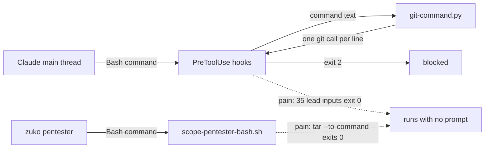

# Guard leads

**Project type:** CLI/Library · **Status:** Shaped

## Problem

The v2.6.0 and v2.7.0 pentests list 20 leads in which a zuko guard lets a command through. On 2026-11-11, 38 of their inputs still passed the real hooks on `main`: a commit on `main`, a secret, a home-dir delete, and a command outside the pentester fence.

## Today

Each row below is an input that I ran through the real hook on 2026-11-11. "Pass" means exit 0.

| Guard | Inputs that pass today | Lead | Slice |
| --- | --- | --- | --- |
| Pentester fence | `tar -x -C <scratch>` with `--to-command`, `--checkpoint-action=exec` or `-I`: 3 of 3 | v2.6.0 N5, v2.7.0 N2 | fence-tar-exec |
| Secret scan | `git commit -a`, `git commit <path>` with the secret not staged, a file with a `-diff` attribute: 3 of 3 | v2.6.0 N11, v2.7.0 N8 | secret-scan-scope |
| Commit on main | `merge`, `cherry-pick`, `rebase`, `pull`, `revert`, `am` on `main`: 6 of 6 | v2.6.0 N9 | main-branch-commits |
| Commit on main | `git checkout main && git commit`, `git switch main; git commit`: 2 of 2. A commit in a dir the parser cannot know: not rerun, `nested-git-commands` O5 | v2.6.0 N8, v2.7.0 S5 | branch-switch-commit |
| Force push | an alias in `.git/config` (`git pf`, `git ci` on `main`), a `remote.origin.push` refspec by `-c` or `git config`: 4 of 4. A push that deletes `main` on the remote: 2 of 2 | v2.6.0 N9, `git-spellings` O1, O6 here | config-aliases |
| Attribution | `git commit --trailer "Co-authored-by: Claude ..."`, `git merge -m "Co-Authored-By: Claude ..."`: 2 of 2 | v2.6.0 N12, v2.7.0 N11 | attribution-trailer |
| rm | `rm -rf /*`, `rm -r -f /`, `rm --recursive --force /`, `rm -rf $HOME`, `rm -rf "$HOME"`, `rm -rf "/"`, `rm -rf /home/user`, `rm -rf /usr/`: 8 of 11 | v2.6.0 N10, v2.7.0 N9 | rm-forms |
| Pentest target | `timeout 5`, `env -i`, `nice -n 5`, `sudo -u x` before curl; `echo curl ... \| sh`; `C=curl; $C`; `if true; then curl ...; fi`; `ssh`, `git clone`, `socat`: 10 of 14 | v2.6.0 N2, N4, v2.7.0 N5 | target-wrappers |

## Slices

Eight slices is over the six-slice check. The idea is really one small idea for each guard, with one source. Each slice is a light-path fix that ships alone, so they stay in one shape. The arrows show the order, not a dependency. Slices 3 and 4 change the same commit check, so build them one after the other.

| # | Slice | What ships | Why this order |
| --- | --- | --- | --- |
| 1 | fence-tar-exec | The pentester fence blocks a `tar` in the repo with an option that runs a program: `--to-command`, `--checkpoint-action`, `-I`, `--use-compress-program`, and their short and attached forms. | It is the only lead that lets a fenced agent run a command outside its fence, in the real repo. The fix is one check in `scope-pentester-bash.sh`. |
| 2 | secret-scan-scope | The secret scan reads what the commit takes: the work-tree changes for `-a`, the named paths for `git commit <path>`, and the text of a file with a `-diff` attribute. | A secret that reaches a push cannot be taken back. |
| 3 | main-branch-commits | The commit-on-main guard also judges `merge`, `cherry-pick`, `rebase`, `pull`, `revert` and `am` on `main`, by the rule that its spec settles (O4). | The commit-on-main rule (D30) is the guard used most. |
| 4 | branch-switch-commit | The guard follows a `git checkout` or `git switch` earlier in the same command, and checks a commit whose dir the parser cannot know in the dir it will run in. | It needs the subcommand list from slice 3 to cover `git checkout main && git merge`. It also works alone for `git commit`. |
| 5 | config-aliases | The git guards read the aliases and the `remote.*.push` refspecs in `~/.gitconfig` and `.git/config`, and block a push that deletes a branch on the remote. | It needs one `git config` read for each call, the largest change. `git-spellings` already refuses an alias that the command sets. |
| 6 | attribution-trailer | The attribution guard reads `--trailer` on a commit, and the message of `git merge -m`, with `hooks.json` wired for `git merge`. | A trailer that gets through is a policy breach, not lost data. |
| 7 | rm-forms | The rm guard also blocks split flags, long options, `/*`, quoted paths, `$HOME` and paths one level under `/` (D141). | Claude Code's own removal check blocked rm twice in this session, so the gap has a second line today. |
| 8 | target-wrappers | During a live pentest, the target guard reads past wrappers with options, a pipe into a shell, shell keywords and a `$` program, and blocks network tools that are not on its list. | The guard runs only while a live pentest is on, and only for the main thread's own commands. |

## Not doing

- **The five leads that are not guards:** v2.6.0 N1 (release `allowed-tools`), N13 (Strix tar fallback), N14 (WebRTC from the drift check), v2.7.0 N7 (Strix report lines), N10 (repo `prettier`). They go to a separate idea (O2).
- **Code that the pentester runs in its scratch copy:** `git config core.fsmonitor`, `GIT_CONFIG_*` and a `PATH` shim (v2.6.0 N6, v2.7.0 N1 and N3). D14 lets code run there by design (O5).
- **Leads that the guards already block:** `#@` in a URL and a `Host:` header (v2.6.0 N3, v2.7.0 N4), a `++` line in the staged diff (v2.7.0 N8), a symlink write and a rewritten tracked script in the scratch copy (v2.6.0 N7, v2.7.0 N3 and N6). Each exited 2 on 2026-11-11.
- **`git reset --hard`, `git branch -D` and `git clean -fdx`.** They pass, but they are local and git can often undo them. They are not pentest leads (O6).
- **`git-spellings` O8, O9 and O10.** They are parser gaps that the review found, not pentest leads, and that spec keeps them.

## Open items

| ID | What | Type | Raised at | Owner | Status | Answer |
| --- | --- | --- | --- | --- | --- | --- |
| O1 | What made you think of this? | question | shape | user | Resolved | The user asked to guard the leads from the v2.6.0 and v2.7.0 pentests. 2026-11-12 |
| O2 | Which leads does this idea cover: the guards only, or also the five leads that are not guards? | question | shape | user | Resolved | The guards only. The other five go to a separate idea. 2026-11-12 |
| O3 | Fix zuko's rm guard, rely on Claude Code's removal check, or remove the rule? | question | shape | user | Resolved | Fix zuko's guard (D141). 2026-11-12 |
| O4 | Which of `merge`, `cherry-pick`, `rebase`, `pull`, `revert` and `am` does the guard block on `main`? `git pull` on `main` is the normal way to update it. | question | shape | user | Handed to main-branch-commits | 2026-11-12 |
| O5 | In its scratch copy, the pentester can run a program through `git config core.fsmonitor` or `GIT_CONFIG_*`. | flag | shape | user | Accepted risk | D14: the fence stops commands, not code, and spec `pentest` O11 (2026-09-27) accepts code that the pentester runs. Only the `tar` options run outside the scratch copy. 2026-11-12 |
| O6 | `git push origin :main` and `git push --delete origin main` pass on `main`. They are not pentest leads. | question | shape | user | Resolved | Add them to config-aliases, which already reads push refspecs. `reset --hard`, `branch -D` and `clean -fdx` stay out. 2026-11-12 |
| O7 | How will we know that this worked? | question | shape | user | Resolved | Each input in the Today table exits 2 in the suite through the real hook, and the next release pentest lists none of these leads under Needs validation. 2026-11-12 |

_Never delete this section or its rows. See references/ledger.md._

## Glossary

- **Pentest** — a penetration test: an attack on your own code to find holes before someone else does.
- **Lead** — a hole that a pentest traced but could not prove. The report lists it under Needs validation, with no severity.
- **Guard** — a zuko hook that reads a Bash command before it runs, and blocks it with exit 2.
- **Fence** — `scope-pentester-bash.sh`, the guard that holds the pentester to read-only git and its scratch copy.
- **Scratch copy** — the copy of the release that `git archive` puts in a temporary folder, where the pentester runs its proofs.
- **Refspec** — the `src:dst` part of a push. A leading `+` forces it, and an empty `src` deletes `dst` on the remote.
- **Trailer** — a `Key: value` line at the end of a commit message, such as `Co-authored-by:`.
- **`-diff` attribute** — a `.gitattributes` setting that makes `git diff` show a file as binary, so its text is not in the diff.
- **Light path** — zuko's short route for a small bug fix: one pause in place of three, and one reviewer.
