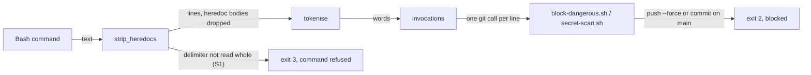
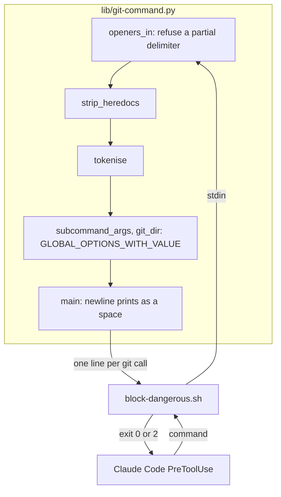
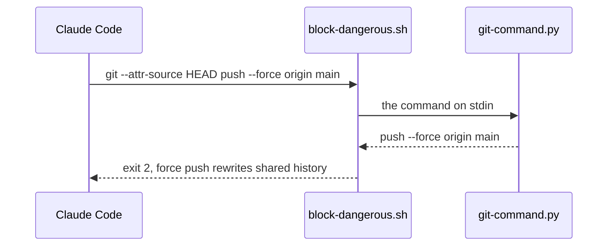

# Guard parser gaps

**Version:** v1 · **Status:** Built · **Type:** Bug · **Project type:** CLI/Library

**Depends on:** None

The shared git parser behind the force-push, commit-on-main and secret-scan
guards now reads three spellings that bash runs and the parser missed. Found by
the v2.7.0 pentest (S1, S3, S4).

## Problem

`git-command.py` reads a Bash command and prints each git call on one line.
`block-dangerous.sh` and `secret-scan.sh` match those lines. The v2.7.0 pentest
found three inputs where the printed lines miss a git call that bash runs:

- `cat <<E-F`, then a line `E-F`, then `git push --force origin main`. The parser
  read the delimiter as `E` and dropped the push as heredoc body (S1).
- `git push --receive-pack='true;<newline>git-receive-pack' origin +feat`. The
  newline in the quoted word split the call into two printed lines, and neither
  matched the force check (S3).
- `git --attr-source HEAD push --force origin main`. The parser did not know that
  `--attr-source` takes a value, so it read `HEAD` as the subcommand (S4).

Each one let a force push or a commit on `main` through with no prompt. I ran
each against the real hook: exit 0 before the fix, exit 2 for the plain command.

## Slice test

| Check                         | Result                                                                          |
| ----------------------------- | ------------------------------------------------------------------------------- |
| Cuts every layer it needs     | Yes. The parser and the guard test that runs the real hook                      |
| One e2e test walks it         | Yes. `test-block-dangerous.sh` feeds the real hook a real payload for each form |
| Worth shipping alone          | Yes. It closes three of the five confirmed v2.7.0 findings                      |
| Fits (≤5 scenarios, ≤2 areas) | Yes. 4 scenarios, 1 area (scripts)                                              |

**Path:** light. A bug fix in 2 files, with no new interface, data or
dependency. Pauses 1 and 3 merged, pause 2 skipped.

The fix is already on `fix/heredoc-delimiter` as `ff74829`, `200ec61` and
`f34c28c`, made by `/debug` before this spec.

## Flow



The parser refuses a heredoc delimiter it cannot read whole, knows the two
value options, and prints one line for each git call. The guard then sees every
push and commit that bash runs.

## Acceptance criteria

```gherkin
Scenario: a heredoc delimiter with a dash is read whole
  Given a command "cat <<E-F", then a line "E-F", then "git push --force origin main", then "E"
  When block-dangerous.sh judges it
  Then it exits 2 with "cannot tell where heredoc E-F ends"
  And "<<-E-F", "<<E.F" and "<< E/F" are blocked the same way

Scenario: a newline in a quoted argument does not split the call
  Given "git push --receive-pack='true;" and "git-receive-pack' origin +feat" on two lines
  When block-dangerous.sh judges it
  Then it exits 2 as a force push
  And "git push -o 'a<newline>b' --force origin main" is blocked too

Scenario: a global option that takes a value is skipped with its value
  Given "git --attr-source HEAD push --force origin main"
  When block-dangerous.sh judges it
  Then it exits 2 as a force push
  And "git --config-env core.editor=EDITOR commit -m x" on main is blocked as a commit on main

Scenario: the standard heredoc commit still parses as one call
  Given git commit -m "$(cat <<'EOF'" with a body of two lines that holds quotes and backticks
  When git-command.py reads it
  Then it prints one line that starts with "commit -m" and holds the body
```

## Scope

**In:** `openers_in`, `GLOBAL_OPTIONS_WITH_VALUE` and `main` in
`git-command.py`, and the cases above in `test-block-dangerous.sh`.

**Out:**

- v2.7.0 S2, a git call inside a double-quoted `$( )`, and the `eval` and
  `bash -c` parts of S5. The parser would have to read the nested command as
  bash does, and refusing every `"$(git ...)"` would block zuko's own
  `release.py plan "$(git rev-parse --show-toplevel)"`. A later slice,
  `nested-git-commands` (O1).
- The `/usr/bin/git` and git-alias parts of S5. They go with the same slice, so
  that S5 is fixed in one place (O1).
- The 11 Strix leads under Needs validation in the v2.7.0 report.

## Technical plan

### Approach

Three changes in `git-command.py`. `openers_in` refuses a top-level heredoc
when `HEREDOC` matches and `INNER_HEREDOC` does not (`git-command.py:190`), as
the `$( )` path already does. `GLOBAL_OPTIONS_WITH_VALUE` gains
`--attr-source` and `--config-env` (`git-command.py:98`), which
`subcommand_args` and `git_dir` both read. `main` prints a newline in a word as
a space (`git-command.py:446`, `:449`), as it already prints the space between
words.

Relies on: D52 (a command the parser cannot read is blocked).





### Changes

| File                                                    | What changes                                                                                      | Why         |
| ------------------------------------------------------- | ------------------------------------------------------------------------------------------------- | ----------- |
| `plugins/zuko/scripts/lib/git-command.py:190`           | Refuse a top-level heredoc whose delimiter does not end at a shell metacharacter                  | Scenario 1  |
| `plugins/zuko/scripts/lib/git-command.py:446`, `:449`   | Print a newline in a word as a space, in both output forms                                        | Scenario 2  |
| `plugins/zuko/scripts/lib/git-command.py:98`            | Add `--attr-source` and `--config-env` to `GLOBAL_OPTIONS_WITH_VALUE`                              | Scenario 3  |
| `plugins/zuko/scripts/tests/test-block-dangerous.sh`    | The cases for scenarios 1 to 3, and the commit-form check now expects one line                    | Scenarios 1–4 |

Reusing: `INNER_HEREDOC` and the `run_hook` test helper, unchanged.

### Non-functionals

|                      |                                                                                                  |
| -------------------- | ------------------------------------------------------------------------------------------------ |
| **Load**             | One parse for each Bash call, as before                                                          |
| **Breaks first**     | Nothing at 10×. Each change is linear in the command                                             |
| **Security surface** | Closes v2.7.0 S1, S3 and S4. Each change can only add blocks: a refusal is a block (D52)         |
| **Proof it works**   | `bash plugins/zuko/scripts/tests/run.sh block-dangerous` passes, with the new cases               |
| **Rollout**          | No flag. It ships with the next zuko release. Rollback: revert `ff74829`, `200ec61` and `f34c28c` |

### Test plan

| Scenario                              | Test                                    | Command                                                  |
| ------------------------------------- | --------------------------------------- | -------------------------------------------------------- |
| 1. A dashed delimiter is read whole   | `test-block-dangerous.sh:543`           | `bash plugins/zuko/scripts/tests/run.sh block-dangerous` |
| 2. A newline does not split the call  | `test-block-dangerous.sh:84`            | same                                                     |
| 3. A value option is skipped whole    | `test-block-dangerous.sh:68`, `:71`     | same                                                     |
| 4. The heredoc commit is one line     | `test-block-dangerous.sh:600`           | same                                                     |

**E2E:** `test-block-dangerous.sh` runs the real hook script on each payload,
as Claude Code runs it, in a scratch repo on `main`.

### Chunks

Single chunk.

### Risks

| Risk                                                                    | Mitigation                                                                              |
| ----------------------------------------------------------------------- | --------------------------------------------------------------------------------------- |
| A real command with a delimiter such as `<<E-F` is now refused          | The block names the delimiter and says to put the command in a file                     |
| A later edit adds a strict copy of a pattern to one path only           | The lesson `a-stricter-twin-belongs-on-every-path.md`, from S1's own history            |

### Decisions to record

None — no choice here rejected an option.

## Open items

| ID | What | Type | Raised at | Owner | Status | Answer |
| -- | ---- | ---- | --------- | ----- | ------ | ------ |
| O1 | S2 and S5 need the parser to read a nested command (`"$( )"`, `eval`, `bash -c`). Leave all of S2 and S5 to a later slice `nested-git-commands`? | question | spec p1 | user | Resolved | Yes. All of S2 and S5 go to `nested-git-commands`; this slice ships S1, S3 and S4. 2026-11-10 |

_Never delete this section or its rows. See references/ledger.md._

## Glossary

- **Heredoc** — `<<WORD` in a shell command: the lines after it, up to a line `WORD`, are text fed to the command, not commands
- **Pentest** — the attack that `/release` runs on the code it ships, to prove each hole with a harmless input
- **e2e** — end-to-end: one test that walks the whole slice as a user would
