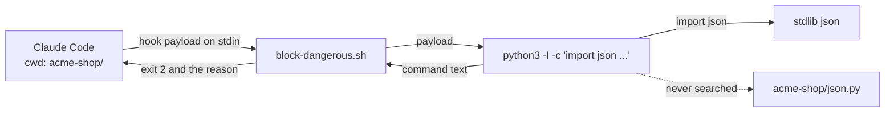
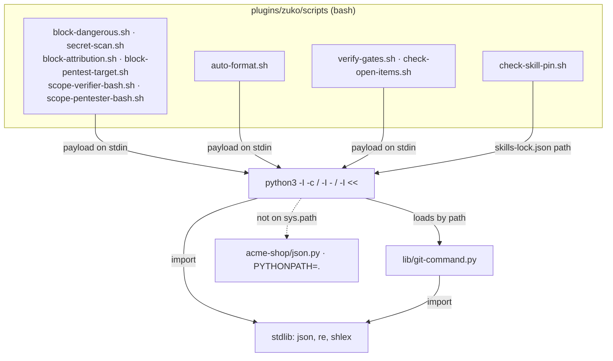
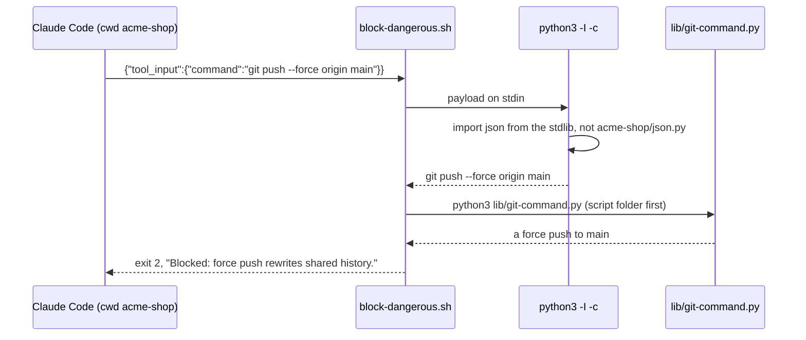

# hook-import-path

**Version:** v1 · **Status:** Built · **Type:** Bug · **Project type:** CLI/Library

**Depends on:** None

Each `python3 -c`, `python3 -` and `python3 <<` call in a zuko hook runs with `-I`, so Python never imports a module from the project folder. A `json.py` at the root of a cloned repo then never runs from a hook, and never turns a block into a pass.

## Problem

`python3 -c`, `python3 -` and `python3 <<` put the current folder first on `sys.path`. zuko's hooks run in the project folder. So each `import json` in a hook loads a `json.py` from the project root before the real one. exe-lookup found this as its O5.

The planted file runs at each Bash call, each file edit and each Stop, with no prompt, on every OS. It can also end the hook with exit 0. Checked on Linux on 2026-11-09: with a `json.py` that exits 0, `block-dangerous.sh` lets `git push --force origin main` through. Without the plant it blocks with exit 2.

Ten scripts make such a call:

| Script | Lines | Runs at |
| --- | --- | --- |
| `block-dangerous.sh` | 6, 10 | PreToolUse, each Bash call |
| `scope-verifier-bash.sh` | 29 | PreToolUse, each Bash call |
| `scope-pentester-bash.sh` | 40 | PreToolUse, each Bash call |
| `block-pentest-target.sh` | 21 | PreToolUse, each Bash call |
| `block-attribution.sh` | 9, 14, 28 | PreToolUse, `git commit`, `git tag`, `gh pr`, `gh release` |
| `secret-scan.sh` | 6, 9 | PreToolUse, `git commit` |
| `auto-format.sh` | 6 | PostToolUse, each Write or Edit |
| `verify-gates.sh` | 6 | Stop |
| `check-open-items.sh` | 43 | Stop |
| `check-skill-pin.sh` | 22 | run by `/spec`, `/design` and `/design-system` |

A script run by its path, such as `python3 "$here/lib/stop_scope.py"`, puts its own folder first, not the current folder. Those calls are safe and do not change.

## Slice test

| Check | Result |
| --- | --- |
| Cuts every layer it needs | yes — each Python call in the hooks, and the suite that proves them |
| One e2e test walks it | yes — one repo with a planted `json.py`, and each of the ten scripts run in it |
| Worth shipping alone | yes — it closes code execution and a guard bypass from a cloned repo |
| Fits (≤5 scenarios, ≤2 areas) | yes — 4 scenarios, one area: `plugins/zuko/scripts` and its tests |

**Path:** full — a security fix in ten files. Pause 2 is skipped: no command, flag, message or exit code changes.

## Flow



Claude Code gives the hook its payload, the hook's Python imports the standard `json`, never the one in `acme-shop/`, and the hook blocks or passes as it does without the plant.

## Acceptance criteria

```gherkin
Scenario Outline: a json.py at the repo root never runs from a zuko hook
  Given a clone of acme-shop with a json.py at its root
  And that json.py writes acme-shop/PWNED and exits 0
  When <script> runs with acme-shop as its current folder
  Then acme-shop/PWNED does not exist
  And the exit code and output are the same as without the json.py

  Examples:
    | script                  |
    | block-dangerous.sh      |
    | scope-verifier-bash.sh  |
    | scope-pentester-bash.sh |
    | block-pentest-target.sh |
    | block-attribution.sh    |
    | secret-scan.sh          |
    | auto-format.sh          |
    | verify-gates.sh         |
    | check-open-items.sh     |
    | check-skill-pin.sh      |

Scenario: the force-push guard still blocks with a planted json.py
  Given a clone of acme-shop with a json.py at its root that exits 0
  When block-dangerous.sh gets "git push --force origin main" from acme-shop
  Then it exits 2
  And it prints "Blocked: force push rewrites shared history. Ask the user first."

Scenario: PYTHONPATH set to the project folder does not reopen the hole
  Given a clone of acme-shop with a json.py at its root
  And PYTHONPATH=. in the environment that starts the hook
  When block-dangerous.sh runs with acme-shop as its current folder
  Then acme-shop/PWNED does not exist

Scenario: the suite fails on a new hook call without -I
  Given a script in plugins/zuko/scripts with the line python3 -c 'import json'
  When bash plugins/zuko/scripts/tests/run.sh runs
  Then a check fails and names that script and line
```

## Scope

**In:** the fourteen `python3 -c`, `python3 -` and `python3 <<` calls in the ten scripts above. A suite check that keeps a new such call from coming in without `-I`. The same e2e on Linux and in the `windows-suite` job.

**Out:**

- `python3 script.py` calls — Python puts the script's own folder first, not the current folder. No slice needed.
- The test suite's own `python3 -c` snippets — they run only in zuko's repo, on files that we commit. No slice planned.
- Node's `spawnSync('taskkill')` in `cdp.mjs:78` — `node-lookup`, slice 8 of the os-agnostic-suite shape.
- `python3 -c` in skill and agent Markdown — none exists today. The suite check reads `plugins/zuko/scripts` only. No slice planned.
- `auto-format.sh` runs the repo's own `node_modules/.bin/prettier`, `ruff` or `black`. That is project code by design, and this slice does not change it.

## Technical plan

### Approach

Add `-I` after `python3` in each of the fourteen calls. In isolated mode, Python puts neither the current folder nor `PYTHONPATH` on `sys.path`, and skips the user's site-packages. The four `python3 -` hooks already load `git-command.py` by its path, so they need nothing more. A new e2e plants a `json.py` in a scratch repo, runs each script there, and scans `plugins/zuko/scripts` for a new call without `-I`.

Relies on: D98 (each hook sets its own stdio, so no `PYTHON*` variable is needed), D105, D125 and D126 (drafted below)



Each hook hands its input to an isolated Python, which loads zuko's own module by its path and the standard library from the install. Nothing in the project folder or `PYTHONPATH` is on `sys.path`.



On the main path, the Bash guard reads the command through an isolated Python, then asks `git-command.py` what it is, and blocks the force push as it does with no plant.

### Changes

| File | What changes | Why |
| --- | --- | --- |
| `plugins/zuko/scripts/block-dangerous.sh:6`, `:10` | `python3 -c` → `python3 -I -c` | scenarios 1, 2, 3 |
| `plugins/zuko/scripts/secret-scan.sh:6`, `:9` | Same. | scenario 1 |
| `plugins/zuko/scripts/block-attribution.sh:9`, `:14` | Same. | scenario 1 |
| `plugins/zuko/scripts/block-attribution.sh:28` | `python3 -` → `python3 -I -` | scenario 1 |
| `plugins/zuko/scripts/scope-verifier-bash.sh:29` | Same. | scenario 1 |
| `plugins/zuko/scripts/scope-pentester-bash.sh:40` | Same. | scenario 1 |
| `plugins/zuko/scripts/check-skill-pin.sh:22` | Same. | scenario 1, O1 |
| `plugins/zuko/scripts/block-pentest-target.sh:21` | `python3 <<'PY'` → `python3 -I <<'PY'` | scenario 1 |
| `plugins/zuko/scripts/auto-format.sh:6` | `python3 -c` → `python3 -I -c` | scenario 1 |
| `plugins/zuko/scripts/verify-gates.sh:6` | Same. | scenario 1 |
| `plugins/zuko/scripts/check-open-items.sh:43` | Same. | scenario 1 |
| `plugins/zuko/scripts/tests/test-e2e-hook-import-path.sh` | New. It builds `acme-shop` in `$work`, with a changed spec, a `skills-lock.json` and a `gh` stub. It runs each script there, plants `json.py`, and runs them again. Then it runs the force-push and `PYTHONPATH=.` checks. Last, its `bare_python` function scans a fixture folder and `plugins/zuko/scripts`. | scenarios 1 to 4 |
| `plugins/zuko/scripts/tests/test-utf8-stdio.sh:23` | The D98 check finds each inline snippet with `python3 (-I )?(-c \|- \|<<)`, so it still counts the fourteen. | O5 |
| `CHANGELOG.md` | One `[Unreleased]` line: zuko's hooks no longer import a Python module from the project folder or `PYTHONPATH`. | `/ship` gate |

Reusing: `run.sh`'s `expect_exit`, `expect_match`, `expect_no_match`, `narrow_path` and `$work`; the `HOME` and `GIT_CONFIG_NOSYSTEM` setup and the Stop payload from `test-e2e-exe-lookup.sh`; the `gh` stub shape from `test-skill-pin.sh`.

`bare_python` reads each `*.sh` in `scripts/` and `scripts/lib/`, not `tests/`. It skips a line whose first character that is not a space is `#`. It flags `python3` or `python` as a command word with `-c`, `-` or `<<` next and no `-I` before it. That includes after `command`, after `env`, and after `VAR=value` words. Each hit prints `file:line`. Today two Python comments in `scope-pentester-bash.sh`, at lines 244 and 371, name `python3 -c`. The `#` rule skips them.

The e2e builds each payload before it goes into `acme-shop`, and runs only `bash "$scripts/…"` there. The test's own `python3 -c` snippets then never see the planted `json.py`.

### Earn-it

| Added | Triggered by |
| --- | --- |
| `test-e2e-hook-import-path.sh` | Scenarios 1 to 3 need a real hook run in a folder with a planted module. No current test does that. |
| `bare_python` in that file | Scenario 4, O3: the hole spread through one copied line. |

### Non-functionals

|                      |                                                                               |
| -------------------- | ----------------------------------------------------------------------------- |
| **Load**             | About 5 hooks start Python at each Bash call. `-I` adds no work, and skips the scan of the user's site-packages. |
| **Breaks first**     | Nothing scales here. A new hook call without `-I` fails `bare_python` on every OS. |
| **Security surface** | Hooks that Claude Code runs in an untrusted project folder. Each reads the payload JSON on stdin. Python now trusts the install's own stdlib and site-packages only, not the project folder, `PYTHONPATH` or the user's site-packages. A `.pth` file in the install's site-packages still runs, but it needs write access to the Python install. No secrets, no stored data. |
| **Proof it works**   | `bash plugins/zuko/scripts/tests/run.sh` ends with `0 failed` on Linux, and the `windows-suite` run on `feat/hook-import-path` does too. |
| **Rollout**          | No flag. It ships in the next zuko release. Rollback: `git revert` of the fix commit. |

### Test plan

| Scenario | Test | Command |
| --- | --- | --- |
| 1. A json.py at the repo root never runs from a zuko hook | `test-e2e-hook-import-path.sh`: each of the ten scripts gets its exit code and output from a run before the plant, then runs again with the plant. Each pair must match, and `acme-shop/PWNED` must not exist. Red first: before the fix, `PWNED` exists after the first hook. | `bash plugins/zuko/scripts/tests/run.sh e2e-hook-import-path` |
| 2. The force-push guard still blocks with a planted json.py | Same file: the plant exits 0, and `block-dangerous.sh` must still exit 2 with its force-push message. Red first: before the fix, it exits 0. | same |
| 3. PYTHONPATH set to the project folder does not reopen the hole | Same file: `PYTHONPATH=.` is set for `block-dangerous.sh` in `acme-shop`. `PWNED` must not exist. A fix that drops only the current folder fails this check, because `PYTHONPATH=.` puts the folder back. | same |
| 4. The suite fails on a new hook call without -I | Same file: `bare_python` on a fixture folder with `python3 -c`, `python3 - "$x"`, `env python3 <<'PY'` and `python3 -I -c` must name the first three lines only. On `plugins/zuko/scripts` it must name nothing. | same |
| Windows | The same file, unchanged, in the `windows-suite` job. A push needs your yes. | `gh workflow run windows-suite.yml --ref feat/hook-import-path` |
| No regressions | The full suite. | `bash plugins/zuko/scripts/tests/run.sh` |

**E2E:** `test-e2e-hook-import-path.sh`.

### Chunks

Single chunk — fourteen one-flag edits, one test file and one CHANGELOG line.

### Risks

| Risk | Mitigation |
| --- | --- |
| A hook depends on a `PYTHON*` variable that `-I` now ignores, such as `PYTHONUTF8` on Windows. | Checked: each hook sets its own stdio (D98), and each `open()` in the four `python3 -` hooks and in `check-skill-pin.sh` names `encoding="utf-8"`. The Windows run proves it. |
| `bare_python` misses a spelling, such as `"$py" -c`. | No script outside `tests/` starts Python through a variable today. The fixture covers the spellings that the scripts use. A new spelling needs a new fixture line (lesson: guard every spelling the parser accepts). |
| The planted `json.py` breaks the e2e's own Python snippets, and the test fails for the wrong reason. | Payloads are built before the test goes into `acme-shop`. Only `bash` hook runs happen there. |

### Decisions to record

Recorded as D125, D126.

## Review

2026-11-09 · 0 raw findings, 0 survived. Clean.

## Open items

| ID | What | Type | Raised at | Owner | Status | Answer |
| --- | --- | --- | --- | --- | --- | --- |
| O1 | `check-skill-pin.sh` is not a hook. `/spec`, `/design` and `/design-system` run it from the project folder, with the same hole. Is it in this slice? | question | spec p1 | user | Resolved | Yes. It is the tenth script in the scenarios, 2026-11-09 |
| O2 | A fix for the current folder alone leaves `PYTHONPATH=.` and user site-packages open. Do the hooks also ignore `PYTHONPATH` and the user's site-packages? | question | spec p1 | user | Resolved | Yes. The hooks ignore both, so `PYTHONPATH=.` gets no way in (scenario 3), 2026-11-09 |
| O3 | Is a suite check that fails on a new `python3 -c`, `python3 -` or `python3 <<` without `-I` in this slice? | question | spec p1 | user | Resolved | Yes. Scenario 4 covers it, 2026-11-09 |
| O4 | `-I` keeps the current folder off `sys.path` for `-c`, `-` and `<<` on Python 3.12 on Windows, as it does on Python 3.9 on Linux. Checked on Linux only, on 2026-11-09. | unproven | spec p3 | poc | Accepted risk | Python documents `-I` the same on every OS. The `windows-suite` run on `feat/hook-import-path` proves it before merge. If it goes red, `/build` changes the fix, 2026-11-09 |
| O5 | The Changes table did not name `test-utf8-stdio.sh`. Its D98 check finds the hooks' inline Python with `python3 (-c \|- \|<<)`. After the fix it found 0 snippets, and its scanned-nothing check failed. | flag | build | user | Decided alone | Chose: the pattern allows an `-I` first, and finds the fourteen snippets again. Other: count the snippets with `bare_python`. Undo: replace the grep at `test-utf8-stdio.sh:23` with a `bare_python` count, 2026-11-09 |

_Never delete this section or its rows. See references/ledger.md._

## Glossary

- **`sys.path`** — the list of folders that Python searches, in order, for each `import`
- **`-I`** — Python's isolated mode: no current folder on `sys.path`, no `PYTHON*` variables and no user site-packages
- **site-packages** — the folder where pip installs packages; a user's own one is under their home folder
- **e2e** — end-to-end: one test that walks the whole slice as a user would
