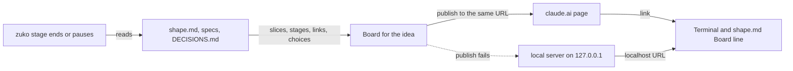
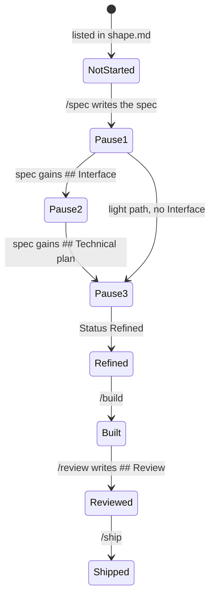
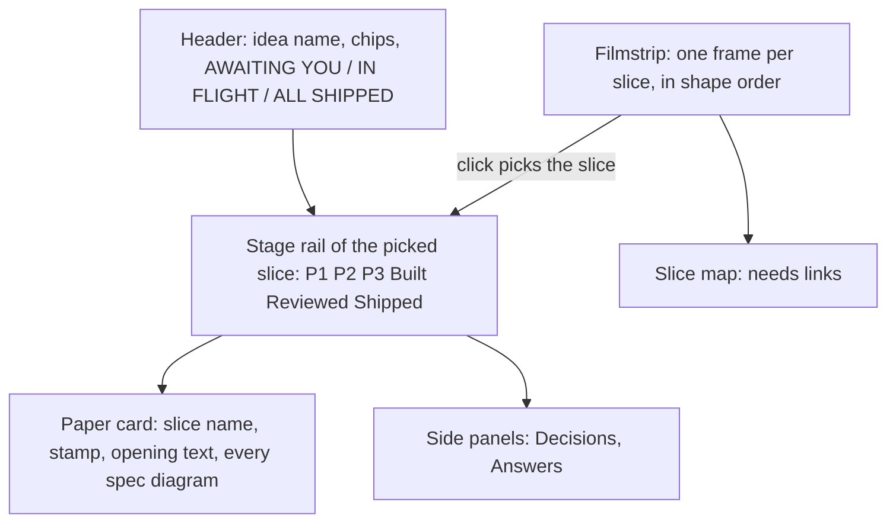
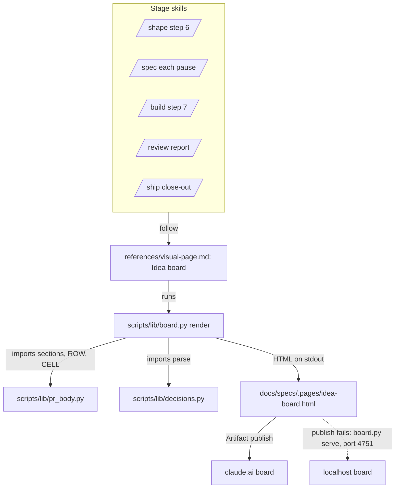
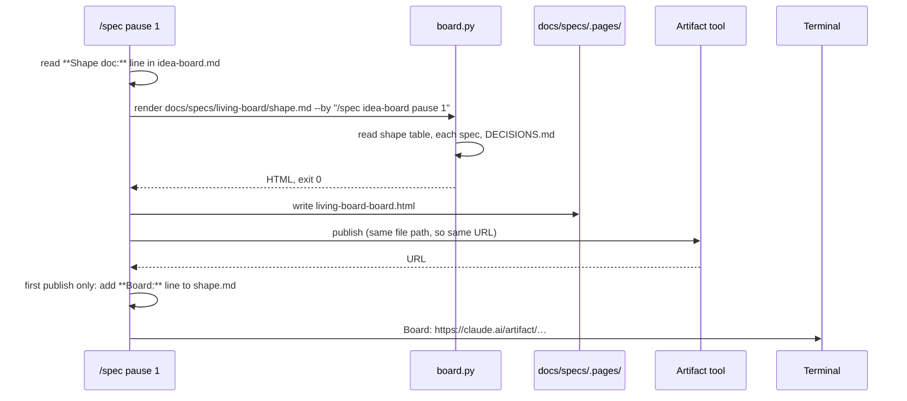

# Idea board

**Version:** v1 · **Status:** Built · **Type:** Feature · **Project type:** CLI/Library

**Shape doc:** docs/specs/living-board/shape.md
**Depends on:** None

Each idea gets one claude.ai page that shows all its slices in order, the stage each slice is at, how the slices connect, and the choices each slice made. Every zuko stage republishes it from the files, so it is current whenever you open it. It ships first because the other four living-board slices add to this page.

## Problem

After a few specs the user cannot recall how the slices of an idea connect, where each one stands, or why a choice was made. The facts are in the files: the shape, one spec per slice of 2,000 to 5,400 words, its ledger, and the 61 entries in `DECISIONS.md`. But no single view ties them together. Today the user asks Claude to explain, or approves without following.

## Slice test

| Check                         | Result                                                                                       |
| ----------------------------- | -------------------------------------------------------------------------------------------- |
| Cuts every layer it needs     | yes: the stage skills, the board builder, the publish, and the link in the shape doc         |
| One e2e test walks it         | yes: build the board for a fixture idea, then check each of the five scenarios on the output |
| Worth shipping alone          | yes: the user gets the one picture of the idea, even if no other living-board slice ships    |
| Fits (≤5 scenarios, ≤2 areas) | yes: 5 scenarios; the stage skills and the board builder                                     |

**Path:** full — it adds a new published page and a new step to five stages.

## User story

As the person who approves each zuko pause and PR, I want one page per idea that shows every slice, its stage and its choices, so that I can approve without asking Claude what we decided.

## Flow



At the end of each stage, or at a `/spec` pause, the stage reads the idea's files, builds the board, and publishes it to the same URL. If the publish fails, a local server on 127.0.0.1 serves the board, and the stage prints that URL instead.

## States

One slice on the rail moves through these stages:



## Acceptance criteria

```gherkin
Scenario: /shape publishes the first board
  Given /shape has just written docs/specs/living-board/shape.md with 5 slices
  When the shape is set to Shaped
  Then a claude.ai page "living-board" is published
  And it shows the 5 slices in order: idea-board, gate-card, pr-gate, library, replay
  And each slice is grey, with its "What ships" text from the shape
  And it draws an arrow from idea-board to each of the other four, as the shape's slice map does
  And shape.md gains a line "**Board:** {url}"
  And the terminal prints the board link

Scenario: /spec moves a slice along the rail
  Given the living-board board exists at its URL
  When the user approves pause 1 of /spec idea-board
  Then the board is republished to the same URL
  And idea-board shows "Pause 1" and links to docs/specs/idea-board.md
  And idea-board's section shows the spec's 2 diagrams so far, Flow and States, each with its heading and the sentence under it
  And the other four slices are still grey

Scenario: a slice's choices show under it
  Given docs/specs/idea-board.md is Built, with 6 Resolved rows and 1 Decided alone row
  And DECISIONS.md has D62 with "Source: specs/idea-board.md"
  When /build ends
  Then under idea-board the board shows D62's title, its Why and its Rejected line
  And below it, folded, the 7 ledger rows with their answers
  And no other slice shows D62

Scenario: a stage on an old shape builds its first board
  Given docs/specs/ask-up-front/shape.md has no Board line
  When /spec runs on a slice of ask-up-front
  Then a board for ask-up-front is published, with its 5 slices at Shipped and the new slice at Pause 1
  And ask-up-front/shape.md gains a Board line

Scenario: the publish fails
  Given claude.ai cannot be reached
  When /review ends on idea-board
  Then the board is written to docs/specs/.pages/living-board-board.html
  And a server on 127.0.0.1 serves it, started if it is not already running
  And the terminal prints "Board not published: {error}. Local board: http://127.0.0.1:{port}/living-board-board.html"
  And /review finishes as usual
  And the next stage tries the publish again
```

## Scope

**In:** one board per idea that has a shape; the rail of slices with each slice's stage; arrows between slices; each slice's D-entries and ledger answers; a link to each slice's spec; republish by `/shape`, each `/spec` pause, `/build`, `/review` and `/ship`; the `**Board:**` line in shape.md; a local server for the board when the publish fails.

**Out:**

- What waits for approval at a pause, and what changed since the last one: **gate-card**.
- The PR card that ties each criterion to its code and tests: **pr-gate**.
- A hub-page list of every idea, and the specs that have no shape: **library**.
- Steps through an idea's history: **replay**.
- Boards for old shapes that no stage runs on again: not doing (user's choice, 2026-10-25).

## Interface

**Preview:** https://claude.ai/artifact/9o36TJM3VXNn2VKRPLYPBi (version 5, built from the real `living-board` and `ask-up-front` files). The look follows OpenMontage's Backlot board, as the user asked.



The header says where the idea stands. A click on a slice in the filmstrip fills the stage rail, the paper card and the side panels with that slice.

**The page**

One dark look, by choice, after Backlot. Stage colours: amber at a pause, blue for Refined, Built and Reviewed, green for Shipped, dashed amber for no spec yet.

| Part | What it shows | From |
| --- | --- | --- |
| Header | A striped mark, `zuko board · {shape path}`, the shape's title in spaced capitals, chips (project type · slices, started, shipped · shape status), the problem, and one status on the right: `AWAITING YOU` when a slice is at pause 1 to 3, `IN FLIGHT` when one is Refined, Built or Reviewed, `ALL SHIPPED` when all are Shipped, else `NOT STARTED` | `shape.md`, each spec's Status line |
| Stage rail | The picked slice's six stages, joined by a line: a check for each stage done, a pulsing ring for the current one with one line under it (`awaiting your approval · answer in the terminal`, `awaiting you · run /build to approve`, `refined · run /build`, `built · next /review`, `reviewed · next /ship`), a number for each stage to come | the spec's Status line and sections |
| Paper card | The slice name, a stamp (`Awaiting you`, `In flight` or `Shipped`), `slice {n} · {stage} · {count} diagrams`, the spec's opening text, then each Mermaid diagram in the spec at full width, with its heading and the sentence under it. A click zooms a diagram; Escape closes it | the spec |
| Decisions panel | Each D-entry: its ID, title and Why, then `also considered:` with each rejected option struck through and its reason after it | `DECISIONS.md` by `Source:` |
| Answers panel | Each Resolved, Accepted risk and Decided alone row: ID, a coloured status tag, the answer. A Decided alone row has a violet edge | the spec's ledger |
| Filmstrip | One frame per slice between two perforated edges: `SL 01`, the stage, the name, the card text, and `needs` tags. A frame for a slice with no spec is dashed amber and says `no spec yet` | the shape table; the spec once it exists |
| Slice map | Every slice, coloured by stage, with a `needs` arrow per link. With no links yet, dotted `then` arrows in shape order | each spec's `**Depends on:**` line |

On first load, the page picks the first slice that is not Shipped, or the last one Shipped. A diagram that fails to draw shows `This diagram did not draw: {Mermaid's first error line}` in its place; the rest of the page still draws.

**The terminal**

At the end of each stage that republishes, one line:

```
Board: https://claude.ai/artifact/…
```

When the publish fails:

```
Board not published: {error from the Artifact tool}. Local board: http://127.0.0.1:4751/living-board-board.html
```

When port 4751 is taken too:

```
Board not published: {error}. Port 4751 is in use, so open the file: {absolute path}
```

**shape.md** gains one line under the Project type line, written on the first publish and never changed after:

```
**Board:** https://claude.ai/artifact/…
```

## Technical plan

### Approach

A new script, `scripts/lib/board.py`, reads one shape, the specs it names, and `DECISIONS.md`, and prints the board as one HTML file. Claude writes that file to `docs/specs/.pages/{idea}-board.html` and publishes it with the Artifact tool. One new section in `references/visual-page.md` holds the steps, and each of the five stages points to it with one line. The script reuses the spec parser in `pr_body.py` and the entry parser in `decisions.py`, so the board reads rows and entries exactly as the ship gate and the decision gate do.

Relies on: D23 (Mermaid stays the source in pages; ASCII in the terminal), D50 (one parser for spec rows), D60 (/ship marks the slice Shipped before the push, so the board it publishes shows Shipped). Drafted below: D62, D63, D64.



Each stage follows the one section in `visual-page.md`. That section runs `board.py`, writes the HTML into `.pages/`, and publishes it, or serves it on localhost when the publish fails.



**How the script reads each part**

| Part | Rule |
| --- | --- |
| Slices | The rows of the table under `## Slices` in `shape.md`, outside code fences. The Slice cell, with backticks and a leading `/` removed, lower case, spaces as `-`, names the spec: `docs/specs/{name}.md` |
| Stage | No spec: Not started. `Draft` with no `## Interface` and no `## Technical plan`: Pause 1. `Draft` with `## Interface` only: Pause 2. `Draft` with `## Technical plan`: Pause 3. `Refined`: Refined. `Built` with no `## Review`: Built. `Built` with `## Review`: Reviewed. `Shipped`: Shipped |
| Card text | The spec's first paragraph under its header lines; with no spec, the shape's What ships cell |
| needs | The spec's `**Depends on:**` names that are slices of this shape. With no spec, nothing |
| Diagrams | Every ```` ```mermaid ```` fence in the spec, outside `## Open items`, copied as it is. The caption is the nearest `##` or `###` heading above it. The sentence is the first prose line after the fence |
| Choices | `DECISIONS.md` entries with `Source: specs/{name}.md`, newest first; then the spec's rows at `Resolved`, `Accepted risk` and `Decided alone` |
| Escaping | The JSON block escapes `</` as `<\/`, so no file text can close the script tag. The page puts every value in through an escape function. Mermaid runs with `securityLevel: "strict"` |

The script writes the data as one JSON block into a fixed template, `scripts/lib/board.html`. The template's script draws the page from that block and loads Mermaid 11.16.1 from jsDelivr to draw every diagram in the paper's colours. claude.ai's own Mermaid is not used: its colours could not be read in the user's theme (O13). The same file works on claude.ai and on localhost.

### Changes

| File | What changes | Why |
| --- | --- | --- |
| `plugins/zuko/scripts/lib/board.html` (new) | The page template from preview version 5: the CSS, the JSON slot, and the script that draws the board | The Interface section |
| `plugins/zuko/scripts/lib/board.py` (new) | `render <shape.md> --by <text>`: prints the board HTML. `data <shape.md>`: prints only the JSON, for the tests. Exit 2 when the shape cannot be read or has no `## Slices` table. `serve <dir>`: serves `<dir>` on 127.0.0.1:4751 and answers 400 to any Host other than `127.0.0.1:4751` or `localhost:4751`. Exit 1 when the port is taken | Scenarios 1 to 5; O10, O11 |
| `plugins/zuko/references/visual-page.md:59` | New section `## Idea board` after "Link back to the hub": when to publish, the `board.py` call, the file path, the publish, the `**Board:**` line, the terminal line, and the localhost fallback. "Link back to the hub" gains the board line for spec pages | Scenarios 1, 2, 5; O7 |
| `plugins/zuko/skills/shape/SKILL.md:160` | Before "Then, in the terminal": publish the board per `visual-page.md` › "Idea board" | Scenario 1 |
| `plugins/zuko/skills/spec/SKILL.md:76`, `:155`, `:222` | Before each "Then stop": republish the board when the spec has a `**Shape doc:**` line | Scenarios 2, 4 |
| `plugins/zuko/skills/build/SKILL.md:135` | Step 7 Report: republish the board | Scenario 3 |
| `plugins/zuko/skills/review/SKILL.md:156` | "Report and fix": republish the board after the Review section is written | Scenario 5 |
| `plugins/zuko/skills/ship/SKILL.md:75` | After the hub page bullet: republish the board | Shipped shows on the board in the slice's own PR, as D60 needs |

Reusing: `pr_body.sections`, `pr_body.ROW`, `pr_body.CELL` (`scripts/lib/pr_body.py:39`), `decisions.parse` and `Entry.value` (`scripts/lib/decisions.py:95`), the test helpers in `scripts/tests/run.sh`.

### Earn-it

| Added | Triggered by |
| --- | --- |
| `board.py` | Scenarios 1 to 4 need the same page from the same files every time, and a test must prove it. Claude writing the HTML by hand would differ from run to run |
| Mermaid 11.16.1 from jsDelivr | O12 and O13: the slice diagrams must be readable, and the built-in renderer's colours were not |
| The JSON block and `board.html` | The tests check the data with `json.loads`, not by matching HTML. The template changes without touching the parser |
| `board.py serve` | Scenario 5, O4 and O10: `http.server` with a Host check, as Backlot does. Standard library only, about 20 lines |

### Non-functionals

|                      |                                                                               |
| -------------------- | ----------------------------------------------------------------------------- |
| **Load**             | One render per stage. An idea has about 5 slices; `DECISIONS.md` has 61 entries. A render reads under 1 MB of Markdown |
| **Breaks first**     | At 10×, 600 D-entries and 50 slices: the page grows to about 1 MB and stays under the 16 MB limit. An idea with 50 slices is two ideas, which `/shape` already says |
| **Security surface** | Called by Claude in a stage. Trusts nothing: every file value is escaped. No secrets. The localhost server binds 127.0.0.1 only, serves only `docs/specs/.pages/`, and answers 400 to any other Host header, so DNS rebinding cannot read it (O10) |
| **Proof it works**   | The terminal line `Board: https://claude.ai/artifact/…` at the end of the stage, and the `**Board:**` line in `shape.md` |
| **Rollout**          | No flag: it ships with the next zuko release. Rollback: revert the merge. Published boards stay up and simply stop updating |

### Test plan

| Scenario | Test | Command |
| --- | --- | --- |
| 1 /shape publishes the first board | `scripts/tests/test-board.sh`: a fixture shape with 3 slices and no specs renders 3 grey cards, the shape text, and a `needs` map | `bash plugins/zuko/scripts/tests/run.sh board` |
| 2 /spec moves a slice | `test-board.sh`: one spec per stage rule renders the right pill and track, 8 cases; a spec with Flow and States fences renders 2 diagrams with their captions and sentences, and a fence inside `## Open items` is not copied | `bash plugins/zuko/scripts/tests/run.sh board` |
| 3 a slice's choices | `test-board.sh`: D62 shows under its own slice only; Resolved, Accepted risk and Decided alone rows show; Open rows do not | `bash plugins/zuko/scripts/tests/run.sh board` |
| 4 an old shape | `test-board.sh`: a shape whose Slice cells read `` `/release` `` and `OWASP lens` maps them to `release.md` and `owasp-lens.md` | `bash plugins/zuko/scripts/tests/run.sh board` |
| 5 the publish fails | `test-e2e-board.sh`: renders the page, starts `board.py serve`, fetches the page with `curl`, gets 400 with `Host: evil.example`, then stops it. The test skips with a message when port 4751 is taken | `bash plugins/zuko/scripts/tests/run.sh e2e-board` |
| The stage steps | `test-idea-board.sh`: `visual-page.md` has the "Idea board" section, and the five skills point to it | `bash plugins/zuko/scripts/tests/run.sh idea-board` |
| Escaping | `test-board.sh`: a spec whose text holds `</script>` gives a page with exactly one closing tag per script block | `bash plugins/zuko/scripts/tests/run.sh board` |

**E2E:** `scripts/tests/test-e2e-board.sh` walks the slice: a fixture idea with one shipped slice (one D-entry, three rows), one slice at Pause 1, and one with no spec. It renders the board, checks scenarios 1 to 4 on the output, then serves it with `board.py serve` for scenario 5. The real publish to claude.ai is checked by hand at the next `/spec` pause.

### Chunks

| Chunk | Scenarios | Files owned |
| --- | --- | --- |
| A | 1 to 5, the script | `scripts/lib/board.py`, `scripts/lib/board.html`, `scripts/tests/test-board.sh`, `scripts/tests/test-e2e-board.sh`, `scripts/tests/fixtures/board/` |
| B | 1 to 5, the stage steps | `references/visual-page.md`, `skills/shape/SKILL.md`, `skills/spec/SKILL.md`, `skills/build/SKILL.md`, `skills/review/SKILL.md`, `skills/ship/SKILL.md`, `scripts/tests/test-idea-board.sh` |

### Risks

| Risk | Mitigation |
| --- | --- |
| An old shape's Slice cell does not match its spec's file name, as in `v3-project-memory` ("Auto-onboard", "Decision log"), so a shipped slice shows Not started | The name rule handles case, spaces, backticks and `/`. A cell that still does not match shows Not started, and the card says `no spec at docs/specs/{name}.md`, so the gap is visible. `/shape` already writes kebab-case names |
| Claude forgets the republish step in a stage | `test-idea-board.sh` proves each of the five skills names the step. Each stage prints the Board line, so a missing one shows |
| A spec's Mermaid has a syntax error, so one diagram shows an error box | The rest of the page still draws. The same block already fails on the spec page, so the gap is seen there too |
| jsDelivr cannot be reached, so no diagram draws | Each diagram shows "Mermaid did not load". The text, panels and filmstrip still draw from the JSON |
| Port 4751 is taken by another program | `serve` exits 1, and the stage prints the file path instead of a URL |

### Decisions to record

Recorded as D62, D63, D64.

## Review

2026-10-26 · 5 raw findings, 4 survived, 4 fixed.

- A03 Software Supply Chain Failures · `plugins/zuko/scripts/lib/board.html:142` · load Mermaid 11.16.1, which has no known advisory, instead of 11.12.0 · `55f046e`
- correctness · `plugins/zuko/references/visual-page.md:117` · the localhost check fetches this board and compares it with the file · `a9fd58c`
- correctness · `plugins/zuko/skills/ship/SKILL.md:116` · a failed ship gate republishes the board after the spec goes back to Built · `38b8c43`
- coverage · `plugins/zuko/scripts/lib/board.html:159` · a headless Chrome test runs the page script: escaping, the stage, and a classDef kept inside its diagram · `256a2df`

## Open items

| ID | What | Type | Raised at | Owner | Status | Answer |
| --- | --- | --- | --- | --- | --- | --- |
| O1 | What counts as "why a choice was made" under a slice? | question | spec p1 | user | Resolved | The D-entries whose Source is that spec, then its Resolved, Accepted risk and Decided alone rows, folded, 2026-10-25 |
| O2 | Do the three shipped shapes get a board now? | question | spec p1 | user | Resolved | No. A board appears the first time a stage runs on that idea, 2026-10-25 |
| O3 | How does a slice with no spec show on the rail? | question | spec p1 | user | Resolved | Grey, with the shape's "What ships" text, 2026-10-25 |
| O4 | When the publish fails, what does the stage do? | question | spec p1 | user | Resolved | A local server on 127.0.0.1 serves the board, the stage prints its URL and goes on, and the next stage tries the publish again, 2026-10-25 |
| O5 | Does `/release` republish boards? | question | spec p1 | user | Resolved | No. A release does not change a slice's stage, 2026-10-25 |
| O6 | Once a slice has a spec, which text shows on its card? | question | spec p2 | user | Resolved | The spec's opening lines. The shape's What ships shows only until a spec exists, 2026-10-25 |
| O7 | Does each spec's page link back to its board? | question | spec p2 | user | Resolved | Yes, one line at the top, as spec pages link to the hub, 2026-10-25 |
| O8 | claude.ai draws `<pre class="mermaid">` on the board page without a library. | unproven | spec p3 | user | Resolved | It drew in the preview, seen by the user, 2026-10-26 |
| O9 | The localhost server keeps running after the stage ends. Leave it up, or stop it at the end of the stage? | question | spec p3 | user | Resolved | Leave it up. The next failed publish reuses it, 2026-10-26 |
| O10 | `python3 -m http.server` does not check the Host header, so a hostile web page open in the browser could read the boards through DNS rebinding while the server runs. | question | spec p3 | user | Resolved | `board.py serve` checks the Host header and answers 400 to any other host, 2026-10-26 |
| O11 | Which port does the localhost board use? | question | spec p3 | user | Resolved | Fixed 4750. If it is taken, the stage says so and prints the file path, 2026-10-26 |
| O12 | What diagrams does the board show for each slice? | question | spec p3 | user | Resolved | Every Mermaid diagram in the slice's spec (flow, states, interface, architecture, sequence, data flow), in a section per slice, so the user sees what is being built. Pause 2 reopened for it, 2026-10-26 |
| O13 | The diagrams drew but could not be read, and the page needed more colour. | question | spec p3 | user | Resolved | Pause 2 reopened: the Backlot look of preview version 5, with Mermaid 11.12.0 drawn by the page on paper. Approved 2026-10-26 |
| O14 | Port 4750 (O11) is held on the user's machine by OpenMontage's Backlot server, which uses 4750 by default. Every failed publish there would print the file path, never a URL. | flag | build | user | Decided alone | Chose: port 4751 in `board.py`, `visual-page.md`, the tests and D63. Other: keep 4750 and accept the file-path line on this machine. Undo: set `PORT = 4750` in `board.py` and change 4751 back in `visual-page.md`, `test-idea-board.sh` and `test-e2e-board.sh`. 2026-10-26 |
| O15 | The spec did not say which pause 3 shows before Status turns Refined. | flag | build | user | Decided alone | Chose: the board publishes before the "Then stop" paragraph, so pause 3 shows `Pause 3 · awaiting you · run /build to approve`. Other: publish after Status is set, so it shows `Refined`. Undo: move the spec pointer in `skills/spec/SKILL.md` below the Status line of the pause 3 "Then stop" paragraph. 2026-10-26 |
| O16 | Scenario 1 says the board appears when the shape is Shaped; a shape can also end as Draft. | flag | build | user | Decided alone | Chose: `/shape` publishes the board for a Draft shape too, so the user sees it early. Other: publish only at Shaped. Undo: add "When Status is `Shaped`," to the pointer in `skills/shape/SKILL.md` step 6. 2026-10-26 |
| O17 | A first publish at `/ship` adds a `**Board:**` line to an old shape, which would leave the tree dirty at the ship gate. | flag | build | user | Decided alone | Chose: `/ship` puts a new Board line in its refresh commit. Other: leave it out and let the gate fail on a dirty tree. Undo: delete that sentence from the board bullet in `skills/ship/SKILL.md` and its check in `test-idea-board.sh`. 2026-10-26 |
| O18 | The slice number on the board: the shape's `#` cell or the row's place in the table. Old shapes use `1b`, `7a` and a separate Order column. | flag | build | user | Decided alone | Chose: the row's place in the Slices table, 1 to N. Other: the `#` cell as written. Undo: read `#` in `slice_rows` in `board.py`. 2026-10-26 |
| O19 | The spec did not say whether a superseded D-entry shows under its slice. | flag | build | user | Decided alone | Chose: every entry with the slice's Source shows, whatever its Status. Other: active entries only. Undo: filter on `entry.active` where `board.py` collects decisions. 2026-10-26 |
| O20 | Two hardening steps past the spec: `<!--` in file text could make the browser skip the data block's closing tag, and `http.server` follows symlinks out of the served folder. | flag | build | user | Decided alone | Chose: `board.py` escapes `<!--` as well as `</`, and `serve` answers 404 for any path that resolves outside `docs/specs/.pages`. Other: escape `</` only and trust `http.server`. Undo: revert those two checks in `board.py` and their tests in `test-board.sh` and `test-e2e-board.sh`. 2026-10-26 |
| O21 | Review: Mermaid 11.12.0, which D64 names, has a classDef HTML injection (GHSA-ghcm-xqfw-q4vr) and eight other advisories. 11.16.1 has none, and only jsDelivr serves it. | flag | review | user | Decided alone | Chose: load Mermaid 11.16.1 from jsDelivr, so D64's title and Why now name a version the page does not load. Other: keep 11.12.0 from cdnjs as D64 says, or supersede D64 through `/spec`. Undo: git revert 55f046e. 2026-10-26 |

## Glossary

- **Board** — the claude.ai page for one idea, rebuilt from its shape, specs and decisions.
- **Rail** — the row of slices in order, each marked with its stage.
- **D-entry** — one numbered entry in `DECISIONS.md`: a choice, why, and what was rejected.
- **Ledger** — the Open items table in a spec or shape.
- **e2e** — end-to-end: one test that walks the whole slice as a user would.
