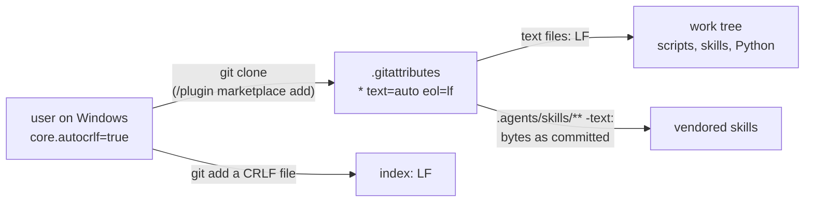
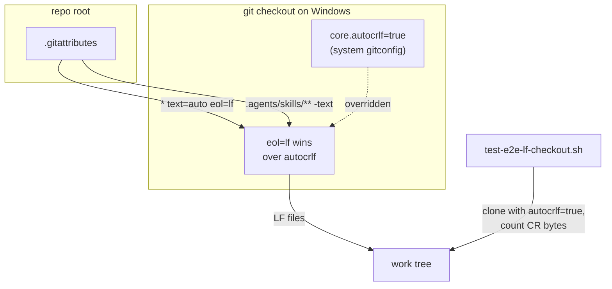
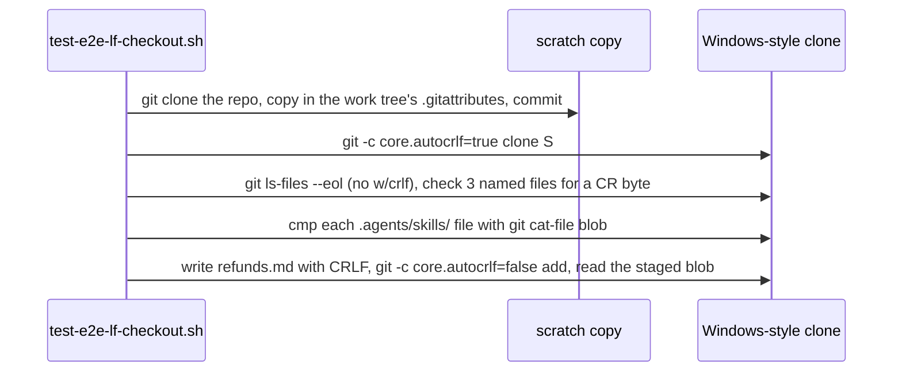

# LF checkout

**Version:** v1 · **Status:** Shipped · **Type:** Bug · **Project type:** CLI/Library

**Shape doc:** docs/specs/os-agnostic-suite/shape.md
**Depends on:** None
**Page:** https://claude.ai/artifact/JUtcu8GLjCzgejTUDXxWFg

A `.gitattributes` rule makes git check out every text file of zuko with LF on every OS. A Windows install then holds the same bytes as a Linux one, and later slices measure their own causes without CRLF noise.

## Problem

Git for Windows sets `core.autocrlf=true` in its system config, and the repo has no rule against it. In this repo's work tree, 366 of 414 tracked files are CRLF, although the index holds LF. The installed zuko 2.5.1 is CRLF too: `block-attribution.sh`, `skills/ship/SKILL.md` and `lib/release.py` all end their lines with `\r\n`. A test that reads a skill file across a line end fails on Windows only, for example `unattended-build` and `pause-questions`.

A pull does not repair an existing clone. In a scratch repo, a pull that added the rule turned only the changed file to LF. The unchanged file stayed CRLF, and only a fresh clone was LF throughout.

## Slice test

| Check                         | Result                                                                 |
| ----------------------------- | ---------------------------------------------------------------------- |
| Cuts every layer it needs     | yes — the repo's attributes and the clone that installs zuko           |
| One e2e test walks it         | yes — `test-e2e-lf-checkout.sh` clones with `core.autocrlf=true`       |
| Worth shipping alone          | yes — a fresh Windows install of zuko gets LF scripts and skills       |
| Fits (≤5 scenarios, ≤2 areas) | yes — 3 scenarios, one area (the repo root)                            |

**Path:** light — a bug fix in 2 files (`.gitattributes` and one test), with no new interface, data or dependency. Pauses 1 and 3 are one stop, and pause 2 is skipped.

## Flow



On a Windows clone, the rule beats `core.autocrlf`: text files arrive with LF, vendored files arrive byte for byte, and a CRLF file that is added goes into the index as LF.

## Acceptance criteria

```gherkin
Scenario: A Windows clone of zuko gets LF text files
  Given git runs with core.autocrlf=true, as Git for Windows sets it
  When the user clones zuko
  Then plugins/zuko/scripts/block-attribution.sh, plugins/zuko/skills/ship/SKILL.md and plugins/zuko/scripts/lib/release.py have no CR byte
  And git ls-files --eol lists no tracked file as w/crlf

Scenario: Vendored files arrive byte for byte
  Given the same clone
  When the user compares each file under .agents/skills/ with its committed blob
  Then each file is identical, including .agents/skills/shadcn/assets/shadcn.png

Scenario: A CRLF file goes into the index as LF
  Given the same clone, git's default core.autocrlf=false, and docs/specs/refunds.md written with CRLF line ends
  When the user runs git add docs/specs/refunds.md
  Then the staged blob of docs/specs/refunds.md has no CR byte
```

## Scope

**In:** the `* text=auto eol=lf` rule at the top of `.gitattributes`, the existing `.agents/skills/** -text` rule below it, and the e2e test. The CHANGELOG line that `/ship` writes tells Windows users to remove and re-add the marketplace once (O1).

**Out:**

- Scripts that write CRLF themselves, such as Python's `print()` on Windows — `utf8-stdio`.
- Hooks that cannot open a Git Bash path — `guard-paths`.
- Every test failure that is left after this slice — `portable-suite`.

## Technical plan

### Approach

Add one line, `* text=auto eol=lf`, above the existing rule in `.gitattributes`. git reads the lines in order, and a later match wins, so `.agents/skills/** -text` still keeps the vendored files as committed. `text=auto` lets git find binary files by their content, so the two PNG files and any new binary stay untouched. The index already holds LF for all 405 text files, so the commit changes no blob.

Relies on: D78 (the vendored taste skill is pinned and hashed byte for byte, so its files must stay `-text`)





### Changes

| File | What changes | Why |
| --- | --- | --- |
| `.gitattributes:1` | Add `* text=auto eol=lf` above `.agents/skills/** -text`, with a two-line comment that names `core.autocrlf`. | Scenarios 1 and 3 |
| `plugins/zuko/scripts/tests/test-e2e-lf-checkout.sh` (new) | Clone the repo to a scratch folder, copy in the work tree's `.gitattributes` and commit it, so the test also runs before the rule is committed. Clone that copy with `-c core.autocrlf=true`, then check the three scenarios. | Scenarios 1 to 3. `core.autocrlf=true` converts on Linux and macOS too, so the test proves the rule on every OS. |

Reusing: `run.sh`'s `expect_exit`, `expect_match` and `expect_no_match`. The clone-and-commit pattern of `test-e2e-*.sh`, with `-c user.name` and `-c user.email` on the commit.

### Earn-it

| Added | Triggered by |
| --- | --- |
| `test-e2e-lf-checkout.sh` | Scenarios 1 to 3. Without it, a rule removed later only shows as failures in other tests. |

### Non-functionals

|                      |                                                                               |
| -------------------- | ----------------------------------------------------------------------------- |
| **Load**             | One clone for each install. The test clones this repo twice, about 3 MB.      |
| **Breaks first**     | A new binary type that git reads as text. `text=auto` checks for NUL bytes, so this needs a file with none, such as an SVG. An SVG with LF is still a correct SVG. |
| **Security surface** | No input and no secrets. The rule only changes line ends on checkout and on add. |
| **Proof it works**   | On a fresh Windows clone, `git ls-files --eol \| grep -c w/crlf` prints `0`.  |
| **Rollout**          | No flag. Rollback: `git revert` the commit. New clones are then CRLF again.   |

### Test plan

| Scenario | Test | Command |
| --- | --- | --- |
| 1. A Windows clone of zuko gets LF text files | `test-e2e-lf-checkout.sh` | `bash plugins/zuko/scripts/tests/run.sh e2e-lf-checkout` |
| 2. Vendored files arrive byte for byte | `test-e2e-lf-checkout.sh` | as scenario 1 |
| 3. A CRLF file goes into the index as LF | `test-e2e-lf-checkout.sh` | as scenario 1 |

**E2E:** `test-e2e-lf-checkout.sh`.

### Chunks

Single chunk.

### Risks

| Risk | Mitigation |
| --- | --- |
| An existing Windows clone stays CRLF after a pull, as the scratch repo showed. | O1 decides how existing installs get the fix. |
| A file that must keep CRLF, such as a `.bat` file, is added later. | The repo has none today (`git ls-files` finds no `.bat`, `.cmd` or `.ps1`). Such a file then gets its own `eol=crlf` line. |
| The rule changes how the skills CLI hashes the vendored files. | `.agents/skills/** -text` stays below the new line and wins. Scenario 2 compares each vendored file byte for byte. |

### Decisions to record

Recorded as D89.

## Review

2026-11-07 · 1 raw finding, 0 survived. Clean.

## Open items

| ID | What | Type | Raised at | Owner | Status | Answer |
| --- | --- | --- | --- | --- | --- | --- |
| O1 | A pull leaves an existing Windows clone CRLF. How does an existing install, such as this machine's marketplace clone, get the fix? | question | spec p1 | user | Resolved | The CHANGELOG line that /ship writes tells Windows users to remove and re-add the marketplace once, so that a fresh clone replaces the CRLF one. No new code, 2026-11-07 |
| O2 | Scenario 3 said "Given the same clone", which has core.autocrlf=true. Then git strips the CR on add without the rule, so the scenario passed before the fix. | flag | build | user | Decided alone | Chose: stage the file with `core.autocrlf=false`, git's default on Linux and macOS, where only the rule removes the CR. Other: keep autocrlf=true, and the scenario proves nothing. Undo: drop `-c core.autocrlf=false` from the `git add` in `test-e2e-lf-checkout.sh`, and the Given line here. 2026-11-07 |
| O3 | The full suite stays red on Windows: 546 failures in 32 files, run in a fresh LF clone of this branch. | flag | build | user | Decided alone | Chose: build with them red. Each file fails as often as on `main` at 03962c3 or less (596 failures in 38 files there), and 50 failures are fixed, 6 files green. The only new test file, `e2e-lf-checkout`, passes its 9 checks. `e2e-board` hung on its `board.py serve` servers, as on `main`, and was stopped by hand. Other: fix the other causes here. Undo: none needed; `guard-paths`, `utf8-stdio` and `portable-suite` own them. 2026-11-07 |
| O4 | At ship, the full suite is red on Windows: 2493 passed, 546 failed, run in a fresh LF clone of this branch at f0a11f6. | flag | ship | user | Decided alone | Chose: ship with it red. The count equals the build run, every red file is red on `main` at 03962c3 too (596 failures there), and `e2e-lf-checkout` passes its 9 checks. `e2e-board` hung on its `board.py serve` servers, as on `main`, and was stopped by hand. Other: hold the PR until `portable-suite` makes the suite green. Undo: none needed; `guard-paths`, `utf8-stdio` and `portable-suite` own the failures. 2026-11-07 |

_Never delete this section or its rows. See references/ledger.md._

## Glossary

- **CRLF / LF** — the two line endings. Windows uses CR+LF (`\r\n`), Linux and macOS use LF (`\n`).
- **core.autocrlf** — a git setting that turns LF into CRLF on checkout. Git for Windows turns it on for every repo.
- **.gitattributes** — a file in the repo that tells git how to treat each file. Its `eol=lf` beats `core.autocrlf`.
- **Index** — git's staging area: the content that the next commit records.
- **Blob** — the bytes of one file as git stores them.
- **e2e** — end-to-end: one test that walks the whole slice as a user would.
