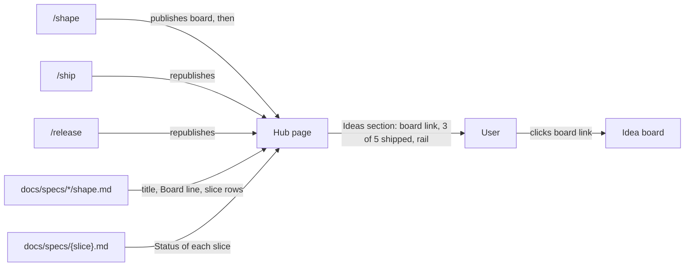
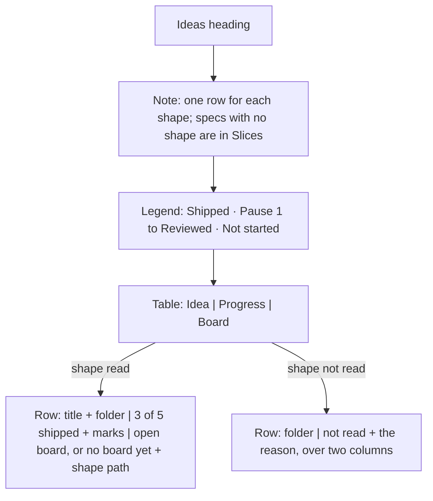
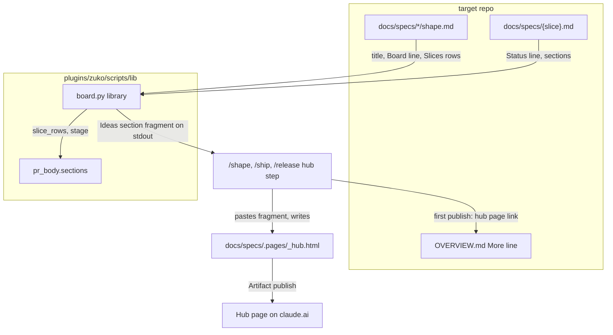
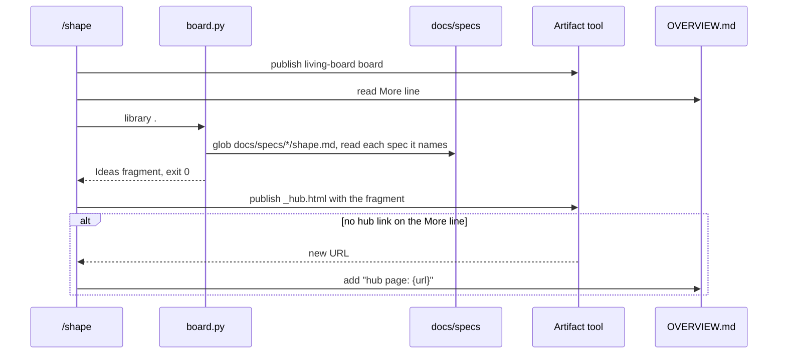

# Library

**Version:** v1 · **Status:** Refined · **Type:** Feature · **Project type:** CLI/Library

**Shape doc:** docs/specs/living-board/shape.md
**Depends on:** idea-board

The hub page gets an Ideas section: every idea in `docs/specs/*/shape.md`, with its board link, how many of its slices shipped, and a small rail of their stages. Four ideas exist and only one board link is written down, so the user cannot find a board without opening the shape file.

## Problem

Each idea has its own board, but no page lists the boards. The one board link lives on a `**Board:**` line inside `docs/specs/living-board/shape.md`. The other three ideas have no board yet, and nothing tells the user so. The hub page lists 26 slices in one flat table, with no word about which idea each slice belongs to or how far each idea got. To see where an idea stands, the user opens the shape file and the spec of each slice.

## Slice test

| Check                         | Result                                                                                     |
| ----------------------------- | ------------------------------------------------------------------------------------------ |
| Cuts every layer it needs     | Yes. The stage steps that publish the hub, the code that reads the shapes, and the hub page |
| One e2e test walks it         | Yes. Render the hub's Ideas section from a fixture repo with three shapes and check each row |
| Worth shipping alone          | Yes. The user finds every board and the progress of every idea on one page                  |
| Fits (≤5 scenarios, ≤2 areas) | Yes. 5 scenarios. Areas: the hub step, and the shape reader that `board.py` already has      |

**Path:** full. The slice adds a section to a published page and a new call in three stages.

## User story

As the author of several ideas, I want one page that lists them all with their boards and progress, so that I open the right board without searching the shape files.

## Flow



`/shape`, `/ship` and `/release` republish the hub. The hub reads each shape and the specs it names, and the user goes from the Ideas section to one idea's board.

## Acceptance criteria

```gherkin
Scenario: The hub lists each idea with its board and progress
  Given docs/specs/living-board/shape.md has the line "**Board:** https://claude.ai/artifact/6ZvDtf657jw6ohs94cyYvs"
  And its Slices table names idea-board, gate-card, pr-gate, library and replay
  And idea-board, gate-card and pr-gate are at Status Shipped, and library and replay have no spec
  When /ship republishes the hub page
  Then the Ideas section has a row "Living board" that links to https://claude.ai/artifact/6ZvDtf657jw6ohs94cyYvs
  And the row says "3 of 5 shipped"
  And the row shows five rail marks: three Shipped, two Not started
  And docs/specs/tokenise-linear.md, which has no Shape doc line, is not in the Ideas section but stays in the Slices table

Scenario: An idea with no board yet still shows
  Given docs/specs/ask-up-front/shape.md has no Board line
  And its five slices are at Status Shipped
  When /ship republishes the hub page
  Then the Ideas section has a row "Ask up front, decide at the PR" that says "no board yet"
  And the row names docs/specs/ask-up-front/shape.md
  And the row says "5 of 5 shipped"

Scenario: A shape the hub cannot read does not stop the hub
  Given docs/specs/billing-export/shape.md has no "## Slices" table
  When /ship republishes the hub page
  Then the Ideas section has a row for billing-export that says "no Slices table in docs/specs/billing-export/shape.md"
  And the rows of the other ideas show as usual
  And /ship goes on to its next step

Scenario: The first /shape in a repo creates the hub
  Given OVERVIEW.md has a "## More" line with no hub page link
  And the user runs /shape on a new idea, csv-import, with three slices
  When /shape publishes the csv-import board
  Then /shape publishes the hub page and adds "hub page: {url}" to the More line
  And the Ideas section has a row "CSV import" with the new board link and "0 of 3 shipped"

Scenario: The v3 release idea counts every spec it became
  Given docs/specs/v3-release-and-hosts/shape.md has one Slices row for each of its 14 specs, release to jira-shape
  When /ship republishes the hub page
  Then the row "v3 · Release and hosts" says "14 of 14 shipped"
  And no rail mark is Not started
```

## Scope

**In:**

- An Ideas section on the hub page, above the Slices table. One row per `docs/specs/*/shape.md`: the shape's title, its board link or "no board yet" with the shape path, the shipped count, and one rail mark per slice in its stage.
- A row for a shape that cannot be read, or that has no Slices table, with the reason. The hub still publishes.
- `/shape` publishes the hub after it publishes the board. With no hub link on the More line, `/shape` creates the hub and adds the link. With a link, it republishes.
- A data fix to `docs/specs/v3-release-and-hosts/shape.md`: the Slices table gets one row for each spec it became. "Regression-aware review" becomes `regression-review`. "Pentest" becomes `pentest` and `pentest-live`. "Stage polish" becomes its 9 specs.

**Out:**

- Specs with no `**Shape doc:**` line. 17 of the 44 specs have none. They stay in the hub's Slices table only, and the Ideas section does not list them. No later slice; the user chose this at pause 1.
- Publishing a missing board from the hub step. A board appears when a stage of its idea publishes it. No later slice.
- A history of how each idea moved: **replay**, slice 5 of living-board.

## Interface

The Ideas section is a new section of the hub page, between "Architecture" and "Slices". It uses the hub's own tokens and its table style. The hub has no design system, and this slice adds none.



The section is a heading, a note, a legend and one table. Each shape gives one row, or one error row when the hub cannot read it.

**Row order.** Error rows come first. Then the ideas with a slice that is not Shipped. Then the ideas with every slice Shipped. In each group, the rows go in the order of the shape folder names.

**Each row:**

| Column   | Text                                                                                                   |
| -------- | ------------------------------------------------------------------------------------------------------ |
| Idea     | The shape's `# ` title, and under it the folder name in mono, for example `living-board`               |
| Progress | `{n} of {total} shipped`, then one mark for each row of the Slices table, in table order               |
| Board    | `open board`, linked to the `**Board:**` URL. With no Board line: `no board yet · docs/specs/{idea}/shape.md` |

**Marks.** A filled green mark is Shipped. A filled blue mark is any stage from Pause 1 to Reviewed. A hollow mark is Not started, which also means the slice has no spec yet. Each mark has the title `{slice} · {stage}`, with the stage names that the board uses. The list of marks has an `aria-label` that names each slice and its stage.

**Error row.** The Idea column has the folder name. The other two columns join, and say `not read` in an amber pill, then the reason:

| Cause                                 | Reason text                                    |
| ------------------------------------- | ---------------------------------------------- |
| The shape has no table with a Slice column under `## Slices` | `no Slices table in docs/specs/{idea}/shape.md` |
| The shape cannot be read              | `cannot read docs/specs/{idea}/shape.md: {error}` |

**No shapes.** With no `docs/specs/*/shape.md`, the hub has no Ideas section. It shows no empty heading.

**Preview:** https://claude.ai/artifact/AcXaSBvFM98p8tbTeee6bt, from `docs/specs/.pages/library-preview.html`

## Technical plan

### Approach

A new `board.py library <root>` command reads every `docs/specs/*/shape.md` under `<root>` and prints the Ideas section as one HTML fragment. It reuses the board's shape reader: `slice_rows` for the Slices table and `stage` for each spec. `/ship`, `/release` and now `/shape` paste that fragment into the hub as it is, between Architecture and Slices. The rest of the hub stays hand-written, as today.

Relies on: D50 (one parser for the rows), D62 (a script renders what reads many files; Claude only publishes), D63 (pages are claude.ai pages), D70 (drafted below).



The script reads the shapes and specs and prints the fragment. The stage's hub step pastes it into `_hub.html` and publishes that file.



At the end of `/shape`, the stage publishes the board, gets the fragment, and publishes the hub. On a first publish it writes the hub link to the overview.

### Changes

| File | What changes | Why |
| ---- | ------------ | --- |
| `plugins/zuko/scripts/lib/board.py:51` | Add `BOARD` (the `**Board:**` line), `STAGES` (the eight stage names that `board.html:193` uses) and `import html` | Scenarios 1, 2 |
| `plugins/zuko/scripts/lib/board.py:518` | New `library(root)`: for each `docs/specs/*/shape.md` in folder-name order, read it with `read`, take its rows with `slice_rows`, and give each slice its stage with `stage`, or 0 when the spec file is missing. A `Refused` from `read`, or no rows, gives an error row. Sort error rows, then ideas in flight, then finished ideas | Scenarios 1, 2, 3, 5 |
| `plugins/zuko/scripts/lib/board.py:543` | New `library_html(ideas)`: the fragment of the Interface section. It has its own `<style>` with classes under `.zuko-ideas` and its own light and dark colours. Every text goes through `html.escape`. A Board URL that does not start with `https://` gives "no board yet". No shapes gives an empty output | Scenarios 1 to 3; Interface |
| `plugins/zuko/scripts/lib/board.py:585` | `main` takes `library <root>`: prints the fragment and exits 0, or exits 2 when `<root>` is not a directory. The docstring and `USAGE` gain the line | Scenarios 1 to 4 |
| `plugins/zuko/references/visual-page.md:175` | "Hub page": `/shape` also builds it. The order list gains item 4, **Ideas**: run `board.py library .`, and paste its output as it is. Do not edit it. No output means no section. Slices and Links become 5 and 6 | Scenarios 1 to 4 |
| `plugins/zuko/skills/shape/SKILL.md:160` | After the board publish: publish the hub per `visual-page.md` › "Hub page". With no `hub page:` link on the overview's More line, add the link that the publish returns | Scenario 4; O4, O6 |
| `docs/specs/v3-release-and-hosts/shape.md:36` | The Slices table gets one row for each of its 14 specs. The Slice cells name the spec files | Scenario 5; O5 |
| `plugins/zuko/scripts/tests/test-library.sh` | New. Unit cases for `library`, and text checks for `visual-page.md` and the `/shape` step | Scenarios 3, 4, 5 |
| `plugins/zuko/scripts/tests/test-e2e-library.sh` | New. The e2e walk, below | Scenarios 1, 2, 3 |

Reusing: `read`, `Refused`, `slice_rows`, `spec_name`, `stage` and `pr_body.sections` from `board.py` and `pr_body.py`. The `section` and `flat` helpers from `test-idea-board.sh` for the text checks. `/ship` and `/release` need no edit: their hub steps already follow `visual-page.md` › "Hub page".

### Earn-it

| Added | Triggered by |
| ----- | ------------ |
| `board.py library` | Scenarios 1 to 5, and D62: the rows must look the same at each stage, and a test must prove them |
| A `<style>` inside the fragment | The hub is hand-written at each stage, so its class names can change between runs. The fragment must draw the same in any hub |
| The `https://` check on the Board URL | The fragment goes into a page. A `javascript:` link in a shape file must not become a live link |

### Non-functionals

|                      |                                                                               |
| -------------------- | ----------------------------------------------------------------------------- |
| **Load**             | 4 shapes and 27 specs in this repo. One run reads about 31 files, in well under a second |
| **Breaks first**     | At 10×, 40 shapes and 270 specs, the run is still under a second. A 14-mark rail wraps to two lines on a phone, which the flex layout allows |
| **Security surface** | Only the stage calls it, on the user's own repo. It trusts no text: every value is escaped, and only an `https://` Board URL becomes a link. No secrets. It stores nothing; the stage writes `_hub.html`, which is git-ignored |
| **Proof it works**   | The published hub shows an "Ideas" heading with 4 rows, and the v3 row says `14 of 14 shipped` |
| **Rollout**          | No flag. The next `/ship`, `/release` or `/shape` after the merge adds the section. Rollback: revert the commits. The next hub publish then has no Ideas section |

### Test plan

| Scenario | Test | Command |
| -------- | ---- | ------- |
| 1. The hub lists each idea with its board and progress | `test-e2e-library.sh`: the living-board row has the board link, `3 of 5 shipped`, 3 Shipped and 2 Not started marks, and no row for the loose spec | `bash plugins/zuko/scripts/tests/run.sh e2e-library` |
| 2. An idea with no board yet still shows | `test-e2e-library.sh`: the ask-up-front row says `no board yet` with its shape path, and `5 of 5 shipped` | `bash plugins/zuko/scripts/tests/run.sh e2e-library` |
| 3. A shape the hub cannot read does not stop the hub | `test-e2e-library.sh`: the billing-export error row comes first, and the run exits 0. `test-library.sh`: an unreadable shape, a `javascript:` Board URL, a title with `<script>`, and no shapes | `bash plugins/zuko/scripts/tests/run.sh library` |
| 4. The first `/shape` in a repo creates the hub | `test-library.sh`: the text checks on `visual-page.md` › "Hub page" and the `/shape` step. The real publish is checked by hand at this slice's `/ship` | `bash plugins/zuko/scripts/tests/run.sh library` |
| 5. The v3 release idea counts every spec it became | `test-library.sh`: `board.py library` on this repo prints `14 of 14 shipped` for v3-release-and-hosts | `bash plugins/zuko/scripts/tests/run.sh library` |

**E2E:** `test-e2e-library.sh`. A fixture repo with three shapes (living-board with a Board line, ask-up-front without one, billing-export with no Slices table), a loose spec and an `OVERVIEW.md`. It runs `board.py library`, pastes the fragment into a hub page, and checks every row and the row order in that page.

### Chunks

Single chunk.

### Risks

| Risk | Mitigation |
| ---- | ---------- |
| A stage edits the fragment while it pastes it, so the rows drift from the files | `visual-page.md` says to paste it as it is. The proof line in Non-functionals is checked at this slice's `/ship` |
| `/shape` now publishes two pages, which adds about a minute | Accepted at pause 1 (O4) |
| An old shape names slices that match no spec, as v3 did | The row shows hollow marks, so the gap is seen. The fix is a data fix in that shape, as in scenario 5 |

### Decisions to record

```text
## D70 · 2026-10-26 · A script renders the hub's Ideas section; the rest of the hub stays hand-written

Why: the Ideas rows read every shape and every spec they name, about 31 files today. They must read them as the board does (D62), and a test must prove each row.
Rejected: Claude writes the rows at each stage (the same misreads that D62 stops, and no test), a script renders the whole hub (about twice the work, better as its own slice).
Source: specs/library.md
Status: active
```

## Open items

| ID  | What | Type | Raised at | Owner | Status | Answer |
| --- | ---- | ---- | --------- | ----- | ------ | ------ |
| O1  | 17 specs in this repo have no shape. Where do they appear in the library? (from shape O8) | question | shape | user | Resolved | In the hub's Slices table only. The Ideas section lists ideas, 2026-10-26 |
| O2  | What does the library show for an idea with no board yet? | question | spec p1 | user | Resolved | The row, marked "no board yet", with the shape path, 2026-10-26 |
| O3  | What is the stage of an idea on the library? | question | spec p1 | user | Resolved | The shipped count and one rail mark per slice, 2026-10-26 |
| O4  | Does `/shape` republish the hub, so a new idea shows the same day? | question | spec p1 | user | Resolved | Yes, after it publishes the board. About a minute more per `/shape`, 2026-10-26 |
| O5  | The v3-release-and-hosts shape names two slices that match no spec file, so the idea reads 3 of 5 shipped when all of it shipped. What do we do? | question | spec p1 | user | Resolved | Fix that shape's Slices table to one row per spec, as a data fix in this slice, 2026-10-26 |
| O6  | At `/shape`, the overview may have no hub link yet. Does `/shape` skip the hub, or create it? | assumption | spec p1 | user | Resolved | `/shape` creates the hub and adds the link to the More line, 2026-10-26 |
| O7  | The published hub says "Updated 2026-10-06" and lists 26 slices, but 44 shipped. The last `/ship` runs did not republish it. Assuming this slice republishes it once at its own `/ship`, and the cause is not this slice's problem. | flag | spec p1 | user | Accepted risk | This slice's `/ship` republishes the hub, which fixes the content. The cause of the skipped republish stays out of scope, 2026-10-26 |

_Never delete this section or its rows. See references/ledger.md._

## Glossary

- **Hub page** — the one claude.ai page for the whole project. Its link is on the `## More` line of `OVERVIEW.md`.
- **Board** — the claude.ai page for one idea, built by `board.py` from its shape, specs and decisions.
- **Rail** — the row of slices in order, each marked with its stage.
- **Idea** — one folder under `docs/specs/` with a `shape.md`.
- **e2e** — end-to-end: one test that walks the whole slice as a user would.
- **Pentest** — a penetration test: an attack on the code to find holes. Here it is only part of two spec names.
