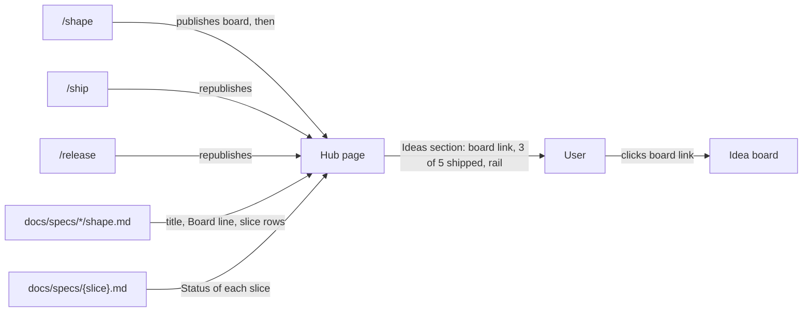

# Library

**Version:** v1 · **Status:** Draft · **Type:** Feature · **Project type:** CLI/Library

**Shape doc:** docs/specs/living-board/shape.md
**Depends on:** idea-board

The hub page gets an Ideas section: every idea in `docs/specs/*/shape.md`, with its board link, how many of its slices shipped, and a small rail of their stages. Four ideas exist and only one board link is written down, so the user cannot find a board without opening the shape file.

## Problem

Each idea has its own board, but no page lists the boards. The one board link lives on a `**Board:**` line inside `docs/specs/living-board/shape.md`. The other three ideas have no board yet, and nothing tells the user so. The hub page lists 26 slices in one flat table, with no word about which idea each slice belongs to or how far each idea got. To see where an idea stands, the user opens the shape file and the spec of each slice.

## Slice test

| Check                         | Result                                                                                     |
| ----------------------------- | ------------------------------------------------------------------------------------------ |
| Cuts every layer it needs     | Yes. The stage steps that publish the hub, the code that reads the shapes, and the hub page |
| One e2e test walks it         | Yes. Render the hub's Ideas section from a fixture repo with three shapes and check each row |
| Worth shipping alone          | Yes. The user finds every board and the progress of every idea on one page                  |
| Fits (≤5 scenarios, ≤2 areas) | Yes. 5 scenarios. Areas: the hub step, and the shape reader that `board.py` already has      |

**Path:** full. The slice adds a section to a published page and a new call in three stages.

## User story

As the author of several ideas, I want one page that lists them all with their boards and progress, so that I open the right board without searching the shape files.

## Flow



`/shape`, `/ship` and `/release` republish the hub. The hub reads each shape and the specs it names, and the user goes from the Ideas section to one idea's board.

## Acceptance criteria

```gherkin
Scenario: The hub lists each idea with its board and progress
  Given docs/specs/living-board/shape.md has the line "**Board:** https://claude.ai/artifact/6ZvDtf657jw6ohs94cyYvs"
  And its Slices table names idea-board, gate-card, pr-gate, library and replay
  And idea-board, gate-card and pr-gate are at Status Shipped, and library and replay have no spec
  When /ship republishes the hub page
  Then the Ideas section has a row "Living board" that links to https://claude.ai/artifact/6ZvDtf657jw6ohs94cyYvs
  And the row says "3 of 5 shipped"
  And the row shows five rail marks: three Shipped, two Not started
  And docs/specs/tokenise-linear.md, which has no Shape doc line, is not in the Ideas section but stays in the Slices table

Scenario: An idea with no board yet still shows
  Given docs/specs/ask-up-front/shape.md has no Board line
  And its five slices are at Status Shipped
  When /ship republishes the hub page
  Then the Ideas section has a row "Ask up front, decide at the PR" that says "no board yet"
  And the row names docs/specs/ask-up-front/shape.md
  And the row says "5 of 5 shipped"

Scenario: A shape the hub cannot read does not stop the hub
  Given docs/specs/billing-export/shape.md has no "## Slices" table
  When /ship republishes the hub page
  Then the Ideas section has a row for billing-export that says "no Slices table in docs/specs/billing-export/shape.md"
  And the rows of the other ideas show as usual
  And /ship goes on to its next step

Scenario: The first /shape in a repo creates the hub
  Given OVERVIEW.md has a "## More" line with no hub page link
  And the user runs /shape on a new idea, csv-import, with three slices
  When /shape publishes the csv-import board
  Then /shape publishes the hub page and adds "hub page: {url}" to the More line
  And the Ideas section has a row "CSV import" with the new board link and "0 of 3 shipped"

Scenario: The v3 release idea counts every spec it became
  Given docs/specs/v3-release-and-hosts/shape.md has one Slices row for each of its 14 specs, release to jira-shape
  When /ship republishes the hub page
  Then the row "v3 · Release and hosts" says "14 of 14 shipped"
  And no rail mark is Not started
```

## Scope

**In:**

- An Ideas section on the hub page, above the Slices table. One row per `docs/specs/*/shape.md`: the shape's title, its board link or "no board yet" with the shape path, the shipped count, and one rail mark per slice in its stage.
- A row for a shape that cannot be read, or that has no Slices table, with the reason. The hub still publishes.
- `/shape` publishes the hub after it publishes the board. With no hub link on the More line, `/shape` creates the hub and adds the link. With a link, it republishes.
- A data fix to `docs/specs/v3-release-and-hosts/shape.md`: the Slices table gets one row for each spec it became. "Regression-aware review" becomes `regression-review`. "Pentest" becomes `pentest` and `pentest-live`. "Stage polish" becomes its 9 specs.

**Out:**

- Specs with no `**Shape doc:**` line. 17 of the 44 specs have none. They stay in the hub's Slices table only, and the Ideas section does not list them. No later slice; the user chose this at pause 1.
- Publishing a missing board from the hub step. A board appears when a stage of its idea publishes it. No later slice.
- A history of how each idea moved: **replay**, slice 5 of living-board.

## Open items

| ID  | What | Type | Raised at | Owner | Status | Answer |
| --- | ---- | ---- | --------- | ----- | ------ | ------ |
| O1  | 17 specs in this repo have no shape. Where do they appear in the library? (from shape O8) | question | shape | user | Resolved | In the hub's Slices table only. The Ideas section lists ideas, 2026-10-26 |
| O2  | What does the library show for an idea with no board yet? | question | spec p1 | user | Resolved | The row, marked "no board yet", with the shape path, 2026-10-26 |
| O3  | What is the stage of an idea on the library? | question | spec p1 | user | Resolved | The shipped count and one rail mark per slice, 2026-10-26 |
| O4  | Does `/shape` republish the hub, so a new idea shows the same day? | question | spec p1 | user | Resolved | Yes, after it publishes the board. About a minute more per `/shape`, 2026-10-26 |
| O5  | The v3-release-and-hosts shape names two slices that match no spec file, so the idea reads 3 of 5 shipped when all of it shipped. What do we do? | question | spec p1 | user | Resolved | Fix that shape's Slices table to one row per spec, as a data fix in this slice, 2026-10-26 |
| O6  | At `/shape`, the overview may have no hub link yet. Does `/shape` skip the hub, or create it? | assumption | spec p1 | user | Resolved | `/shape` creates the hub and adds the link to the More line, 2026-10-26 |
| O7  | The published hub says "Updated 2026-10-06" and lists 26 slices, but 44 shipped. The last `/ship` runs did not republish it. Assuming this slice republishes it once at its own `/ship`, and the cause is not this slice's problem. | flag | spec p1 | user | Accepted risk | This slice's `/ship` republishes the hub, which fixes the content. The cause of the skipped republish stays out of scope, 2026-10-26 |

_Never delete this section or its rows. See references/ledger.md._

## Glossary

- **Hub page** — the one claude.ai page for the whole project. Its link is on the `## More` line of `OVERVIEW.md`.
- **Board** — the claude.ai page for one idea, built by `board.py` from its shape, specs and decisions.
- **Rail** — the row of slices in order, each marked with its stage.
- **Idea** — one folder under `docs/specs/` with a `shape.md`.
- **e2e** — end-to-end: one test that walks the whole slice as a user would.
- **Pentest** — a penetration test: an attack on the code to find holes. Here it is only part of two spec names.
