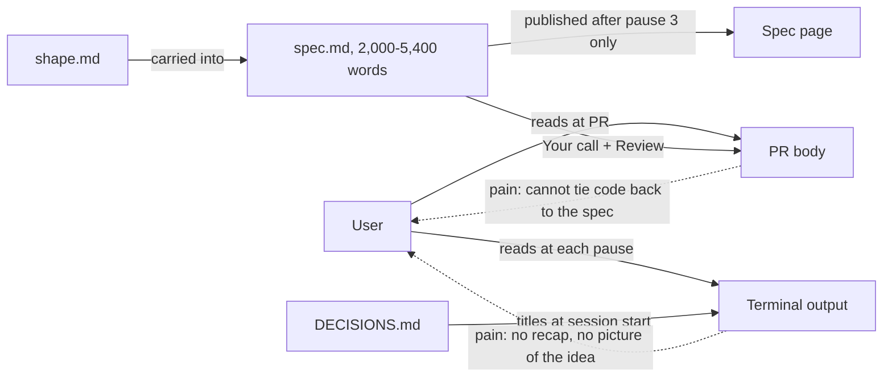
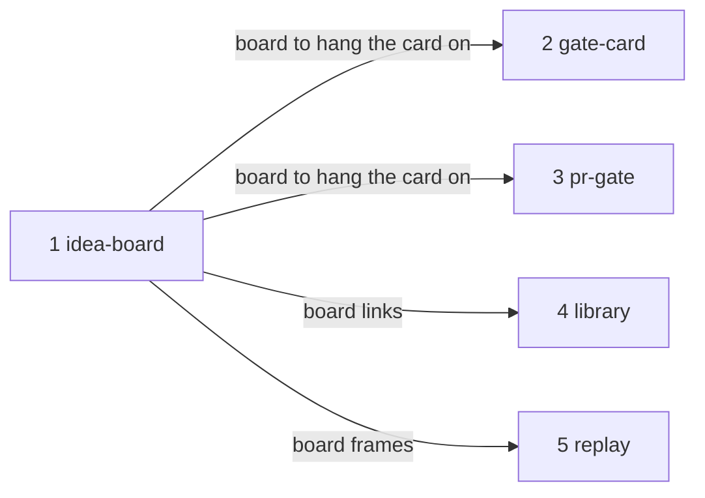

# Living board

**Project type:** CLI/Library · **Status:** Shaped

## Problem

After a few specs, the user cannot recall why a choice was made, how the slices connect, what an approved spec says, or what a shipped slice changed in the code. So the user approves `/spec` pauses and PRs without following them, or asks Claude to explain each time.

## Today

The facts exist in the files, but no single view ties them together, and the spec page arrives only after pauses 1 and 2 are already approved.

## Slices

| # | Slice | What ships | Why this order |
| --- | --- | --- | --- |
| 1 | idea-board | `/shape` publishes one claude.ai page per idea: the slices as a rail, each slice's stage lit (shaped, pause 1 to 3, built, reviewed, shipped), the links between slices, and the decisions each slice made. `/spec`, `/build`, `/review` and `/ship` republish it from the files. | The one picture of the idea. Every later slice adds to this page. |
| 2 | gate-card | At each `/spec` pause and the end of `/shape`, the board shows a gate card: what waits for approval and why, what is settled so far, and what changed since the last pause. The terminal prints the board link and one ASCII picture, then the questions. | The pain is worst at the pauses. Needs slice 1's page. |
| 3 | pr-gate | `/ship` puts a PR gate card on the board: each acceptance criterion next to the files and tests that meet it, and the choices made without the user. The PR body links the card. | Second pain point. Needs slice 1's page; independent of slice 2. |
| 4 | library | The hub page lists every idea with its board link and stage. | Useful once two or more boards exist. |
| 5 | replay | The board scrubs through how an idea moved from shape to ship, rebuilt from the git history of its docs. | Least needed to approve with confidence; last so it blocks nothing. |

## Not doing

- **A local live server, as in Backlot.** The user chose claude.ai pages: they open on a phone and need no new process. The cost is that the board updates only when a stage republishes it.
- **A local static HTML file.** Laptop only, with no gain over the claude.ai page.
- **Shorter specs.** The user did not pick it. The board makes the spec readable without making it shorter.
- **A recap built from the conversation.** It breaks after compaction. Every card is built from the files.

## Open items

| ID | What | Type | Raised at | Owner | Status | Answer |
| --- | --- | --- | --- | --- | --- | --- |
| O1 | Does a pause recap come from the spec file or from the conversation? | question | shape | user | Resolved | The spec file, so it survives compaction and new sessions, 2026-10-25 |
| O2 | Where does the one picture of the idea live? | question | shape | user | Resolved | A page per shape. The hub links to it, 2026-10-25 |
| O3 | Where does the board run? | question | shape | user | Resolved | claude.ai page, republished at each pause and stage, 2026-10-25 |
| O4 | What does the terminal print at a pause once the board exists? | question | shape | user | Resolved | The board link and one ASCII picture, then the questions, 2026-10-25 |
| O5 | The user's global CLAUDE.md bans HTML views of markdown docs. Assuming the board is allowed because it combines many files and does not copy one `.md`. | assumption | shape | user | Resolved | No objection from the user, 2026-10-25 |
| O6 | "What changed since the last pause" needs the spec as it was at the last pause, but the spec is not committed between pauses. Where does that copy come from? | question | shape | user | Handed to gate-card | Likely a copy saved in `docs/specs/.pages/` at each pause, 2026-10-25 |
| O7 | Each republish takes about a minute, at every pause and every stage. Is that cost acceptable? | question | shape | user | Accepted risk | About a minute per stage keeps the board current when read, 2026-10-25 |
| O8 | 23 specs in this repo have no shape. Where do they appear in the library? | question | shape | user | Handed to library | — |
| O9 | Replay rebuilds frames from git history, but a spec is often written in one commit, so it may have only one or two frames. | assumption | shape | user | Handed to replay | May reuse O6's per-pause copies, 2026-10-25 |

## Glossary

- **Board** — the claude.ai page for one idea, rebuilt from its shape, specs and decisions.
- **Gate card** — the part of the board that says what waits for your approval and why.
- **Backlot** — OpenMontage's local board that redraws a video production from the files it writes. This idea copies its board, gate, library and replay.
- **Rail** — the row of slices in order, each marked with its stage.
- **Republish** — publish the page again to the same URL with new content.
