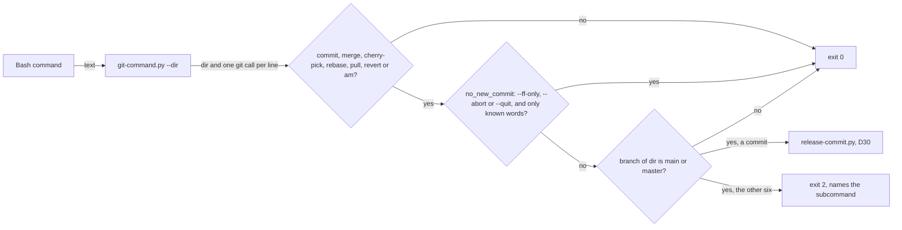
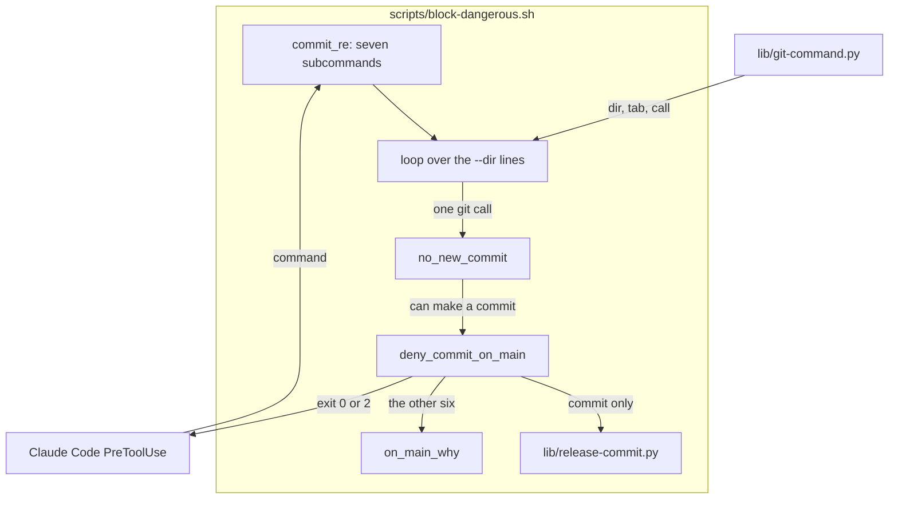
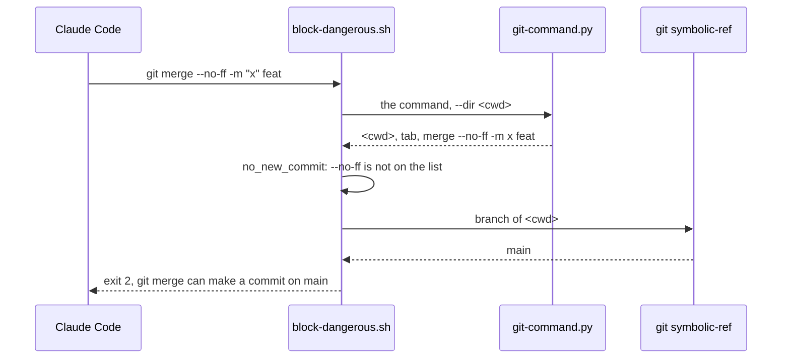

# Main branch commits

**Version:** v1 · **Status:** Built · **Type:** Bug · **Project type:** CLI/Library

**Shape doc:** docs/specs/guard-leads/shape.md
**Depends on:** None

The commit-on-main guard also blocks `merge`, `cherry-pick`, `rebase`,
`pull`, `revert` and `am` on `main`. It still lets through a fast-forward
with `--ff-only`, and an `--abort` or `--quit` that ends one of them.

## Problem

`block-dangerous.sh` blocks `git commit` on `main` (D30). Six other git
subcommands also make commits on the branch they run on, and the guard does
not read them. The v2.6.0 pentest listed this as lead N9. I ran each probe
through the real hook on 2026-11-12, in a scratch repo on `main`:

| Probe | Exit today |
| --- | --- |
| `git merge feat` | 0 |
| `git cherry-pick feat` | 0 |
| `git rebase feat` | 0 |
| `git pull` | 0 |
| `git revert HEAD` | 0 |
| `git am x.patch` | 0 |
| `git commit -m x` | 2 |

`git push origin main` passes the guard, and `/release` needs it to pass. So
a merge commit that the guard lets through on a local `main` can reach the
remote.

git 2.52.0 facts this slice rests on. I ran each one in a scratch repo on
2026-11-12, with a local `main` one commit ahead of a remote that had one new
commit:

- A plain `git pull` with no `pull.*` config stops with "Need to specify how
  to reconcile divergent branches". With `-c pull.rebase=false` it makes a
  merge commit on `main`.
- `git pull --ff-only` stops with "Not possible to fast-forward" also with
  `-c pull.rebase=true`, `-c pull.ff=false`, or `--rebase` before or after it.
  `git merge --ff-only` stops in the same way with `-c merge.ff=false`.
- The last of `--ff`, `--no-ff` and `--ff-only` wins: `git merge --ff-only
  --no-ff` and `git pull --ff-only --no-ff` make a merge commit.
- The parser prints `git merge -m "a --ff-only" feat` as
  `merge -m a --ff-only feat`, and `git pull --ff-only 2>&1` as
  `pull --ff-only 2 >& 1`. The quotes are gone from the printed line.

## Slice test

| Check | Result |
| --- | --- |
| Cuts every layer it needs | Yes. The hook, and the test that runs the real hook |
| One e2e test walks it | Yes. `test-block-dangerous.sh` feeds the real hook each probe in a scratch repo on `main` |
| Worth shipping alone | Yes. It closes the merge, rebase and pull part of lead N9 |
| Fits (≤5 scenarios, ≤2 areas) | Yes. 4 scenarios, 1 area (scripts) |

**Path:** light. A bug fix in 2 files, with no new interface, data or
dependency. Pauses 1 and 3 merged, pause 2 skipped. The user delegated each
pause decision.

## Flow



Each git call that can make a commit is judged on the branch of the
directory it runs in. Only the release commit and the forms that cannot make
a commit pass on `main`.

## Acceptance criteria

```gherkin
Scenario: a subcommand that makes a commit is blocked on main
  Given a repo on main with a branch feat
  When block-dangerous.sh judges "git merge feat", "git cherry-pick feat", "git rebase feat", "git pull", "git revert HEAD" or "git am x.patch"
  Then it exits 2, and the message names the subcommand and says to create a branch first
  And "git merge --no-ff feat", "git pull --rebase", "git merge --continue" and "git -c alias.m=merge m feat" are blocked the same way
  And "git rebase --continue" is blocked while a rebase of main has HEAD detached

Scenario: a fast-forward or an abort passes on main
  Given a repo on main
  When block-dangerous.sh judges "git pull -q --ff-only origin main", "git merge --ff-only origin/main 2>&1" or "git rebase --abort"
  Then it exits 0
  And "git merge --abort", "git cherry-pick --quit", "git am --abort" and "git revert --abort 2> err.txt" pass too

Scenario: a word that can undo --ff-only is blocked
  Given a repo on main
  When block-dangerous.sh judges "git merge --ff-only --no-ff feat", "git merge -m 'a --ff-only' feat", "git pull --ff-only $OPTS" or "git pull --abort"
  Then it exits 2
  And "git pull --ff-only `echo --no-ff`" is blocked, because the parser ends the call at the backtick
  And "echo --no-ff feat | xargs git merge --ff-only" is blocked, because xargs adds words the line cannot show

Scenario: the same calls pass on a feature branch, and the release commit still passes on main
  Given the session on the branch feat/thing
  When block-dangerous.sh judges "git merge main", "git rebase main" or "git pull"
  Then it exits 0
  And the release commit that cut prepared still passes on main, as in release-commit-guard
```

## Scope

**In:** the commit check in `block-dangerous.sh`, and the cases above in
`test-block-dangerous.sh`.

**Out:**

- `git checkout main && git merge feat`, and a merge whose directory the
  parser cannot know. The guard judges these on the session's branch today.
  Slice `branch-switch-commit` follows the checkout.
- Aliases in `~/.gitconfig` and `.git/config`, such as an alias `m` for
  `merge`. Slice `config-aliases`.
- `git reset --hard`, `git branch -D` and `git clean -fdx` (shape O6).
- `git push origin feat:main`, which moves the remote `main` with no commit
  on the local one. Remote branch protection is the line for that (O3).

## Technical plan

### Approach

`block-dangerous.sh` widens the commit match to the seven subcommands. A new
function `no_new_commit` lets a call through before the branch check when
it cannot make a commit. That is a `merge` or `pull` with `--ff-only`, or an
`--abort` or `--quit` for the other five. The function reads an allow-list:
each option must be on it, and each other word must hold only safe
characters. A message such as `-m "a --ff-only"` then blocks, because `-m`
is not on the list. bash can give git words the line does not show: the
parser ends a call at an unquoted backtick, and `xargs` or another program
that runs git adds the words it reads. A new `--hidden-words` mode of the
parser says when that happens, and then the call does not pass. A rebase
leaves HEAD detached while it runs, so the branch check also reads the
branch the rebase started on from git's `head-name` file. The release
exception (D30) stays for `commit` only.

Relies on: D30, D52, D138, D140, D148, D149, D150.





### Changes

| File | What changes | Why |
| --- | --- | --- |
| `plugins/zuko/scripts/block-dangerous.sh:39` | `commit_re` matches `commit`, `merge`, `cherry-pick`, `rebase`, `pull`, `revert` and `am` | Scenario 1 |
| `plugins/zuko/scripts/block-dangerous.sh:60` | New `no_new_commit`, the allow-list. A call that an unquoted backtick ends allows nothing | Scenarios 2, 3 |
| `plugins/zuko/scripts/lib/git-command.py` `hidden_words`, `main` | New `--hidden-words` mode: exit 1 when an unquoted backtick ends a git call, or a word other than a keyword or `NAME=value` runs git. The plain and `--dir` output do not change | Scenario 3 |
| `plugins/zuko/scripts/block-dangerous.sh:91` | New `rebase_branch`: with HEAD detached, the branch a rebase started on | Scenario 1 |
| `plugins/zuko/scripts/block-dangerous.sh:79`, `:90`, `:114` | New `on_main_why`. `deny_commit_on_main` and `deny_commit_anywhere` take the git call, and the message names its subcommand. `release-ok` stays for `commit` only | Scenarios 1, 4 |
| `plugins/zuko/scripts/block-dangerous.sh:119` | The loop skips a call that `no_new_commit` lets through, also in the fallback when `--dir` fails | Scenarios 2, 3 |
| `plugins/zuko/scripts/tests/test-block-dangerous.sh` | The cases for scenarios 1 to 4 | Scenarios 1–4 |

Reusing: the `--dir` walk, `tokenise`, `is_separator` and `program_word` in
`git-command.py`, `deny`, `release-commit.py` and the `run_hook` test helper,
unchanged.

### Earn-it

| Added | Triggered by |
| --- | --- |
| `no_new_commit` | Scenario 2: `git pull --ff-only` is the normal way to update `main`, and 128 logged calls use `--ff-only`, `--abort` or `--quit` |
| `on_main_why` | Scenario 1: the message names the subcommand, and tells a pull to use `--ff-only` |
| `git-command.py --hidden-words` | Scenario 3, and O7: a check of the raw text for a backtick blocked a normal `git merge -q --ff-only origin/main` in the replay. Review F1: xargs |
| `rebase_branch` | Scenario 1, review F2: `git rebase --continue` of a rebase of main passed |

### Non-functionals

| | |
| --- | --- |
| **Load** | `no_new_commit` is a bash loop over the words of one line. A call that the old guard did not match now runs one `git symbolic-ref`, and with HEAD detached one `git rev-parse`. An allowed call runs one more parse |
| **Breaks first** | Nothing at 10×. The work is linear in the command |
| **Security surface** | Closes the merge, rebase and pull part of lead N9. Each change adds blocks only, except the two allowed forms, and git 2.52.0 refuses to make a commit for both |
| **Proof it works** | `bash plugins/zuko/scripts/tests/run.sh block-dangerous`: 504 passed, 0 failed, on 2026-11-12, after the review fixes |
| **Rollout** | No flag. It ships with the next zuko release. Rollback: revert the fix commit |

### Test plan

| Scenario | Test | Command |
| --- | --- | --- |
| 1. A subcommand that makes a commit is blocked | `test-block-dangerous.sh`, "main-branch-commits" block | `bash plugins/zuko/scripts/tests/run.sh block-dangerous` |
| 2. A fast-forward or an abort passes | same file | same |
| 3. A word that can undo `--ff-only` is blocked | same file | same |
| 4. The calls pass on a feature branch | same file, after the checkout of `feat/thing` | same |

**E2E:** `test-block-dangerous.sh` runs the real hook script on each payload,
as Claude Code runs it, in a scratch repo on `main`.

**Replay:** each logged Bash command whose parsed calls hold one of the
seven subcommands goes through the hook at the base commit and at the fix,
in a scratch repo on `main`. Each changed verdict is listed in O6.

### Chunks

Single chunk.

### Risks

| Risk | Mitigation |
| --- | --- |
| A normal call on `main` with an option that is not on the list is now blocked, such as `git pull --ff-only --prune` | The message says what passes. The replay finds each new block in the real logs (O6) |
| A later git version lets `--ff-only` make a commit | The facts above name git 2.52.0. A test in a scratch repo proves each one again |

### Decisions to record

```
## D148 · 2026-11-12 · On main, the commit guard also blocks merge, cherry-pick, rebase, pull, revert and am

Why: each one makes commits on the branch it runs on, and all six passed the guard on 2026-11-12 (v2.6.0 N9). `git push origin main` passes for /release, so a merge commit on a local main can reach the remote. git 2.52.0 refuses to make a commit for `merge --ff-only` and `pull --ff-only`, also with `pull.rebase=true` or `--rebase`, so those pass, with `--abort` and `--quit`.
Rejected: allow a plain `git pull` (with `pull.rebase=false` it made a merge commit on main), read `pull.ff` and `pull.rebase` from the config (an inline `-c` changes them, and config reads belong to slice config-aliases), block `--ff-only` too (it is the normal way to update main, 119 logged calls).
Source: specs/main-branch-commits.md
Status: active

## D149 · 2026-11-12 · The allowed forms on main are an allow-list of words, not a list of the options that make a commit

Why: the parser prints a call with its quotes gone, so `git merge -m "a --ff-only" feat` reads as the words `-m`, `a`, `--ff-only`. A check for `--ff-only` alone lets it through, and git then makes a merge commit. Each option must be on a short list, and each other word must hold no `$`, quote, glob or comma.
Rejected: block on `--no-ff`, `--rebase` and the other options that make a commit (the list is open, and `-m "x --ff-only"` still passes), a new parser mode that keeps the quotes (a change to the parser that six callers share, for one hook).
Source: specs/main-branch-commits.md
Status: active

## D150 · 2026-11-12 · An allowed form on main passes only when git starts its command

Why: xargs adds the words it reads to the git call, and the printed line cannot show them. `echo --no-ff feat | xargs git merge --ff-only` printed as `merge --ff-only` and made a merge commit on main (review F1). Only a keyword such as `if` or `command`, or a `NAME=value`, may stand before git.
Rejected: a list of the programs that add words, such as xargs, parallel and find -exec (a guard that lists wrappers misses one), a mark per call in the `--dir` output (a change to output that six callers share).
Source: specs/main-branch-commits.md
Status: active
```

## Review

2026-11-12 · 2 raw findings, 2 survived, 2 fixed.

- A01 Broken Access Control · `plugins/zuko/scripts/block-dangerous.sh:77` · an allowed `--ff-only` or `--abort` call passes only when git starts its command, so `xargs git merge --ff-only` is blocked on main · `8585434`
- A01 Broken Access Control · `plugins/zuko/scripts/block-dangerous.sh:103` · with HEAD detached, the branch check reads the branch a rebase started on, so `git rebase --continue` of a rebase of main is blocked · `8585434`

## Open items

| ID | What | Type | Raised at | Owner | Status | Answer |
| --- | --- | --- | --- | --- | --- | --- |
| O1 | Which of `merge`, `cherry-pick`, `rebase`, `pull`, `revert` and `am` does the guard block on `main`? `git pull` on `main` is the normal way to update it. (from shape O4) | question | shape | user | Resolved | Decided under the user's delegation: block all six on `main`. Let through `merge --ff-only`, `pull --ff-only`, and `--abort` or `--quit` for each one but `pull`. The release flow runs none of the six on `main`: `release.py` runs git through its own subprocess, and step 4 runs `add`, `commit`, `tag` and `push` (D148). 2026-11-12 |
| O2 | A plain `git pull` on `main` is now blocked, and Claude must run it again with `--ff-only`. Allow it when the config forbids a merge? | question | spec p1 | user | Resolved | Decided under the user's delegation: no. The block message names `git pull --ff-only`, so the cost is one more call. The hook judges Claude's commands only, not the user's own terminal. 2026-11-12 |
| O3 | `git merge --ff-only feat` on `main` moves `main` to the commits of `feat` with no PR, and `git push origin main` then sends them. | flag | spec p1 | user | Accepted risk | Decided under the user's delegation: a fast-forward makes no new commit, and `git push origin feat:main` already does the same today. Remote branch protection is the line for that. 2026-11-12 |
| O4 | `cherry-pick -n`, `revert -n`, `merge --no-commit` and `merge --squash` make no commit, but the guard blocks them on `main`. | flag | spec p1 | user | Accepted risk | Decided under the user's delegation: they stage the change for a `git commit` that the guard blocks anyway, and a shorter allow-list has fewer holes. 12 logged calls use `-n`, `--no-commit` or `--squash`. 2026-11-12 |
| O5 | The allow-list reads the printed line, so a normal option that is not on it blocks a call on `main`. | flag | spec p3 | user | Accepted risk | Decided under the user's delegation: the list holds `--ff-only`, `--abort`, `--quit`, `-q`, `--quiet`, `-v` and `--verbose`, which cover each `--ff-only` and `--abort` call in the logs. The replay counts each new block (O6). 2026-11-12 |
| O6 | The replay ran the 3576 unique logged Bash commands whose parsed calls hold one of the seven subcommands through the hook at `3c11930` and at the fix, in a scratch repo on `main`. | flag | build | user | Decided alone | Chose: ship. 267 verdicts changed, and none is a new allow. 258 are new blocks: 84 merge, 81 rebase, 77 cherry-pick, 12 plain `git pull` (O2) and 4 revert, each a form that can make a commit. No new block is a call made only of `--ff-only`, `--abort` or `--quit` forms. 9 were blocked before as a commit, and now name the cherry-pick in the same command first. The replay judges a command whose directory it cannot place as on `main`, so most of these ran on a branch for real. Other: widen the allow-list. Undo: none needed. 2026-11-12 |
| O7 | Scenario 3 said only that `$OPTS` blocks. A backtick also hides words: the parser ends a call at an unquoted backtick, so ``git pull --ff-only `echo --no-ff` `` printed as `pull --ff-only`. | flag | build | user | Decided alone | Chose: a `--backtick` mode in `git-command.py` that says when an unquoted backtick ends a git call, and no allowance then. The plain and `--dir` output are the same as at `3c11930` for all 28225 logged commands, and no logged command has a backtick that ends a git call. Other: no allowance for any command with a backtick in its text, which blocked a normal `git merge -q --ff-only origin/main` after a quoted `gh` comment in the replay. Undo: revert `f37453c`, which puts back the whole-text check. 2026-11-12 |
| O8 | Review F1: `echo --no-ff feat \| xargs git merge --ff-only` passed on main and made a merge commit. xargs adds the words it reads, and the printed line cannot show them. | flag | review | user | Decided alone | Chose: an allowed form passes only when git starts its command, after nothing but a keyword or `NAME=value` (D150). `--backtick` became `--hidden-words`, which checks both, and runs for each allowed call, not only when the text has a backtick. Other: a list of the programs that add words. Undo: revert `8585434`. 2026-11-12 |
| O9 | The F1 fix blocks on main a fast-forward run by a wrapper that adds no words, such as `sudo git pull --ff-only` or `timeout 60 git pull --ff-only`. It also blocks one in a command where a bare `git` word is another program's argument, such as `grep -rn git a.txt && git pull --ff-only`. | flag | review | user | Accepted risk | Decided under the user's delegation: these are extra blocks only, on main only, and the message names the plain `git pull --ff-only`, which passes. 2026-11-12 |
| O10 | Review F2: a rebase of main that stops leaves HEAD detached, so `git rebase --continue`, `--skip`, `git merge` and `git commit` passed. | flag | review | user | Decided alone | Chose: when `git symbolic-ref` fails, read `rebase-merge/head-name` or `rebase-apply/head-name` through `git rev-parse --path-format=absolute --git-path`. `git rebase --abort` still passes. Other: block every call with a detached HEAD (it blocks normal work on a detached checkout). Undo: revert `8585434`. `--path-format` needs git 2.31 or later; an older git reads as no rebase, as before. 2026-11-12 |

_Never delete this section or its rows. See references/ledger.md._

## Glossary

- **Pentest** — the attack that `/release` runs on the code it ships, to find each hole before someone else does.
- **Fast-forward** — a merge that moves the branch to a later commit with no new commit, because the branch has nothing of its own.
- **Merge commit** — a commit with two parents, which `git merge` or `git pull` makes when both sides have new commits.
- **Allow-list** — a list of the words that may pass. Any word that is not on it blocks.
- **Release commit** — the one commit that `/release` makes on `main`, past the guard, with the marker that `release.py cut` writes (D30).
- **Replay** — running real logged Bash commands through the old and the new hook, to count each verdict that changed.
- **e2e** — end-to-end: one test that walks the whole slice as a user would.
- **xargs** — a program that reads words from its input and runs a command with those words added to the end.
- **Detached HEAD** — git is on a commit, not on a branch. A rebase works this way, then moves the branch when it ends.
