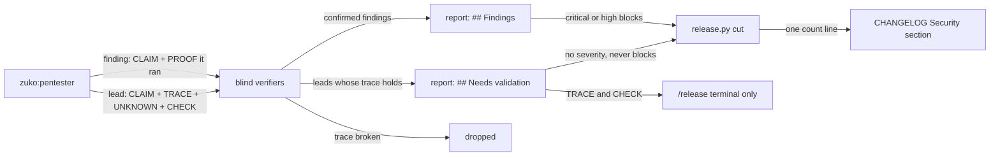
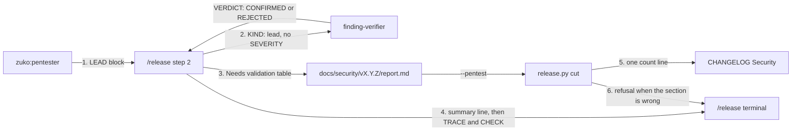
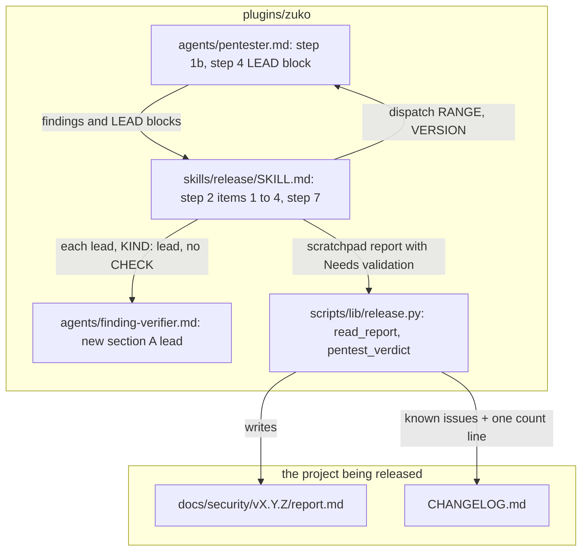
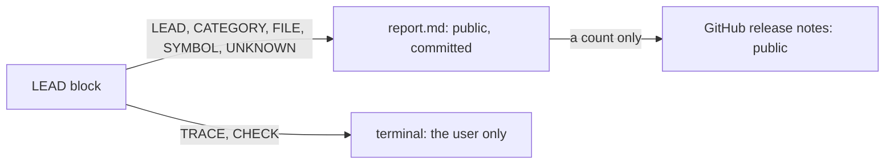

# Needs validation

**Version:** v1 · **Status:** Shipped · **Type:** Feature · **Project type:** CLI/Library

**Shape doc:** docs/specs/pentest-depth/shape.md
**Depends on:** attack-classes

The release pentest keeps each lead that it traced but could not prove, under a new Needs validation section of the report. Each lead names the one fact that is still unknown, so the user can settle it by hand, and a lead never blocks the release.

## Problem

The pentester drops each lead that it cannot prove with a run. The user never hears about it. The class files from slice 1 make this worse: they mark a lead `needs_validation` when a platform, deployment or runtime fact is out of reach, and the pentester throws each one away (D92). zuko runs on Linux, macOS and Windows, but a release pentest runs on one OS. A hole in a Windows-only branch, such as the `cygpath` call in `git-command.py:291`, can never be proved on a Linux release. Today nothing records it.

## Slice test

| Check                         | Result                                                                                                                                   |
| ----------------------------- | ---------------------------------------------------------------------------------------------------------------------------------------- |
| Cuts every layer it needs     | yes — the pentester's output, the blind verifier, `/release` step 2 with its report and terminal summary, and `release.py cut`           |
| One e2e test walks it         | yes — one e2e test takes a seeded pentester reply with a lead through the verifier step and `release.py cut` to the committed report      |
| Worth shipping alone          | yes — the next zuko release report lists the leads that it could not prove, with the fact that settles each one                          |
| Fits (≤5 scenarios, ≤2 areas) | yes — 5 scenarios, 2 areas: the release pentest prompts, and `release.py`                                                                |

**Path:** full — the slice adds a report section that `release.py cut` must read, and it changes the pentester and the verifier.

## User story

As the person who runs `/release`, I want to see each lead that the pentest could not prove, with the one fact that decides it, so that I can check that fact myself instead of never hearing about the lead.

## Flow



The pentester returns proved findings and unproved leads. A blind verifier checks the trace of each lead and drops it when the trace breaks. The report lists the leads that hold under Needs validation, without a severity, and `cut` never blocks on them. The trace and the check that settles a lead print in the terminal only.

## Acceptance criteria

```gherkin
Scenario: a Windows-only branch becomes a lead with the fact that is still unknown
  Given zuko is tagged v2.5.1, and the range v2.5.1..HEAD changes plugins/zuko/scripts/lib/git-command.py
  And the release runs on Linux, so the cygpath branch at git-command.py:291 never runs
  And the pentester traces `git -C /c/work/shop commit` from block-dangerous.sh into that branch
  When the user runs /release, says yes to 2.6.0 and picks code-level
  Then docs/security/v2.6.0/report.md has a Needs validation row N1 for git-command.py:291 native_path
  And N1 says what is unknown: "whether cygpath -m on Git Bash maps /c/work/shop to C:/work/shop"
  And N1 has no severity
  And the terminal prints N1's trace, and the check that settles it: run `cygpath -m -- /c/work/shop` in Git Bash on Windows

Scenario: leads never block the release, and the notes count them
  Given the v2.6.0 pentest has 0 findings and 3 leads that hold
  When /release runs release.py cut with that report
  Then the report reads "**Result:** pass", and cut writes the release
  And the CHANGELOG [2.6.0] Security section has the line "- 3 leads need validation; see docs/security/v2.6.0/report.md."

Scenario: a lead whose trace breaks is dropped
  Given the pentester sends lead N2: board.py opens a slice name from shape.md as a file path
  And board.py refuses a slice name that has a / or \ before it opens anything (D77)
  When the blind verifier checks N2's trace
  Then N2 is dropped, and the report has no row for it

Scenario: zuko's exclusions apply to leads too
  Given the pentester has a lead whose only impact is a slow parse of a 60 KB command
  And it has a lead where PR body text reaches a prompt, and no traced path reaches a tool call or a file write
  When it writes its output
  Then neither lead is a finding, and neither is a lead

Scenario: a report without the section is refused
  Given a pentest report for v2.6.0 has Findings, Assessed and Not assessed, and no Needs validation section
  When /release runs release.py cut with it
  Then cut prints "Pentest report unreadable: no Needs validation section" and writes nothing
  And a report whose Needs validation table has no rows is taken, as a run with no leads
```

## Scope

**In:**

- The pentester returns each unproved lead, with its claim, its trace, the one fact that is unknown, and a safe check that settles it.
- A blind verifier checks each lead's trace. A lead whose trace breaks is dropped.
- The report gets a `## Needs validation` table. A lead has no severity and never blocks.
- `release.py cut` refuses a report without the section, and adds one count line to the CHANGELOG Security section.
- The `/release` terminal summary counts the leads, and prints each trace and check.
- zuko's exclusions apply to leads: the Never-a-finding list (D5) and the untrusted-text rule (D6).

**Out:**

- Carrying a lead into the next release, or marking its code as not covered — slice 3 `coverage-ledger`.
- A Strix finding that the verifier cannot settle — slice 4 `strix-code` puts it in this section.
- A severity for a lead — not doing (shape).
- A command that settles a lead. The user runs the check by hand. A confirmed one goes to `/debug`.
- Leads in `/review` — not doing, as with the class files (shape O7).

## Interface

The slice changes six outputs. It adds no command and no flag.



The pentester returns a LEAD block for each lead. `/release` sends each one to a blind verifier, marked as a lead. It writes the leads that hold into the report table and prints their trace and check. `cut` reads the table, adds one count line, and refuses a report whose section is missing or malformed.

### 1. The pentester's LEAD block

After the findings, one block for each lead. A lead has no `SEVERITY` and no `PROOF`.

```text
LEAD: {one sentence, the possible defect only}
CATEGORY: {A0N:2025 name}, or {A0N:2025 name} · {class file} {class}
FILE: {path:line}
SYMBOL: {the function or class the line sits in}
SNIPPET: {the line, as written}
TRACE: {the input, then each file:line it passes, to the line where harm would happen}
UNKNOWN: {the one fact that decides it, which no run in the scratch copy can observe}
CHECK: {a safe check the user can run to settle the fact}
```

For example:

```text
LEAD: On Windows, a /c/ path in git -C may reach the main-branch guard without conversion.
CATEGORY: A01:2025 Broken Access Control
FILE: plugins/zuko/scripts/lib/git-command.py:291
SYMBOL: native_path
SNIPPET: if os.name != "nt" or not path.startswith("/") or not shutil.which("cygpath"):
TRACE: "git -C /c/work/shop commit" → block-dangerous.sh:84 → git-command.py --dir → native_path("/c/work/shop") → cygpath -m → the guard reads the branch of the path it returns
UNKNOWN: whether cygpath -m on Git Bash maps /c/work/shop to C:/work/shop
CHECK: in Git Bash on Windows, run `cygpath -m -- /c/work/shop` and expect C:/work/shop
```

The rules that go into `pentester.md`:

- A lead has exactly one `UNKNOWN`. The fact is out of reach of a run in the scratch copy: another OS, a hosted setting such as branch protection, a deployed config, the network, or what a model does with text (D6).
- A lead is never a finding with its proof left out. When a run proves it, it is a finding.
- A lead that is out of turns, or that needs more reading, is not a lead. Read more, or drop it.
- The Never-a-finding list (D5) stops a lead. An untrusted-text lead needs a `TRACE` that reaches a tool call or a file write (D6).
- The old rule "Never write `needs_validation`" goes. Cloudflare's `needs_validation` verdict becomes a LEAD block.

### 2. A lead to the blind verifier

`/release` sends each lead as it sends a finding, with `KIND: lead` first and no `SEVERITY`: `KIND`, the claim, `CATEGORY`, `FILE`, `SYMBOL`, `SNIPPET`, `TRACE`, `UNKNOWN` and `BASE`. It never sends `CHECK`.

The verifier confirms a lead when each step of the `TRACE` is in the code as written, the diff introduced it, nothing upstream stops the input, and the repo does not answer the `UNKNOWN`. Any one it cannot establish → REJECT. Its output is the same, without the `SEVERITY`, `ATTACKER` and `GAIN` lines:

```text
VERDICT: CONFIRMED
PATH: "/c/work/shop" reaches native_path unchanged from block-dangerous.sh:84; the result decides which repo's branch the guard reads.
```

### 3. The report table

A new section between Findings and Assessed. It is always there. With no leads, the table has its header and no rows.

```text
## Needs validation

| ID | Category | Where | Description | Unknown |
| -- | -------- | ----- | ----------- | ------- |
| N1 | A01:2025 Broken Access Control | plugins/zuko/scripts/lib/git-command.py:291 native_path | on Windows, a /c/ path in git -C may reach the main-branch guard without conversion | whether cygpath -m on Git Bash maps /c/work/shop to C:/work/shop |
```

`Where` is `FILE` then `SYMBOL`. `Description` is the `LEAD` sentence. `Unknown` is the `UNKNOWN` line. The table has no severity, trace or check (O2). A `|` in either cell is written as `/`, because `cut` reads each `|` as a cell break.

### 4. The terminal

The step 2 summary gets one line after the findings:

```text
Pentest    code-level · v2.5.1..a1b2c3d (9 commits) · 7 categories · 3 class files
           no findings
           needs validation: 1 lead (2 dropped by the verifier)
           not assessed: A01, A07 — no running server (slice 5b)
           class files not read: 7 — no matching code in the range
```

After each finding's `PROOF`, `/release` prints each lead:

```text
N1  plugins/zuko/scripts/lib/git-command.py:291 native_path
    trace    "git -C /c/work/shop commit" → block-dangerous.sh:84 → git-command.py --dir → native_path → cygpath -m
    unknown  whether cygpath -m on Git Bash maps /c/work/shop to C:/work/shop
    check    in Git Bash on Windows, run `cygpath -m -- /c/work/shop` and expect C:/work/shop
```

The step 7 report names the count:

```text
  pentest   passed: 0 critical, 0 high, 0 medium, 0 low · 1 lead needs validation · docs/security/v2.6.0/report.md
```

### 5. The CHANGELOG line

`cut` adds one line to the version's Security section, after the known-issue lines. With no leads, it adds nothing.

```text
- 1 lead needs validation; see docs/security/v2.6.0/report.md.
- 3 leads need validation; see docs/security/v2.6.0/report.md.
```

### 6. The refusals

`cut` refuses the report and writes nothing:

```text
Pentest report unreadable: no Needs validation section
Pentest report unreadable: the Needs validation columns are ID, Severity, Category, Where, Description, not ID, Category, Where, Description, Unknown
Pentest report unreadable: a Needs validation row has 6 cells, not 5: | N1 | ... |
Pentest report unreadable: a Needs validation row has ID P2, not N<n>
```

A skipped pentest (`--no-pentest`) writes no Needs validation section, as it writes no Findings today.

## Technical plan

### Approach

Three prompts and one script change. The pentester writes a LEAD block where it drops a lead today. The verifier gets a `KIND: lead` section. `/release` step 2 sends leads through the verifiers, and writes the new table and the terminal lines. `release.py` reads the new section with the parser that reads Findings now, refuses a malformed one, and adds the count line to the Security section.

D94 rejected a new report section for the class-file lines, because those lines fit the Assessed lists. A lead is a new kind of row with its own columns, so it gets its own section, and `cut` learns it.

Relies on: D4, D5, D6, D10, D12, D14, D94, D100, D101, D102, D103



`/release` dispatches the pentester and gets findings and leads back. It sends each one to a verifier, and writes the scratchpad report. `cut` reads it and writes the committed report and the CHANGELOG lines.

```mermaid
sequenceDiagram
  participant R as /release step 2
  participant P as zuko:pentester
  participant V as finding-verifier
  participant C as release.py cut
  R->>P: RANGE v2.5.1..HEAD, VERSION 2.6.0
  P-->>R: SCOPE, 0 findings, 3 LEAD blocks
  R->>V: KIND: lead, LEAD, CATEGORY, FILE, SYMBOL, SNIPPET, TRACE, UNKNOWN, BASE
  V-->>R: VERDICT CONFIRMED (1 lead), REJECTED (2 leads)
  R->>R: write report: Findings empty, Needs validation N1
  R->>R: print summary, then N1 trace, unknown, check
  R->>C: cut --pentest report.md
  C->>C: read_report: Findings, lists, Needs validation columns and IDs
  C-->>R: writes report.md, CHANGELOG "- 1 lead needs validation; see ..."
```

The verifier sees each lead blind, as it sees a finding. The leads that hold go into the report. `cut` checks the section, then writes.



The public report gets the claim and the unknown. The trace and the check, which can read like an exploit, stay in the terminal (O2). The release notes get only a count (O1).

### Changes

| File | What changes | Why |
| --- | --- | --- |
| `plugins/zuko/agents/pentester.md:62-69` (step 1b) | Replace "A lead without a run proof is dropped. Never report it." with: a lead without a run proof is not a finding; when it meets the rules of Interface 1, write a LEAD block. Replace "`confirmed` and `needs_validation`: ignore these verdicts" with: a class file's `needs_validation` is a LEAD block, and the word never appears in the output | scenarios 1, 4, D101 |
| `plugins/zuko/agents/pentester.md:174-210` (step 4, Report) | "Only what a run proved" becomes the rule for findings. Add the LEAD template and the example from Interface 1, after the finding template, and the five rules under it | scenarios 1, 4, Interface 1 |
| `plugins/zuko/agents/finding-verifier.md:73` (new section "A lead", after the two exceptions) | With `KIND: lead`, confirm when each step of `TRACE` is in the code as written, the diff introduced it, no defence that you read stops the input, and the repo does not answer `UNKNOWN`. A defence still needs its `DEFENCE:` line. Leave out `SEVERITY`, `ATTACKER` and `GAIN`. No `KIND` line means a finding, as today, so `/review` does not change | scenario 3, Interface 2, D103 |
| `plugins/zuko/skills/release/SKILL.md:110-173` (step 2, items 1 to 4) | Item 1: the pentester also returns LEAD blocks. Item 2: send each lead with `KIND: lead` and without `CHECK`. Item 3: the report gets the Needs validation section of Interface 3, from the confirmed leads only, always there. After each `PROOF`, print each lead as Interface 4 shows. Item 4: the summary line `needs validation: …` | scenarios 1, 2, 3, Interface 3 and 4 |
| `plugins/zuko/skills/release/SKILL.md:263` (step 7) | The pentest line names the lead count | Interface 4 |
| `plugins/zuko/scripts/lib/release.py:795` `findings_table` | Take the heading as a second argument, default `"## Findings"`, and put the section name in its error. Every rule stays: each line of the section is read, and a line with a severity that is not a row is refused | scenario 5 |
| `plugins/zuko/scripts/lib/release.py:836` `read_report` | After the Assessed and Not assessed checks, read `## Needs validation` with `findings_table`. Refuse: no section, columns other than `LEAD_COLUMNS`, a row without 5 cells, and an ID that does not match `^N[0-9]+$`. Return the lead count as a third value | scenario 5, Interface 6 |
| `plugins/zuko/scripts/lib/release.py:933` `pentest_verdict` | After the known-issue lines, add `- 1 lead needs validation; see <report>.` or `- N leads need validation; see <report>.`. No line for 0 | scenario 2, Interface 5, D102 |
| `plugins/zuko/scripts/tests/test-release.sh` | The `findings_report` helper (line 1123) gets an empty Needs validation table. New cases: a missing section, wrong columns, 6 cells, a `P2` ID, an empty table taken, and 1 and 3 leads giving the two count lines | scenarios 2, 5 |
| `plugins/zuko/scripts/tests/fixtures/pentest/pass.md`, `medium.md`, `fixtures/pentest-live/live-pass.md`, `fixtures/attack-classes/report.md` | Add an empty Needs validation table between Findings and Assessed | scenario 5: every pass report has the section |
| `plugins/zuko/scripts/tests/test-e2e-attack-classes.sh:69,73` | The two checks on the old drop rule check the new LEAD rule | D101 |
| `plugins/zuko/scripts/tests/test-e2e-needs-validation.sh` (new) | The e2e test below | all |
| `plugins/zuko/scripts/tests/fixtures/needs-validation/` (new) | `report.md`: a v1.5.0 pass report with 1 medium finding and 3 leads. `range.patch`: the seed range on `fixtures/pentest/base/` for seeded run 1. `lead-n2.txt`: the broken-trace lead for seeded run 2 | scenarios 1 to 4 |

Reusing: `findings_table` and `unreadable` in `release.py`, the `known_issue` line shape, the `run.sh` helpers and the scratch invoice-cli repo of `test-e2e-attack-classes.sh` section 4, the invoice-cli seed in `fixtures/pentest/base/`, the `llm-base` seed of `fixtures/attack-classes/`, and the seeded run command in `docs/specs/pentest.md` › Seeded run.

### Earn-it

| Added | Triggered by |
| --- | --- |
| The `## Needs validation` section and `LEAD_COLUMNS` | Scenarios 1 and 5. A lead has an Unknown and no Severity, so the five Findings columns do not fit it |
| The `^N[0-9]+$` ID check | Risk 1. A finding row in this table would never block. `cut` fails closed on it, as it does on a hidden Findings row (test-release.sh case 39) |
| `KIND: lead` in the verifier | O3 and scenario 3. A lead has no concrete outcome, so the verifier's rule 1 rejects every lead without it |
| `fixtures/needs-validation/range.patch` | Scenario 1 needs a Windows-only branch, and scenario 4 a resource-exhaustion lead. The invoice-cli seed has neither |

Not added: no flag, no new script, no new agent, no cap (O5), and no dependency.

### Non-functionals

|                      |                                                                               |
| -------------------- | ----------------------------------------------------------------------------- |
| **Load**             | One pentest for each release, about one each week. Each lead adds one haiku verifier run. |
| **Breaks first**     | At 10 times the leads, about 30, step 2 runs 30 more verifiers, and the report gets long. There is no cap (O5). When it hurts, raise the lead rules in the pentester first. |
| **Security surface** | The committed report and the release notes are public. The report gets the claim, the place and the unknown of each lead, never the trace or the check (O2). The notes get a count (O1). `cut` trusts the scratchpad report only after its checks, and refuses an ID that is not `N<n>` in the lead table. No secret is read or stored. |
| **Proof it works**   | `docs/security/v2.6.0/report.md` has a `## Needs validation` heading with its table, and the step 2 summary has the line `needs validation: N leads`. |
| **Rollout**          | No flag. `/release` uses it once the installed plugin has this version. To roll back, revert the commits. `cut` reads only the report of the release that it cuts, so old reports without the section stay valid in the repo. |

### Test plan

| Scenario | Test | Command |
| --- | --- | --- |
| 2 | `test-release.sh`: a report with 3 leads and a medium finding gives the known-issue line, then `- 3 leads need validation; see docs/security/v1.5.0/report.md.`. 1 lead gives `- 1 lead needs validation; …`. 0 leads give no line | `bash plugins/zuko/scripts/tests/run.sh release` |
| 5 | same: no section, the columns `ID, Severity, Category, Where, Description`, a row with 6 cells, and a row with ID `P2` each print their Interface 6 refusal and write nothing. A table with no rows is taken | same |
| 1, 3, 4 (prompts) | `test-e2e-needs-validation.sh`: `pentester.md` has the LEAD template lines `TRACE:`, `UNKNOWN:` and `CHECK:`, the exactly-one-UNKNOWN rule, and no "Never write `needs_validation`". `finding-verifier.md` has the `KIND: lead` section. `release/SKILL.md` sends `KIND: lead`, says `CHECK` is never sent, and has the Needs validation table and the summary line | `bash plugins/zuko/scripts/tests/run.sh e2e-needs-validation` |
| 1, 2 (report) | same: a scratch invoice-cli release cut with `fixtures/needs-validation/report.md`. The release commit on origin carries the report with N1, and `release.py notes` prints the count line | same |
| 1, 3, 4 (agents) | the seeded runs below | recorded in this spec by `/build` |

**E2E:** `test-e2e-needs-validation.sh`. It checks the three prompts for the LEAD contract. It then cuts a scratch invoice-cli v1.5.0 with a report that has a medium finding and 3 leads, and expects the report, the known-issue line and the count line on origin and in `release.py notes`.

**Seeded runs:** use the command in `docs/specs/pentest.md` › Seeded run, with `--allowedTools Bash`.

1. **Pentester.** On `fixtures/pentest/base/` plus `fixtures/needs-validation/range.patch`, tagged v1.4.2. The patch adds an export path that builds a shell string only under `os.name == "nt"`, and an invoice-number regex whose only harm is a slow match. The run passes when the Windows branch is a LEAD block with one `UNKNOWN` about Windows, the regex gives no finding and no lead, the bank-import A05 is still a finding with a `PROOF`, and the output has no `needs_validation`.
2. **Verifier.** Dispatch `zuko:finding-verifier` with `lead-n2.txt`: a lead that says an export name reaches `open()`, when a check before it refuses a `/`. The run passes on `VERDICT: REJECTED` with a `DEFENCE:` line.
3. **The D6 half of scenario 4.** Seeded run 2 of `attack-classes.md` on `llm-base`, run again. The PR-summary skill gives no finding and no lead.

### Seeded runs, recorded

Recorded by `/build` on 2026-11-09 on Linux, with the command in `docs/specs/pentest.md` › Seeded run and `--allowedTools Bash`. Seed 1 is `fixtures/pentest/base/` tagged v1.4.2, then `fixtures/pentest/range.patch`, then `fixtures/needs-validation/range.patch`, each with `git apply`.

| Check | Run 1: pentester, invoice-cli v1.4.2..HEAD | Run 2: verifier, `lead-n2.txt` | Run 3: pentester, llm-base v0.3.0..HEAD |
| --- | --- | --- | --- |
| Result | pass | pass | not run to the end (O8) |
| The Windows branch is a LEAD block with one `UNKNOWN` | yes: `suppliers.py:29` `start` call, UNKNOWN "whether cmd.exe on Windows treats the & in the target as a command separator" | — | — |
| The regex gives no finding and no lead | yes: listed under `DEFENCES:` only | — | — |
| The bank-import A05 is still a finding with a `PROOF` | yes: high, `ls pwned` printed "pwned" | — | — |
| No `needs_validation` in the output | yes: 0 matches | — | — |
| A broken trace is rejected | — | yes: `VERDICT: REJECTED`, `DEFENCE: invoice_cli/exporters/suppliers.py:20` | — |
| The PR-summary skill gives no finding and no lead | — | — | no answer: the run stopped |
| Turns | 23 subagent messages of 60 | 2 | 34 messages, then stopped |

Run 1 also returned a second lead that the seed did not plant: on Windows, a supplier name `C:x` passes the `/` and `\` check, and `os.path.join` drops `exports`. Its UNKNOWN is where `open("C:x.csv", "w")` writes on Windows. The A03 lockfile finding came back as low, as in the attack-classes runs. No leak: `git status --porcelain` and the home listing matched the baseline.

### Chunks

| Chunk | Scenarios | Files owned |
| --- | --- | --- |
| A | 2, 5 | `plugins/zuko/scripts/lib/release.py`, `plugins/zuko/scripts/tests/test-release.sh`, `plugins/zuko/scripts/tests/fixtures/pentest/pass.md`, `fixtures/pentest/medium.md`, `fixtures/pentest-live/live-pass.md`, `fixtures/attack-classes/report.md` |
| B | 1, 3, 4 | `plugins/zuko/agents/pentester.md`, `plugins/zuko/agents/finding-verifier.md`, `plugins/zuko/skills/release/SKILL.md`, `plugins/zuko/scripts/tests/test-e2e-attack-classes.sh`, `plugins/zuko/scripts/tests/test-e2e-needs-validation.sh`, `plugins/zuko/scripts/tests/fixtures/needs-validation/` |

No shared files. The e2e test in chunk B cuts with chunk A's parser, so it goes green only after both merge. The seeded runs go after the merge.

### Risks

| Risk | Mitigation |
| --- | --- |
| 1. The pentester writes a provable critical as a lead, and the release does not block. | The rule "a lead is never a finding with its proof left out". Seeded run 1 keeps the provable bank-import A05 as a finding. Today the same lead is dropped, so the user sees more than before. |
| 2. The haiku verifier passes weak traces, and the section fills with noise. | The lead section keeps the verifier's default of REJECT and its `DEFENCE:` rule. Seeded run 2 must reject a broken trace. If it does not, `/build` moves lead checks to a stronger model and adds a Decided alone row. |
| 3. The public report gives an attacker a list of unproved places to look. | O2: no trace and no check in the report. D12 already names the file of each unfixed medium and low finding. |
| 4. A pass fixture without the section fails tests that do not test leads. | Chunk A adds the section to every pass fixture. A missed fixture fails loudly, with the refusal message. |

### Decisions to record

Recorded as D100, D101, D102, D103.

## Review

2026-11-09 · 3 raw findings, 1 survived, 1 fixed.

- correctness · `plugins/zuko/skills/release/SKILL.md:181` · keep a pipe out of a lead's Description and Unknown cells, in the pentester and in /release · `7d7b777`

## Open items

| ID | What | Type | Raised at | Owner | Status | Answer |
| --- | --- | --- | --- | --- | --- | --- |
| O1 | Do the release notes name a lead, as D12 does for unfixed medium and low findings? (from shape O14) | question | shape | user | Resolved | One count line in the Security section: "- 3 leads need validation; see docs/security/v2.6.0/report.md." No line for each lead. The D-entry is drafted at pause 3, 2026-11-08 |
| O2 | The committed report is public. Which parts of a lead go into it, and which print in the terminal only? | question | spec p1 | user | Resolved | The report row has the category, the place, the claim and the unknown fact. The trace and the check print in the terminal only, as D12 does for `PROOF`. The D-entry is drafted at pause 3, 2026-11-08 |
| O3 | Does a blind verifier check each lead's trace before the lead reaches the report? | question | spec p1 | user | Resolved | Yes. A blind verifier checks that each line in the trace exists and that nothing upstream stops the input. A lead whose trace breaks is dropped. The D-entry is drafted at pause 3, 2026-11-08 |
| O4 | Do zuko's exclusions also stop a lead: the Never-a-finding list (D5), and untrusted text with no path to a tool call or a file write (D6)? | question | spec p1 | user | Resolved | Yes, both. A lead whose only impact is resource exhaustion is never a lead (D5). An untrusted-text lead is a lead only when its trace reaches a tool call or a file write. Its unknown is then whether the model obeys the text (D6), 2026-11-08 |
| O5 | Is there a limit on the number of leads in one report? | question | spec p1 | user | Resolved | No limit. Every lead whose trace holds goes in. A cap would hide leads, and the verifier drops the weak ones (O3), 2026-11-08 |
| O6 | Interface 4 printed only `needs validation: 1 lead (2 dropped by the verifier)` and the step 7 line with a count. It did not say what to print with no lead or no rejected lead. | flag | build | user | Decided alone | Chose: with no rejected lead, leave out the part in brackets. With no lead, the summary reads `needs validation: 0 leads`, and step 7 leaves the lead part out, as the CHANGELOG has no line for 0 (D102). Other: always print `(0 dropped by the verifier)` and `0 leads need validation`. Undo: change the two sentences after the summary example and after the step 7 example in `plugins/zuko/skills/release/SKILL.md`. 2026-11-09 |
| O7 | The verifier's Always-REJECT item "You had to assume how a function behaves without reading it" rejects every lead, because the `UNKNOWN` is that kind of fact. | flag | build | user | Decided alone | Chose: the lead section says "Do not reject a lead only because you cannot settle its `UNKNOWN`". Seeded run 2 still rejected a broken trace. Other: leave the rule, and let the verifier reject every lead. Undo: delete that sentence from the `## A lead` section of `plugins/zuko/agents/finding-verifier.md`. 2026-11-09 |
| O8 | Seeded run 3 was to show that the `llm-base` PR-summary skill gives no finding and no lead (the D6 half of scenario 4). The pentester stopped after 34 messages: "Opus 5.5's safeguards flagged this session", request `req_011CgqkSwdrBRmAd94M7k95B`. | flag | build | user | Decided alone | Chose: record it as not run, and rest the D6 half on the pentester rule and its check in `test-e2e-needs-validation.sh`. The same block stopped the v2.4.2 pentest (D59). Other: run it again with another model in place of the pentester's `opus`. Undo: run seeded run 3 again with the command in Test plan, after CVP access or when the classifier lets it through, and record it here. 2026-11-09 |
| O9 | Interface 6 named three refusals. The plan's ID check (`^N[0-9]+$`) had no message. | flag | build | user | Decided alone | Chose: `Pentest report unreadable: a Needs validation row has ID P2, not N<n>`, added to Interface 6. A section with a heading and no table gets `no Needs validation section`. Other: a separate message for a heading with no table. Undo: change the two `unreadable(...)` texts in `read_report` in `plugins/zuko/scripts/lib/release.py`, and the cases in `test-release.sh` case 43. 2026-11-09 |
| O10 | Interface 3 copied the `LEAD` sentence and the `UNKNOWN` line into the table as written. A `\|` in either one made a sixth cell, and `cut` refused the whole report. | flag | review | user | Decided alone | Chose: the pentester never writes a `\|` in `LEAD` or `UNKNOWN`, and `/release` writes any `\|` in those cells as `/`. Interface 3 now says so. Other: teach `cells()` in `release.py` to read an escaped `\\|`. Undo: `git revert 7d7b777`. 2026-11-09 |

_Never delete this section or its rows. See references/ledger.md._

## Glossary

- **Pentest** — a penetration test: an attack on your own code to find holes before someone else does.
- **Lead** — a possible hole that the pentester traced in the code but could not prove with a run.
- **Trace** — the path from an input, through named lines of code, to the place where harm would happen.
- **Blind verifier** — a separate agent that sees only the claim and the code, not the reasoning, and tries to prove the claim false.
- **e2e** — end-to-end: one test that walks the whole slice as a user would.
- **Git Bash** — the bash shell that Git for Windows installs. zuko's hooks run in it on Windows.
- **cygpath** — a Git Bash tool that turns a path such as `/c/work` into a Windows path such as `C:/work`.
