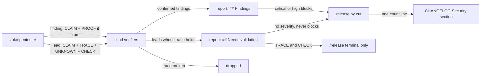

# Needs validation

**Version:** v1 · **Status:** Draft · **Type:** Feature · **Project type:** CLI/Library

**Shape doc:** docs/specs/pentest-depth/shape.md
**Depends on:** attack-classes

The release pentest keeps each lead that it traced but could not prove, under a new Needs validation section of the report. Each lead names the one fact that is still unknown, so the user can settle it by hand, and a lead never blocks the release.

## Problem

The pentester drops each lead that it cannot prove with a run. The user never hears about it. The class files from slice 1 make this worse: they mark a lead `needs_validation` when a platform, deployment or runtime fact is out of reach, and the pentester throws each one away (D92). zuko runs on Linux, macOS and Windows, but a release pentest runs on one OS. A hole in a Windows-only branch, such as the `cygpath` call in `git-command.py:291`, can never be proved on a Linux release. Today nothing records it.

## Slice test

| Check                         | Result                                                                                                                                   |
| ----------------------------- | ---------------------------------------------------------------------------------------------------------------------------------------- |
| Cuts every layer it needs     | yes — the pentester's output, the blind verifier, `/release` step 2 with its report and terminal summary, and `release.py cut`           |
| One e2e test walks it         | yes — one e2e test takes a seeded pentester reply with a lead through the verifier step and `release.py cut` to the committed report      |
| Worth shipping alone          | yes — the next zuko release report lists the leads that it could not prove, with the fact that settles each one                          |
| Fits (≤5 scenarios, ≤2 areas) | yes — 5 scenarios, 2 areas: the release pentest prompts, and `release.py`                                                                |

**Path:** full — the slice adds a report section that `release.py cut` must read, and it changes the pentester and the verifier.

## User story

As the person who runs `/release`, I want to see each lead that the pentest could not prove, with the one fact that decides it, so that I can check that fact myself instead of never hearing about the lead.

## Flow



The pentester returns proved findings and unproved leads. A blind verifier checks the trace of each lead and drops it when the trace breaks. The report lists the leads that hold under Needs validation, without a severity, and `cut` never blocks on them. The trace and the check that settles a lead print in the terminal only.

## Acceptance criteria

```gherkin
Scenario: a Windows-only branch becomes a lead with the fact that is still unknown
  Given zuko is tagged v2.5.1, and the range v2.5.1..HEAD changes plugins/zuko/scripts/lib/git-command.py
  And the release runs on Linux, so the cygpath branch at git-command.py:291 never runs
  And the pentester traces `git -C /c/work/shop commit` from block-dangerous.sh into that branch
  When the user runs /release, says yes to 2.6.0 and picks code-level
  Then docs/security/v2.6.0/report.md has a Needs validation row N1 for git-command.py:291 native_path
  And N1 says what is unknown: "whether cygpath -m on Git Bash maps /c/work/shop to C:/work/shop"
  And N1 has no severity
  And the terminal prints N1's trace, and the check that settles it: run `cygpath -m -- /c/work/shop` in Git Bash on Windows

Scenario: leads never block the release, and the notes count them
  Given the v2.6.0 pentest has 0 findings and 3 leads that hold
  When /release runs release.py cut with that report
  Then the report reads "**Result:** pass", and cut writes the release
  And the CHANGELOG [2.6.0] Security section has the line "- 3 leads need validation; see docs/security/v2.6.0/report.md."

Scenario: a lead whose trace breaks is dropped
  Given the pentester sends lead N2: board.py opens a slice name from shape.md as a file path
  And board.py refuses a slice name that has a / or \ before it opens anything (D77)
  When the blind verifier checks N2's trace
  Then N2 is dropped, and the report has no row for it

Scenario: zuko's exclusions apply to leads too
  Given the pentester has a lead whose only impact is a slow parse of a 60 KB command
  And it has a lead where PR body text reaches a prompt, and no traced path reaches a tool call or a file write
  When it writes its output
  Then neither lead is a finding, and neither is a lead

Scenario: a report without the section is refused
  Given a pentest report for v2.6.0 has Findings, Assessed and Not assessed, and no Needs validation section
  When /release runs release.py cut with it
  Then cut prints "Pentest report unreadable: no Needs validation section" and writes nothing
  And a report whose Needs validation table has no rows is taken, as a run with no leads
```

## Scope

**In:**

- The pentester returns each unproved lead, with its claim, its trace, the one fact that is unknown, and a safe check that settles it.
- A blind verifier checks each lead's trace. A lead whose trace breaks is dropped.
- The report gets a `## Needs validation` table. A lead has no severity and never blocks.
- `release.py cut` refuses a report without the section, and adds one count line to the CHANGELOG Security section.
- The `/release` terminal summary counts the leads, and prints each trace and check.
- zuko's exclusions apply to leads: the Never-a-finding list (D5) and the untrusted-text rule (D6).

**Out:**

- Carrying a lead into the next release, or marking its code as not covered — slice 3 `coverage-ledger`.
- A Strix finding that the verifier cannot settle — slice 4 `strix-code` puts it in this section.
- A severity for a lead — not doing (shape).
- A command that settles a lead. The user runs the check by hand. A confirmed one goes to `/debug`.
- Leads in `/review` — not doing, as with the class files (shape O7).

## Open items

| ID | What | Type | Raised at | Owner | Status | Answer |
| --- | --- | --- | --- | --- | --- | --- |
| O1 | Do the release notes name a lead, as D12 does for unfixed medium and low findings? (from shape O14) | question | shape | user | Resolved | One count line in the Security section: "- 3 leads need validation; see docs/security/v2.6.0/report.md." No line for each lead. The D-entry is drafted at pause 3, 2026-11-08 |
| O2 | The committed report is public. Which parts of a lead go into it, and which print in the terminal only? | question | spec p1 | user | Resolved | The report row has the category, the place, the claim and the unknown fact. The trace and the check print in the terminal only, as D12 does for `PROOF`. The D-entry is drafted at pause 3, 2026-11-08 |
| O3 | Does a blind verifier check each lead's trace before the lead reaches the report? | question | spec p1 | user | Resolved | Yes. A blind verifier checks that each line in the trace exists and that nothing upstream stops the input. A lead whose trace breaks is dropped. The D-entry is drafted at pause 3, 2026-11-08 |
| O4 | Do zuko's exclusions also stop a lead: the Never-a-finding list (D5), and untrusted text with no path to a tool call or a file write (D6)? | question | spec p1 | user | Resolved | Yes, both. A lead whose only impact is resource exhaustion is never a lead (D5). An untrusted-text lead is a lead only when its trace reaches a tool call or a file write. Its unknown is then whether the model obeys the text (D6), 2026-11-08 |
| O5 | Is there a limit on the number of leads in one report? | question | spec p1 | user | Resolved | No limit. Every lead whose trace holds goes in. A cap would hide leads, and the verifier drops the weak ones (O3), 2026-11-08 |

_Never delete this section or its rows. See references/ledger.md._

## Glossary

- **Lead** — a possible hole that the pentester traced in the code but could not prove with a run.
- **Trace** — the path from an input, through named lines of code, to the place where harm would happen.
- **Blind verifier** — a separate agent that sees only the claim and the code, not the reasoning, and tries to prove the claim false.
- **e2e** — end-to-end: one test that walks the whole slice as a user would.
- **Git Bash** — the bash shell that Git for Windows installs. zuko's hooks run in it on Windows.
- **cygpath** — a Git Bash tool that turns a path such as `/c/work` into a Windows path such as `C:/work`.
