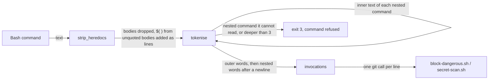
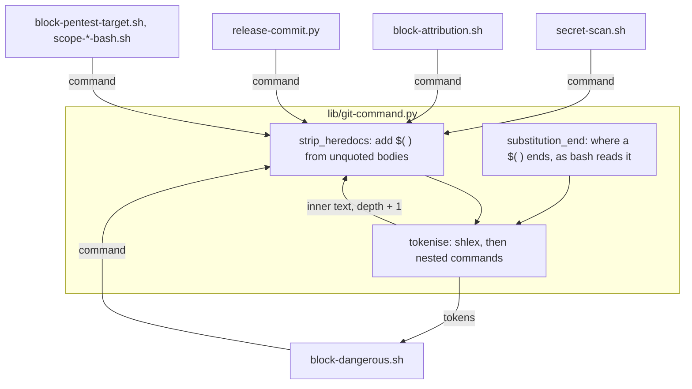
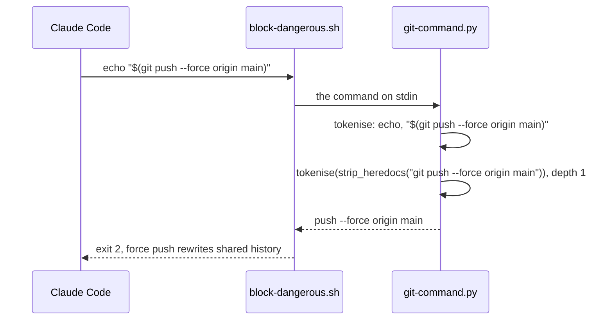

# Nested git commands

**Version:** v1 · **Status:** Shipped · **Type:** Bug · **Project type:** CLI/Library

**Depends on:** guard-parser-gaps

The shared git parser reads the commands that bash runs inside another
command: `$( )` and backticks in double quotes and in heredoc bodies, and the
strings given to `bash -c` and `eval`. The force-push, commit-on-main,
secret-scan and attribution guards then see a git call there.

## Problem

`git-command.py` reads a Bash command and prints each git call on one line.
It does not read a command that sits inside the text of another command.
Each input below runs a force push in bash, and the parser prints nothing, so
`block-dangerous.sh` exits 0. I ran each one against `origin/main`.

| Input | Source |
| ----- | ------ |
| `echo "$(git push --force origin main)"` | v2.7.0 S2 |
| ``echo "`git push --force origin main`"`` | v2.7.0 S2 |
| `bash -c 'git push --force origin main'`, `sh -lc '...'` | v2.7.0 S5 |
| `eval 'git push --force origin main'` | v2.7.0 S5 |
| `cat <<EOF`, then a line `$(git push --force origin main)`, then `EOF` | new: bash runs `$( )` and backticks in a heredoc body when the delimiter is not quoted |

The parser cannot refuse every `"$(`. Of 28611 Bash calls in the local
session logs, 971 hold `"$(` or `` "` ``. The standard commit form
`git commit -m "$(cat <<'EOF'` and `release.py plan "$(git rev-parse --show-toplevel)"`
are two of them.

## Slice test

| Check                         | Result                                                                          |
| ----------------------------- | ------------------------------------------------------------------------------- |
| Cuts every layer it needs     | Yes. The parser and the guard tests that run the real hooks                     |
| One e2e test walks it         | Yes. `test-block-dangerous.sh` feeds the real hook a real payload for each form |
| Worth shipping alone          | Yes. It closes S2 and the `bash -c` and `eval` parts of S5                      |
| Fits (≤5 scenarios, ≤2 areas) | Yes, after a split. 5 scenarios, 1 area (scripts). With all of S5 it was 7 (O1) |

**Path:** light. A bug fix in 3 files, with no new interface, data or
dependency. Pauses 1 and 3 merged, pause 2 skipped.

## Flow



`tokenise` reads each nested command with the same parse, and adds its words
after the outer words as one more line. The guards then judge a nested git
call as they judge a git call on its own line.

## Acceptance criteria

```gherkin
Scenario: a git call in a double-quoted substitution is read
  Given the command echo "$(git push --force origin main)"
  When block-dangerous.sh judges it
  Then it exits 2 with "force push rewrites shared history"
  And echo "`git push --force origin main`" is blocked the same way
  And echo "done: $(git commit -m 'fix: round refunds')" in a repo on main is blocked as a commit on main

Scenario: a git call in an unquoted heredoc body is read
  Given "cat <<EOF", then a line "$(git push --force origin main)", then a line "EOF"
  When block-dangerous.sh judges it
  Then it exits 2 as a force push
  And a body line "`git push --force origin main`" is blocked the same way
  And a body line "  EOF" does not end the body: after the lines "  EOF", "it's" and "EOF", the line "git push --force origin main" is blocked as a force push (O2)

Scenario: a command string given to a shell or to eval is read
  Given the command bash -c 'git push --force origin main'
  When block-dangerous.sh judges it
  Then it exits 2 as a force push
  And sh -lc '...', sudo bash -c '...', eval 'git push --force origin main' and eval git push --force origin main are blocked the same way
  And bash -c 'git commit -m x' in a repo on main is blocked as a commit on main

Scenario: text stays text, and the standard forms still pass
  Given the command echo '$(git push --force origin main)'
  When block-dangerous.sh judges it
  Then it exits 0
  And "cat <<'EOF'" with the body line "$(git push --force origin main)" exits 0
  And python3 release.py plan "$(git rev-parse --show-toplevel)" exits 0
  And git commit -m "$(cat <<'EOF'" with a body that holds quotes, "it's" and backticks exits 0 on a feature branch, and git-command.py prints it as one commit line
  And gh pr create --title "fix: round refunds" --body "$(cat <<'EOF'" with a two-line body exits 0

Scenario: a nested command the parser cannot read whole is refused
  Given the command echo "$(case x in x) git push --force origin main;; esac)"
  When block-dangerous.sh judges it
  Then it exits 2 with "this command could not be checked"
  And four shells nested inside each other, each with -c, are refused as nested too deep
```

## Scope

**In:** `strip_heredocs`, `openers_in` and `tokenise` in `git-command.py`, and
the cases above in `test-block-dangerous.sh` and `test-secret-scan.sh`. Also the
heredoc body end from guard-parser-gaps O3 (O2).

**Out:**

- The `/usr/bin/git` and `git -c alias.*` parts of S5: a later slice
  `git-spellings` (O1).
- The `git checkout main && git commit` part of S5: a later slice
  `branch-switch-commit` (O1).
- A command string held in a variable, as in `eval "$X"` or `bash -c "$X"`.
  Its value is not in the text. Accepted risk (O3).
- A commit whose directory the parser cannot know, such as
  `cd <repo on main> && (git commit -m x)`. It passes on `main` today, and a
  nested commit after a `cd` gets the same unknown directory. A later slice,
  `unknown-dir-commit` (O5).
- Code given to an interpreter, as in `python3 -c "os.system('git push -f')"`.

## Technical plan

### Approach

`tokenise` reads each nested command with the same parse, one level deeper,
and adds its words after the outer words, behind a newline token. A newline
is a separator, so every caller judges the nested call as a command of its
own, with no change to `invocations` or `invocations_with_dirs`. Every caller
already calls `tokenise(strip_heredocs(...))`, so all six get it from one
file. `strip_heredocs` adds each `$( )` and backtick it finds in an unquoted
heredoc body as one more line at the end of its text. A depth over 3, or a
substitution whose end the walk cannot find, raises `ValueError`, and each
caller already blocks that (D52).

Relies on: D51 (the 64 KB limit bounds each nested parse too), D52 (a
command the parser cannot read is blocked), D58 (the body checks in `"$( )"`
stay as they are), and the drafted entry below.





### Changes

| File | What changes | Why |
| ---- | ------------ | --- |
| `plugins/zuko/scripts/lib/git-command.py:199` | `openers_in` also returns, for each delimiter, whether it is quoted (`match.group(1)`) and whether it is `<<-` | Scenario 2 |
| `plugins/zuko/scripts/lib/git-command.py:245` | For an unquoted delimiter, find each `$( )` and backtick in the body, after a `\` that escapes `$` or a backtick is skipped, and add its inner text as a line at the end. End the body at a line that equals the delimiter as bash compares it: exact, or with leading tabs dropped for `<<-`, not after `.strip()` (`:248`) | Scenario 2 |
| `plugins/zuko/scripts/lib/git-command.py` | New `substitution_end(text, at)`: the index after the `)` that closes the `$(` at `at`, read with a new quote context, nested `$( )`, backticks and heredoc bodies. Refuses a `case` or an end it cannot find. `arithmetic_end` reads `$((` to its `))`, where `<<` is a shift | Scenarios 1, 5 |
| `plugins/zuko/scripts/lib/git-command.py` | New `quoted_substitutions(text)`: the inner text of each `$( )` and backtick in double quotes. Unquoted `$( )` is not taken: shlex already splits it. New `shell_strings(tokens)`: the string after a `-c` group for `bash`, `sh`, `zsh`, `dash`, `ksh` or `fish` at any word, and the words after `eval`. New `within_recursion`: Python's recursion limit is a parse failure (O7) | Scenarios 1, 3, 5 |
| `plugins/zuko/scripts/lib/git-command.py:258` | `tokenise(command, depth=0)` adds `"\n"` and `tokenise(strip_heredocs(inner), depth + 1)` for each nested command. Over depth 3 it raises `ValueError` | Scenarios 1–3, 5 |
| `plugins/zuko/scripts/tests/test-block-dangerous.sh` | The cases for scenarios 1 to 5 | Scenarios 1–5 |
| `plugins/zuko/scripts/tests/test-secret-scan.sh` | `echo "$(git commit -m x)"` with a staged key is blocked | Scenario 1 |

Reusing: `run_hook` and `expect_exit` in the tests, `INNER_HEREDOC` for a
heredoc inside a substitution, and the shell set, the `-c` group test and
the depth cap of 3 from `block-pentest-target.sh:123`, `:210` and `:234`.

### Earn-it

| Added | Triggered by |
| ----- | ------------ |
| `substitution_end` | Scenarios 1 and 5. shlex drops the quotes, so it cannot tell `"$(` from `'$(`, or find where a `$( )` with inner quotes ends |
| The depth cap of 3 | Risk: each level parses its text again, so a deep nest multiplies the parse time that D51 bounds |

### Non-functionals

|                      |                                                                                                                       |
| -------------------- | --------------------------------------------------------------------------------------------------------------------- |
| **Load**             | One parse for each Bash call, and one more for each nested command. 971 of 28611 local calls have one                 |
| **Breaks first**     | Parse time at the 64 KB limit with 3 levels: at most 4 parses of 64 KB, so about 4 × D51's 0.14 s. Not measured      |
| **Security surface** | Closes v2.7.0 S2, part of S5, and the unquoted heredoc body hole. It can only add calls to judge, and a refusal is a block (D52). The fences refuse `$` and backticks before `tokenise`, so only their `bash -c` strings gain a second read |
| **Proof it works**   | `bash plugins/zuko/scripts/tests/run.sh block-dangerous` and `run.sh secret-scan` pass, with the new cases            |
| **Rollout**          | No flag. It ships with the next zuko release. Rollback: revert the build commits                                      |

### Test plan

| Scenario | Test | Command |
| -------- | ---- | ------- |
| 1. A double-quoted substitution is read | `test-block-dangerous.sh`, `test-secret-scan.sh` | `bash plugins/zuko/scripts/tests/run.sh block-dangerous`, then `run.sh secret-scan` |
| 2. An unquoted heredoc body is read | `test-block-dangerous.sh` | `bash plugins/zuko/scripts/tests/run.sh block-dangerous` |
| 3. A `bash -c` or `eval` string is read | `test-block-dangerous.sh` | same |
| 4. Text stays text | `test-block-dangerous.sh` | same |
| 5. An unreadable nested command is refused | `test-block-dangerous.sh` | same |

**E2E:** `test-block-dangerous.sh` runs the real hook script on each payload,
as Claude Code runs it, in a scratch repo on `main`.

**Replay (O4):** a scratch script runs each Bash command from the local
session logs through the `origin/main` parser and the new one, and lists
each command whose exit code or output changes. Each new block must be a real
nested git call. The script and its output stay in the scratchpad, because
the logs hold private data. Then the full suite: `bash plugins/zuko/scripts/tests/run.sh`.

### Chunks

Single chunk.

### Risks

| Risk | Mitigation |
| ---- | ---------- |
| `substitution_end` ends a `$( )` at a different place than bash, so a real command is refused or a nested one is missed | It refuses what it cannot read. The replay over 971 real commands finds each new block before ship |
| A heredoc in `"$( )"` whose body bash 5.1 ends at a line `EOF)` | `substitution_end` refuses a body line that starts with the delimiter and is not the delimiter alone, as D58 does for `strip_heredocs` |
| The fences get a second read of each `bash -c` string | Each read can only block more. `test-block-pentest-target.sh` and both fence tests run in the full suite |

### Decisions to record

Recorded as D138.

## Review

2026-11-11 · 7 raw findings, 7 survived, 7 fixed.

- A06 Insecure Design · `plugins/zuko/scripts/lib/git-command.py:494` · undo backtick escapes in a nested backtick · `abaf7ba`
- A06 Insecure Design · `plugins/zuko/scripts/lib/git-command.py:397` · read `$((cmd) )` as a substitution · `e1e019e`
- A06 Insecure Design · `plugins/zuko/scripts/lib/git-command.py:351` · skip a parameter expansion whole inside `$( )` · `d00dd8e`
- A06 Insecure Design · `plugins/zuko/scripts/lib/git-command.py:509` · find a shell's -c string past options with a value · `63f9214`
- correctness · `plugins/zuko/scripts/lib/git-command.py:503` · read eval only in command position · `abb52a8`
- correctness · `plugins/zuko/scripts/lib/git-command.py:275` · add a heredoc body's commands as plain lines · `9972592`
- quality · `plugins/zuko/scripts/lib/git-command.py:8` · the module docstring names the nested commands · `1aa9b29`

## Open items

| ID | What | Type | Raised at | Owner | Status | Answer |
| -- | ---- | ---- | --------- | ----- | ------ | ------ |
| O1 | With all of S5 the slice has 7 scenarios and fails Fits (from guard-parser-gaps O1). Move `/usr/bin/git` and `git -c alias.*` to `git-spellings`, and `git checkout main && git commit` to `branch-switch-commit`? | question | spec p1 | user | Resolved | Yes. Split: `git-spellings` takes `/usr/bin/git` and `git -c alias.*`, `branch-switch-commit` takes the checkout form. 2026-11-10 |
| O2 | `strip_heredocs` ends a body at a line that equals the delimiter after `.strip()`, so a body line `  EOF` ends it early for the walk but not for bash (from guard-parser-gaps O3). This slice changes the same loop. Fix it here, as a 6th case in scenario 2? | question | spec p1 | user | Resolved | Yes. Fixed here, as the last case of scenario 2. 2026-11-10 |
| O3 | A command string held in a variable, as in `eval "$X"` or `bash -c "$X"`, still passes. A bare `$X` command word passes today too. | flag | spec p1 | user | Accepted risk | The value is not in the text, the same hole as a bare `$X`. Refusing a `$` in each `-c` or `eval` string would block real commands such as `bash -c 'cd "$1" && ls' _ dir`. 2026-11-10 |
| O4 | `substitution_end` finds where each `$( )` ends as bash does, for the 971 `"$(` commands in the local logs, with no new false block. Nobody has run it. | unproven | spec p3 | user | Accepted risk | No /poc. `/build` runs the replay in the test plan before ship, and fixes or refuses each new block it finds. 2026-11-10 |
| O5 | A commit whose directory the parser cannot know is checked only in the start and project dirs. `cd <repo on main> && (git commit -m x)` exits 0 on `origin/main`. I ran it. A nested commit after a `cd` gets the same unknown directory. | flag | spec p3 | user | Accepted risk | Not here. The fix is in `block-dangerous.sh` and `secret-scan.sh`, in a later slice `unknown-dir-commit`. 2026-11-10 |
| O6 | The plan named one function, `nested_commands(text, tokens)`. | flag | build | user | Decided alone | Chose: two functions, `quoted_substitutions` on the text and `shell_strings` on the tokens, because one reads quotes and the other reads words. Other: one function with both inputs. Undo: merge them in `git-command.py`. 2026-11-11 |
| O7 | 2000 nested `"$(` levels raised `RecursionError`, not `ValueError`. `block-dangerous.sh` blocked it on exit 1, but each caller that catches only `ValueError` would crash. | flag | build | user | Decided alone | Chose: `within_recursion` turns the error into a `ValueError`, so every caller blocks it as a parse failure. A test in `test-block-dangerous.sh` proves it. Other: a level counter inside the scanner. Undo: revert that part of `66f0907`. 2026-11-11 |
| O8 | The replay (O4) ran 27752 unique logged commands through the `origin/main` parser and the new one. | flag | build | user | Decided alone | Chose: ship. 222 changed. 221 only add read-only git lines (`rev-parse`, `rev-list`, `log` and others), with no new push or commit line. 1 is newly refused: three backticks in double quotes, which bash 5.1.8 also refuses as a syntax error. Other: none needed. Undo: none. 2026-11-11 |
| O9 | The diff has 7 findings, and the large-diff rule sends each one to three verifiers. Each finding turns on what bash runs, and a verifier cannot run bash (lesson `verifiers-cannot-run-code.md`). | flag | review | user | Decided alone | Chose: run each failing case myself, through bash 5.1.8 and both parsers, in place of 21 verifier agents. All 7 reproduced. F1 to F4 also pass the `origin/main` parser, but each is a form that this slice's new code says it reads. Other: three verifiers for each finding. Undo: rerun `/review`. 2026-11-11 |
| O10 | The F5 fix needed a test in `test-scope-verifier-bash.sh`, a file that the plan did not name. | flag | review | user | Decided alone | Chose: two `allows` cases there for `git log -S eval` and `git log --grep eval`. Other: test only through `block-dangerous.sh`, which does not show the fence's false block. Undo: drop the two lines in `abb52a8`. 2026-11-11 |

_Never delete this section or its rows. See references/ledger.md._

## Glossary

- **Command substitution** — `$(cmd)` or `` `cmd` ``: bash runs `cmd` and puts its output in the text
- **Heredoc** — `<<WORD` in a shell command: the lines after it, up to a line `WORD`, are text fed to the command. With `WORD` unquoted, bash still runs the substitutions in those lines
- **shlex** — Python's standard module that splits a command line into words as a shell does, without running it
- **e2e** — end-to-end: one test that walks the whole slice as a user would
