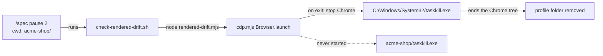
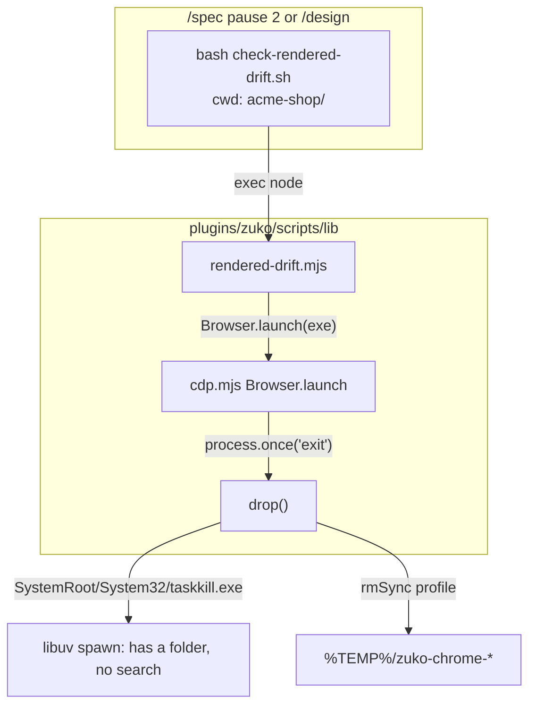
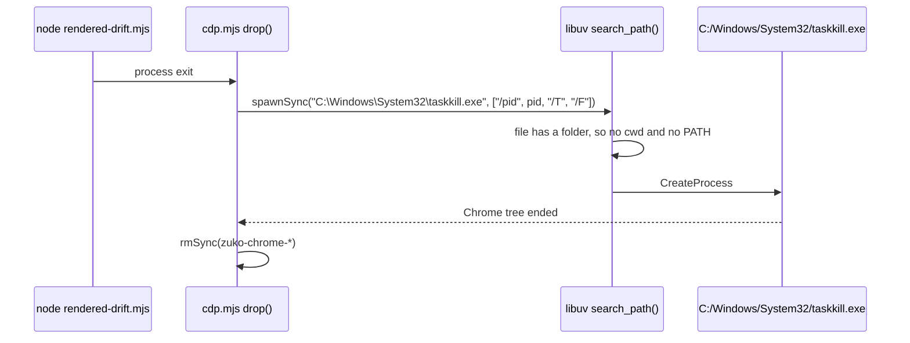

# node-lookup

**Version:** v1 · **Status:** Shipped · **Type:** Bug · **Project type:** CLI/Library

**Shape doc:** docs/specs/os-agnostic-suite/shape.md
**Depends on:** exe-lookup

zuko's rendered drift check stops Chrome with the `taskkill.exe` in `System32`, never with a `taskkill.exe` from the project folder. On Windows, a planted `taskkill.exe` at the root of a repo then never runs from `/spec` pause 2 or `/design`.

## Problem

On Windows, Node starts a program through libuv. For a bare name, libuv looks in the current folder first and then in PATH. The source says so at `src/win/process.c` `search_path()`: "look in cwd first, then scan path". It skips the current folder only when `NoDefaultCurrentDirectoryInExePath` is set. This was read from the libuv source at `f6b7133` (2026-06-09). Nobody has run it on Windows yet.

`check-rendered-drift.sh:56` runs Node in the project folder. When Node exits, `cdp.mjs:78` runs `spawnSync('taskkill', ...)` to stop Chrome. So each drift check on Windows runs a `taskkill.exe` at the root of the project, with no prompt. `/spec` pause 2 and `/design` run the drift check on each preview.

`cdp.mjs:78` is the only bare program name in zuko's Node. `cdp.mjs:95` starts Chrome by an absolute path from `findChrome()`. exe-lookup raised this as its O3.

## Slice test

| Check | Result |
| --- | --- |
| Cuts every layer it needs | yes — `cdp.mjs` and the drift check that runs it |
| One e2e test walks it | yes — one drift check in a project with a planted `taskkill.exe` |
| Worth shipping alone | yes — it closes code execution from a cloned repo on Windows |
| Fits (≤5 scenarios, ≤2 areas) | yes — 2 scenarios, one area: `plugins/zuko/scripts/lib` and its tests |

**Path:** light — a one-line bug fix in three files, with no new interface, data or dependency. Pauses 1 and 3 are one pause, and pause 2 is skipped.

## Flow



A stage runs the drift check in the project folder, and on exit `cdp.mjs` stops Chrome with the `taskkill.exe` in `System32`, never the one in the project folder.

## Acceptance criteria

```gherkin
Scenario: a taskkill.exe at the repo root never runs from the drift check
  Given a Windows clone of acme-shop open in Git Bash
  And a taskkill.exe at the root of acme-shop that is not taskkill
  When check-rendered-drift.sh renders clean.html with acme-shop as its current folder
  Then the taskkill.exe at the root of acme-shop does not run
  And the drift check exits 0 with its pass line
  And no zuko-chrome- profile folder stays in the temp folder

Scenario: off Windows nothing changes
  Given a Linux checkout of zuko
  When bash plugins/zuko/scripts/tests/run.sh runs
  Then the drift check stops Chrome with SIGKILL, as before
  And the suite has 0 failures
```

## Scope

**In:**

- `cdp.mjs:78` starts `taskkill.exe` by its path in `System32`.
- A check, on every OS, that fails a bare program name in a `spawn` or `spawnSync` call in `plugins/zuko/scripts/lib/*.mjs`.

**Out:**

- `cdp.mjs:100` and `findChrome()` — on Windows, Chrome starts by an absolute path. Off Windows, `findChrome()` can give a path that is relative to the project folder (O5).
- The vendored `.agents/skills/design-taste-frontend/scripts/lib/cdp.mjs:85` — upstream code, left as it is (O2).
- `check-rendered-drift.sh:28` — bash finds `node` on PATH, and Git Bash's PATH has no current folder.

## Technical plan

### Approach

`drop()` in `cdp.mjs` starts `taskkill.exe` by its full path, `%SystemRoot%\System32\taskkill.exe`. libuv does no PATH search for a name with a folder in it, so the current folder is never searched. Windows ships `taskkill.exe` in `System32` only, so a PATH walk would find the same file.

Relies on: D105, D119, D127



The drift check runs Node, `Browser.launch` registers `drop()` for exit, and `drop()` hands libuv a full path, so libuv never searches.



At exit, `drop()` gives libuv a name with a folder, so libuv starts that one file and searches nothing.

### Changes

| File | What changes | Why |
| --- | --- | --- |
| `plugins/zuko/scripts/lib/cdp.mjs:41` | A new export, `taskkillPath()`, gives `win32.join(process.env.SystemRoot \|\| 'C:\\Windows', 'System32', 'taskkill.exe')`. `drop()` at `cdp.mjs:83` starts it in place of the bare `'taskkill'`. Lines 6 to 9 name it as a change from upstream. | scenario 1 |
| `plugins/zuko/scripts/tests/test-e2e-node-lookup.sh` | New. On every OS: each `spawn(` and `spawnSync(` in `lib/*.mjs` has no string literal as its program. On Windows: plant a copy of Git Bash's `/usr/bin/mkdir.exe` as `taskkill.exe` in a copy of the `rendered-drift/project` fixture. Then run the drift check there, as the Test plan says. Elsewhere, the Windows checks print SKIP with the reason (D105). | scenarios 1 and 2 |
| `CHANGELOG.md` | One `[Unreleased]` `### Security` line: on Windows, the rendered drift check no longer runs a `taskkill.exe` from the project folder. | `/ship` gate |

Reusing: `run.sh`'s `is_windows`, `skip`, `expect_exit`, `expect_match` and `expect_no_match`; the `rd()` helper and the `rendered-drift/project` fixture from `test-e2e-rendered-drift.sh`.

### Earn-it

| Added | Triggered by |
| --- | --- |
| `test-e2e-node-lookup.sh` | Only a real libuv spawn on Windows proves scenario 1. The Linux suite never takes the `win32` branch. |
| The bare-name check in it | Risk: a second bare `spawnSync` added later opens the same hole, and no Linux test would see it. D119 does the same for Python. |

### Non-functionals

|                      |                                                                               |
| -------------------- | ----------------------------------------------------------------------------- |
| **Load**             | One `taskkill` call at the end of each drift check, as before. Nothing new. |
| **Breaks first**     | Nothing scales here. A new bare program name in `lib/*.mjs` fails the check on every OS. |
| **Security surface** | The drift check runs in an untrusted project folder. The fix trusts `SystemRoot`, which comes from the user's environment, not from the project. No secrets, no stored data. |
| **Proof it works**   | The `windows-suite` job on `feat/node-lookup` ends with `0 failed`, and each `e2e-node-lookup` check prints PASS, not SKIP. |
| **Rollout**          | No flag. It ships in the next zuko release. Rollback: `git revert` of the fix commit. |

### Test plan

| Scenario | Test | Command |
| --- | --- | --- |
| 1. A taskkill.exe at the repo root never runs | `test-e2e-node-lookup.sh`, Windows only. First, a bare `spawnSync('taskkill', ['4242'])` from Node in `acme-shop` makes a folder `4242`, so the hole is real on this runner. Then the drift check on `clean.html` exits 0. No folder with a number for its name appears in `acme-shop`, and the list of `zuko-chrome-*` folders in the temp folder is the same as before the run. | `bash plugins/zuko/scripts/tests/run.sh e2e-node-lookup` |
| 2. Off Windows nothing changes | The whole suite on Linux, `e2e-rendered-drift` included. The bare-name check in `test-e2e-node-lookup.sh` passes. | `bash plugins/zuko/scripts/tests/run.sh` |

**E2E:** `test-e2e-node-lookup.sh` in the `windows-suite` job, after the branch is pushed: `gh workflow run windows-suite.yml --ref feat/node-lookup`, then `gh run watch`. On Linux, its Windows checks print SKIP, and the bare-name check carries the proof.

### Chunks

Single chunk. One line in `cdp.mjs`, one new test file and one CHANGELOG line.

### Risks

| Risk | Mitigation |
| --- | --- |
| A copy of `mkdir.exe` outside `/usr/bin` may not start. Then the planted file proves nothing. | exe-lookup's copy of `echo.exe` started from the project folder in run 42555977864. The first check fails when the copy does not make its folder, so the test cannot pass on a stand-in that never ran. |
| `SystemRoot` is not set, so the path is wrong and Chrome stays alive. | The fall back is `C:\Windows`. The `try` around the call stays, so the worst case is a profile folder left in the temp folder, as when `taskkill` fails today. |

### Decisions to record

Recorded as D127.

## Review

2026-11-09 · 1 raw finding, 1 survived, 1 fixed.

- correctness · `plugins/zuko/scripts/tests/test-e2e-node-lookup.sh:46` · the e2e now checks the `taskkillPath()` text on every OS and starts it on Windows, so a wrong path fails · `66a5d8a`

## Open items

| ID | What | Type | Raised at | Owner | Status | Answer |
| --- | --- | --- | --- | --- | --- | --- |
| O1 | The shape says "from PATH". The plan starts `taskkill.exe` by its fixed path in `System32` instead. Is that the fix? | question | spec p1 | user | Resolved | Yes. `taskkill.exe` starts from `%SystemRoot%\System32`, with `C:\Windows` as the fall back. A PATH walk would find the same file, 2026-11-09 |
| O2 | The vendored `.agents/skills/design-taste-frontend/scripts/lib/cdp.mjs:85` has the same bare `taskkill`. It runs in this repo's own sessions, not in zuko. Is it in this slice? | question | spec p1 | user | Resolved | No. It is upstream code, and a local edit is lost at the next vendor update, 2026-11-09 |
| O3 | The Windows test plants a copy of Git Bash's `mkdir.exe` as `taskkill.exe`. Assuming that it makes a folder `4242` in the current folder from the arguments `/pid 4242 /T /F`. Nobody has run it. | unproven | spec p1 | poc | Accepted risk | exe-lookup's copy of `echo.exe` ran from a project folder. The first check fails when the copy makes no folder, so the test cannot pass on a stand-in that never ran, 2026-11-09 |
| O4 | The Test plan said the first check runs the planted copy with `/pid 4242 /T /F`. `mkdir.exe` reads `/pid`, `/T` and `/F` as folders at the root of Git for Windows, and a CI runner is an admin, so it would make them there. | flag | build | user | Decided alone | Chose: the first check passes only `4242`. The drift check run still passes all four arguments, and after the fix the planted copy gets none of them. Other: pass all four and remove the three folders after. Undo: change `['4242']` back to `['/pid', '4242', '/T', '/F']` in `test-e2e-node-lookup.sh`, 2026-11-09 |
| O5 | The review found that `findChrome()` at `cdp.mjs:48` builds a relative path when `LOCALAPPDATA` or `PROGRAMFILES` is not set, as on Linux and macOS. In a project folder with an executable `Google/Chrome/Application/chrome.exe`, `findChrome()` gave that file, and `spawn` starts it at each drift check. The reviewer ran this on Linux. The old Out line said Chrome always starts by an absolute path. | flag | review | user | Decided alone | Chose: leave `findChrome()` as it is in this slice, and correct the Out line. Other: fix it here. Undo: spec a new slice that skips each candidate path that is not absolute, 2026-11-09 |
| O6 | The `windows-suite` job on `feat/node-lookup` (run 42628894316) ends with 3789 passed, 3 failed, 12 skipped. `e2e-node-lookup` passes its 9 checks. The 3 failures are the `test-replay.sh` "stale fork" checks. | flag | ship | user | Decided alone | Chose: ship with those 3 checks red. The `main` run 42547085812 fails the same 3, so this branch did not cause them. Other: fix replay on Windows in this slice. Undo: none needed; take the 3 `test-replay.sh` "stale fork" checks to `/debug`, 2026-11-09 |

_Never delete this section or its rows. See references/ledger.md._

## Glossary

- **libuv** — the C library under Node that starts programs, reads files and runs the event loop.
- **PATH** — the list of folders that a shell or a program searches for a command name.
- **taskkill** — the Windows program that stops a process. `/T` also stops each child process.
- **SystemRoot** — the Windows variable that names the Windows folder, usually `C:\Windows`.
- **Git Bash** — the bash that comes with Git for Windows. zuko's hooks run in it on Windows.
- **e2e** — end-to-end: one test that walks the whole slice as a user would.
