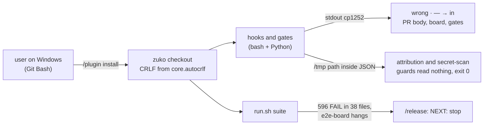
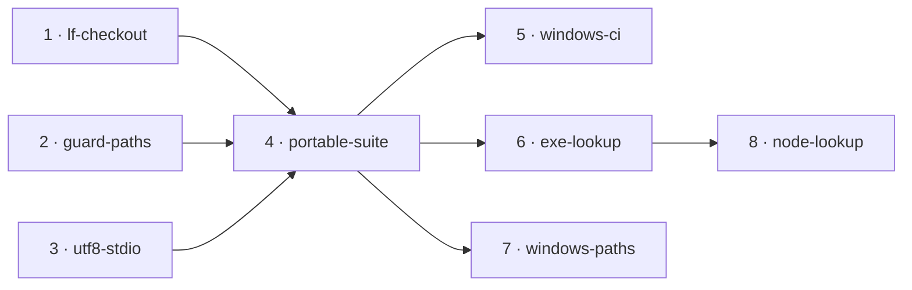

# OS-agnostic suite

**Project type:** CLI/Library · **Status:** Shaped

**Board:** https://claude.ai/artifact/3kuMaMXKin94sSpdrbs5ci

## Problem

On Windows, zuko writes wrong text, and two of its guards let through what they block on Linux. Its test suite fails 596 checks in 38 files, so `/release` stops at its tests gate and no version can be cut from a Windows machine.

## Today

The user runs zuko on Windows, macOS and Linux. Only the Windows run breaks, and nothing checks it before a release.

What this session measured:

| Cause | Evidence |
| --- | --- |
| CRLF checkout | Git for Windows sets `core.autocrlf=true`. 366 of 414 tracked files are CRLF in the work tree, and the installed zuko 2.5.1 is CRLF too. The repo has no `eol=lf` rule. |
| Python stdio is cp1252 | `PYTHONUTF8=1` takes `decisions` from 17 to 1 failure, `verify-ship-gates` from 14 to 2, and `release` from 164 to 150. `pr_body.py` wrote `·` as a broken byte at `/ship`. |
| Git Bash paths | `git commit -F /tmp/msg` with a Claude trailer exits 0 from `block-attribution.sh`: Python cannot open `/tmp/...` when it comes inside the hook's JSON. `board.py --by "/spec ..."` writes `C:/Program Files/Git/spec ...`. |
| Test-only gaps | `ln -s` makes a copy, `chmod 000` does not stop a read, `scope-pentester-bash` hard-codes macOS `/var/folders` paths, and `e2e-board` hangs because its timeout leaves `board.py serve` alive. |

## Slices

| # | Slice | What ships | Why this order |
| --- | --- | --- | --- |
| 1 | lf-checkout | A `.gitattributes` rule checks out every text file with LF on every OS, so a Windows install of zuko has the same bytes as a Linux one. The vendored `.agents/skills/**` rule stays. | Smallest change, and it removes the CRLF cause from every later failure count. |
| 2 | guard-paths | Each hook converts a Git Bash path that it reads from a command before it opens the file. When it still cannot read the file, it blocks. The attribution, secret-scan and worktree guards then decide on Windows as they do on Linux. | A guard that lets a signed commit or a staged secret through is a security gap. Independent of slice 1. |
| 3 | utf8-stdio | Each zuko Python entry point reads and writes UTF-8 with LF, whatever the platform default is. `/ship`, `/release`, the board and the gates show `·`, `—` and `→` correctly on Windows. | Visible in every stage that prints text. Independent of slices 1 and 2. |
| 4 | portable-suite | `run.sh` passes on Windows Git Bash, Linux and macOS: 0 failures, and no test file hangs past its timeout. The tests stop depending on symlinks, `chmod`, fixed temp paths and exact POSIX path text. `/release` can cut a version from Windows. | Needs slices 1 to 3, so that what is left is test-only. It also traces every failure they leave (O3). |
| 5 | windows-ci | A GitHub Actions workflow runs `run.sh` on `windows-latest` and `ubuntu-latest` for each PR. A test that passes on one OS only shows red before merge. | Green only after slice 4. It keeps the suite OS-agnostic from then on. |
| 6 | exe-lookup | Each zuko Python call to `git` finds its program on PATH, as Git Bash does. A `git.exe` at the root of a repo never runs from a hook or a gate on Windows. | It reuses slice 4's `program.argv()`. It is a security fix, so it gets its own review. Raised at `/spec portable-suite` (O7). |
| 7 | windows-paths | Each path that zuko prints or compares uses `/` on every OS. On Windows, the ADR scan, the gates, the board and `/release` stop writing `docs\adr\...`. The last 26 Windows failures of the suite then pass. | `portable-suite` found the cause in four Windows runs (its O17). It is zuko itself, not a test, so it is its own slice. |
| 8 | node-lookup | zuko's Node scripts start `taskkill` and each other program from PATH, never from the current folder. A `taskkill.exe` at the root of a repo never runs from the rendered drift check on Windows. | Raised at `/spec exe-lookup` (O3). Nobody has checked yet whether Node looks in the current folder, so its spec starts with that check. |

## Not doing

- **Run `/release` from WSL.** It gives a green suite, but zuko still breaks for a Windows user, and the guards still fail open in Git Bash.
- **Fix only the tests.** The user chose to fix zuko and use the tests as proof. A test-only fix hides the guard and encoding bugs.
- **Set `PYTHONUTF8=1` in the user's environment.** It fixes this machine only. Slice 3 puts the encoding in zuko.
- **macOS in CI.** The user picked Windows and Linux. macOS stays covered by the user's own runs.
- **Native Windows shells (cmd, PowerShell).** zuko's hooks run in Git Bash on Windows. Other shells are out of scope.

## Open items

| ID | What | Type | Raised at | Owner | Status | Answer |
| --- | --- | --- | --- | --- | --- | --- |
| O1 | Is the problem the suite only, or zuko itself on Windows? | question | shape | user | Resolved | zuko itself. The scripts must work on Windows, and the suite is the proof, 2026-11-07 |
| O2 | How does the suite stay OS-agnostic after this? | question | shape | user | Resolved | CI on `windows-latest` and `ubuntu-latest` for each PR. macOS stays out of CI, 2026-11-07 |
| O3 | Assuming the untraced failures (release 150, replay 34, scope-pentester-bash 81, board render exit 1) come from the four causes | assumption | shape | user | Handed to portable-suite | Its spec traces each failure that slices 1 to 3 leave. A new cause becomes a new slice, 2026-11-07 |

## Glossary

- **CRLF / LF** — the two line endings. Windows uses CR+LF (`\r\n`), Linux and macOS use LF (`\n`). A `\r` left at a line end breaks a `grep` or a compare that expects LF.
- **core.autocrlf** — a git setting that rewrites LF to CRLF on checkout. Git for Windows turns it on for every repo.
- **.gitattributes** — a file in the repo that tells git how to treat files. `eol=lf` overrides `core.autocrlf`.
- **cp1252** — the old Windows text encoding that Python uses for stdin and stdout by default. It has no byte for `→`, and it writes `·` as a byte that bash does not read as UTF-8.
- **Git Bash (MSYS)** — the bash that comes with Git for Windows. It rewrites a path such as `/tmp/x` when it passes the path as an argument to a native program, but not when the path is inside other text.
- **ADR** — architecture decision record: one short file that states one design choice and why. The ADR scan turns them into D-entries.
- **Fail open / fail closed** — a guard that cannot decide either lets the action through (open) or blocks it (closed). zuko's guards must fail closed (D31).
