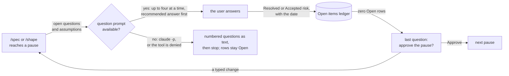
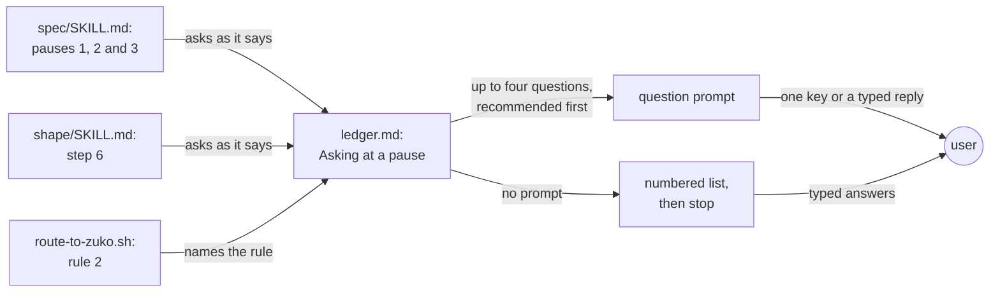
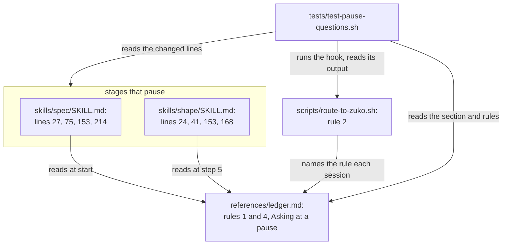
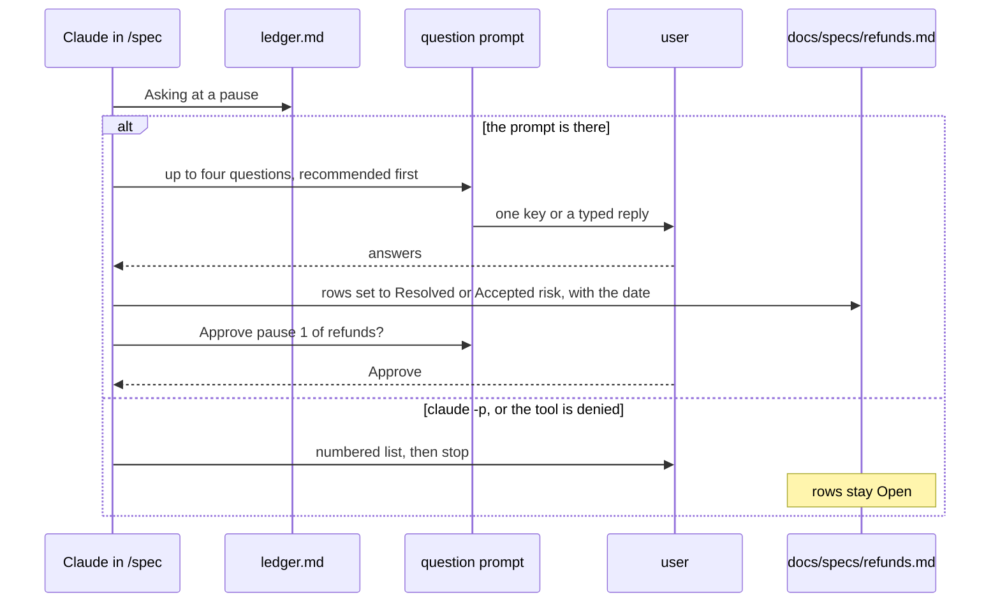

# Pause questions

**Version:** v1 · **Status:** Shipped · **Type:** Enhancement · **Project type:** CLI/Library

**Shape doc:** docs/specs/ask-up-front/shape.md
**Depends on:** None

At each pause, `/spec` and `/shape` put every open question and assumption to
the user in the question prompt, with a recommended answer first. A pause is
approved only when no row is Open, so nothing unanswered reaches `/build`.

## Problem

27 ledger rows in 10 specs say "default chosen autonomously". Claude picked
each answer alone, and the user accepted the defaults later. Four places allow
this today:

- `skills/spec/SKILL.md:27`: "Anything unknown is either asked or written into
  the ledger as an assumption."
- `skills/shape/SKILL.md:24`: "either ask, or write it into the ledger as an
  assumption."
- `references/ledger.md:47`, rule 1: the stage "writes an `assumption` row
  first", and work continues.
- `scripts/route-to-zuko.sh:34`, the session-start text: "An unknown is either
  asked, or written into the spec's open-items ledger as an assumption."

Only a `Shaped` shape, or a spec at `Refined` or later, must have zero Open rows. So pauses 1
and 2 of `/spec` can be approved while rows are still Open.

## Slice test

| Check | Result |
| --- | --- |
| Cuts every layer it needs | yes. The rule in `/spec` and `/shape`, ledger rules 1 and 4, the session-start text, and a contract test. |
| One e2e test walks it | partly. A contract test proves the text. The behaviour shows at the next real pause (O6). |
| Worth shipping alone | yes. The pauses ask before they write, even while `/build` still stops to ask. |
| Fits (≤5 scenarios, ≤2 areas) | yes. 5 scenarios. Two areas: the pause stages and the ledger rules. |

**Path:** full. It changes 5 files and the way two stages talk to the user.
Pause 2 is the exact wording of the questions, the approval and the text
fallback.

## User story

As the person who approves each pause, I want every open question put to me
with a recommended answer, so that no answer that Claude picked alone reaches
`/build`.

## Flow



At a pause, each open question goes to the user in the question prompt. Each
answer goes into the ledger. When no row is Open, the last question asks for
approval. Without the prompt, Claude prints the questions and stops.

## Acceptance criteria

```gherkin
Scenario: a pause asks each question, with the recommended answer first
  Given /spec refunds reaches pause 1 with the question "Can a refund be more than the order total?"
  And Claude would assume "Refunds over £500 need a manager's approval"
  When Claude ends pause 1
  Then it asks both in the question prompt, the assumption as a question
  And the first option of each is the recommended answer, marked "(Recommended)"
  And each answer goes into the ledger as Resolved or Accepted risk, with the date 2026-10-14

Scenario: more than four questions, and no approval while a row is Open
  Given /spec refunds reaches pause 2 with five Open rows
  When Claude ends pause 2
  Then it asks four questions in one prompt, and the fifth in the next
  And it asks "Approve pause 2?" only after all five rows are Resolved or Accepted risk

Scenario: an unproven claim offers /poc first
  Given pause 3 of /spec refunds rests on "Stripe refunds a part of a JPY charge"
  And nobody has checked it
  When Claude asks about it
  Then the first option is /poc
  And the recommended answer is the second option, marked "(Recommended)"

Scenario: with no question prompt, Claude prints the questions and stops
  Given a headless claude -p run of /spec refunds reaches pause 1 with two Open rows
  When Claude ends pause 1
  Then it prints the two questions as a numbered list, each with its recommended answer first
  And it stops without writing either answer
  And both rows stay Open

Scenario: /shape asks the same way
  Given /shape "loyalty points" has the question "Do points expire after 12 months?"
  And the question belongs to the slice points-expiry
  When the shape stops
  Then it asks the question in the question prompt, with the recommended answer first
  And "Hand to points-expiry" is one of the options
  And the last question asks "Which slice do we spec first?", with the recommended slice first
```

The contract test proves the rule text for each scenario. The next real pause
shows the behaviour (O6).

## Scope

**In:**

- `/spec`: the "Never assume" rule, the stop at pauses 1 and 2, and the Open
  rows at pause 3. Pause 3 still ends when the user types `/build` (O8).
- `/shape`: the "Never assume" rule, the questions in step 1, the ledger in
  step 5, and the stop in step 6.
- `ledger.md` rule 1: at a pause, an assumption is asked, not written down
  without asking. Rule 4: no pause is approved while a row is Open, at pauses
  1 and 2 too.
- `route-to-zuko.sh` rule 2, the session-start text.
- Up to four questions in each prompt. More than four → several prompts, one
  after the other, and the approval is the last question.
- The recommended answer is first, marked "(Recommended)". An unproven claim
  is the exception: `/poc` is first, and the recommended answer is second (O5).
- The approval is a question in the prompt: "Approve" or a typed change (O3).
  For `/shape`, the approval is "Which slice do we spec first?" (O7).
- No question prompt → a numbered list of the questions, each with its
  recommended answer first, then stop. The rows stay Open (O4).
- A contract test, `tests/test-pause-questions.sh`.

**Out:**

- `/design-system`'s three pauses (O2). No slice picks it up yet.
- `/build` and `/review` stopping to ask, and the rows they decide alone.
  unattended-build picks these up.
- A new gate for each pause. The `Shaped` and `Refined` gates stay as they are
  (D19).
- An interactive spike that proves the behaviour (O6).

## Interface

The interface is the text that Claude reads at a pause, and the prompt that
the user sees. A new section in `ledger.md` holds the rules for asking.
`/spec`, `/shape` and the session-start text point to it, so the rules exist
in one place.



Each pause follows "Asking at a pause" in `ledger.md`. The user answers in the
question prompt, or in text when there is no prompt.

### The new section in ledger.md

It goes after "Rules" and before "What qualifies".

````markdown
## Asking at a pause

At each pause, `/shape` and `/spec` ask the user every open question and
every assumption. Use the question prompt, the `AskUserQuestion` tool.

- Ask up to four questions in one prompt. When there are more, use several
  prompts, one after the other.
- Give each question two to four answers. Put the recommended answer first,
  and end its label with "(Recommended)".
- For an `unproven` row, put `/poc` first. Put the recommended answer second.
- In a shape, give a question that belongs to a later slice the answer
  "Hand to {slice}", with a slice from the table.
- Write each answer into its row as `Resolved`, `Accepted risk` or, in a
  shape, `Handed to {slice}`. Add the date.
- When a question has no answer to offer, such as "What made you think of
  this?", ask it as plain text.

When no row is Open, the last question approves the pause. A typed reply is a
change. Make the change, then ask again. `/spec` pause 3 has no last question:
the user types `/build`, and that approves the plan.

| Pause | Last question | Answers |
| --- | --- | --- |
| `/spec` pause 1 | Approve pause 1 of {slice}? | Approve (Recommended): go on to pause 2. Not yet: stop here. |
| `/spec` pause 2 | Approve pause 2 of {slice}? | Approve (Recommended): go on to pause 3. Not yet: stop here. |
| `/shape` | Which slice do we spec first? | The recommended slice first, then the others. Not yet: stop here. |

**No question prompt.** In a `claude -p` run, or when the user denies the
tool, print the questions as a numbered list. Put the recommended answer first
in each. Then stop. Do not write an answer, and leave each row Open.

```text
Open items. Answer by number:

1. O2 · Can a refund be more than the order total?
   Recommended: No. A refund stops at the order total.
   Or: Yes, up to 110% as a goodwill payment.
2. O3 · Assuming refunds over £500 need a manager's approval. Is that right?
   Recommended: Yes.
   Or: No. Any refund goes through.
```
````

### Rules 1 and 4 in ledger.md

Rule 1, before:

```markdown
**1. Never guess silently.** Any moment a stage would assume something to
keep moving, it writes an `assumption` row first. The assumption still gets
used — work continues — but it is now visible and owed an answer.
```

Rule 1, after:

```markdown
**1. Never guess silently.** At a pause in `/shape` or `/spec`, ask each
unknown, as "Asking at a pause" says. Do not write it down without asking. In
any other stage, any moment a stage would assume something to keep moving, it
writes an `assumption` row first. The assumption still gets used — work
continues — but it is now visible and owed an answer.
```

Rule 4 gets a new first sentence. The rest stays:

```markdown
**4. Nothing is approved with an Open row.** No pause of `/shape` or `/spec`
is approved while a row is Open, and this includes pauses 1 and 2. A shape is
not `Shaped`, and a spec is not `Refined`, while any row is `Open`: …
```

### /spec

| Line | Before | After |
| --- | --- | --- |
| `spec/SKILL.md:27` | **Never assume.** Anything unknown is either asked or written into the ledger as an assumption. Never a silent guess. | **Never assume.** At each pause, ask every unknown in the question prompt, as `ledger.md` › "Asking at a pause" says. Never a silent guess, and never an assumption written down without asking. |
| `spec/SKILL.md:75` | **Then stop.** Show the diagram, the scenarios, the slice test result, and any open items. Ask for approval. Do not continue. | **Then stop.** Show the diagram, the scenarios, the slice test result, and any open items. Ask the open items, then the approval, as `ledger.md` › "Asking at a pause" says. Do not continue until the user approves. |
| `spec/SKILL.md:153` | **Then stop.** Give the preview link and name which design system the tokens came from. Design review is a loop … | **Then stop.** Give the preview link and name which design system the tokens came from. Ask the open items, then the approval, as `ledger.md` › "Asking at a pause" says. Design review is a loop … |
| `spec/SKILL.md:214` | **`Refined` needs zero `Open` rows.** Work each one with the user first: … | **`Refined` needs zero `Open` rows.** Ask each one first, as `ledger.md` › "Asking at a pause" says: … |

### /shape

| Line | Before | After |
| --- | --- | --- |
| `shape/SKILL.md:24` | When something is unknown, either ask, or write it into the ledger as an assumption. | Ask each unknown in the question prompt, as `ledger.md` › "Asking at a pause" says. |
| `shape/SKILL.md:41` | Anything it leaves unsure is asked or goes into the ledger as an assumption. | Anything it leaves unsure is asked. |
| `shape/SKILL.md:153` | Before writing it, take each Open row to the user: … | Before writing it, ask each Open row, as `ledger.md` › "Asking at a pause" says: … |
| `shape/SKILL.md:168` | - Ask which slice to spec first. Recommend one and say why. | - Ask which slice to spec first, as the last question in the prompt. Put the recommended slice first, and say why in its description. |

The interview questions in step 1, such as "What made you think of this?",
stay plain text. They have no answer to offer.

### route-to-zuko.sh, rule 2

Before:

```text
2. Never guess silently. An unknown is either asked, or written into the
   spec's open-items ledger as an assumption.
```

After:

```text
2. Never guess silently. At a /shape or /spec pause, ask each unknown in the
   question prompt. In other stages, write it into the spec's open-items
   ledger as an assumption.
```

## Technical plan

### Approach

This change is prompt text and one contract test. A new section in
`ledger.md`, "Asking at a pause", holds the rules for asking. `/spec`,
`/shape`, ledger rules 1 and 4, and the session-start text point to it.
`test-pause-questions.sh` is written first. It reads the three Markdown files
and runs the session-start hook.

Relies on: D19, D39, D40, D41 (the last three drafted below)



`/spec` and `/shape` read the rules in `ledger.md`. The test reads all three
files and runs the hook.



At a pause, Claude asks through the prompt and writes each answer into the
spec. Without the prompt, it prints the list and stops.

**What the code already says.** The question prompt holds one to four
questions, each with two to four answers. It adds an "Other" answer for a typed
reply by itself. `spec/SKILL.md` and `shape/SKILL.md` have no `allowed-tools`
line, so nothing stops either skill from calling the prompt.

### Changes

| File | What changes | Why |
| --- | --- | --- |
| `plugins/zuko/scripts/tests/test-pause-questions.sh` (new) | The contract test, written first. It fails before the other changes. | Test plan |
| `plugins/zuko/references/ledger.md:82` | The section "Asking at a pause" goes before "What qualifies", word for word from the Interface section. | Scenarios 1 to 5 |
| `plugins/zuko/references/ledger.md:47` | Rule 1 asks at a pause, and keeps the assumption row for other stages. | Scenario 1 |
| `plugins/zuko/references/ledger.md:60` | Rule 4 gets its new first sentence: no pause is approved with an Open row. | Scenario 2 |
| `plugins/zuko/skills/spec/SKILL.md:27` | The "Never assume" rule points to the section. | Scenario 1 |
| `plugins/zuko/skills/spec/SKILL.md:75`, `:153` | The stops of pauses 1 and 2 ask the open items, then the approval. | Scenario 2 |
| `plugins/zuko/skills/spec/SKILL.md:214` | Pause 3 asks each Open row as the section says. | Scenarios 2, 3 |
| `plugins/zuko/skills/shape/SKILL.md:24`, `:41`, `:153`, `:168` | The rule, the Jira line, the Open rows and the last question, as the Interface section says. | Scenario 5 |
| `plugins/zuko/scripts/route-to-zuko.sh:34` | Rule 2 asks at a pause, and writes an assumption in other stages. | Scenario 1 |

Reusing: `run.sh`'s `expect_match` and `expect_no_match`, the one-line
`section()` helper as `test-ste-voice.sh` defines it, and
`route=$(bash "$scripts/route-to-zuko.sh")` from `test-design-system.sh:69`.

No existing test reads the lines that change. `test-jira-shape.sh` reads step 1
of `/shape`, but it checks other phrases.

### Earn-it

| Added | Triggered by |
| --- | --- |
| The section "Asking at a pause" in `ledger.md` | `/spec`, `/shape` and the session-start text need the same rules (scenarios 1 to 5). Two copies would drift, as `git-naming.md` warns. `ledger.md` is the one file that both skills already read. |

### Non-functionals

|  |  |
| --- | --- |
| **Load** | `ledger.md` grows by about 40 lines, or 600 tokens. `/spec` reads it at start, and `/shape` at step 5. A pause with nine open rows takes three prompts. |
| **Breaks first** | A pause with many trivial questions. The "What qualifies" rules in `ledger.md` keep trivia out of the ledger, so it stays out of the prompt too. |
| **Security surface** | Prompt text only. The user's typed answers go into the spec as data. Nothing new reads a secret or stores data. |
| **Proof it works** | After the release and a plugin update, the next real `/spec` pause 1 asks its open items in the question prompt and ends with "Approve pause 1 of {slice}?". No new row says "default chosen autonomously": `grep -c` over `docs/specs/*.md` stays at 27. |
| **Rollout** | No flag. Rollback: `git revert` the build commits. |

### Test plan

| Scenario | Test | Command |
| --- | --- | --- |
| 1. A pause asks each question, recommended first | `tests/test-pause-questions.sh` | `bash plugins/zuko/scripts/tests/run.sh pause-questions` |
| 2. More than four questions, no approval with a row Open | `tests/test-pause-questions.sh` | same |
| 3. An unproven claim offers `/poc` first | `tests/test-pause-questions.sh` | same |
| 4. No question prompt: print and stop | `tests/test-pause-questions.sh` | same |
| 5. `/shape` asks the same way | `tests/test-pause-questions.sh` | same |
| The behaviour at a real pause | by hand, after the release (O6) | — |

What the test checks:

- **The section.** It sits between "Rules" and "What qualifies". It names
  `AskUserQuestion`, four questions in one prompt, several prompts for more,
  the recommended answer first with "(Recommended)", `/poc` first for an
  `unproven` row, "Hand to {slice}", plain text for an open question, the last
  question for each pause, and the no-prompt list that stops and leaves each
  row Open.
- **The old allowance is gone.** None of the four files still says that an
  unknown can be written down as an assumption instead of asked, at a pause.
  The hook's output is checked by running it.
- **The pointers.** Each changed line in `/spec` and `/shape` names
  "Asking at a pause". Ledger rules 1 and 4 have their new sentences.

**E2E:** `test-pause-questions.sh` walks scenarios 1 to 5 over the files that
ship, and runs the hook as Claude Code runs it at session start. The behaviour
at a real pause is the check by hand.

The full suite must stay green, apart from the known timeout in
`test-scope-verifier-bash.sh:176`: `bash plugins/zuko/scripts/tests/run.sh`.

### Chunks

Single chunk. The test file is written first.

### Risks

| Risk | Mitigation |
| --- | --- |
| Claude still writes an assumption without asking. Only a person sees it at a pause. | The `grep -c` count of "default chosen autonomously" is a cheap check after each spec. |
| The user approves a pause in the prompt without reading the summary above it. | "Not yet" is always an answer, and the summary prints before the prompt. |
| `claude -p` may lack the question prompt, or deny it. Nobody has checked which. | The fallback handles both: print the list and stop. |
| `/build`'s own gate still walks Open rows with the user. | No change here. A `Refined` spec has zero Open rows, and unattended-build changes `/build`. |

### Decisions to record

Recorded as D39, D40, D41.

## Open items

| ID | What | Type | Raised at | Owner | Status | Answer |
| --- | --- | --- | --- | --- | --- | --- |
| O1 | In auto mode the harness tells Claude not to ask questions. Does a skill rule to ask at each pause win over it? The 27 rows suggest that it does not today. (from shape O6) | unproven | shape | poc | Resolved | Settled by the evidence, and `/poc` was declined. The auto-mode text in all 378 logged sessions says "If the user, a skill, or the shape of the task suggests they want you to ask (with AskUserQuestion or otherwise), do so." This session ran in auto mode and asked at each pause. The 27 rows came from the skills that allow "or write an assumption". 2026-10-12 |
| O2 | Which stages must ask through the question prompt at their pauses? | question | spec p1 | user | Resolved | `/spec` and `/shape`. Not `/design-system`. 2026-10-12 |
| O3 | How does a pause end? | question | spec p1 | user | Resolved | The approval is the last question in the prompt. 2026-10-12 |
| O4 | What happens when the question prompt is not available? | question | spec p1 | user | Resolved | Print the questions as a numbered list, each with its recommended answer first, and stop. The rows stay Open. 2026-10-12 |
| O5 | An unproven row offers `/poc` first (shape O4), and this slice puts the recommended answer first. Which wins? | question | spec p1 | user | Resolved | `/poc` first, always. The recommended answer is second, marked "(Recommended)". 2026-10-12 |
| O6 | How do we prove that the pauses ask through the question prompt? | question | spec p1 | user | Resolved | A contract test proves the text. The next real `/spec` pause shows the behaviour. 2026-10-12 |
| O7 | How does `/shape` end? | question | spec p2 | user | Resolved | One question, "Which slice do we spec first?", with the recommended slice first. The answer approves the shape. 2026-10-12 |
| O8 | How does pause 3 of `/spec` end? | question | spec p2 | user | Resolved | As today. The user types `/build`. A "Run /build now?" answer was approved first, then dropped at pause 3: `/build` has `disable-model-invocation: true`, so Claude cannot start it. 2026-10-12 |

_Never delete this section or its rows. See references/ledger.md._

## Glossary

- **Question prompt** — Claude Code's multiple-choice question box, the
  `AskUserQuestion` tool. The user answers with one key press or a typed reply.
  It holds up to four questions at a time.
- **Auto mode** — a Claude Code mode where Claude works without stopping for
  approval.
- **Headless run** — running Claude Code with `claude -p`, with no terminal UI.
  It has no question prompt.
- **Unproven** — a ledger row for a technical claim that nobody has checked,
  which a `/poc` spike could settle.
- **Contract test** — a test that checks the text of a prompt file, not what
  Claude does with it.
- **e2e** — end-to-end: one test that walks the whole slice as a user would.
