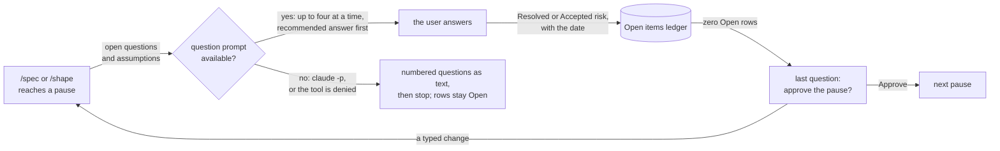

# Pause questions

**Version:** v1 · **Status:** Draft · **Type:** Enhancement · **Project type:** CLI/Library

**Shape doc:** docs/specs/ask-up-front/shape.md
**Depends on:** None

At each pause, `/spec` and `/shape` put every open question and assumption to
the user in the question prompt, with a recommended answer first. A pause is
approved only when no row is Open, so nothing unanswered reaches `/build`.

## Problem

27 ledger rows in 10 specs say "default chosen autonomously". Claude picked
each answer alone, and the user accepted the defaults later. Four places allow
this today:

- `skills/spec/SKILL.md:27`: "Anything unknown is either asked or written into
  the ledger as an assumption."
- `skills/shape/SKILL.md:24`: "either ask, or write it into the ledger as an
  assumption."
- `references/ledger.md:47`, rule 1: the stage "writes an `assumption` row
  first", and work continues.
- `scripts/route-to-zuko.sh:34`, the session-start text: "An unknown is either
  asked, or written into the spec's open-items ledger as an assumption."

Only a `Shaped` shape, or a spec at `Refined` or later, must have zero Open rows. So pauses 1
and 2 of `/spec` can be approved while rows are still Open.

## Slice test

| Check | Result |
| --- | --- |
| Cuts every layer it needs | yes. The rule in `/spec` and `/shape`, ledger rules 1 and 4, the session-start text, and a contract test. |
| One e2e test walks it | partly. A contract test proves the text. The behaviour shows at the next real pause (O6). |
| Worth shipping alone | yes. The pauses ask before they write, even while `/build` still stops to ask. |
| Fits (≤5 scenarios, ≤2 areas) | yes. 5 scenarios. Two areas: the pause stages and the ledger rules. |

**Path:** full. It changes 5 files and the way two stages talk to the user.
Pause 2 is the exact wording of the questions, the approval and the text
fallback.

## User story

As the person who approves each pause, I want every open question put to me
with a recommended answer, so that no answer that Claude picked alone reaches
`/build`.

## Flow



At a pause, each open question goes to the user in the question prompt. Each
answer goes into the ledger. When no row is Open, the last question asks for
approval. Without the prompt, Claude prints the questions and stops.

## Acceptance criteria

```gherkin
Scenario: a pause asks each question, with the recommended answer first
  Given /spec refunds reaches pause 1 with the question "Can a refund be more than the order total?"
  And Claude would assume "Refunds over £500 need a manager's approval"
  When Claude ends pause 1
  Then it asks both in the question prompt, the assumption as a question
  And the first option of each is the recommended answer, marked "(Recommended)"
  And each answer goes into the ledger as Resolved or Accepted risk, with the date 2026-10-14

Scenario: more than four questions, and no approval while a row is Open
  Given /spec refunds reaches pause 2 with five Open rows
  When Claude ends pause 2
  Then it asks four questions in one prompt, and the fifth in the next
  And it asks "Approve pause 2?" only after all five rows are Resolved or Accepted risk

Scenario: an unproven claim offers /poc first
  Given pause 3 of /spec refunds rests on "Stripe refunds a part of a JPY charge"
  And nobody has checked it
  When Claude asks about it
  Then the first option is /poc
  And the recommended answer is the second option, marked "(Recommended)"

Scenario: with no question prompt, Claude prints the questions and stops
  Given a headless claude -p run of /spec refunds reaches pause 1 with two Open rows
  When Claude ends pause 1
  Then it prints the two questions as a numbered list, each with its recommended answer first
  And it stops without writing either answer
  And both rows stay Open

Scenario: /shape asks the same way
  Given /shape "loyalty points" has the question "Do points expire after 12 months?"
  And the question belongs to the slice points-expiry
  When the shape stops
  Then it asks the question in the question prompt, with the recommended answer first
  And "Hand to points-expiry" is one of the options
  And the last question asks "Approve the shape?"
```

The contract test proves the rule text for each scenario. The next real pause
shows the behaviour (O6).

## Scope

**In:**

- `/spec`: the "Never assume" rule, and the stop at each of the three pauses.
- `/shape`: the "Never assume" rule, the questions in step 1, the ledger in
  step 5, and the stop in step 6.
- `ledger.md` rule 1: at a pause, an assumption is asked, not written down
  without asking. Rule 4: no pause is approved while a row is Open, at pauses
  1 and 2 too.
- `route-to-zuko.sh` rule 2, the session-start text.
- Up to four questions in each prompt. More than four → several prompts, one
  after the other, and the approval is the last question.
- The recommended answer is first, marked "(Recommended)". An unproven claim
  is the exception: `/poc` is first, and the recommended answer is second (O5).
- The approval is a question in the prompt: "Approve" or a typed change (O3).
- No question prompt → a numbered list of the questions, each with its
  recommended answer first, then stop. The rows stay Open (O4).
- A contract test, `tests/test-pause-questions.sh`.

**Out:**

- `/design-system`'s three pauses (O2). No slice picks it up yet.
- `/build` and `/review` stopping to ask, and the rows they decide alone.
  unattended-build picks these up.
- A new gate for each pause. The `Shaped` and `Refined` gates stay as they are
  (D19).
- An interactive spike that proves the behaviour (O6).

## Open items

| ID | What | Type | Raised at | Owner | Status | Answer |
| --- | --- | --- | --- | --- | --- | --- |
| O1 | In auto mode the harness tells Claude not to ask questions. Does a skill rule to ask at each pause win over it? The 27 rows suggest that it does not today. (from shape O6) | unproven | shape | poc | Resolved | Settled by the evidence, and `/poc` was declined. The auto-mode text in all 378 logged sessions says "If the user, a skill, or the shape of the task suggests they want you to ask (with AskUserQuestion or otherwise), do so." This session ran in auto mode and asked at each pause. The 27 rows came from the skills that allow "or write an assumption". 2026-10-12 |
| O2 | Which stages must ask through the question prompt at their pauses? | question | spec p1 | user | Resolved | `/spec` and `/shape`. Not `/design-system`. 2026-10-12 |
| O3 | How does a pause end? | question | spec p1 | user | Resolved | The approval is the last question in the prompt. 2026-10-12 |
| O4 | What happens when the question prompt is not available? | question | spec p1 | user | Resolved | Print the questions as a numbered list, each with its recommended answer first, and stop. The rows stay Open. 2026-10-12 |
| O5 | An unproven row offers `/poc` first (shape O4), and this slice puts the recommended answer first. Which wins? | question | spec p1 | user | Resolved | `/poc` first, always. The recommended answer is second, marked "(Recommended)". 2026-10-12 |
| O6 | How do we prove that the pauses ask through the question prompt? | question | spec p1 | user | Resolved | A contract test proves the text. The next real `/spec` pause shows the behaviour. 2026-10-12 |

_Never delete this section or its rows. See references/ledger.md._

## Glossary

- **Question prompt** — Claude Code's multiple-choice question box, the
  `AskUserQuestion` tool. The user answers with one key press or a typed reply.
  It holds up to four questions at a time.
- **Auto mode** — a Claude Code mode where Claude works without stopping for
  approval.
- **Headless run** — running Claude Code with `claude -p`, with no terminal UI.
  It has no question prompt.
- **Unproven** — a ledger row for a technical claim that nobody has checked,
  which a `/poc` spike could settle.
- **Contract test** — a test that checks the text of a prompt file, not what
  Claude does with it.
- **e2e** — end-to-end: one test that walks the whole slice as a user would.
