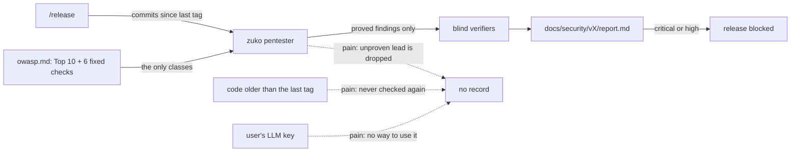
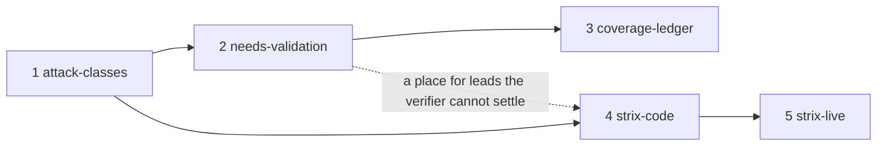

# Pentest depth

**Project type:** CLI/Library · **Status:** Shaped

**Board:** https://claude.ai/artifact/WfSHhpnPE8p24mXXa3KGyF

## Problem

The release pentest checks only OWASP Top 10 and six fixed checks, over the commits since the last tag. It drops each lead that it cannot prove, and a user with an LLM key cannot add a second attacker.

## Today

Eight releases ran this pentest and found six holes, and v2.4.2 shipped without it (D59). Nothing records the classes that it never tried, the code that it never read again, or the leads that it could not prove.

## Slices

| # | Slice | What ships | Why this order |
| --- | --- | --- | --- |
| 1 | attack-classes | The Cloudflare class files are copied into the plugin, pinned to upstream commit `c1c8a8c`, with the MIT licence and credit. The pentester reads the class files that match the repo. The report's Assessed lines name each class. A pin check prints a notice when upstream has newer commits, as D78 does for the taste skill. | The smallest change that is worth shipping. zuko itself is an LLM tool, so its next release gets the AI-AND-LLM checks. |
| 2 | needs-validation | When the pentester finds a lead that it cannot prove, the report keeps it under Needs validation, with the exact fact that is still unknown. A lead has no severity and does not block the release. | Before the ledger, so that the ledger can mark a unit with a lead as not covered. Before Strix, so that a Strix finding the verifier cannot settle has a place. |
| 3 | coverage-ledger | Each pentest records the units that it checked. The next release also checks the units that no run has checked yet, so old code gets covered over a few releases. | It replaces a separate `/audit` command. It does not need Strix. |
| 4 | strix-code | When `strix`, `STRIX_LLM`, `LLM_API_KEY` and Docker are all present, `/release` also runs Strix on the scratch copy of the release. zuko's blind verifier checks each Strix finding, and the confirmed ones go into the same report. A confirmed critical or high blocks the release (D10). With no `strix`, zuko offers to install it. With no key or no Docker, `/release` prints one line that says why Strix was skipped. | Its spec starts with a `/poc` for O8 and O9, because the slice rests on both. Slices 1 to 3 do not wait for that answer. |
| 5 | strix-live | Strix also attacks a running app on a host that the user names. Each run, `/release` names the host and asks the user to confirm that they own it and accept data loss on it. | It needs slice 4's Strix run. It carries the most risk, so it comes last. |

## Not doing

- **A separate `/audit` command for a whole repo.** The coverage ledger lets `/release` reach old code over a few releases. A Cloudflare-style audit is 10 to 30 or more agents for each run. The user chose this on 2026-11-07.
- **The whole Cloudflare skill and its six phases.** It runs target code only in an OS-level sandbox. Without that sandbox on Windows, every lead stays `needs_validation`. zuko stages also do not hand their work to a skill from another plugin.
- **Rewriting the class files in zuko's own words.** A pinned copy keeps the link to upstream fixes, and the pin check tells the user about them.
- **Each project installs the Cloudflare skill itself.** The pentester runs in every project, so the files ship with the plugin.
- **The class files in `/review`.** `/review` runs on each slice, so more classes make each review slower. The pentester reads them once for each release (O7).
- **Strix in place of the pentester.** A user without an LLM key keeps the same pentest as today. This keeps zuko free of a provider.
- **Strix through a proxy to a Claude subscription.** It breaks the subscription terms (`v3-release-and-hosts/shape.md`, Not doing). This shape uses an API key only. That old shape rejected Strix because no key was available. The user now has $100 a month of API credits, so this shape reopens that row (O5).

## Open items

| ID | What | Type | Raised at | Owner | Status | Answer |
| --- | --- | --- | --- | --- | --- | --- |
| O1 | What made you think of this? | question | shape | user | Resolved | The user saw the Cloudflare repo. Cloudflare is well known, and its methods close gaps that zuko has, 2026-11-07 |
| O2 | Which gaps should zuko close? | question | shape | user | Resolved | G1 unproven leads, G2 coverage memory, G3 attack classes, 2026-11-07 |
| O3 | Do we also add a separate `/audit` command for a whole repo (G4)? | question | shape | user | Resolved | No. The coverage ledger lets `/release` reach old code, 2026-11-07 |
| O4 | How do the class files reach the pentester in every project? | question | shape | user | Resolved | Copied into the plugin, pinned to `c1c8a8c`, with MIT credit. The D-entry is drafted at `/spec attack-classes`, 2026-11-07 |
| O5 | How does Strix fit next to the zuko pentester? | question | shape | user | Resolved | An optional second engine. The pentester always runs. Strix runs only with `STRIX_LLM`, `LLM_API_KEY` and Docker, for any provider. This reopens O2 of `v3-release-and-hosts`, 2026-11-07 |
| O6 | Strix may attack any host that the user names. zuko cannot hold its requests to one host (D28) or to reads only (D29), so it can change or delete data on staging. | flag | shape | user | Accepted risk | The user wants staging covered. Each run, `/release` names the host and asks the user to confirm ownership and data loss. A D-entry at `/spec strix-live` records that D28 and D29 do not cover Strix, 2026-11-07 |
| O7 | Does `/review` also check each diff against the class files? | question | shape | user | Resolved | No. Only the release pentester reads them, 2026-11-07 |
| O8 | Strix lists Claude Opus 5.5 as "needs CVP access". Do Claude models work in Strix with an API key, without CVP, on Windows with Docker Desktop? | unproven | shape | poc | Handed to strix-code | A `/poc` runs first in that spec, 2026-11-07 |
| O9 | What does one code-level Strix run cost, and does one run for each release fit in $100 a month? | unproven | shape | poc | Handed to strix-code | Measured in the same `/poc` as O8. The answer also sets the default `--scan-mode`, 2026-11-07 |
| O10 | How will we know that this worked? | question | shape | user | Resolved | zuko's next release report lists the Cloudflare classes it assessed (AI-AND-LLM and SUPPLY-CHAIN at least), any leads that need validation, and the code it checked. With a key, it also lists the verified Strix findings, 2026-11-07 |
| O11 | Does zuko install Strix for a user who does not have it? | question | shape | user | Resolved | Yes. zuko asks once, and installs on a yes, as D80 does for Node, 2026-11-07 |
| O12 | How does zuko install Strix? Its main installer is `curl \| bash`, and it also ships as the `strix-agent` package. | question | shape | user | Handed to strix-code | The lean is `uv tool install` or `pipx install` of `strix-agent` at a pinned version, 2026-11-07 |
| O13 | Does a confirmed critical or high Strix finding block the release? | question | shape | user | Resolved | Yes. The same rule as the pentester's findings (D10), 2026-11-07 |
| O14 | Do the release notes name a lead that needs validation, as D12 does for unfixed medium and low findings? | question | shape | user | Handed to needs-validation | — |
| O15 | What is one unit in the coverage ledger: a file, a function, or Cloudflare's own recon units? | question | shape | user | Handed to coverage-ledger | Decide after reading Cloudflare's `RECONNAISSANCE.md` and its ledger validator, 2026-11-07 |
| O16 | Which Cloudflare class files go into the plugin: all 15, or only those that zuko's project types use? | question | shape | user | Handed to attack-classes | Decide with the map from project type to class files, 2026-11-07 |

## Glossary

- **Pentest** — a penetration test: an attack on your own code to find holes before someone else does.
- **OWASP** — the Open Worldwide Application Security Project. Its Top 10 is a list of the most common web security risks.
- **Blind verifier** — a separate agent that sees only the claim and the code, not the reasoning, and tries to prove the finding false.
- **Attack class** — one family of attacks, such as prompt injection or a poisoned dependency. Each Cloudflare class file gives the prompts to hunt for one group of them.
- **needs_validation** — Cloudflare's verdict for a lead with a source trace that could not be proved. It names the exact fact that is still unknown.
- **Coverage ledger** — a record of each unit of code and whether a run has checked it.
- **Strix** — an open-source AI pentest tool (`usestrix/strix`). It runs its agents in Docker and calls an LLM with your own key.
- **LiteLLM** — the library that Strix uses to call 100 or more LLM providers through one interface.
- **CVP** — Anthropic's Cyber Verification Program. Strix says that Claude Opus 5.5 needs this access for pentest work.
- **Scratch copy** — the copy of the release that `git archive` puts in a temporary folder, where the pentester runs its proofs.
