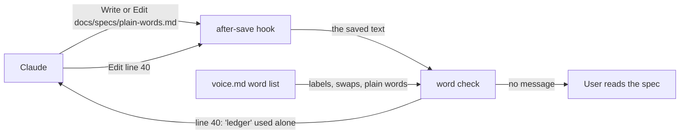

# plain-words

**Version:** v1 · **Status:** Draft · **Type:** Enhancement · **Project type:** CLI/Library

**Shape doc:** docs/specs/goal-thread/shape.md
**Depends on:** None

`voice.md` gets a zuko word list, and a check reads each shape and spec right after Claude saves it. Claude then fixes a hard word before the user reads it.

**Goal (from the shape):** you keep each idea's goal in sight from `/shape` to `/ship`, and you understand every zuko reply well enough to decide. This slice completes Done when point 3: the word check passes on each shape and spec.

## Problem

The user finds zuko's shapes and specs hard to read. They use zuko labels alone, such as "ledger" and "earn-it", and words with odd meanings, such as "surface" for "show". `voice.md` has sentence-length rules only (D37). No word list exists, and nothing checks the words (D38).

A real example: ste-voice shipped on 2026-10-12 with the sentence rules only. Six weeks later the replies were still hard to read, and nothing had flagged one word. In `drop-board.md`, written on 2026-11-26, line 101 still says "with 15 new entries, D163 to D177", with no plain words before the numbers.

## Slice test

| Check                         | Result                                                                                 |
| ----------------------------- | -------------------------------------------------------------------------------------- |
| Cuts every layer it needs     | yes: the word list in `voice.md`, the check script, and the hook that runs it          |
| One e2e test walks it         | yes: save a spec with hard words, read the message, fix it, save again, see no message |
| Worth shipping alone          | yes: the next spec that Claude writes is in plain words                                |
| Fits (≤5 scenarios, ≤2 areas) | yes, after the split below: 5 scenarios, `references/voice.md` and `scripts/`           |

As the shape wrote it, the slice also checks words against the user's own STE copy. No STE copy exists under the user's home folder today (searched 2026-11-28). That part has no file to test against, and it adds two more scenarios. So it moves to a new slice, `ste-dictionary`, after this one (O1, O2).

**Path:** full. The slice adds a new hook and a new message that Claude reads.

## Flow



Claude saves a spec, and the hook gives the saved text to the word check. The check reads the word list in `voice.md` and tells Claude each line with a hard word. Claude fixes the line and saves again. The user reads only the fixed text.

## Acceptance criteria

```gherkin
Scenario: A zuko label used alone is caught after the save
  Given the word list in voice.md gives "ledger" the plain words "the open-items table"
  When Claude saves docs/specs/plain-words.md with line 40 "The ledger has no Open rows."
  Then the check tells Claude: line 40 uses "ledger" alone, write "the open-items table (ledger)"
  And Claude changes line 40 before the turn ends
  And a save with "The open-items table (ledger) has no Open rows." gets no message

Scenario: A hard word or a metaphor gets its plain swap
  Given the word list swaps "surface" for "show" and "prior to" for "before"
  When Claude saves docs/specs/goal-thread/shape.md with "Each stage will surface the goal prior to the questions."
  Then the check tells Claude: use "show" for "surface", and "before" for "prior to"

Scenario: A decision or row number comes only after the plain words
  When Claude saves docs/specs/plain-words.md with "D38 says that nothing measures sentence length."
  Then the check tells Claude to write the plain words first, then the number in brackets
  And "Nothing measures sentence length (D38)." gets no message

Scenario: The check reads sentence cells and skips the columns that scripts read
  When Claude saves a ledger row "| O24 | Can the hook reply? | unproven | shape | user | Open | The ledger says yes. |"
  Then the check flags "ledger" in the Answer cell
  And it does not flag "O24" in the ID column, or the Type, Raised at, Owner and Status cells

Scenario: Old text stays as it is
  Given docs/specs/drop-board.md line 101 says "with 15 new entries, D163 to D177"
  When /ship changes only the Status line of drop-board.md to Shipped
  Then the check says nothing about line 101
  And a save of README.md with "the ledger" is never checked
```

## Scope

**In:**

- A word list in `references/voice.md` with three parts: zuko labels and their plain words, metaphors and their literal words, hard words and their plain swaps.
- A rule in `voice.md`: write the plain words first, and put a label or a D or O number in brackets after them (O4). Claude follows this in terminal replies as a prompt rule.
- The check reads only the text that a save adds (O5). Old text stays as it is.
- "slice" and "gate" stay off the label list. Each doc defines them in its Glossary (O6).
- A check that runs right after each Write or Edit of a shape or spec, and tells Claude each line to fix.
- New entries that supersede D37 (no word list) and the part of D38 that says nothing checks the writing. The sentence-length part of D38 stays.

The starting word list. The user grows it by editing `voice.md`.

| Kind     | Word              | Write instead                       |
| -------- | ----------------- | ----------------------------------- |
| label    | ledger            | the open-items table (ledger)       |
| label    | light path        | the short route (light path)        |
| label    | earn-it           | the "is it needed" check (earn-it)  |
| label    | chunk             | one part of the build (chunk)       |
| label    | walking skeleton  | the thinnest working version        |
| label    | Decided alone     | a choice made without you           |
| metaphor | surface           | show                                |
| metaphor | land (a change)   | merge                               |
| metaphor | front door        | first step                          |
| hard     | utilise / utilize | use                                 |
| hard     | prior to          | before                              |
| hard     | in order to       | to                                  |
| hard     | via               | through                             |

**Out:**

- The check against the user's STE copy, and how it treats software words such as "commit" and "merge": `ste-dictionary`, slice 7 (O1, O2).
- A check on terminal replies. A script cannot see a reply, as the shape says.
- The goal line at the top of each doc: idea-goal, slice 3.
- The four-part reply: cto-brief, slice 4.
- Stories and analogies: story-flow, slice 5.

## Open items

| ID  | What                                                                                                                                            | Type     | Raised at | Owner | Status | Answer |
| --- | ----------------------------------------------------------------------------------------------------------------------------------------------- | -------- | --------- | ----- | ------ | ------ |
| O1  | Where does the user's STE copy live, so that the gate can find it? (from shape O18)                                                             | question | shape     | user  | Resolved | Moved to a new slice, `ste-dictionary` (slice 7 in the shape). No copy exists on disk today. 2026-11-28 |
| O2  | STE probably lacks software words such as commit and merge. How does the gate treat them? (from shape O19)                                      | question | shape     | user  | Resolved | Moved to `ste-dictionary` with O1. 2026-11-28 |
| O3  | Can a script that runs right after a save send a message back to Claude? The check needs this. (from shape O24)                                 | unproven | shape     | poc   | Open   | —      |
| O4  | How does the check know that a label is explained? By plain words with the label in brackets after them, or by an entry in the doc's Glossary? | question | spec p1   | user  | Resolved | Plain words first, then the label in brackets, as in "the open-items table (ledger)". The check reads each line. 2026-11-28 |
| O5  | When Claude edits an old doc, does the check read only the text that the save added, or the whole file?                                       | question | spec p1   | user  | Resolved | Only the added text: an Edit's new text, or the changed lines of a Write to a file that exists. 2026-11-28 |
| O6  | "slice" has 46 uses and "gate" has 23 in three recent docs. Are they on the label list?                                                         | question | spec p1   | user  | Resolved | No. They name the stages that the user runs, and each doc defines them in its Glossary. 2026-11-28 |

## Glossary

- **e2e** — end-to-end: one test that walks the whole slice as a user would.
- **STE** — ASD-STE100, Simplified Technical English: writing rules and a dictionary of approved words.
- **zuko label** — a name that zuko gives to one of its own parts, such as "ledger" for the open-items table.
- **after-save hook** — a script that Claude Code runs right after Claude writes or edits a file (a PostToolUse hook).
- **D37, D38** — entries in `DECISIONS.md`. A new entry supersedes an old one, and never just contradicts it.
