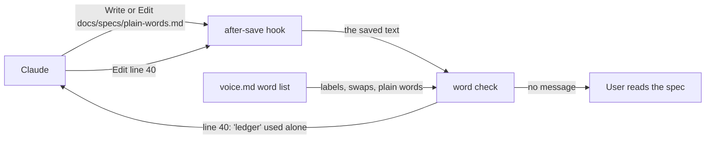
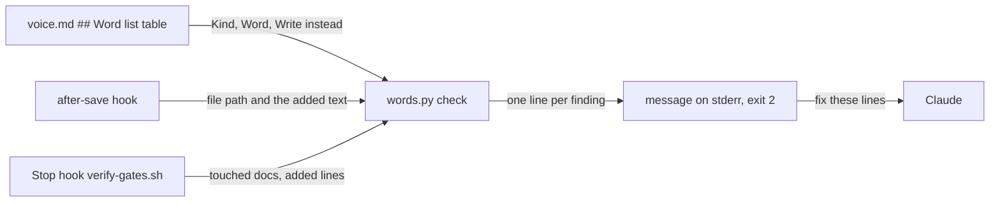
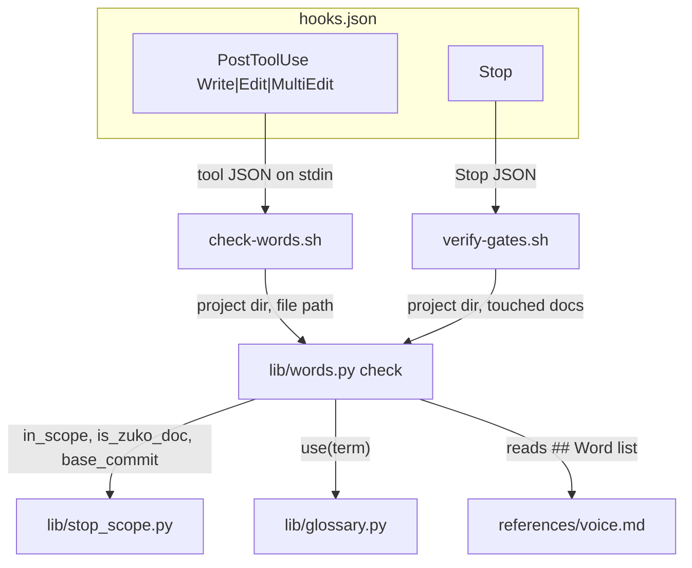
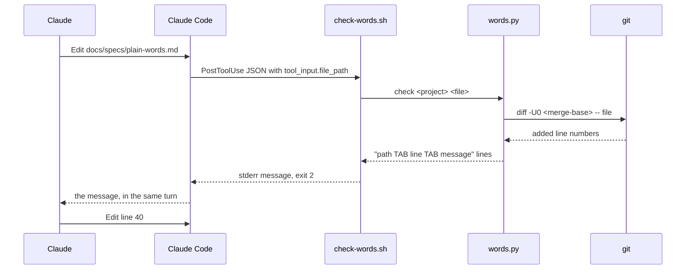

# plain-words

**Version:** v1 · **Status:** Refined · **Type:** Enhancement · **Project type:** CLI/Library

**Shape doc:** docs/specs/goal-thread/shape.md
**Depends on:** None

`voice.md` gets a zuko word list, and a check reads each shape and spec right after Claude saves it. Claude then fixes a hard word before the user reads it.

**Goal (from the shape):** you keep each idea's goal in sight from `/shape` to `/ship`, and you understand every zuko reply well enough to decide. This slice completes Done when point 3: the word check passes on each shape and spec.

## Problem

The user finds zuko's shapes and specs hard to read. They use zuko labels alone, such as "ledger" and "earn-it", and words with odd meanings, such as "surface" for "show". `voice.md` has sentence-length rules only (D37). No word list exists, and nothing checks the words (D38).

A real example: ste-voice shipped on 2026-10-12 with the sentence rules only. Six weeks later the replies were still hard to read, and nothing had flagged one word. In `drop-board.md`, written on 2026-11-26, line 101 still says "with 15 new entries, D163 to D177", with no plain words before the numbers.

## Slice test

| Check                         | Result                                                                                 |
| ----------------------------- | -------------------------------------------------------------------------------------- |
| Cuts every layer it needs     | yes: the word list in `voice.md`, the check script, and the hook that runs it          |
| One e2e test walks it         | yes: save a spec with hard words, read the message, fix it, save again, see no message |
| Worth shipping alone          | yes: the next spec that Claude writes is in plain words                                |
| Fits (≤5 scenarios, ≤2 areas) | yes, after the split below: 5 scenarios, `references/voice.md` and `scripts/`           |

As the shape wrote it, the slice also checks words against the user's own STE copy. No STE copy exists under the user's home folder today (searched 2026-11-28). That part has no file to test against, and it adds two more scenarios. So it moves to a new slice, `ste-dictionary`, after this one (O1, O2).

**Path:** full. The slice adds a new hook and a new message that Claude reads.

## Flow



Claude saves a spec, and the hook gives the saved text to the word check. The check reads the word list in `voice.md` and tells Claude each line with a hard word. Claude fixes the line and saves again. The user reads only the fixed text.

## Acceptance criteria

```gherkin
Scenario: A zuko label used alone is caught after the save
  Given the word list in voice.md gives "ledger" the plain words "the open-items table"
  When Claude saves docs/specs/plain-words.md with line 40 "The ledger has no Open rows."
  Then the check tells Claude: line 40 uses "ledger" alone, write "the open-items table (ledger)"
  And Claude changes line 40 before the turn ends
  And a save with "The open-items table (ledger) has no Open rows." gets no message

Scenario: A hard word or a metaphor gets its plain swap
  Given the word list swaps "surface" for "show" and "prior to" for "before"
  When Claude saves docs/specs/goal-thread/shape.md with "Each stage will surface the goal prior to the questions."
  Then the check tells Claude: use "show" for "surface", and "before" for "prior to"

Scenario: A decision or row number comes only after the plain words
  When Claude saves docs/specs/plain-words.md with "D38 says that nothing measures sentence length."
  Then the check tells Claude to write the plain words first, then the number in brackets
  And "Nothing measures sentence length (D38)." gets no message

Scenario: The check reads sentence cells and skips the columns that scripts read
  When Claude saves a ledger row "| O24 | Can the hook reply? | unproven | shape | user | Open | The ledger says yes. |"
  Then the check flags "ledger" in the Answer cell
  And it does not flag "O24" in the ID column, or the Type, Raised at, Owner and Status cells

Scenario: Old text stays as it is
  Given docs/specs/drop-board.md line 101 says "with 15 new entries, D163 to D177"
  When /ship changes only the Status line of drop-board.md to Shipped
  Then the check says nothing about line 101
  And a save of README.md with "the ledger" is never checked
```

## Scope

**In:**

- A word list in `references/voice.md` with three parts: zuko labels and their plain words, metaphors and their literal words, hard words and their plain swaps.
- A rule in `voice.md`: write the plain words first, and put a label or a D or O number in brackets after them (O4). Claude follows this in terminal replies as a prompt rule.
- The check reads only the lines that this work added: the lines changed since the base branch, and every line of a new file (O5, O11). Old text stays as it is.
- The Stop hook runs the same check on the docs this work touched, so a save through Bash is not missed (O7).
- "slice" and "gate" stay off the label list. Each doc defines them in its Glossary (O6).
- A check that runs right after each Write or Edit of a shape or spec, and tells Claude each line to fix.
- A new entry that supersedes the part of D38 that says nothing checks the writing. The sentence-length part stays. D37 stays until `ste-dictionary` adds the STE copy (O10).

The starting word list. The user grows it by editing `voice.md`.

| Kind     | Word              | Write instead                       |
| -------- | ----------------- | ----------------------------------- |
| label    | "ledger" | "the open-items table (ledger)" |
| label    | "light path" | "the short route (light path)" |
| label    | "earn-it" | "the "is it needed" check (earn-it)" |
| label    | "chunk" | "one part of the build (chunk)" |
| label    | "walking skeleton" | "the thinnest working version" |
| label    | "Decided alone" | "a choice made without you" |
| metaphor | "surface" | "show" |
| metaphor | "land (a change)" | "merge" |
| metaphor | "front door" | "first step" |
| hard     | "utilise / utilize" | "use" |
| hard     | "prior to" | "before" |
| hard     | "in order to" | "to" |
| hard     | "via" | "through" |

**Out:**

- The check against the user's STE copy, and how it treats software words such as "commit" and "merge": `ste-dictionary`, slice 7 (O1, O2).
- A check on terminal replies. A script cannot see a reply, as the shape says.
- The goal line at the top of each doc: idea-goal, slice 3.
- The four-part reply: cto-brief, slice 4.
- Stories and analogies: story-flow, slice 5.

## Interface

The slice has two readers: Claude reads the check's message, and the user edits the word list.



The word list and either hook feed the check. The check prints one line for each finding, and Claude reads them as one message.

### The word list

A table under `## Word list` in `references/voice.md`, with three columns. The script reads this table, so the user adds a word with one new row.

```markdown
## Word list

| Kind     | Word     | Write instead                 |
| -------- | -------- | ----------------------------- |
| label    | "ledger" | "the open-items table (ledger)" |
| metaphor | "surface" | "show" |
| hard     | "prior to" | "before" |
```

- **label:** the word is a zuko label. It passes only inside brackets after plain words.
- **metaphor** and **hard:** the word never passes in prose. The message gives the plain swap.
- Each Word matches as a whole word, in any case, plural allowed.

### The message Claude sees

After a save with findings, the hook exits 2 and prints this on stderr:

```text
Word check: docs/specs/plain-words.md
- line 40: "ledger" is a zuko label used alone. Write "the open-items table (ledger)".
- line 52: "surface" is a metaphor. Write "show".
- line 61: "D38" comes before its plain words. Write the plain words, then "(D38)".
Fix these lines now. The check reads only the lines that this work added.
```

The Stop hook adds the same lines to its "Spec gate check failed:" list, as `- docs/specs/plain-words.md line 40: "ledger" is a zuko label used alone. ...`.

A save with no findings, and a save of a file that is not a shape or spec, print nothing and exit 0.

When the check cannot run, it fails closed. It exits 2 with `Word check could not run: voice.md has no ## Word list table.`. It never passes when it read nothing.

### What the check skips

- Code: fenced blocks, inline code, and paths.
- Headings, diagram labels, and the `## Glossary` section.
- In a table, the ID, Type, Raised at, Owner and Status columns.
- Text in double quotes, as voice.md says for quoted text (O9).
- The drafted entries under `### Decisions to record`. They follow the format in `decisions.md`, which puts a D-number first.
- Text that this work did not add: a line not changed since the base branch (O11).

## Technical plan

### Approach

One new script, `lib/words.py`, finds the hard words in the lines that this work added to a shape or spec. A new after-save hook, `check-words.sh`, runs it after each Write or Edit of a doc and sends any findings to Claude. `verify-gates.sh` runs it at Stop too, for a doc saved through Bash.

Relies on: the Stop hooks judge only the docs this work touched (D35), a zuko doc is known by its Version and Status line (D36), the fence check runs at Stop on each changed doc (D76), scripts read and write UTF-8 with LF (D98, D99), and the entries drafted below (D178 to D180).



`words.py` borrows the doc test and the base branch from `stop_scope.py`, and the word match from `glossary.py`. It reads the word list from the plugin's own `voice.md`, not the project's.



Claude saves a doc, and the hook passes the path to `words.py`. The script asks git which lines this work added, and checks only those. Claude Code gives the hook's message to Claude, and Claude fixes the line. The /poc on 2026-11-28 proved the last two steps (O3).

### Changes

| File | What changes | Why |
| ---- | ------------ | --- |
| `plugins/zuko/scripts/lib/words.py` | New. `check <project> <path>...` prints one `path TAB line TAB message` line for each finding. It reads the `## Word list` table in `references/voice.md`, the added lines from `git diff -U0 --relative <base> -- <path>`, or every line of an untracked file. It walks the doc line by line and skips fences, headings, inline code, quoted text, the Glossary and Decisions to record sections, and the script columns of a table. Exit 2 with a reason when the word list is missing or empty, or git fails. | Scenarios 1 to 5 |
| `plugins/zuko/scripts/check-words.sh` | New PostToolUse hook. Reads `tool_input.file_path` as `auto-format.sh:6` does, and gives it to `words.py check`. Prints the message in the Interface section and exits 2 when there are findings. A path outside `docs/specs/`, or not a zuko doc, exits 0 with no output. | Scenarios 1 to 3, 5 |
| `plugins/zuko/hooks/hooks.json:61` | A second hook under the `Write\|Edit\|MultiEdit` matcher, after `auto-format.sh`, with the status message "Checking the words in the doc...". | Scenario 1 |
| `plugins/zuko/scripts/verify-gates.sh:66` | After the fence check, run `words.py check` on `${docs[@]}` (every touched doc, at any Status) and add each finding to `problems`. | O7 |
| `plugins/zuko/references/voice.md:43` | The STE section gains the rule: write the plain words first, then a label or a D or O number in brackets. A new `## Word list` section after "Simplified Technical English" holds the 13-row table from Scope. "It does not use the STE dictionary" stays. | Scenarios 1 to 3 |
| `plugins/zuko/skills/spec/references/spec-template.md:92` | The `Relies on:` example becomes "Relies on: {what each entry says, then its number in brackets, as in: the Stop hooks judge only the docs this work touched (D35)}". | O8 |
| `plugins/zuko/scripts/tests/test-words.sh` | New unit tests for `words.py`. | Scenarios 1 to 5 |
| `plugins/zuko/scripts/tests/test-e2e-plain-words.sh` | New e2e test. | All |
| `plugins/zuko/scripts/tests/test-ste-voice.sh` | One check that the word list table sits in `voice.md` with the three columns. | Scenario 1 |

Reusing: `stop_scope.in_scope`, `stop_scope.is_zuko_doc`, `stop_scope.base_commit` and `stop_scope.git` for the doc test and the diff. `glossary.use` for a whole-word match that skips paths and file names. `pr_body.FENCE` and `fence.closes` for code blocks. `program.argv` for the git call, through `stop_scope.git`. `run.sh`'s `expect_exit`, `expect_match`, `expect_no_match` and `native` in the tests. Each module loads its neighbour by path, as `stop_scope.py:27` loads `program.py` (the hook-import-path rule).

### Earn-it

| Added | Triggered by |
| ----- | ------------ |
| `lib/words.py` | Scenarios 1 to 5 need a word check. `glossary.py` checks whole files for undefined terms and cannot give line numbers or read added lines only. |
| `check-words.sh` | Scenario 1: the check runs right after a save (shape O21). The Stop hook alone runs only at the end of the turn. |
| The word check in `verify-gates.sh` | O7: a doc saved through Bash fires no Write or Edit hook. |

No config option, no new dependency.

### Non-functionals

|                      |                                                                               |
| -------------------- | ----------------------------------------------------------------------------- |
| **Load**             | One `python3` and one `git diff` for each Write or Edit of a doc under `docs/specs/`. Other files exit in Python before git runs. About 20 saves of a doc in one `/spec` run. |
| **Breaks first**     | Nothing at 10 times the saves. A 2,000-line spec takes one `git diff`, a few milliseconds. |
| **Security surface** | Claude Code calls the hook. It trusts `tool_input.file_path` only as a path to read under `docs/specs/`, and gives it to git after `--`. It reads no secrets and stores nothing. |
| **Proof it works**   | The message "Word check: docs/specs/..." in the transcript after a save with a hard word, and "Spec gate check failed:" with a word line at Stop. |
| **Rollout**          | Ships in the next zuko release, with no flag: hooks have no switch. Rollback: remove the `check-words.sh` entry from `hooks.json` and the `words.py` call from `verify-gates.sh`, or revert the commit. |

### Test plan

Each test runs in a scratch git repo with a `main` branch and a work branch, because the verdict depends on the diff (the test-the-guard-where-it-fires lesson).

| Scenario | Test | Command |
| -------- | ---- | ------- |
| 1. A label used alone | `test-words.sh` scenario 1: "ledger" alone gives the message, "(ledger)" after plain words gives none | `bash plugins/zuko/scripts/tests/run.sh test-words` |
| 2. Metaphor and hard word swaps | `test-words.sh` scenario 2: "surface" and "prior to" each get their swap; "surfaces" counts, `surface.md` does not | same |
| 3. A number after plain words | `test-words.sh` scenario 3: "D38 says" fails, "(D38)" and "(D62 to D74)" pass | same |
| 4. Table columns | `test-words.sh` scenario 4: a ledger row flags the Answer cell only | same |
| 5. Old text | `test-words.sh` scenario 5: a committed line with "ledger" and a one-line Status edit give no message; `README.md` gives none | same |
| The check cannot run | `test-words.sh`: a `voice.md` with no word list exits 2 with the reason, never 0 | same |
| A doc saved through Bash | `test-words.sh`: `verify-gates.sh` lists the word finding at Stop | same |
| Quotes, Glossary, Decisions to record | `test-words.sh`: a quoted "ledger", a Glossary entry and a drafted entry's `Supersedes: D38` give no message | same |

**E2E:** `test-e2e-plain-words.sh`. It pipes a real PostToolUse JSON for a new `docs/specs/refund-export.md` with the line "The ledger has no Open rows." to `check-words.sh`, and expects exit 2 and the line 40 message. It then rewrites the line as "The open-items table (ledger) has no Open rows.", runs the hook again, and expects exit 0 and no output. It reads the real `references/voice.md`. Run it with `bash plugins/zuko/scripts/tests/run.sh test-e2e-plain-words`.

The whole suite: `bash plugins/zuko/scripts/tests/run.sh`.

### Chunks

Single chunk. The hook, the Stop hook line and the tests all read the output of `words.py`. A split would share that format across two worktrees.

### Risks

| Risk | Mitigation |
| ---- | ---------- |
| An inline code span that wraps onto a second line leaks its second half into the check, because the walk goes line by line. | A test with a wrapped span. If the walk cannot handle it, the line counts as code. A false finding costs one rewrite. |
| Claude quotes a label to get past the check (O9). | `/review` reads the diff. The quote rule matches voice.md, so a quote that is not a mention breaks the voice rule. |
| A whole-word match flags a common word, such as "land" in "land on the page". | The word list is the user's to edit. Remove the row, or change it to a longer phrase. |
| The hook fires on each save, so a long `/spec` run shows the message many times while one line stays wrong. | Each message names the line. Claude fixes it on the next save. |
| A repo with no git, or no base branch, has no diff. Every line of the doc counts as added. | The same fallback as `stop_scope.py`: it judges every doc. A test covers it. |

### Decisions to record

#### D178 · 2026-11-28 · A word check reads the added lines of each shape and spec after each save and at Stop; sentence length stays unmeasured

Why: ste-voice shipped on 2026-10-12 with prompt rules only. Six weeks later the replies were still hard to read, and nothing had flagged one word (goal-thread shape O28). A /poc on 2026-11-28 showed that Claude acts on an after-save hook's message in the same turn. Claude can also write a doc through Bash, which fires no Write or Edit hook, so the Stop hook checks too. The STE sentence rules stay prompt text, as D38 said.
Rejected: prompt rules only (ste-voice showed that they drift), the Stop hook only (the check runs after Claude has moved on), the whole file (every edit of an old spec flags its old text, O5), lines since the last commit (a bad line committed earlier on the branch is never checked again, O11), a gate on sentence length (still pulls Claude off its task, as D38 said).
Supersedes: D38
Source: specs/plain-words.md
Status: active

#### D179 · 2026-11-28 · A zuko label or a D or O number passes only in brackets after the plain words

Why: the user named zuko labels used alone as the clearest pain (goal-thread shape O12). One rule for labels and numbers is checkable line by line, and it matches how numbers are already written (goal-thread shape O23).
Rejected: a Glossary entry is enough (the bare word still stands mid-sentence, O4), a skip for the `Relies on:` line (a second format for the same thing, O8), "slice" and "gate" on the list (each doc defines them in its Glossary, and every spec would get much longer, O6).
Source: specs/plain-words.md
Status: active

#### D180 · 2026-11-28 · The word list is a table in voice.md that the check reads

Why: Claude follows the list as a prompt rule in replies, and the check reads it in docs. One table keeps the two the same, and the user adds a word with one row.
Rejected: a closed tuple in the script, as `glossary.py` keeps its terms (a second copy that can disagree with voice.md, and a code change for each word), a separate words file (a third file for each stage to read).
Source: specs/plain-words.md
Status: active

## Open items

| ID  | What                                                                                                                                            | Type     | Raised at | Owner | Status | Answer |
| --- | ----------------------------------------------------------------------------------------------------------------------------------------------- | -------- | --------- | ----- | ------ | ------ |
| O1  | Where does the user's STE copy live, so that the gate can find it? (from shape O18)                                                             | question | shape     | user  | Resolved | Moved to a new slice, `ste-dictionary` (slice 7 in the shape). No copy exists on disk today. 2026-11-28 |
| O2  | STE probably lacks software words such as commit and merge. How does the gate treat them? (from shape O19)                                      | question | shape     | user  | Resolved | Moved to `ste-dictionary` with O1. 2026-11-28 |
| O3  | Can a script that runs right after a save send a message back to Claude? The check needs this. (from shape O24)                                 | unproven | shape     | poc   | Resolved | Yes. /poc on 2026-11-28: a PostToolUse hook on Write and Edit exited 2, and Claude quoted its message and edited the file in the same turn (headless `claude -p`, Claude Code 2.1.332). |
| O4  | How does the check know that a label is explained? By plain words with the label in brackets after them, or by an entry in the doc's Glossary? | question | spec p1   | user  | Resolved | Plain words first, then the label in brackets, as in "the open-items table (ledger)". The check reads each line. 2026-11-28 |
| O5  | When Claude edits an old doc, does the check read only the text that the save added, or the whole file?                                       | question | spec p1   | user  | Resolved | Only the added text: an Edit's new text, or the changed lines of a Write to a file that exists. 2026-11-28 |
| O6  | "slice" has 46 uses and "gate" has 23 in three recent docs. Are they on the label list?                                                         | question | spec p1   | user  | Resolved | No. They name the stages that the user runs, and each doc defines them in its Glossary. 2026-11-28 |
| O7  | The /poc found that Claude sometimes writes a file with Bash, and a Write and Edit hook never fires for that. A spec saved through Bash then skips the check. | flag     | spec p1   | user  | Resolved | The Stop hook also runs the word check on the docs this work touched, next to the glossary check. 2026-11-28 |
| O8  | The template's "Relies on:" line puts each D-number first. Does it follow the new rule, or does the check skip it? | question | spec p2   | user  | Resolved | It follows the new rule. The template example becomes "Relies on: the Stop hooks judge only the docs this work touched (D35)". 2026-11-28 |
| O9  | Does the word check skip text in double quotes? | question | spec p3   | user  | Resolved | Yes, as voice.md says for quoted text. A quote used to get past the check breaks the voice rule, and `/review` reads the diff. 2026-11-28 |
| O10 | The shape says this slice supersedes D37, but a house word list does not contradict it. When is D37 superseded? | question | spec p3   | user  | Resolved | With `ste-dictionary`, when the STE copy comes in. This slice supersedes D38 only. 2026-11-28 |
| O11 | After a Write, the old file is gone, so the hook cannot see one save's change. What counts as added text? | question | spec p3   | user  | Resolved | The lines changed since the base branch, and every line of a new file: the D35 rule. 2026-11-28 |

## Glossary

- **e2e** — end-to-end: one test that walks the whole slice as a user would.
- **walking skeleton** — the thinnest working version of a new project, through every layer, deployed.
- **base branch** — the branch that this work will merge into, usually `main`. The check compares against the commit where this branch left it.
- **STE** — ASD-STE100, Simplified Technical English: writing rules and a dictionary of approved words.
- **zuko label** — a name that zuko gives to one of its own parts, such as "ledger" for the open-items table.
- **after-save hook** — a script that Claude Code runs right after Claude writes or edits a file (a PostToolUse hook).
- **D37, D38** — entries in `DECISIONS.md`. A new entry supersedes an old one, and never just contradicts it.
