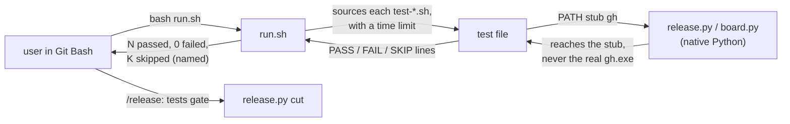
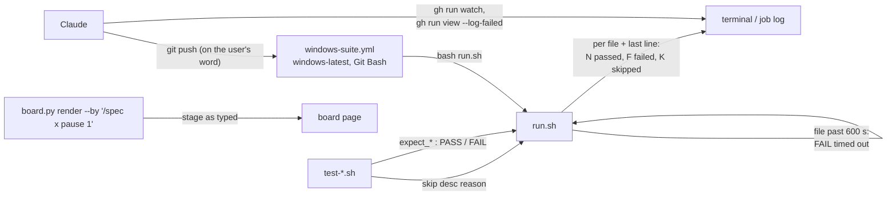
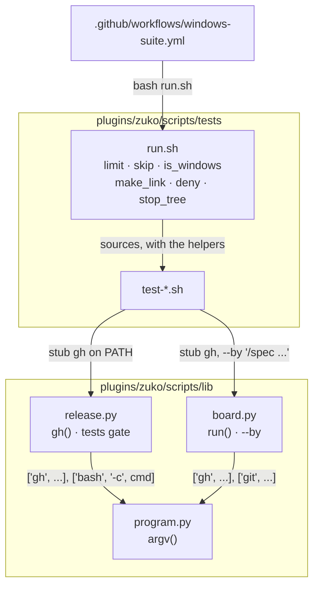
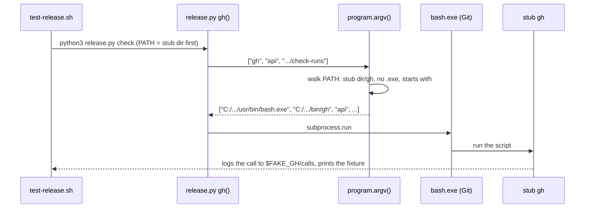

# Portable suite

**Version:** v1 · **Status:** Refined · **Type:** Technical · **Project type:** CLI/Library

**Shape doc:** docs/specs/os-agnostic-suite/shape.md
**Depends on:** lf-checkout, guard-paths, utf8-stdio

`run.sh` passes on Windows Git Bash with 0 failures, and no test file hangs. Slices 1 to 3 fixed zuko itself, so what is left is mostly in the tests, and `/release` still cannot cut a version from Windows.

## Problem

`/release` runs the suite as its tests gate, so a red suite on Windows stops every release there. The last full Windows run, on `main` at 03962c3, failed 596 checks in 38 files, and `e2e-board` hung until it was stopped by hand. Slices 1 to 3 fixed some of them, but nobody has run the full suite on Windows since. Two runs stopped because the machine ran low on memory (utf8-stdio O7).

This spec is written on Linux, where the suite passes: 3289 passed, 0 failed, in 2 min 34 s at 71d57fb. The Windows causes below come from reading the tests next to the Git for Windows, MSYS2, Cygwin, Python and Microsoft docs. They are not measured.

| Cause | Where | What the docs say |
| --- | --- | --- |
| A test stub `gh` is a bash script with no extension, and native Python starts it | `test-release.sh:12`, `test-replay.sh:24`, `test-e2e-replay.sh`, `test-e2e-pentest.sh`, `test-e2e-release.sh`, `test-e2e-attack-classes.sh` | CreateProcess appends `.exe` to a name with no extension, and looks in Python's own folder and the current folder before PATH. Python never finds the stub. It finds a real `gh.exe` when one is installed, and that `gh.exe` then calls GitHub. |
| Native Python starts `bash` for the `/release` tests gate | `release.py:246` | CreateProcess looks in `System32` before PATH, and WSL puts its own `bash.exe` there. The tests gate then runs the test command in WSL, not in Git Bash. |
| `ln -s` makes a copy | 10 places, among them `test-load-overview.sh:94`, `test-decisions.sh:106`, `test-verify-ship-gates.sh:394`, `test-render-readme-block.sh:380`, `test-e2e-board.sh:190`, `test-replay.sh:23` | Git Bash: "By default, the ln -s command in Git Bash does not create symbolic links. Instead, it creates copies." A symlink-refusal check then reads a plain file, and a copied `git.exe` runs away from its DLLs. |
| `chmod` does not stop a read | `test-stop-scope.sh:136`, `test-load-overview.sh:71`, `test-release.sh:878` | Git for Windows mounts `/` and `/tmp` with `noacl`. Cygwin then "only fakes a subset of permission bits based on the DOS readonly attribute." |
| `kill` stops the server but not its children, and the run waits | `test-e2e-board.sh:172`, `test-e2e-pentest-live.sh:28`, `test-e2e-rendered-drift.sh:109` | Windows "does not terminate any child processes that the process has created." Only `taskkill /T` ends the tree. |
| `--by "/spec …"` is rewritten | every `board.py` call from a skill or a test | Git Bash converts an argument that starts with `/` into a Windows path. `/spec x pause 1` becomes `C:/Program Files/Git/spec x pause 1` on the board. |

## Slice test

| Check | Result |
| --- | --- |
| Cuts every layer it needs | yes. It changes the test files, `run.sh`, and the one product path that Git Bash rewrites: `board.py --by` |
| One e2e test walks it | yes. One full `run.sh` on Windows Git Bash walks scenarios 1 to 4, and the board check in it walks scenario 5 |
| Worth shipping alone | yes. `/release` can cut a version from Windows, and the board names the stage correctly |
| Fits (≤5 scenarios, ≤2 areas) | yes. 5 scenarios, in 2 areas: the test suite and `board.py` |

**Path:** full. It touches more than 3 files and changes what `run.sh` prints.

## Flow



The user runs the suite in Git Bash. Each test file runs with a time limit, and its stubs answer the Python that it calls. `run.sh` names each check that Windows cannot set up, and the `/release` tests gate passes.

## Acceptance criteria

```gherkin
Scenario: The full suite passes on Windows
  Given the user has told Claude to push feat/portable-suite
  When the push starts the Windows workflow on GitHub's windows-latest runner, in Git Bash with Python 3.12
  Then the last line of "bash plugins/zuko/scripts/tests/run.sh" in the job log reads "N passed, 0 failed"
  And every test file prints its own result line
  And the job ends in less than 15 minutes

Scenario: A test never reaches the real gh
  Given gh.exe 2.62 is installed and signed in to github.com
  And test-release.sh puts its stub gh first on PATH
  When release.py asks gh for the check runs of HEAD
  Then the stub answers, and $FAKE_GH/calls logs "api repos/acme/invoice-cli/commits/<sha>/check-runs"
  And no request reaches api.github.com

Scenario: A test server stops with its test
  Given test-e2e-board.sh has started "board.py serve" on port 4751
  When the test file ends
  Then "curl http://127.0.0.1:4751/" exits 7
  And run.sh goes on to the next file without a wait
  And a test file that runs past 600 s records FAIL "timed out after 600 s", and run.sh goes on

Scenario: A check that Windows cannot set up is named, never passed
  Given a Windows user with no Developer Mode, so ln -s makes a copy
  When test-load-overview.sh reaches its symlink check
  And Windows refuses a real symlink to that user
  Then the check prints "SKIP  symlink: exits 0 (ln -s made a copy, not a link)"
  And the last line of run.sh counts it as skipped, not passed
  And on Linux and macOS the same check runs, and nothing is skipped

Scenario: The board names the stage as typed
  Given the spec docs/specs/portable-suite.md at pause 1
  When Git Bash runs board.py render docs/specs/os-agnostic-suite/shape.md --by "/spec portable-suite pause 1"
  Then the board reads "/spec portable-suite pause 1"
  And no "C:/Program Files/Git" text is on the page
```

## Scope

**In:**

- Each Windows failure that the suite shows after slices 1 to 3, traced from the code and the docs, then confirmed by a Windows run, and fixed. A cause in zuko, not in a test, is fixed only when it is in the table above. Any other one becomes a new slice (shape O3).
- Test stubs that native Python can run on Windows.
- A time limit of 600 s for each test file in `run.sh`, and stopped test servers.
- The Windows way to set up a check, when one exists: `icacls` to deny a read, a real symlink when Windows allows it.
- A SKIP result in `run.sh`, for a check whose setup Windows refuses.
- One GitHub Actions workflow that runs `run.sh` on `windows-latest`, on each push to `feat/portable-suite`. It proves scenario 1 from Linux.
- `board.py --by`, as Git Bash passes it.
- `/release` from Windows, through its tests gate.

**Out:**

- The PR trigger, the `ubuntu-latest` job and the required check — `windows-ci`. It builds on this slice's workflow.
- Native Windows shells (cmd, PowerShell) — not planned, from the shape.
- A Windows failure from a cause that is not a test and not in the table — a new slice, from shape O3.
- zuko's other Python `git` calls, which CreateProcess may find in the current folder — `exe-lookup` (O7).

## Interface

The slice has four surfaces: what `run.sh` prints, one new helper for test files, the Windows workflow, and the `--by` text on the board.



A test file records SKIP through `skip`. `run.sh` stops a file at 600 s and prints one count line. The workflow runs the same `run.sh` on Windows, and Claude reads its log with `gh`.

### `run.sh` output

A file with no skip and no failure prints one line, as today:

```text
decisions           41 passed
```

A file with a skip names each skipped check and its reason under the count:

```text
load-overview       27 passed, 1 skipped
  SKIP  symlink: exits 0
        ln -s made a copy, not a link
```

A file past the limit fails. The checks that it recorded before the limit still show:

```text
release
  FAIL  release
        timed out after 600 s; 212 checks recorded before the limit
```

The last line always has three counts. The exit code is 0 only when the failed count is 0. A skip never changes the exit code, and it is never added to the passed count.

```text
                  3288 passed, 0 failed, 1 skipped
```

### The `skip` helper

`run.sh` gives each test file one new helper, next to `expect_exit`, `expect_match` and `expect_no_match`:

```bash
skip <description> <reason>    # records SKIP; the description names the check, as expect_* does
```

A test file calls `skip` only after the Windows way failed, as D101 says. On Linux and macOS, no check calls it.

`ZUKO_TEST_LIMIT` sets the limit in seconds, 600 by default. It exists for `test-run-helpers.sh`, which proves the time limit with a limit of 2 s instead of a 600 s wait.

### The Windows workflow

`.github/workflows/windows-suite.yml` holds one job, on `windows-latest`, with `shell: bash`. It checks out the branch and runs `bash plugins/zuko/scripts/tests/run.sh`. The job fails when `run.sh` exits 1.

| Trigger | When it runs |
| --- | --- |
| `push` to `feat/portable-suite` | Each push of this branch. Claude pushes only when the user says so. |
| `workflow_dispatch` | By hand from the Actions tab or `gh workflow run`, but only after the file is on `main` (GitHub's rule). |

Claude reads the result with `gh run watch` and `gh run view --log-failed`.

### The board's `--by`

The board shows the `--by` text as the stage typed it. On Windows, `board.py` turns the Git Bash rewrite back into the typed text. Git Bash rewrites `/spec portable-suite pause 1` to `C:/Program Files/Git/spec portable-suite pause 1`. No skill changes its `--by`.

## Technical plan

### Approach

Three changes do the work. `run.sh` gets the time limit, `skip`, and four Windows helpers that the tests share. zuko's Python finds `gh` and `bash` on PATH itself, as Git Bash does, and runs a script through bash. `board.py` turns the Git Bash rewrite of `--by` back. Then each test from the Problem table uses the shared helper in place of its own `ln -s`, `chmod` or `kill`.

Relies on: D31 (fail closed), D96 (cygpath, only on Windows), D98 (UTF-8 with LF), D100, D101, D102, D103, D104



The workflow runs `run.sh`, which gives each test file its helpers. The tests reach `release.py` and `board.py`, and both start their programs through `program.argv()`.



On Windows, `release.py` asks `program.argv()` for the command. That function finds the stub first on PATH, and runs it through Git's bash. On Linux and macOS, `argv()` gives the command back unchanged.

### Failure trace

Each failure count from the shape, traced from the code and the docs. The Windows run at `/build` confirms each line (O1).

| Test file | Windows cause | Fix |
| --- | --- | --- |
| `test-release.sh` (150 left after `PYTHONUTF8=1`) | `release.py:141` starts the stub `gh` with CreateProcess, which cannot run it. `release.py:246` starts `bash`, and CreateProcess looks in `System32` first, where WSL puts its own `bash.exe`. `chmod a-w` at `:878` may not stop a write. | `program.argv()` for both calls (O8). `deny w` at `:878`. |
| `test-replay.sh` (34), `test-e2e-replay.sh` | `ln -s "$(command -v git)"` copies `git.exe` away from its DLLs. `board.py:551` cannot run the stub `gh`. `--by "/spec ..."` is rewritten. | `narrow_path` in place of the git link. `program.argv()` in `board.py run()`. The `--by` repair. |
| `test-board.sh` (render exit 1) | Not traced. The likely causes are a `--by` that starts with `/`, or a test's `python3 -c` output that ends in CR (O6). | Confirmed or traced again in the first Windows run. |
| `test-e2e-board.sh` (hangs) | `kill` stops the `python3` shim and leaves the real `python.exe` serving 4751. `ln -s` at `:190` makes a copy, which the server then serves. | `stop_tree`. Start the server with `sys.executable`. `make_link`, else `skip`. |
| `test-e2e-pentest-live.sh`, `test-e2e-rendered-drift.sh` | The same `kill` of a `python3` server. | `stop_tree`. |
| `test-rendered-drift.sh:45` | `ln -sf` copies `cat.exe` and the others away from `msys-2.0.dll`. | Wrapper scripts that `exec` the real tool, as `test-attack-pin.sh:95` already does. |
| `test-stop-scope.sh:136`, `test-load-overview.sh:71` | `chmod 000` and `chmod a-r` do not stop a read under `noacl`. | `deny r`. |
| `test-load-overview.sh:94`, `test-decisions.sh:106`, `test-verify-ship-gates.sh:394`, `test-render-readme-block.sh:380,386` | `ln -s` makes a copy, so the symlink refusal reads a plain file. | `make_link`, else `skip`. |
| `test-scope-pentester-bash.sh` (81) | Fixed in `guard-paths` (its O6): 256 of 256 on Windows. | None. |

### Changes

| File | What changes | Why |
| --- | --- | --- |
| `plugins/zuko/scripts/tests/run.sh:60-87` | Each file runs as `( . "$file" ) &`, with job control on, so it has its own process group. A watchdog stops that group with `stop_tree` after `${ZUKO_TEST_LIMIT:-600}` seconds and records the timeout FAIL. Each file line and the last line add the SKIP count, and the SKIP lines print under the count. | Scenarios 3 and 4, D102 |
| `plugins/zuko/scripts/tests/run.sh` (new helpers, next to `expect_*`) | `skip`. `is_windows`: `uname -s` is `MINGW*` or `MSYS*`. `make_link <target> <link>`: `MSYS=winsymlinks:nativestrict ln -s` on Windows, plain `ln -s` elsewhere, with exit 1 when no real link exists. `deny r\|w <file>` and `allow <file>`: `chmod` elsewhere, `icacls //deny "$USERNAME:(R)"` or `(W)` on Windows. `stop_tree <pid>`: `kill` and `wait` elsewhere, `taskkill //F //T //PID "$(cat /proc/<pid>/winpid)"` on Windows. `narrow_path <dir>`: the stub dir, then on Windows the folders of `git.exe` and `bash.exe`, and on other OSes a `git` link in the stub dir. | Scenarios 2, 3, 4 |
| `plugins/zuko/scripts/lib/program.py` (new) | `find(name, path, exts)` walks the PATH folders in order, and tries `name` and then `name` with each PATHEXT extension in each folder. It never looks in the current folder. `argv(args)` returns `args` unchanged when `os.name != "nt"`. On Windows it puts the found path first, and puts `bash.exe` from PATH before a found file that starts with `#!`. When nothing is found, it returns `args`, so the caller's `FileNotFoundError` path stays. | Scenario 2, D103 |
| `plugins/zuko/scripts/lib/release.py:141,246` | `subprocess.run(program.argv([...]))` for `gh` and for the tests-gate `bash`. `program` loads through `load()` at `:64`. | Scenario 2, O8 |
| `plugins/zuko/scripts/lib/board.py:551` | `run()` passes `program.argv(list(args))`. | Scenarios 2 and 5 |
| `plugins/zuko/scripts/lib/board.py:721` | `board()` passes `by` through `typed(by)`. On Windows, a `by` that starts with the output of `cygpath -m /` gets that prefix turned back into `/`. `typed()` calls `cygpath` through `program.argv()`. | Scenario 5, D104 |
| `plugins/zuko/scripts/tests/test-program.sh` (new) | `find()` with fixture folders, on every OS: a stub before a later `gh.exe`, a name with no extension, a `.EXE` from PATHEXT, and no current-folder hit. | Scenario 2 |
| `plugins/zuko/scripts/tests/test-run-helpers.sh` | `ZUKO_TEST_LIMIT=2` with a file that sleeps: FAIL "timed out after 2 s", and a server it started is stopped. A file that calls `skip`: the SKIP lines, the count, exit 0. | Scenarios 3 and 4 |
| `plugins/zuko/scripts/tests/test-board.sh` | `typed()` with a faked `cygpath -m /` prefix. | Scenario 5 |
| The test files in the Failure trace | Use the shared helpers, as the Fix column says. | Scenarios 1 to 4 |
| `.github/workflows/windows-suite.yml` (new) | `on: push: branches: [feat/portable-suite]` and `workflow_dispatch`. One job: `runs-on: windows-latest`, `defaults.run.shell: bash`, `actions/checkout` at a pinned tag, `actions/setup-python` with `python-version: "3.12"`, then `bash plugins/zuko/scripts/tests/run.sh`. `timeout-minutes: 30`. | Scenario 1, D100 |

Reusing: `expect_*` and `record` in `run.sh`, the wrapper-script pattern of `test-attack-pin.sh:95`, `load()` in `release.py:64`, and the `cygpath` rule of D96.

### Earn-it

| Added | Triggered by |
| --- | --- |
| `lib/program.py` | Scenario 2. Two modules, `release.py` and `board.py`, start `gh`, and `shutil.which` searches the current folder first. It also finds a name with no extension only from Python 3.12. |
| `ZUKO_TEST_LIMIT` | Scenario 3's test. A 600 s wait in `test-run-helpers.sh` would make the suite 10 minutes slower. |
| The six helpers in `run.sh` | Scenarios 3 and 4. Each one has two or more callers in the Failure trace. |
| `windows-suite.yml` | Scenario 1 and D100. |

### Non-functionals

| | |
| --- | --- |
| **Load** | One Windows job for each push of this branch. The Linux suite takes 2 min 34 s, and Windows is slower. `timeout-minutes: 30` caps the job. |
| **Breaks first** | A slower runner pushes `release` toward 600 s. The timeout FAIL then names the file, and the fix is a faster test, not a longer limit. |
| **Security surface** | `program.argv()` changes which file runs, so it walks PATH only and never the current folder. That is narrower than CreateProcess today. The workflow reads no secret and gets the default read-only `GITHUB_TOKEN`. |
| **Proof it works** | The job log's last `run.sh` line: `N passed, 0 failed, K skipped`. |
| **Rollout** | No flag. Linux and macOS run the same code, because `argv()` and `typed()` change nothing when `os.name != "nt"`. Rollback: revert the squash commit. |

### Test plan

| Scenario | Test | Command |
| --- | --- | --- |
| 1. Full suite on Windows | the Windows workflow run | `git push -u origin feat/portable-suite` (on the user's word), then `gh run watch` and `gh run view --log-failed` |
| 2. Never the real gh | `test-program.sh`, `test-release.sh`, `test-replay.sh` | `bash plugins/zuko/scripts/tests/run.sh program` |
| 3. Server stops, time limit | `test-run-helpers.sh`, `test-e2e-board.sh` | `bash plugins/zuko/scripts/tests/run.sh run-helpers` |
| 4. SKIP named | `test-run-helpers.sh`, `test-load-overview.sh` | `bash plugins/zuko/scripts/tests/run.sh load-overview` |
| 5. `--by` as typed | `test-board.sh`, `test-e2e-replay.sh` | `bash plugins/zuko/scripts/tests/run.sh board` |
| Linux stays green | the full suite | `bash plugins/zuko/scripts/tests/run.sh`: 3289 passed or more, 0 failed, 0 skipped |

**E2E:** the Windows workflow run of `bash plugins/zuko/scripts/tests/run.sh`, which walks all five scenarios.

### Chunks

| Chunk | Scenarios | Files owned |
| --- | --- | --- |
| A | 3, 4 | `tests/run.sh`, `tests/test-run-helpers.sh` |
| B | 2, 5 | `lib/program.py`, `lib/release.py`, `lib/board.py`, `tests/test-program.sh`, `tests/test-release.sh`, `tests/test-replay.sh`, `tests/test-e2e-replay.sh`, `tests/test-board.sh` |
| C | 1, 3, 4 | the other test files in the Failure trace, `.github/workflows/windows-suite.yml` |

A goes first, because B and C call its helpers. B and C then run side by side. The Windows runs come after the merge of all three, on the user's word for each push.

### Risks

| Risk | Mitigation |
| --- | --- |
| The Windows run shows a cause that is not in the trace. | Fix it here when it is a test. Make it a new slice when it is zuko itself (O1). |
| The SKIP path never runs on Linux, and maybe not on the admin runner either. | `test-run-helpers.sh` calls `skip` directly. A user without Developer Mode exercises the `make_link` fallback. |
| A Windows fact in the plan is wrong (O6). | The `/poc` settles it before `/build`, or the first Windows run does. |
| `icacls //deny` stays on a file when a test stops early. | Each `deny` is in the test's own `mktemp -d` folder, and `run.sh` removes `$work` at exit. |

### Decisions to record

```markdown
## D100 · 2026-11-08 · A Windows workflow on branch pushes proves the suite while zuko is built on Linux

Why: this slice is built on Linux, and its done line is 0 failures on Windows. GitHub's `windows-latest` runner is the only Windows that a Linux session can reach. GitHub starts a `workflow_dispatch` workflow only from the default branch, but a `push` trigger runs from a file on a branch. Claude pushes only when the user says so, so the user starts each run.
Rejected: the user's Windows machine (the last two full runs there stopped on low memory, utf8-stdio O7), Linux plus the docs only (nothing then proves the Windows claim), a dispatch-only workflow merged to `main` first (one more PR and merge before the first proof).
Source: specs/portable-suite.md
Status: active

## D101 · 2026-11-08 · A check whose setup Windows refuses prints SKIP with the reason, and never counts as a pass

Why: without Developer Mode, `ln -s` makes a copy, so a symlink check would pass or fail on a plain file. A SKIP line names the check and the reason, as the lesson "a gate that scanned nothing must never exit 0" asks. The Windows way runs first: `icacls` denies a read, and a real symlink is used when Windows allows it.
Rejected: fail the check (a green run then needs Developer Mode on every Windows machine), pass it quietly (a check that ran nothing would count as proof).
Source: specs/portable-suite.md
Status: active

## D102 · 2026-11-08 · run.sh gives each test file 600 s, and a file past it fails

Why: `e2e-board` hung on Windows until it was stopped by hand, and a hang blocks `/release` at its tests gate. On Windows, `release` ran past 300 s, so 600 s gives it twice that.
Rejected: 300 s (a slow Windows machine may fail `release`), no limit (a new hang still blocks the run).
Source: specs/portable-suite.md
Status: active

## D103 · 2026-11-08 · On Windows, zuko's Python finds gh and bash on PATH itself, and runs a script through bash

Why: CreateProcess looks in Python's own folder, the current folder and `System32` before PATH, and appends `.exe` only. So `release.py` misses a test's stub `gh`, and may start WSL's `bash.exe` from `System32`. Git Bash walks PATH in order and runs a `#!` script, and zuko now does the same.
Rejected: `shutil.which` (it searches the current folder first, and finds a name with no extension only from Python 3.12), a `ZUKO_GH` variable for tests (a setting that only tests read, and the real `gh.exe` still wins without it), `.cmd` stubs (`cmd.exe` splits the `&` in `status?per_page=100&page=1`).
Source: specs/portable-suite.md
Status: active

## D104 · 2026-11-08 · board.py turns the Git Bash rewrite of --by back into the typed text

Why: Git Bash rewrites `/spec x pause 1` to `C:/Program Files/Git/spec x pause 1`, and the board shows it. The live board said `C:/Program Files/Git/ship utf8-stdio` on 2026-11-08. One repair in `board.py` covers each stage's call.
Rejected: `MSYS_NO_PATHCONV=1` in six skill commands (one missed command shows the bug again), `--by` without its leading `/` (every caller and the board's text change).
Source: specs/portable-suite.md
Status: active
```

## Open items

| ID | What | Type | Raised at | Owner | Status | Answer |
| --- | --- | --- | --- | --- | --- | --- |
| O1 | Assuming the untraced failures (release 150, replay 34, scope-pentester-bash 81, board render exit 1) come from the four causes (from shape O3) | assumption | shape | user | Resolved | Trace each failure from the code and the Windows docs now. The manual Windows run (O2) confirms the trace. A cause that is not a test and not in the Problem table becomes a new slice. `scope-pentester-bash` already passes 256 of 256 on Windows (guard-paths O6), 2026-11-08 |
| O2 | This spec is written on Linux. What proves scenario 1, "0 failed on Windows"? | question | spec p1 | user | Resolved | A workflow in this slice that runs `run.sh` on `windows-latest`, started by hand only. Claude pushes the branch only when the user says so, and reads the log with `gh`. `windows-ci` adds the PR trigger, ubuntu and the required check, 2026-11-08 |
| O3 | A check whose setup Windows cannot make, such as a symlink without Developer Mode: SKIP and name it, or make every check run on Windows? | question | spec p1 | user | Resolved | Use the Windows way when one exists: `icacls` to deny a read, a real symlink when Windows allows it. Print SKIP with the reason only when Windows refuses. A SKIP never counts as a pass, 2026-11-08 |
| O4 | What time limit does `run.sh` give each test file? On Linux the whole suite takes 2 min 34 s. On Windows, `release` alone ran past 300 s. | question | spec p1 | user | Resolved | 600 s for each file. A file past it records FAIL "timed out after 600 s", and `run.sh` goes on, 2026-11-08 |
| O5 | GitHub starts a `workflow_dispatch` workflow only when its file is on the default branch, so a by-hand run cannot start from this branch. How does the Windows run start before the merge? | question | spec p2 | user | Resolved | A `push` trigger on `feat/portable-suite`, plus `workflow_dispatch` for after the merge. Claude pushes only when the user says so. D100 now says so, 2026-11-08 |
| O6 | The plan rests on five Windows facts that no doc settles: Git Bash `$( )` keeps the CR from a test's `python3 -c` print (26 lines in 11 files), `icacls //deny` stops a read by native Python, git and Git Bash's `cat`, `winsymlinks:nativestrict` makes a real link on the runner, `taskkill //T` on `/proc/<pid>/winpid` stops `board.py serve`, and `cygpath -m /` is the prefix that Git Bash adds to `/spec`. | unproven | spec p3 | poc | Accepted risk | No `/poc`. The first Windows run at `/build` checks each fact, and a wrong one becomes a Decided alone row with its fix. `/build` may need two or three runs, 2026-11-08 |
| O7 | CreateProcess looks in the current folder before PATH. So a repo with `git.exe` at its root runs that file from each zuko Python `git` call on Windows, the Stop hooks too: `changelog.py:59`, `decisions.py:238`, `stop_scope.py:35`, `release-commit.py:40`. `program.argv()` fixes the calls that use it. | flag | spec p3 | user | Resolved | A new slice, `exe-lookup`, slice 6 of the shape, sends those calls through `program.argv()` with its own review. This slice uses the helper only for `gh`, `bash` and `cygpath` in `release.py` and `board.py`, 2026-11-08 |
| O8 | `release.py:246` starts `bash` for the tests gate, and CreateProcess tries `System32\bash.exe` (WSL) before Git's bash. It is the same cause as the stub `gh`, and `/release` from Windows needs it, but it is not in the Problem table. | question | spec p3 | user | Resolved | Fix it here, with `program.argv()`. It is now a row of the Problem table, 2026-11-08 |

_Never delete this section or its rows. See references/ledger.md._

## Glossary

- **Git Bash (MSYS2)** — the bash that comes with Git for Windows. zuko's hooks and tests run in it on Windows.
- **Native Python** — the Windows `python.exe`. It starts programs through CreateProcess, not through bash.
- **CreateProcess** — the Windows call that starts a program. It appends `.exe` to a name with no extension, so it cannot start a bash script.
- **Stub** — a small fake program that a test puts first on PATH, so the code under test talks to it instead of the real tool.
- **noacl** — a mount option that makes Git Bash ignore Windows file permissions, so `chmod` cannot make a file unreadable.
- **Developer Mode** — a Windows setting that lets a normal user make real symlinks.
- **taskkill /T** — the Windows command that ends a process and every child it started.
- **e2e** — end-to-end: one test that walks the whole slice as a user would.
- **SKIP** — a test result that says a check did not run, and why. It is never counted as a pass.
