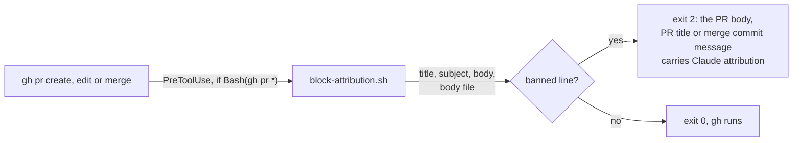
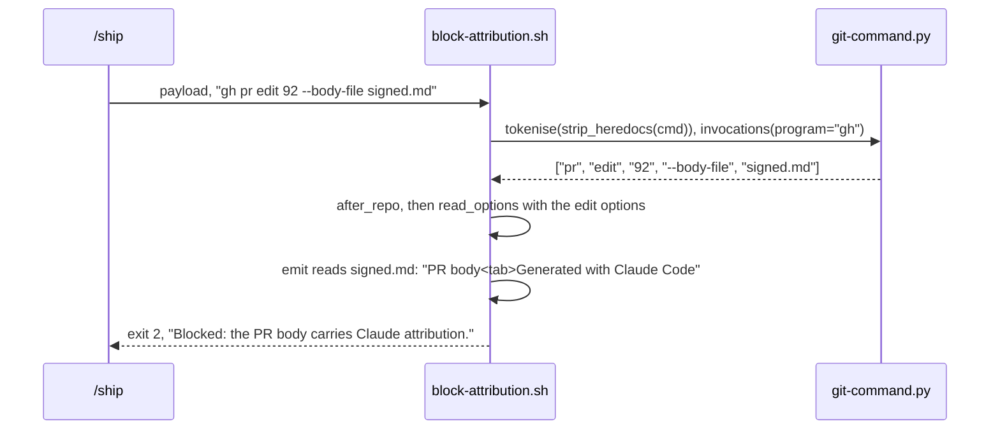

# PR edit attribution

**Version:** v1 · **Status:** Shipped · **Type:** Bug · **Project type:** CLI/Library

**Depends on:** None

The attribution hook reads `gh pr edit` and `gh pr merge` as it reads
`gh pr create`. A PR body that `/ship` replaces, or a merge commit message,
can no longer carry Claude attribution past the hook.

## Problem

`references/git-naming.md` bans Claude attribution in each commit message, PR
body, tag message and release notes. `block-attribution.sh` reads only
`gh pr create` and its alias `gh pr new` (`block-attribution.sh:147`).
`hooks.json` already sends each `gh pr` call to the hook, but the hook finds no
text in the others and exits 0. Each row was run on `main` at `780d238`
(v2.4.0), with a body file that ends "Generated with Claude Code":

| Command | `block-attribution.sh` |
| --- | --- |
| `gh pr create -t 'feat(export): write ledger csv' --body-file signed.md` | exit 2 |
| `gh pr edit 92 --body-file signed.md` | exit 0 |
| `gh pr edit 92 -t 'feat: x Generated with Claude Code'` | exit 0 |
| `gh pr merge 92 --squash --body 'Generated with Claude Code'` | exit 0 |
| `gh pr merge 92 --squash -t 'feat: x' -F signed.md` | exit 0 |

Since decision-pr, `/ship` replaces the PR body with
`gh pr edit --body-file` when a row lands after the PR is open
(`skills/ship/SKILL.md:198`). `gh pr merge --subject` and `--body` write the
merge commit on the base branch, so that text goes into `main`'s history.

## Slice test

| Check | Result |
| --- | --- |
| Cuts every layer it needs | yes. The hook's parser and its message. `hooks.json` already routes `gh pr`. |
| One e2e test walks it | yes. `test-block-attribution.sh` sends real hook payloads to the real script. |
| Worth shipping alone | yes. A signed PR body or merge commit is blocked before it is public. |
| Fits (≤5 scenarios, ≤2 areas) | yes. 4 scenarios. One area: the attribution hook and its test. |

**Path:** light. A bug fix in two files, with no new interface, data or
dependency. Pauses 1 and 3 are one pause, and pause 2 is skipped.

## Flow



## Acceptance criteria

```gherkin
Scenario: A replaced PR body is read
  Given signed.md ends with "Generated with Claude Code"
  When /ship runs "gh pr edit 92 --body-file signed.md"
  Then block-attribution.sh exits 2 with "Blocked: the PR body carries Claude attribution."

Scenario: A new PR title is read
  When /ship runs "gh pr edit 92 -t 'feat(export): write ledger csv, Generated with Claude Code'"
  Then block-attribution.sh exits 2 with "Blocked: the PR title carries Claude attribution."

Scenario: A merge commit message is read
  When the main thread runs "gh pr merge 92 --squash --subject 'feat(export): write ledger csv' --body 'Generated with Claude Code'"
  Then block-attribution.sh exits 2 with "Blocked: the merge commit message carries Claude attribution."
  And "gh pr merge 92 --squash -F signed.md" exits 2 the same way

Scenario: A clean edit and a plain merge pass
  Given clean.md holds the rendered body, with no attribution
  When /ship runs "gh pr edit 92 --body-file clean.md", then "gh pr merge 92 --merge"
  Then block-attribution.sh exits 0 for each
```

## Scope

**In:**

- `block-attribution.sh` reads `gh pr edit`: `-b`/`--body` and `-t`/`--title`
  as text, `-F`/`--body-file` as a file. The labels are "PR body" and
  "PR title", as for `gh pr create`.
- `block-attribution.sh` reads `gh pr merge`: `-b`/`--body` and
  `-t`/`--subject` as text, `-F`/`--body-file` as a file. The label is
  "merge commit message".
- `-R`/`--repo` before the subcommand is dropped, as it is for `create`.
- New cases in `test-block-attribution.sh` for scenarios 1 to 4.

**Out:**

- `gh pr comment` and `gh pr review` bodies (O1). `git-naming.md` does not
  ban attribution in comments or reviews. No slice picks them up.
- The GitHub MCP tools. D20 rejected them, and they are not connected here.

## Technical plan

### Approach

The `gh pr` loop at `block-attribution.sh:147` already drops `-R` and reads
`create` and `new`. It gets two more cases, which call the same
`read_options` with the options for `edit` and `merge`. No other part
changes. The hook's block message already names each label that carried a
banned line. The settings hint prints for each label that has "commit
message" in it, so a merge commit message gets it too.



Relies on: D20 (the hook reads PR bodies and titles from the command line
only), and D54, drafted here.

### Changes

| File | Change | Why |
| --- | --- | --- |
| `plugins/zuko/scripts/block-attribution.sh:147` | After `after_repo`, `edit` calls `read_options` with `--body`, `--body-file`, `--title` and `b`, `F`, `t`, as `create` does. `merge` calls it with `--body`, `--body-file`, `--subject` and `b`, `F`, `t`, labelled "merge commit message". `drop_equals=True` for both, as gh's flag parser takes `-F=path`. Each other option of `edit` and `merge` that takes a value, such as `-B`, `-m`, `-A` or `--add-label`, takes its value and emits nothing (O3). The header comment at `:2` and the one at `:13` name the two subcommands. | Scenarios 1 to 3. |
| `plugins/zuko/references/git-naming.md:32` | The list of commands that the hook blocks also names `gh pr edit` and `gh pr merge` (O2). | Scenarios 1 to 3. |
| `plugins/zuko/scripts/tests/test-block-attribution.sh` | Scenarios 1 to 4 as hook payloads, with `signed.md` and `clean.md` in `$work`. `gh pr -R o/r edit` too. | All. |

Reusing: `read_options`, `after_repo`, `emit` and its file read, the banned
pattern, and the block message. `hooks.json`'s `if: Bash(gh pr *)` route.

### Earn-it

No new layer, option or dependency.

### Non-functionals

| | |
| --- | --- |
| **Load** | Two more comparisons for each `gh pr` call. |
| **Breaks first** | A `gh pr edit` or `gh pr merge` whose text carries a banned line is blocked. The message says which text. |
| **Security surface** | The hook reads the command text and a body file that the command names, up to 1 MB, as it does for `create`. No secret and no stored data. |
| **Proof it works** | `run.sh block-attribution` passes, with the four signed rows of the Problem table as cases that block. |
| **Rollout** | No flag. Rollback: `git revert` the fix commit. |

### Test plan

| Scenario | Test |
| --- | --- |
| 1. Replaced body | `test-block-attribution.sh`: `gh pr edit 92 --body-file`, `-F` and `-b`, each exit 2 with the PR body message. |
| 2. New title | `test-block-attribution.sh`: `gh pr edit 92 -t`, exit 2 with the PR title message. |
| 3. Merge commit | `test-block-attribution.sh`: `gh pr merge` with `--body`, `--subject` and `-F`, each exit 2 with the merge commit message. |
| 4. Clean edit and merge | `test-block-attribution.sh`: `gh pr edit 92 --body-file clean.md` and `gh pr merge 92 --merge`, each exit 0. |

```bash
bash plugins/zuko/scripts/tests/run.sh block-attribution
bash plugins/zuko/scripts/tests/run.sh
```

**E2E:** `test-block-attribution.sh` sends a real hook payload for each
scenario to the real `block-attribution.sh`.

### Chunks

Single chunk. The tests first, then the two cases in `block-attribution.sh`.

### Risks

| Risk | Mitigation |
| --- | --- |
| A PR body or merge text that only names the banned line, such as a PR about this hook, is blocked. | The same is true for `create` today. The block message shows the line, and the text can name it in other words. |

### Decisions to record

Recorded as D54.

## Review

2026-10-13 · 1 raw finding, 1 survived, 1 fixed.

- correctness · `plugins/zuko/scripts/block-attribution.sh:164` · each `gh pr edit` and `gh pr merge` option that takes a value takes it, so `-Bnext` no longer hides the body · `86a0c9f`

## Open items

| ID | What | Type | Raised at | Owner | Status | Answer |
| --- | --- | --- | --- | --- | --- | --- |
| O1 | Which `gh pr` subcommands does the hook read, after `create`? `gh pr merge --subject` and `--body` write the merge commit on `main`. `gh pr comment` and `gh pr review` post comments. | question | spec p1 | user | Resolved | `edit` and `merge`. `git-naming.md` bans attribution in a PR body and a commit message, and not in a comment. 2026-10-13 |
| O2 | The plan named `block-attribution.sh` and its test only. `git-naming.md:32` lists each command that the hook blocks, and `test-block-attribution.sh` checks that list, so it would name `gh pr create` and not `gh pr edit` or `gh pr merge`. | flag | build | user | Decided alone | Chose: name `gh pr edit` and `gh pr merge` in `git-naming.md`, and check both in the test. Other: leave the list at the four commands it named. Undo: put back the old sentence in `git-naming.md` and the old pattern in `test-block-attribution.sh`, both in b1c6cdf. 2026-10-13 |
| O3 | `/review`: the edit and merge tables knew only `-b`, `-F` and `-t`. A value-taking option they did not know, such as `-Bnext`, read its value as `-t`, took `--body` as the title, and `gh pr edit 92 -Bnext --body` with a signed body passed. The finding named the short options. The long ones, such as `--add-label -t --body`, fail the same way. | flag | review | user | Decided alone | Chose: list every value-taking option of `gh pr edit` and `gh pr merge`, short and long, from gh 2.101.0's help. Other: list only the short options that the finding named. Undo: git revert 86a0c9f. 2026-10-13 |
| O4 | `/review` found the same gap outside this slice: `gh pr create -Bnext --body` and `gh release create v2.4.1 --target -t -n`, each with a signed text, pass the hook on `main` too. | flag | review | user | Decided alone | Chose: leave `create` and `release create` as they are, because no scenario needs them. Other: give them the same value-option tables here. Undo: run /zuko:debug on it, or spec a slice with /spec. 2026-10-13 |

_Never delete this section or its rows. See references/ledger.md._

## Glossary

- **Attribution** — a line that signs Claude's name, such as "Generated with
  Claude Code" or a Co-Authored-By trailer.
- **Merge commit message** — the subject and body of the commit that
  `gh pr merge` makes on the base branch.
- **e2e** — end-to-end: one test that walks the whole slice.
