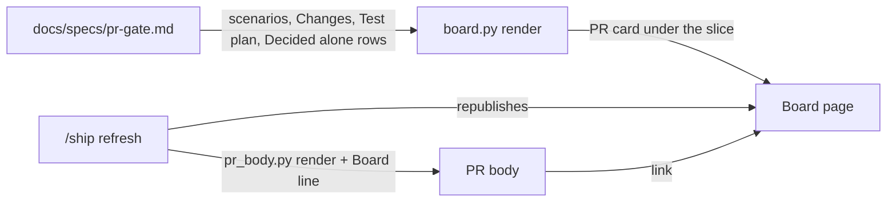

# PR gate

**Version:** v1 · **Status:** Draft · **Type:** Feature · **Project type:** CLI/Library

**Shape doc:** docs/specs/living-board/shape.md
**Depends on:** idea-board

`/ship` puts a PR card on the board: each acceptance scenario next to the files and the tests that the spec names for it, and the choices made without the user. The PR body links the board, so the user reviews the PR from one picture.

## Problem

At the PR, the user cannot tie the code back to the spec. The PR body lists the choices made alone and the review result, but not which file or test answers which scenario. The spec holds that link in two tables, Changes and Test plan, 300 lines below the scenarios. So the user merges without following, or asks Claude which test proves scenario 3.

## Slice test

| Check                         | Result                                                                                      |
| ----------------------------- | ------------------------------------------------------------------------------------------- |
| Cuts every layer it needs     | yes: `/ship`'s board and PR body steps, `board.py`, and the board page                      |
| One e2e test walks it         | yes: render a fixture idea with a Built spec and check the card, then render the PR body    |
| Worth shipping alone          | yes: the user reads each scenario with its proof at every PR, with no other slice shipped   |
| Fits (≤5 scenarios, ≤2 areas) | yes: 5 scenarios; the board builder and the `/ship` steps                                   |

**Path:** full — it adds a new part to the board page and a new line to every PR body.

## User story

As the person who merges each zuko PR, I want each scenario shown next to the files and tests that meet it, so that I can check the PR against the spec without asking Claude.

## Flow



At `/ship`, `board.py` reads the slice's spec and builds the PR card from its scenarios and its two tables. `/ship` republishes the board, then opens the PR with a link to it.

## Acceptance criteria

```gherkin
Scenario: /ship puts the PR card on the board
  Given docs/specs/gate-card.md is Built, with 5 scenarios, a Changes table and a Test plan table
  When /ship gate-card republishes the board
  Then gate-card's section shows a PR card with 5 rows, one per scenario, in order
  And the row "a later pause shows what changed since the last stop" lists test-gate.sh with its command
  And it lists the files whose Changes row names scenario 2, such as plugins/zuko/scripts/lib/board.py
  And under the rows, the card lists the 7 Decided alone rows, each with its Chose and Undo

Scenario: the PR body links the board
  Given docs/specs/living-board/shape.md has the line "**Board:** https://claude.ai/artifact/6ZvDtf657jw6ohs94cyYvs"
  When /ship opens the PR for gate-card
  Then the PR body's last line reads "Spec: docs/specs/gate-card.md · Board: https://claude.ai/artifact/6ZvDtf657jw6ohs94cyYvs"

Scenario: a scenario that no test names
  Given scenario 3 of a spec has no row in its Test plan
  When the board renders
  Then that scenario's row says "No test named in the Test plan" in amber
  And the other rows show as usual

Scenario: a scenario that no file names
  Given no Changes row of a spec names scenario 4
  When the board renders
  Then that scenario's row says "No file named in Changes" in amber

Scenario: a spec with no board
  Given docs/specs/pentest.md has no **Shape doc:** line
  When /ship opens the PR for pentest
  Then the PR body's last line reads "Spec: docs/specs/pentest.md", as today
```

## Scope

**In:** a PR card on the board for each slice; one row per scenario with its tests and files from the spec's Test plan and Changes tables; the Decided alone rows under the rows; amber notes for a scenario with no test or no file; the Board link on the PR body's last line.

**Out:**

- Test results, pass or fail, on the card. CI and the PR show those.
- Checking the named files against the branch's real diff.
- A board for a spec with no shape: **library**.
- Stepping back through older PRs: **replay**.

## Open items

| ID | What | Type | Raised at | Owner | Status | Answer |
| --- | --- | --- | --- | --- | --- | --- |
| O1 | Where does the card get the files and tests for each scenario? | question | spec p1 | user | Open | — |
| O2 | When does the PR card show: only on the render that `/ship` makes, or on every render once the slice is Built? | question | spec p1 | user | Open | — |
| O3 | Does the PR body link the board, or open the board on this slice with a deep link? | question | spec p1 | user | Open | — |
| O4 | Does the card repeat the Decided alone rows that the Answers panel and the PR body already show? | question | spec p1 | user | Open | — |

## Glossary

- **Board** — the claude.ai page for one idea, rebuilt from its shape, specs and decisions.
- **PR card** — the part of the board that ties each scenario to its files and tests.
- **Ledger** — the Open items table in a spec or shape.
- **e2e** — end-to-end: one test that walks the whole slice as a user would.
