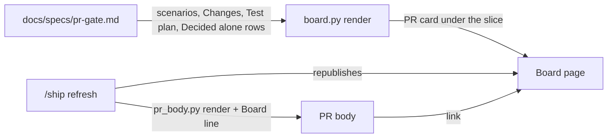
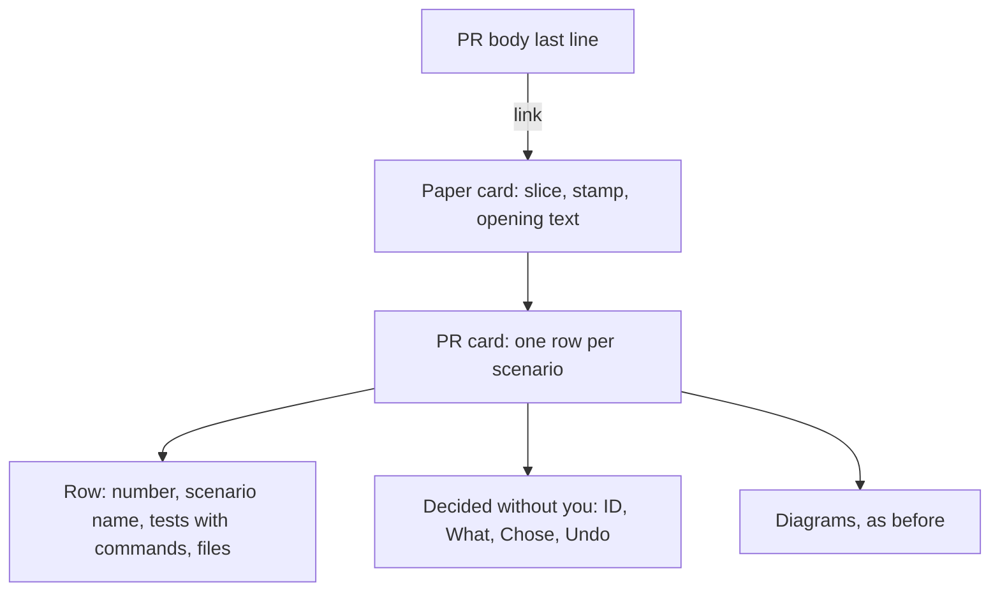
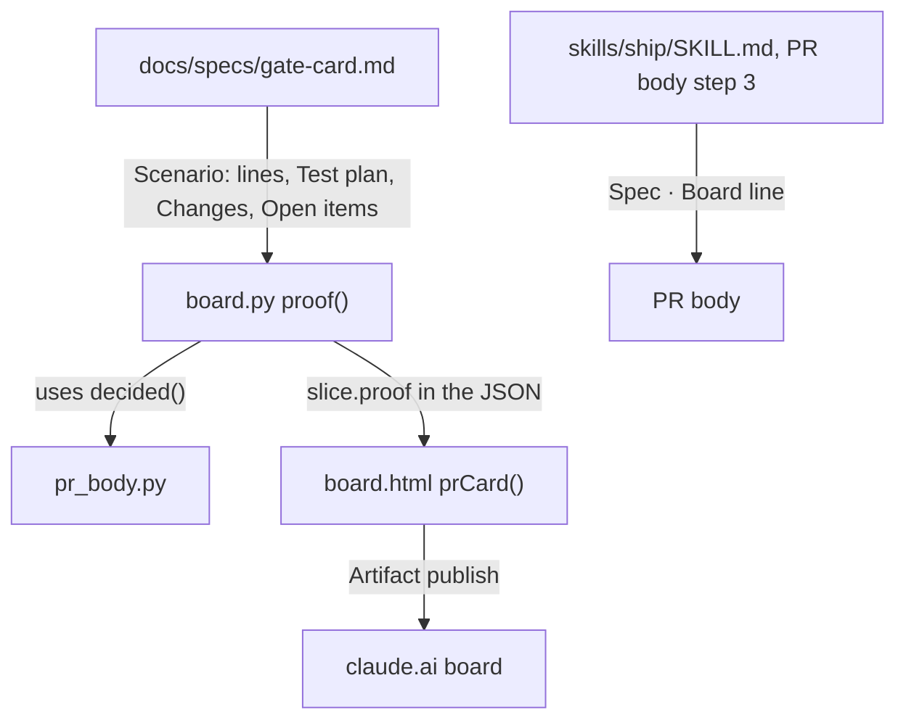

# PR gate

**Version:** v1 · **Status:** Refined · **Type:** Feature · **Project type:** CLI/Library

**Shape doc:** docs/specs/living-board/shape.md
**Depends on:** idea-board

`/ship` puts a PR card on the board: each acceptance scenario next to the files and the tests that the spec names for it, and the choices made without the user. The PR body links the board, so the user reviews the PR from one picture.

## Problem

At the PR, the user cannot tie the code back to the spec. The PR body lists the choices made alone and the review result, but not which file or test answers which scenario. The spec holds that link in two tables, Changes and Test plan, 300 lines below the scenarios. So the user merges without following, or asks Claude which test proves scenario 3.

## Slice test

| Check                         | Result                                                                                      |
| ----------------------------- | ------------------------------------------------------------------------------------------- |
| Cuts every layer it needs     | yes: `/ship`'s board and PR body steps, `board.py`, and the board page                      |
| One e2e test walks it         | yes: render a fixture idea with a Built spec and check the card, then render the PR body    |
| Worth shipping alone          | yes: the user reads each scenario with its proof at every PR, with no other slice shipped   |
| Fits (≤5 scenarios, ≤2 areas) | yes: 5 scenarios; the board builder and the `/ship` steps                                   |

**Path:** full — it adds a new part to the board page and a new line to every PR body.

## User story

As the person who merges each zuko PR, I want each scenario shown next to the files and tests that meet it, so that I can check the PR against the spec without asking Claude.

## Flow



At `/ship`, `board.py` reads the slice's spec and builds the PR card from its scenarios and its two tables. `/ship` republishes the board, then opens the PR with a link to it.

## Acceptance criteria

```gherkin
Scenario: /ship puts the PR card on the board
  Given docs/specs/gate-card.md is Built, with 5 scenarios, a Changes table and a Test plan table
  When any stage republishes the board
  Then gate-card's section shows a PR card with 5 rows, one per scenario, in order
  And the row "a later pause shows what changed since the last stop" lists test-gate.sh with its command
  And it lists the files whose Changes row names scenario 2, such as plugins/zuko/scripts/lib/board.py
  And under the rows, the card lists the 7 Decided alone rows, each with its Chose and Undo

Scenario: the PR body links the board
  Given docs/specs/living-board/shape.md has the line "**Board:** https://claude.ai/artifact/6ZvDtf657jw6ohs94cyYvs"
  When /ship opens the PR for gate-card
  Then the PR body's last line reads "Spec: docs/specs/gate-card.md · Board: https://claude.ai/artifact/6ZvDtf657jw6ohs94cyYvs"

Scenario: a scenario that no test names
  Given scenario 3 of a spec has no row in its Test plan
  When the board renders
  Then that scenario's row says "No test named in the Test plan" in amber
  And the other rows show as usual

Scenario: a scenario that no file names
  Given no Changes row of a spec names scenario 4
  When the board renders
  Then that scenario's row says "No file named in Changes" in amber

Scenario: a spec with no board
  Given docs/specs/pentest.md has no **Shape doc:** line
  When /ship opens the PR for pentest
  Then the PR body's last line reads "Spec: docs/specs/pentest.md", as today
```

## Scope

**In:** a PR card on the board for each slice at Built, Reviewed or Shipped; one row per scenario with its tests and files from the spec's Test plan and Changes tables; the Decided alone rows under the rows; amber notes for a scenario with no test or no file; the Board link on the PR body's last line.

**Out:**

- Test results, pass or fail, on the card. CI and the PR show those.
- Checking the named files against the branch's real diff.
- A board for a spec with no shape: **library**.
- Stepping back through older PRs: **replay**.

## Interface

**Preview:** https://claude.ai/artifact/94oQVZH4y75WTmfKPmgaFP. It is built from the real `living-board` board and the real gate-card spec. Its two buttons show gate-card as built, and gate-card with one test and one file taken out, so the amber notes show. The buttons exist only in the preview.



The PR card sits on the paper, under the opening text and above the diagrams. Each row reads from left to right: the scenario, the tests that prove it, and the files that change for it.

**The card**

It shows for a slice at Built, Reviewed or Shipped, on every render.

| Part | What it shows | From |
| --- | --- | --- |
| Heading | `PR card · what meets each scenario`, and on the right `from Test plan and Changes` | — |
| Row | The scenario number, its name, each test with its command under it, and each file | `Scenario:` lines; Test plan rows whose first cell starts with that number; Changes rows whose Why cell names that scenario |
| No test | `No test named in the Test plan`, in amber, in the Tests column | — |
| No file | `No file named in Changes`, in amber, in the Files column | — |
| Decided without you | `Decided without you · <n>`, then each row with a violet edge: its ID and What, then `Chose` and `Undo` | Decided alone rows, split as `pr_body.py` splits them |

A file shows once per row, without its line number: `board.py:244` and `board.py` are one file. A Changes row whose Why cell names no scenario, such as `The Interface section`, joins no row. On a narrow screen, the Tests and Files columns move under the scenario name.

**The PR body**

The last line gains the board link when the spec's shape has a `**Board:**` line:

```
Spec: docs/specs/gate-card.md · Board: https://claude.ai/artifact/6ZvDtf657jw6ohs94cyYvs
```

With a `**Page:**` line too, the order is `Spec · Page · Board`. With no board, the line is as today.

## Technical plan

### Approach

`board.py` gains a `proof()` function. For each slice at Built, Reviewed or Shipped, it reads the spec's scenarios, its Test plan and Changes tables, and its Decided alone rows, and adds a `proof` object to that slice in the JSON. `board.html` draws it on the paper with a new `prCard()`. `/ship`'s PR body step adds the board link to the last line. The same build fixes the empty gate-card bar on the localhost board.

Relies on: D46 (the PR body order), D50 (one parser for spec rows), D62 (a script renders the board). Drafted below: D68, D69.



`proof()` reads only the spec, so the card is the same before and after the merge. `/ship` writes the link into the PR body by hand, as it already writes the Spec line.

```mermaid
sequenceDiagram
  participant S as /ship pr-gate
  participant B as board.py
  participant F as docs/specs/pr-gate.md
  participant A as Artifact tool
  participant G as gh pr create
  S->>B: render shape.md --by "/ship pr-gate"
  B->>F: read Status, Scenario lines, Test plan, Changes, Open items
  B-->>S: HTML with slices[n].proof
  S->>A: publish the board
  S->>S: write the PR body; last line Spec · Board
  S->>G: --body-file .git/zuko-pr-body.md
```

**How the script builds the proof**

| Part | Rule |
| --- | --- |
| When | The slice's `stage()` is 5, 6 or 7. Otherwise `proof` is `null` |
| Scenarios | Each `Scenario:` line in the fence under `## Acceptance criteria`, numbered 1 to N in order, with `scenarios()` |
| A table | The first table under `### Test plan` or `### Changes`, outside fences. Columns are found by header name: `Scenario`, `Test` and `Command`; `File` and `Why`. A cell is split on `\|` outside backticks, so `` `render\|data` `` stays one cell |
| Numbers | A Test plan row belongs to the scenarios that its Scenario cell starts with. A Changes row belongs to the scenarios that its Why cell names after `Scenario` or `Scenarios`, case ignored. Both read a list such as `1`, `1, 2, 5`, `2, 3 and 5` or `1 to 5` |
| Tests | Test and Command cells with backticks taken off |
| Files | The first code span of the File cell, with a `:<line>` end taken off. One file shows once per row |
| Decided without you | `pr_body.decided()` on the Open items lines: ID, What, Chose and Undo, the date taken off |

### Changes

| File | What changes | Why |
| --- | --- | --- |
| `plugins/zuko/scripts/lib/board.py:80` | A backtick-aware cell split for the proof tables. `cells()` keeps its current split for the slice and ledger tables | Scenarios 1, 3, 4 |
| `plugins/zuko/scripts/lib/board.py` (new functions after `gate`, `:380`) | `numbers`, `table` and `proof` | Scenarios 1, 3, 4 |
| `plugins/zuko/scripts/lib/board.py:422` | `one_slice` adds `"proof": proof(text, found, stage)`; a slice with no spec gets `null` | Scenarios 1, 3, 4 |
| `plugins/zuko/scripts/lib/board.html:137` | `.gate[hidden] { display: none; }`, so the localhost board has no empty bar (O5) | O5 |
| `plugins/zuko/scripts/lib/board.html` (paper template in `pick`) | `prCard(s)` under the opening text, with its CSS from the preview, without the preview's buttons. Every value goes through `esc()` | Scenarios 1, 3, 4 |
| `plugins/zuko/skills/ship/SKILL.md:151` | Step 3 of the body: add ` · Board: ` and the link when the spec's shape has a `**Board:**` line. Order: Spec, Page, Board | Scenarios 2, 5 |
| `plugins/zuko/scripts/tests/test-decision-pr.sh:35` | The check that pins step 3 matches the new text | Scenarios 2, 5 |

Reusing: `pr_body.sections`, `pr_body.decided` and `pr_body.FENCE` (`scripts/lib/pr_body.py:39`); `board.stage`, `board.raw_sections`, `board.scenarios` and `board.blob`; `esc()` in `board.html`; the helpers in `scripts/tests/run.sh`.

### Earn-it

| Added | Triggered by |
| --- | --- |
| `proof()` and its JSON | Scenarios 1, 3 and 4, and a test that checks the data, not the HTML |
| A second cell split | The gate-card spec has `` `render\|data` `` in a Changes cell. The current split would move its Why cell, so a row would join the wrong scenarios |

### Non-functionals

|                      |                                                                               |
| -------------------- | ----------------------------------------------------------------------------- |
| **Load**             | One more pass over each Built or later spec at each render: about 5 specs of up to 40 KB |
| **Breaks first**     | At 10×, 50 slices: the page gains about 50 cards of 5 rows. Still under 2 MB, far below the 16 MB limit |
| **Security surface** | Called by Claude in a stage. It reads repo Markdown only. Every value reaches the page through `blob()` and `esc()`. No secrets, no network, no stored data |
| **Proof it works**   | The PR body's last line `Spec: docs/specs/pr-gate.md · Board: https://claude.ai/artifact/…`, and the PR card under pr-gate on the board |
| **Rollout**          | No flag: it ships with the next zuko release. Rollback: revert the merge |

### Test plan

| Scenario | Test | Command |
| --- | --- | --- |
| 1 the PR card | `test-pr-card.sh`: a Built fixture spec with 3 scenarios gives 3 rows with their tests, commands and files; `:244` is taken off and a file shows once; a `` `a\|b` `` cell keeps its Why; `Scenarios 2, 3 and 5` and `1 to 3` read right; the Decided alone rows have Chose and Undo; a Draft spec gives `null` | `bash plugins/zuko/scripts/tests/run.sh pr-card` |
| 2 the PR body link | `test-decision-pr.sh`: step 3 names ` · Board: ` and the order Spec, Page, Board | `bash plugins/zuko/scripts/tests/run.sh decision-pr` |
| 3 no test | `test-pr-card.sh`: a scenario with no Test plan row has an empty `tests` list | `bash plugins/zuko/scripts/tests/run.sh pr-card` |
| 4 no file | `test-pr-card.sh`: a scenario that no Why cell names has an empty `files` list | `bash plugins/zuko/scripts/tests/run.sh pr-card` |
| 5 no board | `test-decision-pr.sh`: step 3 adds the Board part only when the shape has a `**Board:**` line | `bash plugins/zuko/scripts/tests/run.sh decision-pr` |
| The page | `test-board-dom.sh`: the card draws under the opening text; an `` in a scenario name shows as text; the amber notes show for empty lists; with no gate, the gate card's computed display is `none` | `bash plugins/zuko/scripts/tests/run.sh board-dom` |

**E2E:** `scripts/tests/test-e2e-pr-card.sh` copies the real `docs/specs/gate-card.md` and `docs/specs/idea-board.md` into a fixture idea, renders the board, and checks both cards: gate-card has 5 rows, each with `test-gate.sh` and its files, and 8 Decided alone rows; idea-board has 5 rows. The real publish and the PR body line are checked by hand at the next `/ship`.

### Chunks

Single chunk.

### Risks

| Risk | Mitigation |
| --- | --- |
| A spec's Test plan names scenarios in words, not numbers, as idea-board's "The stage steps" row does | That row joins no scenario. The card shows what the numbered rows give, and the amber note shows a scenario with no row |
| A Why cell names scenarios in a form the reader misses, such as "the first three" | The amber note shows it. `/spec` writes "Scenarios 1, 2" in every spec so far |
| Most Changes rows say "Scenarios 1 to 5", so each row lists the same files | The card shows what the spec says. A plan that names its scenarios more closely gets a closer card |

### Decisions to record

```text
## D68 · 2026-10-26 · The PR card reads the spec's Test plan and Changes tables, not the branch diff

Why: the card must still show what met each scenario after the merge, when the branch is gone (pr-gate O1). The spec's Test plan names a test per scenario, and each Changes row names its scenarios, so the spec alone ties each scenario to its tests and files.
Rejected: the spec checked against the branch diff (works only while the branch exists), the diff alone (it cannot tell which scenario a file serves).
Source: specs/pr-gate.md
Status: active

## D69 · 2026-10-26 · The PR card shows on every render for a slice at Built or later

Why: a shipped slice keeps a record of what met each scenario, which is the shape's "what a shipped slice changed" pain (pr-gate O2). The card reads only the spec, so any stage can draw it.
Rejected: the card only on the render that /ship makes (the next stage's render would drop the record).
Source: specs/pr-gate.md
Status: active
```

## Open items

| ID | What | Type | Raised at | Owner | Status | Answer |
| --- | --- | --- | --- | --- | --- | --- |
| O1 | Where does the card get the files and tests for each scenario? | question | spec p1 | user | Resolved | The spec's tables: Test plan rows that start with the scenario number, and Changes rows whose Why cell names the scenario. No git, so it works after the merge too, 2026-10-26 |
| O2 | When does the PR card show: only on the render that `/ship` makes, or on every render once the slice is Built? | question | spec p1 | user | Resolved | Every render, for a slice at Built, Reviewed or Shipped, so a shipped slice keeps its record, 2026-10-26 |
| O3 | Does the PR body link the board, or open the board on this slice with a deep link? | question | spec p1 | user | Resolved | The board URL, on the PR body's last line. No deep link, 2026-10-26 |
| O4 | Does the card repeat the Decided alone rows that the Answers panel and the PR body already show? | question | spec p1 | user | Resolved | Yes, each with its Chose and Undo parts, 2026-10-26 |
| O5 | The shipped `board.html` gives the gate card `display: grid`, which beats its `hidden` attribute, so the localhost board shows an empty amber bar when no gate waits. | flag | spec p2 | user | Resolved | Fold the one-line fix into this build, with a DOM test check, 2026-10-26 |

## Glossary

- **Board** — the claude.ai page for one idea, rebuilt from its shape, specs and decisions.
- **PR card** — the part of the board that ties each scenario to its files and tests.
- **Ledger** — the Open items table in a spec or shape.
- **D-entry** — one numbered entry in `DECISIONS.md`: a choice, why, and what was rejected.
- **Code span** — text between backticks in Markdown.
- **e2e** — end-to-end: one test that walks the whole slice as a user would.
