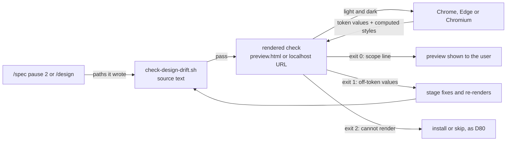
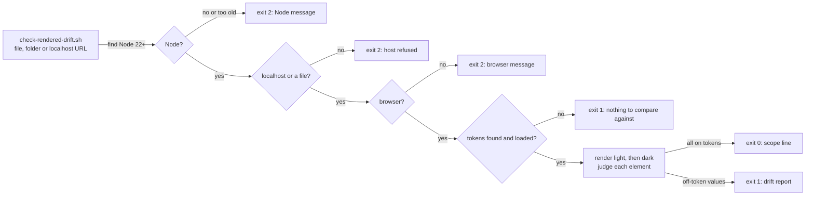
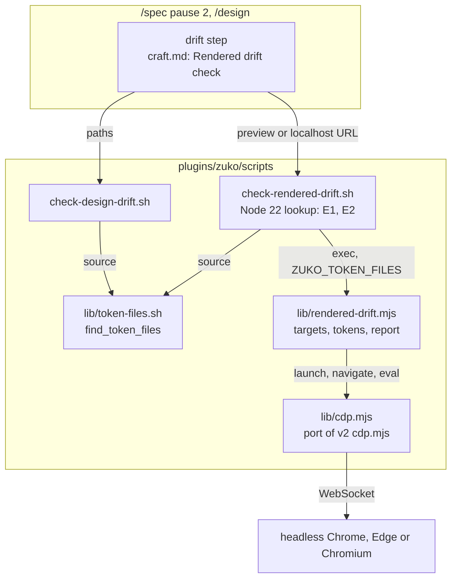
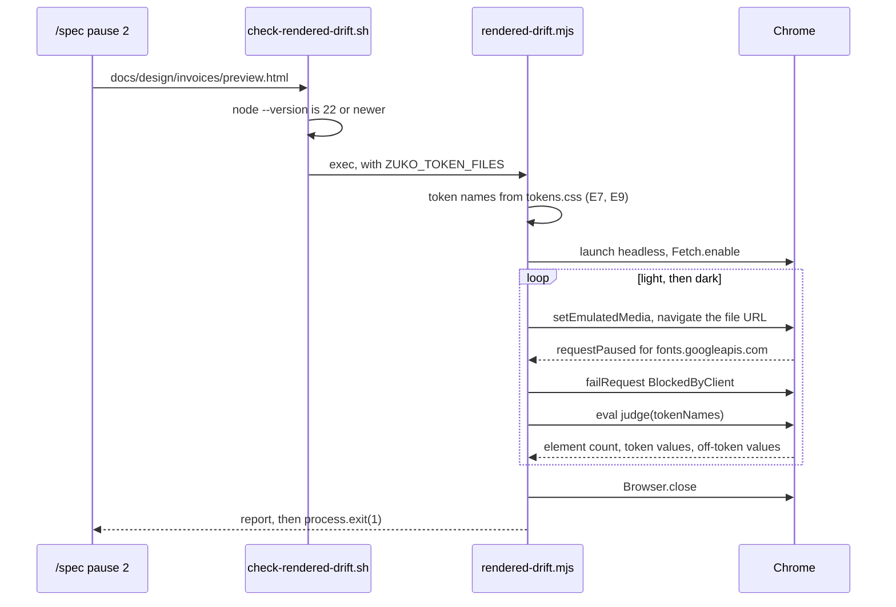

# Rendered drift check

**Version:** v1 · **Status:** Built · **Type:** Feature · **Project type:** CLI/Library
**Depends on:** taste-skill-upgrade
**Page:** https://claude.ai/artifact/4LMxFsJzU4csMXsqKgn3xo

A new zuko gate opens the preview in a real browser and checks each element's
computed style against the design system's token values. The static
`check-design-drift.sh` reads source text only, so a colour written as `rgb()`,
`hsl()` or a name, or set by a script, reaches the user unchecked.

## Problem

- `check-design-drift.sh:83` finds raw colours with one pattern, `#[0-9a-fA-F]{3,8}`.
  `color: rgb(220, 38, 38)`, `hsl(0 0% 13%)`, `color: crimson` and
  `el.style.background = '…'` all pass it.
- The token check at `check-design-drift.sh:140` finds only a `var(--x)` with
  an unknown name. A component library or a Tailwind palette class such as
  `bg-red-600` puts a colour on the page with no `var()` in the source.
- The v2 inspector renders the page, but it judges the v2 house style. It does
  not know the product's tokens. It is also a repo-local skill, so zuko users
  do not get it (taste-skill-upgrade, Scope Out).
- A drifted preview reaches the user at `/spec` pause 2 and `/design`. The user
  then finds the drift by eye, or does not find it.

## Slice test

| Check                         | Result                                                                                           |
| ----------------------------- | ------------------------------------------------------------------------------------------------ |
| Cuts every layer it needs     | yes: one new script, its test, and the drift step in `/spec` pause 2 and `/design` that run it    |
| One e2e test walks it         | yes: one test renders a fixture preview with a real browser, and walks scenarios 1 to 3 and 5    |
| Worth shipping alone          | yes: a preview with an off-token colour stops before the user sees it, in any zuko project       |
| Fits (≤5 scenarios, ≤2 areas) | yes: 5 scenarios, two areas (gate scripts, design stages)                                        |

**Path:** full. This is a new gate with a new runtime need (Node and a browser), and two
stages change.

## Flow



The stage runs the static check, then the rendered check. Only a preview that passes both
reaches the user. A preview that cannot render never reads as a pass.

## Acceptance criteria

```gherkin
Scenario: A colour that the source check cannot see fails the rendered check
  Given docs/design/tokens.css defines --ink: #1a1a1a, --surface: #ffffff and --danger: #b42318
  And docs/design/invoices/preview.html sets ".overdue { color: rgb(220, 38, 38) }"
  And check-design-drift.sh passes on docs/design/invoices/preview.html
  When the rendered check runs on docs/design/invoices/preview.html
  Then it exits 1
  And it reports "both  td.overdue  color  rgb(220, 38, 38)" as a value that is not a token
  And it names the nearest token, "nearest --danger #b42318"

Scenario: A preview that uses only token values passes, and says what it checked
  Given docs/design/invoices/preview.html takes every colour from var(--ink), var(--surface) and var(--danger)
  When the rendered check runs on it
  Then it exits 0
  And it prints "Rendered drift check passed: 214 elements over 1 page, light and dark, against 18 token values."

Scenario: A drift in dark mode only is caught
  Given tokens.css sets --surface: #111111 under prefers-color-scheme: dark
  And the preview sets ".invoice-total { background: hsl(0 0% 20%) }" for dark mode only
  When the rendered check runs on the preview
  Then it exits 1
  And it reports "dark  div.invoice-total  background-color  rgb(51, 51, 51)"

Scenario: No browser or no Node is found
  Given a machine with no Chrome, Edge or Chromium, and no CHROME_PATH
  When the rendered check runs on docs/design/invoices/preview.html
  Then it exits 2, never 0
  And it prints "Rendered drift check could not run: no Chrome, Edge or Chromium found. Install one, or set CHROME_PATH."
  And the stage asks the user to install or to skip, as D80 says, and announces a skip

Scenario: No token file is found
  Given a project with a preview and no tokens*.css, theme.css, globals.css or tailwind.config.*
  When the rendered check runs on the preview
  Then it exits 1
  And it prints "Rendered drift check has nothing to compare against: no design system token file found."
```

## Scope

**In:**

- One new script in `plugins/zuko/scripts/` that renders a preview file, or a URL on
  `localhost` or `127.0.0.1`, and reports each off-token value. It refuses any other
  host with exit 2 (O6).
- It judges text, background, border and outline colours, font size, font family
  and corner radius (O1). It renders twice at 1440px: light, then
  `prefers-color-scheme: dark` (O2).
- It skips the contents of `img`, `svg`, `video`, `canvas` and `iframe`. It has no
  allow attribute: any other off-token value is a proposal to the design system (O5).
- The drift step of `/spec` pause 2 (step 7) and `/design` (step 5) runs it after
  `check-design-drift.sh`. A FAIL stops the preview, as a static FAIL does (O3).
  When Node or a browser is missing, the stage asks to install or skip, as D80 says
  (O4).
- Its tests, with one e2e test that drives a real browser.

**Out:**

- Hover, focus and other pseudo-states. The check reads each element at rest. A
  preview shows those states as their own frames, as `/spec` pause 2 step 6 says.
- The craft floors that a render can measure: contrast, touch targets, focus rings,
  overflow at 390px. Later slice `rendered-floors`.
- A PostToolUse or Stop hook that runs the check on each UI edit (issue #116).
  Later slice, after this one proves the check.
- Spacing (padding, margin, gap) against the spacing scale. Later slice
  `rendered-spacing`, when a real preview shows spacing drift that the eye missed.
- `/review` runs the rendered check on a UI slice. Later slice, with the hook from #116.
- Replace or change the v2 inspector. It stays as taste-skill-upgrade left it.

## Interface

The interface is one new command, its output and exit codes, and one new line in the drift
step of `/spec` pause 2 and `/design`.



The script checks that it can run before it renders anything. Exit 2 means that it could
not render, exit 1 means that the preview fails, and only exit 0 is a pass.

### Command

```
bash "${CLAUDE_PLUGIN_ROOT}/scripts/check-rendered-drift.sh" <target> [<target> ...]
```

| Argument | Accepts |
| --- | --- |
| `<target>` | An `.html` or `.htm` file. A folder: each `.html` file in it, the same skip list as `check-design-drift.sh`. A URL whose host is `localhost` or `127.0.0.1`, with `http` or `https`. |
| `-h`, `--help` | Prints the usage lines below and exits 0. |

| Environment | Use |
| --- | --- |
| `CLAUDE_PROJECT_DIR` | The project root where the token files are found. The default is `$PWD`. |
| `CHROME_PATH` | A browser to use in place of the search for Chrome, Edge or Chromium. |

There are no other flags. The modes and the width are fixed by D81.

Help text:

```
usage: check-rendered-drift.sh <file.html | folder | http://localhost:PORT/path> [...]
Renders each page in light and dark at 1440px, and fails on any colour, font size,
font family or corner radius that is not a design system token value.
Exit 0: pass. Exit 1: drift, or no tokens to compare. Exit 2: could not render.
```

### What it judges

The tokens are the CSS custom properties in the files that `check-design-drift.sh` finds:
`tokens*.css`, `theme.css`, `globals.css`. The browser resolves each token in the page,
so a token in `oklch()` or one that points at another token is compared by its final value.

| Property | Judged on | Passes when |
| --- | --- | --- |
| `color` | elements with their own text | it equals a colour token |
| `background-color` | every element | it equals a colour token, or it is fully transparent |
| `border-*-color` | each side with a width over 0 | it equals a colour token |
| `outline-color` | elements with an outline style that is not `none` | it equals a colour token |
| `font-size` | elements with their own text | it equals a size token |
| `font-family` | elements with their own text | its first family is the first family of a font token |
| `border-*-radius` | each corner over 0 | it equals a radius token |

The contents of `img`, `svg`, `video`, `canvas` and `iframe` are not judged (D83). A
token in shadcn's channel form, such as `--background: 0 0% 100%`, is a colour token: it is read
as `hsl(0 0% 100%)`. A colour matches when it is within 1 unit in each RGB channel, so `oklch()` rounding does
not fail a token.

### Output

A pass prints one line on stdout, and the scope is always in it:

```
Rendered drift check passed: 214 elements over 1 page, light and dark, against 18 token values.
```

A drift prints the pages, one line for each distinct value, and a fix line:

```
Rendered drift check FAILED: 3 values over 1 page are not design system tokens.

docs/design/invoices/preview.html
  both   td.overdue            color             rgb(220, 38, 38)  x4  nearest --danger #b42318
  dark   div.invoice-total     background-color  rgb(51, 51, 51)       nearest --surface #111111
  both   h2.section-title      font-size         22px              x3  nearest --text-lg 20px

Fix these with tokens and re-render before showing the user. A value the system lacks is a proposal to the system, not a one-off.
```

| Column | Means |
| --- | --- |
| mode | `light`, `dark`, or `both` when the same value fails in both |
| selector | the tag, then the `id` or the first class, as `td.overdue` |
| property | the computed property |
| value | the computed value, as the browser gives it |
| `xN` | how many elements have it, when more than one |
| nearest | the closest token of the same kind and its value |

A page shows its first 20 lines, then `... and 34 more`. A URL target shows the URL in
place of the path.

### Errors

Each error goes to stderr and starts with `Rendered drift check`.

| ID | When | Exit | Text |
| --- | --- | --- | --- |
| E1 | No Node | 2 | `Rendered drift check could not run: Node not found.` |
| E2 | Node older than 22 | 2 | `Rendered drift check could not run: Node v20.11.0 is older than 22.` |
| E3 | No browser | 2 | `Rendered drift check could not run: no Chrome, Edge or Chromium found. Install one, or set CHROME_PATH.` |
| E3 | `CHROME_PATH` is set, and no file is there | 2 | `Rendered drift check could not run: CHROME_PATH is /opt/chrome/chrome, and no browser is there.` |
| E4 | A URL on another host | 2 | `Rendered drift check refused https://staging.example.com/invoices: only localhost and 127.0.0.1 may be opened.` |
| E5 | No target can be rendered | 2 | `Rendered drift check rendered NOTHING: no .html file or localhost URL in docs/design/invoices/card.css.` |
| E6 | A page does not load, answers with HTTP 400 or more, or one of its scripts does not run or throws | 2 | `Rendered drift check could not load http://localhost:3000/preview/invoices: connection refused.` Or `...: HTTP 404.`, or `...: the script https://cdn.example.com/app.js was blocked, because it is not on localhost (D87).` |
| E7 | No token file | 1 | `Rendered drift check has nothing to compare against: no design system token file found.` |
| E8 | Token files found, but the page loads none of their tokens | 1 | `Rendered drift check has nothing to compare against: docs/design/invoices/preview.html loads none of the 18 tokens in docs/design/tokens.css.` |
| E9 | A `tailwind.config.*` is found, and no CSS file defines a custom property | 2 | `Rendered drift check could not run: the tokens live in tailwind.config.js, not in CSS variables.` |

A set `CHROME_PATH` is used alone. The script does not fall back to the search, so a wrong
path is an error and not a different browser.

The page may load only `localhost`, `127.0.0.1`, `file:` and `data:` resources (O9). When it
asks for other hosts, the script blocks the requests and names the hosts on stderr. This
note does not change the exit code:

```
Rendered drift check blocked 2 requests to other hosts: fonts.googleapis.com, fonts.gstatic.com.
```

E5 also applies when no target is given: the rendered check has no default folder. E5 also
applies when a path does not exist. A missing path with other targets that render
is named on stderr and skipped, as `check-design-drift.sh` does.

### Stage text

`/spec` pause 2 step 7 and `/design` step 5 add these lines after the static check:

```
bash "${CLAUDE_PLUGIN_ROOT}/scripts/check-rendered-drift.sh" <preview>
```

`<preview>` is `docs/design/{slice}/preview.html`, or the preview route URL on the
dev-server path. Exit 1 → fix with tokens and re-render, as for a static FAIL. Exit 1 with E7 → skip with
the reason `no design system token file`, and say that `/design-system` makes the tokens. Exit 2 with
E1, E2 or E3 → the install-or-skip prompt of the "taste-skill v2" section of `craft.md`,
with "the rendered drift check" in place of "the v2 inspector". On a skip, print:

```
Rendered drift check skipped: Node not found. check-design-drift.sh ran on docs/design/invoices/preview.html.
```

Exit 2 with E9 → print the skip line with the reason `tokens live in tailwind.config.js`. Do not
ask to install anything.

Exit 2 with E4, E5 or E6 → fix the call or start the dev server, then run it again.

## Technical plan

### Approach

A bash entry point finds Node 22 and the token files, then gives control to one Node
script. The script opens each page in headless Chrome over the DevTools protocol (CDP),
once in light and once in dark. A judge function runs inside the page. It resolves each
token and each element's computed style, and it converts each colour to 8-bit sRGB on a
canvas.

A spike on 2026-11-01 proved the path on this machine:

- Chrome returned `--ink: oklch(0.25 0 0)` as `oklch(...)`, not as `rgb()`.
- The canvas gave `34,34,34,255` for the token and for the `<p>` that used it.
- Dark emulation changed `--ink` to `#eeeeee`.
- Two renders took 1.9 s.

Relies on: D57, D80, D81, D82, D83, D84, D85, D86, D87, D88



Both gates get the token files from one function. The entry point checks Node, and the Node
script does all the browser work through the ported CDP client.



The script blocks remote requests during each render. It judges the page twice and merges the
two results into one report.

### Changes

| File | What changes | Why |
| ---- | ------------ | --- |
| `plugins/zuko/scripts/lib/token-files.sh` (new) | `find_token_files <dir>`: the `find` from `check-design-drift.sh:22-25`, moved without a change. | Scenario 5 and E7: the two gates must agree which files are the design system |
| `plugins/zuko/scripts/check-design-drift.sh:21-25` | Source `lib/token-files.sh` and call `find_token_files "$dir"`. No other change. | One list in one place |
| `plugins/zuko/scripts/check-rendered-drift.sh` (new) | `-h`. Finds `node` on `PATH`, then `$PROGRAMFILES/nodejs/node.exe`, as the "taste-skill v2" section of `craft.md` does. Prints E1 or E2. Exports `ZUKO_TOKEN_FILES` from `find_token_files`, then runs the Node script with `exec`. | Scenario 4, E1, E2 |
| `plugins/zuko/scripts/lib/cdp.mjs` (new) | A port of v2.1.5 `scripts/lib/cdp.mjs`, with its MIT notice. It keeps `findChrome`, `Browser.launch`, `send`, `on`, `newPage`, `close`, `Page.goto` and `Page.eval`. A set `CHROME_PATH` is used alone. Screenshots, wheel input and the profile sweep are not ported. | Scenarios 1 to 3: only a browser computes styles. D86 |
| `plugins/zuko/scripts/lib/rendered-drift.mjs` (new) | Sorts the targets: files and folders become `file:` URLs, and a URL needs the exact host `localhost` or `127.0.0.1` (E4, E5). Reads the `--name:` declarations from the CSS token files (E7, E9). Launches Chrome (E3), and blocks other hosts on `Fetch.requestPaused` (D87). Renders light, then dark with the media query, `class="dark"` and `data-theme="dark"` (D88). Waits for `load`, `document.fonts.ready` and two frames. Runs the judge, then checks E8. Merges the modes, prints the report, and calls `process.exit`. | Scenarios 1, 2, 3, 5, E3 to E9 |
| `plugins/zuko/references/craft.md:237` | New section "Rendered drift check", before "The two checks". It gives the command, the meaning of exit 1 and exit 2, the install-or-skip prompt with the rendered check's name, the E9 skip, and the skip line. | Scenario 4. One text for the two stages |
| `plugins/zuko/skills/spec/SKILL.md:148-162` | Step 7: after the static check, run `check-rendered-drift.sh` on the preview, as the "Rendered drift check" section of `craft.md` says. | Scenarios 1 to 4 |
| `plugins/zuko/skills/design/SKILL.md:48-53` | Step 5: the same line. | Scenarios 1 to 4 |
| `README.md:65` | A `check-rendered-drift` row in the table of what the scripts enforce. | The README names each gate |
| `plugins/zuko/scripts/tests/test-rendered-drift.sh` (new) | No browser. The entry point parses under `/bin/bash`. `-h` exits 0. E1: a `PATH` with no `node`, and `PROGRAMFILES` set to an empty folder. E2: a stub `node` that prints `v20.11.0`. `find_token_files` gives the list that `check-design-drift.sh` uses. | Scenario 4, E1, E2 |
| `plugins/zuko/scripts/tests/test-e2e-rendered-drift.sh` (new) | Real Node and browser: scenarios 1, 2, 3 and 5. Also E3 with a wrong `CHROME_PATH`, E4 for `http://localhost.evil.example/` and `http://127.0.0.1@evil.example/`, E5, E8 and E9. Also: `svg` contents are skipped, a `.dark`-class drift is caught, a blocked font request is named, and a run takes less than 15 s. When Node 22 or a browser is missing, the test records a FAIL that names the missing part. | The slice e2e |
| `plugins/zuko/scripts/tests/fixtures/rendered-drift/` (new) | `tokens.css` (light, dark media and `.dark`), `drift.html`, `clean.html`, `dark-class.html`, `no-tokens/`, `tailwind-only/`. | The e2e fixtures |

Reusing: the `find` and skip list of `check-design-drift.sh`; v2's `cdp.mjs` under its MIT
licence; `run.sh` with `expect_exit`, `expect_match` and `expect_no_match`; the stub on
`PATH` from `test-skill-pin.sh`; the Node lookup and the install-or-skip prompt from the
"taste-skill v2" section of `craft.md`.

### Earn-it

| Added | Triggered by |
| ----- | ------------ |
| Node as a zuko runtime | Scenarios 1 to 3. Only a browser computes styles, and Node 22 drives one with no package (D86). |
| `lib/cdp.mjs` as its own file | It is a port under the MIT notice of another project. A separate file keeps the notice with the code, and keeps a diff with upstream readable. |
| `lib/token-files.sh` | Scenario 5 and E7. With two copies of the list, the two gates can disagree about what the design system is. |
| A canvas conversion of each colour | Scenario 1. The spike showed that Chrome returns `oklch()` values unconverted. A string compare and the 1-unit rule both need sRGB bytes. |
| `Fetch` request blocking | D84 and D87. Without it, a preview that names a CDN makes the gate send requests to that host. |
| An explicit `process.exit` | The spike: Node stayed alive for 10 to 25 s after `Browser.close`, on open CDP timers. |

Not added: a static file server (a `file:` URL works for one self-contained preview), v2's
profile sweep and screenshots, and any flag.

### Non-functionals

|                      |                                                                                                    |
| -------------------- | -------------------------------------------------------------------------------------------------- |
| **Load**             | One run each time a preview is built or rebuilt at `/spec` pause 2 or `/design`. A few runs an hour at most. One page took 1.9 s in the spike. |
| **Breaks first**     | A cold Chrome start. The launch waits 20 s, then exits 2 with E6 and the reason. A page of 5,000 elements is still one `eval`, and each distinct colour is converted once and cached. |
| **Security surface** | The stage calls it with paths and URLs from its own run. The host check parses the URL and compares the hostname exactly, so `localhost.evil.example` and `127.0.0.1@evil.example` are refused. The page's own scripts run, as they do when the user opens the preview. Each request to another host is blocked. The browser profile is a temp folder that is removed on exit. The check reads no secret and stores nothing. Selectors from the page are printed as text only. |
| **Proof it works**   | `Rendered drift check passed: 214 elements over 1 page, light and dark, against 18 token values.` at `/spec` pause 2 of the next UI slice. |
| **Rollout**          | No flag. Rollback: `git revert` the slice commits. The stages then run the static check alone, as before. |

### Test plan

| Scenario | Test | Command |
| -------- | ---- | ------- |
| 1. A colour that the source check cannot see fails | `test-e2e-rendered-drift.sh` on `drift.html`, after `check-design-drift.sh` passes on it | `bash plugins/zuko/scripts/tests/run.sh e2e-rendered-drift` |
| 2. A preview with only token values passes | `test-e2e-rendered-drift.sh` on `clean.html` | as scenario 1 |
| 3. A drift in dark mode only is caught | `test-e2e-rendered-drift.sh`: the media-query drift, and the `.dark`-class drift in `dark-class.html` | as scenario 1 |
| 4. No browser or no Node | `test-rendered-drift.sh` for E1 and E2. `test-e2e-rendered-drift.sh` for E3 with `CHROME_PATH=/no/chrome` | `bash plugins/zuko/scripts/tests/run.sh rendered-drift` |
| 5. No token file | `test-e2e-rendered-drift.sh` on `no-tokens/` (E7) and on `tailwind-only/` (E9) | as scenario 1 |

**E2E:** `test-e2e-rendered-drift.sh`. It drives the real browser through scenarios 1, 2, 3
and 5. In scenario 4, the stage asks to install or skip, which is prompt behaviour. `/build`
checks it once by hand: rename Node's folder for one run of `/design`.

### Chunks

| Chunk | Scenarios | Files owned |
| ----- | --------- | ----------- |
| A | 1 to 5 | `scripts/check-rendered-drift.sh`, `scripts/check-design-drift.sh`, `scripts/lib/token-files.sh`, `scripts/lib/cdp.mjs`, `scripts/lib/rendered-drift.mjs`, the two test files, `tests/fixtures/rendered-drift/` |
| B | 4 | `references/craft.md`, `skills/spec/SKILL.md`, `skills/design/SKILL.md`, `README.md` |

Chunk B names only the command and its exit codes, so it does not wait for the code of chunk A.

### Risks

| Risk | Mitigation |
| ---- | ---------- |
| Node stays alive after the browser closes. In the spike, a run took 11 to 26 s in place of 1.9 s. | Call `process.exit` with the exit code after `Browser.close`. The e2e test fails a run over 15 s. |
| A preview that uses `fetch()` or a module import of a local file fails under a `file:` URL. | Such a preview belongs on the dev-server path, with a localhost URL. The check prints the page's error with E6. |
| A length token goes into the wrong group, and a correct size fails. | A length token whose name holds `radius` or `rounded` is a radius token. Every other length is a size token. The craft.md section says so, and the e2e covers both. |
| A page script resets the dark class after the check sets it. | The check sets the class and the attribute after `load`, then waits two frames. When a page still undoes them, both modes show the same values. That gives no false FAIL. |
| `cdp.mjs` falls behind fixes in upstream v2. | Its header names v2.1.5. The pin notice of D78 tells the user when upstream moves. |

### Decisions to record

Recorded as D81, D82, D83, D84, D85, D86, D87, D88.

## Review

2026-11-02 · 7 raw findings, 6 survived, 6 fixed.

- A06 Insecure Design · `plugins/zuko/scripts/lib/cdp.mjs:92` · send each WebSocket to a dead local proxy, so a preview cannot reach a far host · `40551dc`
- correctness · `plugins/zuko/scripts/lib/rendered-drift.mjs:277` · a localhost page with HTTP 400 or more is E6, not a pass · `41a1f31`
- correctness · `plugins/zuko/scripts/lib/rendered-drift.mjs:253` · a script that does not run, or an uncaught page error, is E6 · `16a4352`
- correctness · `plugins/zuko/scripts/lib/rendered-drift.mjs:119` · read shadcn channel tokens as colours, and compare RGB only · `301c6fb`
- correctness · `plugins/zuko/references/craft.md:263` · skip and point at /design-system on E7, in place of a fix loop · `0b018d9`
- coverage · `plugins/zuko/scripts/tests/test-e2e-rendered-drift.sh:18` · one named FAIL when Node 22 or a browser is missing · `6856c13`

## Open items

| ID  | What                                                                                                                              | Type     | Raised at | Owner | Status   | Answer |
| --- | --------------------------------------------------------------------------------------------------------------------------------- | -------- | --------- | ----- | -------- | ------ |
| O1  | Which computed properties count as drift: colours only, or colours with font size, font family and corner radius? Spacing too?    | question | spec p1   | user  | Resolved | Text, background, border and outline colours, font size, font family and corner radius. Spacing goes to a later slice. 2026-11-01 |
| O2  | Does the check render light and dark, or light only? At which widths?                                                              | question | spec p1   | user  | Resolved | Light and dark, at 1440px only. 2026-11-01 |
| O3  | Does a rendered FAIL stop the preview, as a static FAIL does, or only warn?                                                        | question | spec p1   | user  | Resolved | It stops the preview. The stage fixes and re-renders. 2026-11-01 |
| O4  | When Node or a browser is missing, does the stage ask to install or skip as D80 says for the inspector, or stop the pause?        | question | spec p1   | user  | Resolved | Ask to install or skip, as D80 says. A skip is announced, and the static check still runs. 2026-11-01 |
| O5  | How does a preview keep a deliberate off-token value, such as a customer's logo colours or a third-party embed?                    | question | spec p1   | user  | Resolved | No allow attribute. The contents of `img`, `svg`, `video`, `canvas` and `iframe` are skipped. 2026-11-01 |
| O6  | On the dev-server path, does the check take a URL? Which hosts may it open?                                                        | question | spec p1   | user  | Resolved | Files, and URLs on `localhost` or `127.0.0.1` only. Any other host exits 2. 2026-11-01 |
| O7  | A Tailwind v3 project keeps its tokens in `tailwind.config.js`, not in CSS variables. The rendered check finds no token to compare, and D82 would stop every preview. | flag | spec p2 | user | Resolved | Exit 2 with E9, and the stage announces a skip. The static check still runs. 2026-11-01 |
| O8  | Which runtime drives the browser? Every zuko script today is bash or Python.                                                       | question | spec p3   | user  | Resolved | Node 22 or newer, with no package: a port of the MIT `cdp.mjs` from v2. 2026-11-01 |
| O9  | Does the rendered page load fonts and images from other hosts?                                                                     | question | spec p3   | user  | Resolved | No. Each request that is not to `localhost`, `127.0.0.1`, `file:` or `data:` is blocked, and the hosts are named on stderr. 2026-11-01 |
| O10 | How does the dark render switch the page to dark?                                                                                  | question | spec p3   | user  | Resolved | It emulates `prefers-color-scheme: dark`, and sets `class="dark"` and `data-theme="dark"` on `<html>`. 2026-11-01 |
| O11 | The plan split the build into chunk A (scripts, tests) and chunk B (stage text), each for a chunk-builder agent in a worktree. | flag | build | user | Decided alone | Chose: build both chunks in this session, in order. Chunk B is four text edits, and docs/learnings records worktree agents that did not commit. Other: two chunk-builder agents in worktrees. Undo: none needed; the files and commits are the same. 2026-11-01 |
| O12 | Scenario 1 said "Then it reports "light  td.overdue  color  rgb(220, 38, 38)"". The colour is off-token in dark mode too, so the merge rule of the Interface reports it as both. | flag | build | user | Decided alone | Chose: change scenario 1, the Interface example and the e2e to `both`. Other: report each mode on its own line. Undo: drop the merge in `merge()` of `lib/rendered-drift.mjs`, and put back `light` in scenario 1. 2026-11-01 |
| O13 | Suites stay red on Windows: ascii-terminal (1), render-readme-block (22), e2e-readme (1), glossary (9), fence (8), gate-steps (13), pause-questions (7) and idea-board (7) failed. | flag | build | user | Decided alone | Chose: ship with them red. Each gives the same count on `main` (worktree at 4b27b6d), so this slice adds no failure. The slice's own `rendered-drift` (16) and `e2e-rendered-drift` (36) pass, and `design-drift` (7) still passes after the token-file move. Other: fix the Windows failures first. Undo: none needed; the Windows suite is its own work. 2026-11-01 |
| O14 | The Test plan said `/build` checks the scenario 4 prompt once by hand, with Node's folder renamed for one run of `/design`. | flag | build | user | Decided alone | Chose: not run. Renaming `C:\Program Files\nodejs` needs admin rights, and a skill edited this session does not load until a new session (docs/learnings). `test-rendered-drift.sh` proves E1 and E2 exit 2 with no Node. Other: rename the folder and run `/design` in a new session. Undo: do that check at `/review` or at the next UI slice. 2026-11-01 |
| O15 | Review B1: the Stage text sent every exit 1 to "fix with tokens and re-render". With E7 there is no token file, so `/design`, after the user declines `/design-system` for a quick exploration, looped and never showed the preview. | flag | review | user | Decided alone | Chose: E7 gets its own rule in craft.md and the Stage text: skip, announce `Rendered drift check skipped: no design system token file.`, and point at `/design-system`. The script still exits 1, so it is never a pass (D82). Other: make E7 exit 2 in the script. Undo: delete the E7 row and skip line from the "Rendered drift check" section of craft.md. 2026-11-02 |
| O16 | Review A1, A2: E6 said "A page does not load". A dev-server 404 page and a page whose script did not run both loaded, so the gate judged them and exited 0. | flag | review | user | Decided alone | Chose: E6 also covers a main document with HTTP 400 or more, a script that fails to load (a module under `file:`, or one blocked by D87), and an uncaught page error. Each exits 2 and names the cause. Other: judge such a page and let it pass. Undo: `git revert 41a1f31 16a4352`. 2026-11-02 |
| O17 | Review A3: "What it judges" counted a token as a colour only when the browser read it as one. shadcn's `--background: 0 0% 100%` is not, so each colour of a shadcn page failed. | flag | review | user | Decided alone | Chose: a token that is a colour inside `hsl()` is a colour token, and colours compare on the RGB channels only, as the Interface says, so `hsl(var(--primary) / 0.9)` matches `--primary`. Other: send a channel-only token set to the E9 skip. Undo: `git revert 301c6fb`. 2026-11-02 |

_Never delete this section or its rows. See references/ledger.md._

## Glossary

- **e2e** — end-to-end: one test that walks the whole slice as a user would
- **Computed style** — the final value that the browser uses for a property, after
  every rule, variable and script has applied
- **Token** — a named design value, such as `--ink: #1a1a1a`, that the design system
  defines and screens reuse
- **Drift** — a value on screen that does not come from the design system
- **CDP** — the Chrome DevTools Protocol: the messages that a script sends to Chrome to
  open a page and run code in it
- **Headless** — a browser that runs with no window
- **sRGB** — the standard red, green and blue colour space of screens; each channel is a
  number from 0 to 255
- **Preview** — the page that `/spec` pause 2 or `/design` builds to show a screen
  before `/build`
