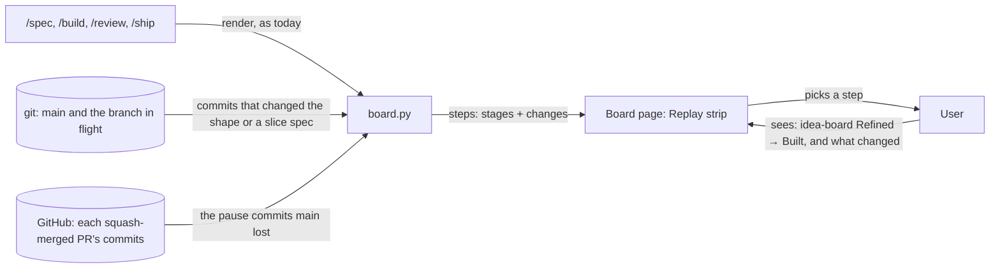
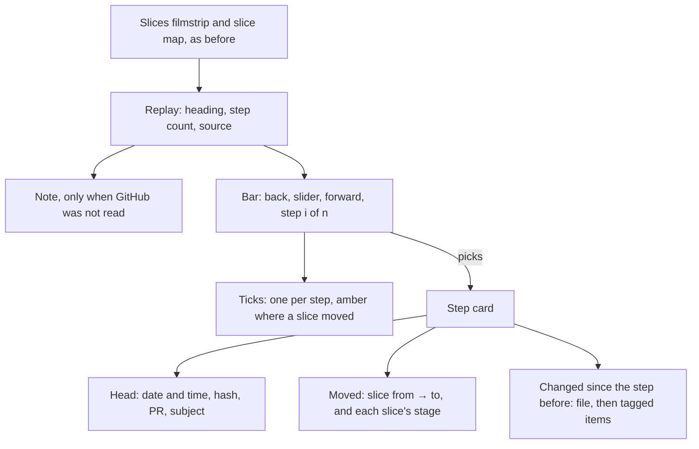

# Replay

**Version:** v1 · **Status:** Draft · **Type:** Feature · **Project type:** CLI/Library

**Shape doc:** docs/specs/living-board/shape.md
**Depends on:** idea-board

The idea board gets a Replay strip: one step for each commit that changed the idea's shape or specs, oldest first. A step shows the stage of each slice at that commit and what changed since the step before, so the user can step through how the idea moved from shape to ship.

## Problem

The board shows an idea as it is now. It does not show how it got there: when a slice passed each pause, what changed between pauses, and in which order the slices moved. The facts are in git, but `main` hides most of them. In this repo, gate-card, pr-gate and library each reached `main` as one squash commit, so `main` shows each of them go from Not started to Shipped in one step. Even idea-board's first commit on `main` is already at Refined. The 12 commits that took gate-card through its pauses exist only on GitHub, in PR #104.

## Slice test

| Check                         | Result                                                                                                       |
| ----------------------------- | ------------------------------------------------------------------------------------------------------------ |
| Cuts every layer it needs     | Yes. `board.py` reads the history from git, `board.html` draws the strip, and each stage republishes as today |
| One e2e test walks it         | Yes. Render a fixture repo that has commits on `main`, a squash-merged PR and a branch in flight, then check the steps |
| Worth shipping alone          | Yes. The user can see when and how each slice moved, with no other slice shipped                             |
| Fits (≤5 scenarios, ≤2 areas) | Yes. 5 scenarios. Areas: the board builder and the board page                                                 |

**Path:** full. The slice adds a part to a published page and a new source of data, git history.

## User story

As the author of an idea, I want to step through the idea's history on its board, so that I can see when each slice moved and what changed at each step, without reading `git log`.

## Flow



Each stage renders the board as it does today. `board.py` now also reads the idea's commits from git, and the commits of each squash-merged PR from GitHub, and the board draws one step for each commit. The user picks a step to see the stage of each slice at that commit and what changed.

## Acceptance criteria

```gherkin
Scenario: the board replays the idea's commits, oldest first
  Given docs/specs/living-board/shape.md and its slice specs were changed in 11 commits on main, from 7ac7353 at 2026-10-26 00:28 to 2f594f4 at 15:06
  When /spec replay republishes the board at pause 1
  Then the board has a Replay strip, and its first step is 7ac7353 "docs(spec): add living-board shape and idea-board spec"
  And each step shows its date and time, its short hash, its commit subject and the stage of each of the 5 slices at that commit
  And the step for 2f594f4 shows idea-board, gate-card, pr-gate and library at Shipped, and replay at Not started

Scenario: a step shows what moved since the step before
  Given the Replay strip of living-board
  When the user picks the step 16c53ad "docs(spec): mark idea-board built"
  Then the step reads "idea-board: Refined → Built"
  And it lists the changes to docs/specs/idea-board.md since the step before, a5cb93f, with the gate card's tags: added, removed, changed, new row, resolved
  And the step shows the stage of each of the 5 slices at 16c53ad

Scenario: a squash-merged slice shows the commits of its PR
  Given gate-card reached main as the one commit caf25a7, squash-merged from PR #104
  And PR #104 has 12 commits that changed docs/specs/gate-card.md, from b845774 "docs(spec): draft gate-card pause 1" at 09:59 to e25a7c8 at 10:56
  When the board is rendered
  Then the strip shows those 12 steps in place of caf25a7
  And gate-card moves through Pause 1 at b845774, Pause 2 at d6e6794, Refined at 2887111, Built at 1059896 and Shipped at 2f69a9c

Scenario: GitHub cannot be reached
  Given the network is down
  When the board is rendered
  Then gate-card, pr-gate and library each show as one step, their squash commit on main
  And the strip reads "PR commits not read: <reason>. Squash-merged slices show as one step."
  And the rest of the board draws as usual

Scenario: an idea with no commits yet
  Given /shape has just written docs/specs/ask-up-front/shape.md, and nothing under it is committed
  When /shape renders the board
  Then the Replay strip reads "No commits yet for this idea. Replay starts after the first commit."
  And the rest of the board draws as usual
```

## Scope

**In:**

- A Replay strip on the idea board, with one step for each commit that changed the shape or a slice spec.
- The commits of the branch in flight, after the commits of `main`. The current slice then shows a step for each pause commit.
- For each squash-merged slice, the commits of its PR, in place of its squash commit.
- In each step: the date and time, the short hash, the subject, the stage of each slice, and what changed since the step before.
- The board opens on the last step. A step changes only the Replay strip; the rest of the board stays as it is now.

**Out:**

- Changes that were never committed. The live board already shows the work tree as it is now.
- Changes to `DECISIONS.md` alone. A D-entry is recorded in the same PR as its spec, so its step is already in the strip.
- Ideas with no shape. They have no board (shape O8, settled in library).
- Playing the steps as an animation. Not in any slice. The user goes one step at a time, or drags the slider.
- History from a GitLab origin or a repo with no GitHub remote. Its squash-merged slices show as one step, as in scenario 4. Not in any slice.

## Interface

**Preview:** https://claude.ai/artifact/2mvUGzveMZJ1rr2T4SiUL9. It is built from the real `living-board` board, with steps read from `main`, PRs #104 to #106 and this branch. Its buttons show the three states: GitHub read, GitHub not reached, and no commits yet. A fourth button jumps to 16c53ad. The buttons exist only in the preview.



The Replay strip sits at the foot of the board, under the slice map. The bar picks a step, and the card under it shows that step. The rest of the board does not change.

**The strip**

| Part | What it shows | From |
| --- | --- | --- |
| Heading | `Replay · step through the idea's commits`, and on the right `<n> steps · from main, the merged PRs and this branch`. When GitHub was not read: `from main and this branch` | — |
| Note | `PR commits not read: <reason>. Squash-merged slices show as one step.`, in amber, under the heading. Only when GitHub was not read | The failed `git fetch` |
| Bar | `◀`, a slider with one stop per step, `▶`, then `step <i> of <n>`. The slider takes the arrow keys. `◀` is off at step 1, and `▶` is off at the last step | — |
| Ticks | One mark per step under the slider. A mark is amber when a slice changed stage at that step. The current step has an outline | Each step's Moved list |
| Head | `<YYYY-MM-DD HH:MM> · <short hash>`, then ` · from PR #<n>` for a step read from a PR, then the commit subject | The commit |
| Moved | One line per slice that changed stage: `<slice>: <stage> → <stage>`. With none: `No slice changed stage.` Then a chip per slice, `<slice> · <stage>`, in the board's stage colours. A slice that moved has a ring | Each slice spec at that commit, read with the board's stage rule |
| Changed | `Changed since step <i-1>`. Then each file that changed: its path, then one line per change with a gate card tag: `added`, `removed`, `changed`, `new row`, `resolved` or `accepted risk`. A spec seen for the first time is `added · the spec`. A file whose only change is above its first `##` heading: `Only the Status line changed.` | The file at this commit against the step before, compared as the gate card compares |

The board opens on the last step. With no commit for the idea, the strip has only its heading and `No commits yet for this idea. Replay starts after the first commit.`

**Which commits are steps**

1. Each commit on `main` that changed the shape or a slice spec, oldest first. The commits of a merged branch count, when the merge was a merge commit.
2. A squash commit of a merged PR is replaced by the commits of that PR that changed those files, in their order.
3. Then each commit of the branch in flight, after its base on `main`.

For `living-board` today, that gives 38 steps: 8 from `main` for idea-board, 12 from PR #104, 8 from PR #105, 8 from PR #106, and 2 from `feat/replay`. Their JSON is 15 KB. With GitHub not reached, it gives 13 steps.

## Open items

| ID  | What | Type | Raised at | Owner | Status | Answer |
| --- | ---- | ---- | --------- | ----- | ------ | ------ |
| O1  | Replay rebuilds frames from git history, but a spec is often written in one commit, so it may have only one or two frames. On `main`, gate-card, pr-gate and library are one squash commit each. Where do the lost frames come from? (from shape O9) | question | shape | user | Resolved | Main, plus each squash-merged PR's commits read from GitHub (`refs/pull/N/head`). Offline or with no GitHub remote, each squash-merged slice shows as one step. 2026-10-26 |
| O2  | What does a frame show: the stage of each slice and what changed, or the whole board as it was at that commit, with its diagrams and panels? | question | spec p1 | user | Resolved | The stage of each slice, the commit, and what changed since the frame before, with the gate card's tags. 2026-10-26 |
| O3  | Approved scenario 2 said the stage rail shows each slice as it was at that step. The step card now shows each slice's stage in its own chips, and the rest of the board stays at now, so it never mixes past and present. Is that right? | question | spec p2 | user | Open | — |

_Never delete this section or its rows. See references/ledger.md._

## Glossary

- **Step** — one point of the Replay strip: the idea as it was at one commit. The board's slice cards are already called frames, so replay does not use that word.
- **Squash merge** — merging a PR as one new commit on `main`. The PR's own commits stay on GitHub, but not on `main`.
- **Branch in flight** — the branch of the slice that is being worked on now and is not merged.
- **e2e** — end-to-end: one test that walks the whole slice as a user would.
