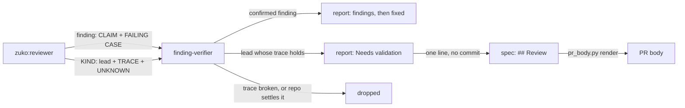
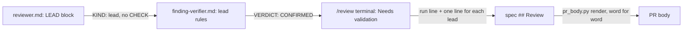

# Review leads

**Version:** v1 · **Status:** Draft · **Type:** Enhancement · **Project type:** CLI/Library

**Depends on:** needs-validation

`/review` keeps each lead that it traced but could not settle, under a Needs validation part of its report, with the one fact that is still unknown. This closes the last open item of GitHub issue #115.

## Problem

The `/review` reviewer drops each problem that it cannot trace to a concrete failing case. A lead that turns on one fact the review cannot observe, such as how a path behaves on Windows, is never reported. zuko runs on Linux, macOS and Windows, and most reviews run on Linux. The release pentest keeps such leads since slice `needs-validation`, and `finding-verifier.md` already judges them. Only `/review` still throws them away.

Issue #115 also asked for a boundary and result rule with severity anchors. That rule exists: the verifier names the `ATTACKER` and the `GAIN`, the pentester shows a `PROOF` that it ran, and the D4 grid in `owasp.md` sets the tier (O1).

## Slice test

| Check                         | Result                                                                                                                         |
| ----------------------------- | ------------------------------------------------------------------------------------------------------------------------------ |
| Cuts every layer it needs     | yes — the reviewer's output, the blind verifier, the `/review` report and its `## Review` line, and the PR body from `pr_body.py` |
| One e2e test walks it         | yes — one e2e test checks the three prompts for the lead contract, then renders a spec with a lead line into the PR body       |
| Worth shipping alone          | yes — the next review of a Windows-only branch reports the lead and the check that settles it, and the PR shows it             |
| Fits (≤5 scenarios, ≤2 areas) | yes — 4 scenarios, 2 areas: the `/review` prompts, and the PR body                                                             |

**Path:** full — the slice adds an output block to the reviewer and a new part of the review report, so pause 2 sets that format.

## User story

As the person who runs `/review`, I want to see each lead that the review could not settle, with the one fact that decides it, so that I can check that fact myself before I ship.

## Flow



The reviewer returns findings and leads. A blind verifier checks the trace of each lead and drops it when the trace breaks or the repo settles the fact. A lead that holds goes into the report and the spec's `## Review` section, and from there into the PR body. Nobody fixes it, and it never blocks `/ship`.

## Acceptance criteria

```gherkin
Scenario: a Windows-only branch becomes a lead with the fact that is still unknown
  Given the diff changes `argv` in plugins/zuko/scripts/lib/program.py inside the `os.name == "nt"` branch at line 41
  And the review runs on Linux, so that branch never runs
  When the user runs /review
  Then the reviewer writes a LEAD block for program.py:41 argv, with a TRACE, one UNKNOWN and a CHECK
  And the LEAD block has no SEVERITY and no FAILING CASE
  And the verifier gets the block with `KIND: lead` first and without its CHECK

Scenario: a lead that holds is reported and not fixed
  Given the verifier returns VERDICT: CONFIRMED for that lead
  When /review prints its report
  Then the Findings line reads "Findings   5 raw, 2 survived · 1 lead needs validation"
  And a Needs validation part after the findings names program.py:41 in argv, the UNKNOWN and the CHECK
  And /review makes no fix commit for the lead

Scenario: the lead reaches the spec and the PR body
  Given that review confirmed 1 lead
  When /review writes its run into the spec's ## Review section
  Then the section has a line "- needs validation · `plugins/zuko/scripts/lib/program.py:41` · whether PATHEXT on Windows lists .EXE in upper case · in Git Bash on Windows, run `cmd //c echo %PATHEXT%`"
  And `pr_body.py check` passes on the spec
  And `pr_body.py render` copies that line into the PR body word for word

Scenario: a lead that the repo settles is dropped
  Given a lead whose UNKNOWN is "whether the suite runs this path on Windows"
  And .github/workflows runs the suite on windows-latest for each PR
  When the verifier judges the lead
  Then it returns VERDICT: REJECTED, and the report counts the lead under raw only
```

## Scope

**In:** a LEAD block in `agents/reviewer.md`; `/review` sends each lead to the verifier blind and reports the ones that hold; one `## Review` line for each lead that holds; the same 2-of-3 vote on a large diff as for a finding.

**Out:**

- A BOUNDARY field on security findings. #115's boundary and result rule is already met (O1). No later slice.
- A lead that blocks `/ship`. A lead only reports (O2). No later slice.
- The Cloudflare class files in `/review`. The pentest-depth shape rejected this (its O7). No later slice.

## Interface

Four text contracts. Each one copies the matching contract of the release pentest, so the verifier and `pr_body.py` read a lead from `/review` as they read one today.



The reviewer writes a LEAD block, and `/review` sends it to the verifier without its `CHECK`. A confirmed lead prints under Needs validation, then goes into `## Review` as one line, which the PR body copies.

**1. The reviewer's LEAD block** (`agents/reviewer.md`, after the finding template):

```
LEAD: {one sentence, the possible defect only}
CATEGORY: {A0N:2025 name, or correctness}
FILE: {path:line}
SYMBOL: {the function or class the line sits in}
SNIPPET: {the line, as written; on a deleted line, as it was on the base branch}
CHANGE: {added, deleted, or caller}
EVIDENCE: {the command and its output, verbatim — whenever the trace rests on command output}
TRACE: {the input, then each file:line it passes, to the line where harm would happen}
UNKNOWN: {the one fact that decides it, which no command the review can run will show}
CHECK: {a safe check the user can run to settle the fact}
```

A lead has no `SEVERITY`, no `RAISED` and no `FAILING CASE`. Only a security or correctness problem can be a lead. A coverage, quality or decisions finding never is. The rules are the pentester's lead rules: exactly one `UNKNOWN`, a lead that a command can prove is a finding, an unfinished trace is not a lead, and D5 and D6 stop a lead. Never put a `|` in `LEAD` or `UNKNOWN`.

**2. What the verifier gets:** `KIND: lead`, the `LEAD` claim, `CATEGORY`, `FILE`, `SYMBOL`, `SNIPPET`, `CHANGE`, `EVIDENCE`, `TRACE`, `UNKNOWN` and `BASE`. It never gets `CHECK`. A small diff needs one `CONFIRMED`. A large diff needs 2 of 3. `finding-verifier.md` keeps its lead rules as they are.

**3. The terminal report:**

```
Findings   5 raw, 2 survived · 1 lead needs validation

...findings, as today...

Needs validation   1 lead, not fixed, does not block /ship
  correctness · plugins/zuko/scripts/lib/program.py:41 in argv
    Lead: argv may not find git.exe when PATHEXT lists extensions in lower case.
    Unknown: whether PATHEXT on Windows lists .EXE in upper case
    Check: in Git Bash on Windows, run `cmd //c echo %PATHEXT%`
```

The raw count includes each lead. With no lead that holds, the Findings line and the report stay as they are today.

**4. The `## Review` lines:**

```markdown
2026-11-12 · 5 raw findings, 2 survived, 2 fixed, 1 lead needs validation.

- A05 Injection · `plugins/zuko/scripts/lib/git-command.py:120` · quote the branch name · `4f2a9c1`
- needs validation · `plugins/zuko/scripts/lib/program.py:41` · whether PATHEXT on Windows lists .EXE in upper case · in Git Bash on Windows, run `cmd //c echo %PATHEXT%`
```

A lead line has four parts: `needs validation`, `file:line`, the `UNKNOWN` and the `CHECK`. It has no commit. The lead lines come after the fix lines.

## Open items

| ID | What | Type | Raised at | Owner | Status | Answer |
| -- | ---- | ---- | --------- | ----- | ------ | ------ |
| O1 | #115 asks for a boundary and result rule with severity anchors. Is it already covered? | question | spec p1 | user | Resolved | Yes. ATTACKER and GAIN in the verifier, the pentester's run PROOF and the D4 grid cover it. Tick it on #115, no code change. 2026-11-10 |
| O2 | What happens to a lead that holds in /review? | question | spec p1 | user | Resolved | It is reported under Needs validation and on a `## Review` line. It is not fixed, and it never blocks /ship. 2026-11-10 |

_Never delete this section or its rows. See references/ledger.md._

## Glossary

- **Lead** — a possible defect that the reviewer traced in the code but could not prove, because one fact is out of reach
- **Blind verifier** — the `finding-verifier` agent, which sees the claim and the code but not the reasoning behind the claim
- **Pentest** — the attack that `/release` runs on the code it ships, to prove each hole with a harmless input
- **e2e** — end-to-end: one test that walks the whole slice as a user would
