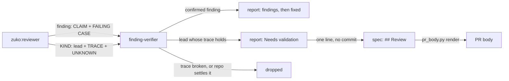
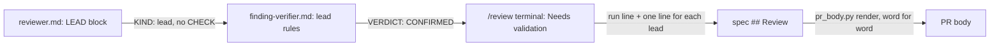
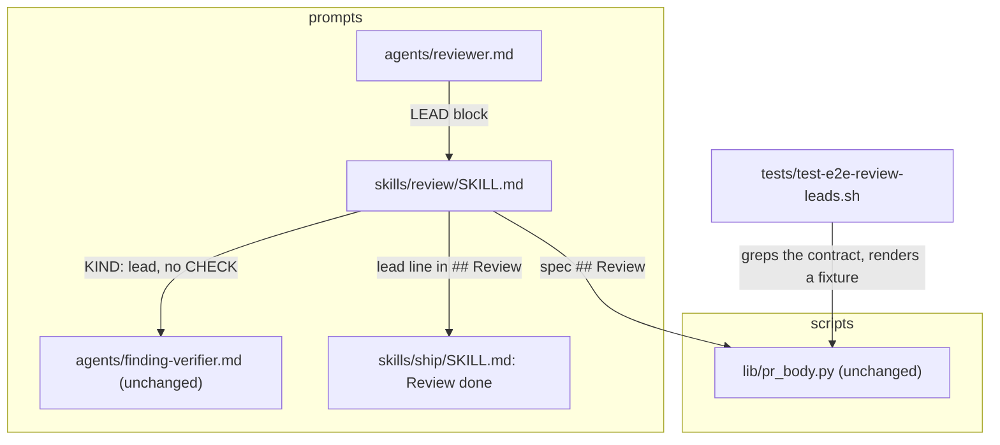
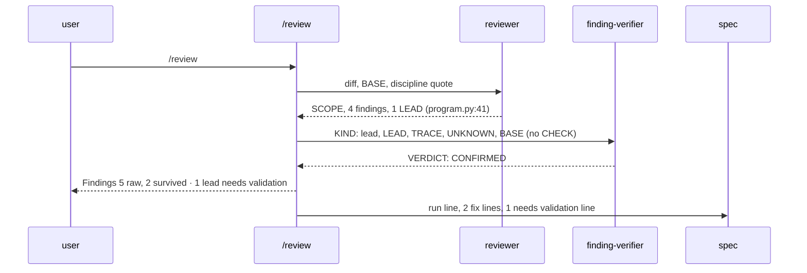

# Review leads

**Version:** v1 · **Status:** Built · **Type:** Enhancement · **Project type:** CLI/Library

**Depends on:** needs-validation

`/review` keeps each lead that it traced but could not settle, under a Needs validation part of its report, with the one fact that is still unknown. This closes the last open item of GitHub issue #115.

## Problem

The `/review` reviewer drops each problem that it cannot trace to a concrete failing case. A lead that turns on one fact the review cannot observe, such as how a path behaves on Windows, is never reported. zuko runs on Linux, macOS and Windows, and most reviews run on Linux. The release pentest keeps such leads since slice `needs-validation`, and `finding-verifier.md` already judges them. Only `/review` still throws them away.

Issue #115 also asked for a boundary and result rule with severity anchors. That rule exists: the verifier names the `ATTACKER` and the `GAIN`, the pentester shows a `PROOF` that it ran, and the D4 grid in `owasp.md` sets the tier (O1).

## Slice test

| Check                         | Result                                                                                                                         |
| ----------------------------- | ------------------------------------------------------------------------------------------------------------------------------ |
| Cuts every layer it needs     | yes — the reviewer's output, the blind verifier, the `/review` report and its `## Review` line, and the PR body from `pr_body.py` |
| One e2e test walks it         | yes — one e2e test checks the three prompts for the lead contract, then renders a spec with a lead line into the PR body       |
| Worth shipping alone          | yes — the next review of a Windows-only branch reports the lead and the check that settles it, and the PR shows it             |
| Fits (≤5 scenarios, ≤2 areas) | yes — 4 scenarios, 2 areas: the `/review` prompts, and the PR body                                                             |

**Path:** full — the slice adds an output block to the reviewer and a new part of the review report, so pause 2 sets that format.

## User story

As the person who runs `/review`, I want to see each lead that the review could not settle, with the one fact that decides it, so that I can check that fact myself before I ship.

## Flow



The reviewer returns findings and leads. A blind verifier checks the trace of each lead and drops it when the trace breaks or the repo settles the fact. A lead that holds goes into the report and the spec's `## Review` section, and from there into the PR body. Nobody fixes it, and it never blocks `/ship`.

## Acceptance criteria

```gherkin
Scenario: a Windows-only branch becomes a lead with the fact that is still unknown
  Given the diff changes `argv` in plugins/zuko/scripts/lib/program.py inside the `os.name == "nt"` branch at line 41
  And the review runs on Linux, so that branch never runs
  When the user runs /review
  Then the reviewer writes a LEAD block for program.py:41 argv, with a TRACE, one UNKNOWN and a CHECK
  And the LEAD block has no SEVERITY and no FAILING CASE
  And the verifier gets the block with `KIND: lead` first and without its CHECK

Scenario: a lead that holds is reported and not fixed
  Given the verifier returns VERDICT: CONFIRMED for that lead
  When /review prints its report
  Then the Findings line reads "Findings   5 raw, 2 survived · 1 lead needs validation"
  And a Needs validation part after the findings names program.py:41 in argv, the UNKNOWN and the CHECK
  And /review makes no fix commit for the lead

Scenario: the lead reaches the spec and the PR body
  Given that review confirmed 1 lead
  When /review writes its run into the spec's ## Review section
  Then the section has a line "- needs validation · `plugins/zuko/scripts/lib/program.py:41` · whether PATHEXT on Windows lists .EXE in upper case · in Git Bash on Windows, run `cmd //c echo %PATHEXT%`"
  And `pr_body.py check` passes on the spec
  And `pr_body.py render` copies that line into the PR body word for word

Scenario: a lead that the repo settles is dropped
  Given a lead whose UNKNOWN is "whether the suite runs this path on Windows"
  And .github/workflows runs the suite on windows-latest for each PR
  When the verifier judges the lead
  Then it returns VERDICT: REJECTED, and the report counts the lead under raw only
```

## Scope

**In:** a LEAD block in `agents/reviewer.md`; `/review` sends each lead to the verifier blind and reports the ones that hold; one `## Review` line for each lead that holds; the same 2-of-3 vote on a large diff as for a finding.

**Out:**

- A BOUNDARY field on security findings. #115's boundary and result rule is already met (O1). No later slice.
- A lead that blocks `/ship`. A lead only reports (O2). No later slice.
- The Cloudflare class files in `/review`. The pentest-depth shape rejected this (its O7). No later slice.

## Interface

Four text contracts. Each one copies the matching contract of the release pentest, so the verifier and `pr_body.py` read a lead from `/review` as they read one today.



The reviewer writes a LEAD block, and `/review` sends it to the verifier without its `CHECK`. A confirmed lead prints under Needs validation, then goes into `## Review` as one line, which the PR body copies.

**1. The reviewer's LEAD block** (`agents/reviewer.md`, after the finding template):

```
LEAD: {one sentence, the possible defect only}
CATEGORY: {A0N:2025 name, or correctness}
FILE: {path:line}
SYMBOL: {the function or class the line sits in}
SNIPPET: {the line, as written; on a deleted line, as it was on the base branch}
CHANGE: {added, deleted, or caller}
EVIDENCE: {the command and its output, verbatim — whenever the trace rests on command output}
TRACE: {the input, then each file:line it passes, to the line where harm would happen}
UNKNOWN: {the one fact that decides it, which no command the review can run will show}
CHECK: {a safe check the user can run to settle the fact}
```

A lead has no `SEVERITY`, no `RAISED` and no `FAILING CASE`. Only a security or correctness problem can be a lead. A coverage, quality or decisions finding never is. The rules are the pentester's lead rules: exactly one `UNKNOWN`, a lead that a command can prove is a finding, an unfinished trace is not a lead, and D5 and D6 stop a lead. Never put a `|` in `LEAD` or `UNKNOWN`.

**2. What the verifier gets:** `KIND: lead`, the `LEAD` claim, `CATEGORY`, `FILE`, `SYMBOL`, `SNIPPET`, `CHANGE`, `EVIDENCE`, `TRACE`, `UNKNOWN` and `BASE`. It never gets `CHECK`. A small diff needs one `CONFIRMED`. A large diff needs 2 of 3. `finding-verifier.md` keeps its lead rules as they are.

**3. The terminal report:**

```
Findings   5 raw, 2 survived · 1 lead needs validation

...findings, as today...

Needs validation   1 lead, not fixed, does not block /ship
  correctness · plugins/zuko/scripts/lib/program.py:41 in argv
    Lead: argv may not find git.exe when PATHEXT lists extensions in lower case.
    Unknown: whether PATHEXT on Windows lists .EXE in upper case
    Check: in Git Bash on Windows, run `cmd //c echo %PATHEXT%`
```

The raw count includes each lead. With no lead that holds, the Findings line and the report stay as they are today.

**4. The `## Review` lines:**

```markdown
2026-11-12 · 5 raw findings, 2 survived, 2 fixed, 1 lead needs validation.

- A05 Injection · `plugins/zuko/scripts/lib/git-command.py:120` · quote the branch name · `4f2a9c1`
- needs validation · `plugins/zuko/scripts/lib/program.py:41` · whether PATHEXT on Windows lists .EXE in upper case · in Git Bash on Windows, run `cmd //c echo %PATHEXT%`
```

A lead line has four parts: `needs validation`, `file:line`, the `UNKNOWN` and the `CHECK`. It has no commit. The lead lines come after the fix lines.

## Technical plan

### Approach

Only prompt text changes, plus one test. `finding-verifier.md` already judges `KIND: lead` (D103), and `pr_body.py` already copies each `## Review` line word for word (`pr_body.py:99`). So this slice teaches the reviewer to write a lead and `/review` to route it. It also tells `/ship` that a lead line has no commit.

Relies on: D5, D6, D7, D17, D102, D103, D136, D137



The reviewer writes the block, and the review skill routes it to the unchanged verifier and into `## Review`. The ship skill accepts a lead line with no commit, and `pr_body.py` copies the line as it is.



### Changes

| File | What changes | Why |
| ---- | ------------ | --- |
| `plugins/zuko/agents/reviewer.md:17` | The bold rule gains one sentence: a problem whose trace is complete except for one fact out of reach goes in a LEAD block. | Scenario 1 |
| `plugins/zuko/agents/reviewer.md:104` | "Report format" adds the LEAD template from Interface §1, its rules, and one example for `program.py:41`. It also says LEAD blocks come after the findings. | Scenario 1 |
| `plugins/zuko/skills/review/SKILL.md` › Verification | Send each lead to its own verifier, as Interface §2 says. The large-diff vote is the same. A lead holds on `CONFIRMED`. Each other lead is dropped. | Scenarios 1, 4 |
| `plugins/zuko/skills/review/SKILL.md` › Report and fix | The Findings line and the Needs validation part from Interface §3. Never fix a lead. The `## Review` lead line from Interface §4, and a run line with leads, such as `3 raw findings, 0 survived, 1 lead needs validation.`, which is not `Clean`. | Scenarios 2, 3 |
| `plugins/zuko/skills/ship/SKILL.md:105` | Review done: "Each fix line names a commit on this branch. A needs validation line names none." | Scenario 3 |
| `plugins/zuko/scripts/tests/test-decision-pr.sh:70` | The Review done pattern matches the new cell. | Keeps the suite green |
| `plugins/zuko/scripts/tests/test-e2e-review-leads.sh` | New: the e2e test. | All four |

Reusing: the pentester's lead rules (`agents/pentester.md`, step 4), the verifier's lead section (`agents/finding-verifier.md` › "A lead"), the release step's blind send (`skills/release/SKILL.md:207`), `pr_body.py check` and `render`, and the `expect_*` helpers that `run.sh` provides.

### Earn-it

| Added | Triggered by |
| ----- | ------------ |
| The LEAD block in `reviewer.md` | Scenario 1: the reviewer has no way to report a lead today |
| `test-e2e-review-leads.sh` | The slice test: one e2e test walks the slice |

Nothing else is added. The verifier and `pr_body.py` stay as they are.

### Non-functionals

|                      |                                                                               |
| -------------------- | ----------------------------------------------------------------------------- |
| **Load**             | One `/review` for each slice. A lead costs one verifier run on a small diff, or three on a large one, the same as a finding. |
| **Breaks first**     | A reviewer that writes many leads costs verifier turns. The rules cap a lead at one `UNKNOWN` that no command can show. An unfinished trace is not a lead. |
| **Security surface** | The reviewer reads untrusted diff text. A diff could steer it into a harmful `CHECK`. zuko never runs a `CHECK`: the user runs it by hand, and the verifier never sees it. The template asks for a safe check. |
| **Proof it works**   | A review report with `· 1 lead needs validation` on its Findings line, and the same lead line in the PR body. |
| **Rollout**          | No flag. The text applies from the next session (lesson: skills load at session start). Rollback is `git revert` of the slice's commits. |

### Test plan

| Scenario | Test | Command |
| -------- | ---- | ------- |
| 1 · a Windows-only branch becomes a lead | `test-e2e-review-leads.sh` part 1: the LEAD template and rules in `reviewer.md`, and the blind send in `review/SKILL.md` | `bash plugins/zuko/scripts/tests/run.sh test-e2e-review-leads` |
| 2 · a lead that holds is reported, not fixed | part 1: the Findings line, the Needs validation part and the never-fix rule in `review/SKILL.md` | same |
| 3 · the lead reaches the spec and the PR body | part 2: a fixture spec with a run line, a fix line and a lead line. `pr_body.py check` passes, and `render` prints the lead line word for word. Part 1 checks the ship rule. | same |
| 4 · a lead that the repo settles is dropped | part 1: the verifier still has its rule 4 for leads, and `review/SKILL.md` drops each lead that is not `CONFIRMED` | same |
| the suite | all test files | `bash plugins/zuko/scripts/tests/run.sh` |

**E2E:** `test-e2e-review-leads.sh`, which checks the prompt contract and then renders the fixture spec into a PR body.

### Chunks

Single chunk. The change is four prompt files and two tests, about 120 lines.

### Risks

| Risk | Mitigation |
| ---- | ---------- |
| A test checks prompt text, so it cannot show that the reviewer writes good leads. | The same limit as `needs-validation`. The first real review of a Windows-only branch is the proof. |
| The reviewer calls a problem a lead to skip the work of proving it. | The rule "a lead that a command can prove is a finding" is copied from the pentester, and the blind verifier still rejects a broken trace. |
| A lead line breaks the ship gate's placeholder check. | The existing rule bans a brace pair, `TODO` and `[TBD]` in each `## Review` line. The fixture's lead line passes `verify-ship-gates.sh`. |

### Decisions to record

Recorded as D136, D137.

## Open items

| ID | What | Type | Raised at | Owner | Status | Answer |
| -- | ---- | ---- | --------- | ----- | ------ | ------ |
| O1 | #115 asks for a boundary and result rule with severity anchors. Is it already covered? | question | spec p1 | user | Resolved | Yes. ATTACKER and GAIN in the verifier, the pentester's run PROOF and the D4 grid cover it. Tick it on #115, no code change. 2026-11-10 |
| O2 | What happens to a lead that holds in /review? | question | spec p1 | user | Resolved | It is reported under Needs validation and on a `## Review` line. It is not fixed, and it never blocks /ship. 2026-11-10 |

_Never delete this section or its rows. See references/ledger.md._

## Glossary

- **Lead** — a possible defect that the reviewer traced in the code but could not prove, because one fact is out of reach
- **Blind verifier** — the `finding-verifier` agent, which sees the claim and the code but not the reasoning behind the claim
- **Pentest** — the attack that `/release` runs on the code it ships, to prove each hole with a harmless input
- **e2e** — end-to-end: one test that walks the whole slice as a user would
