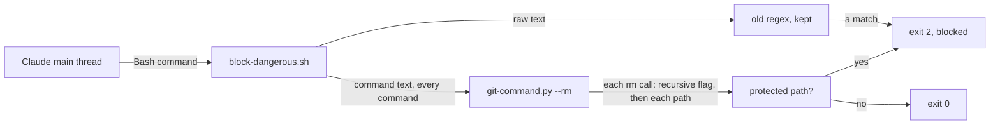
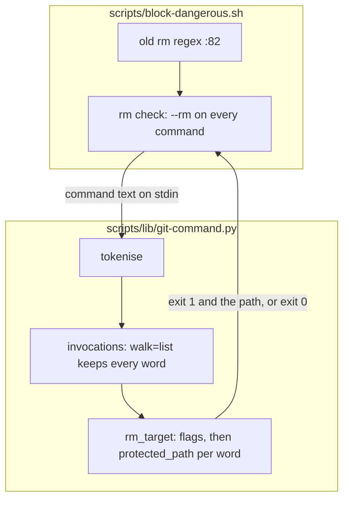
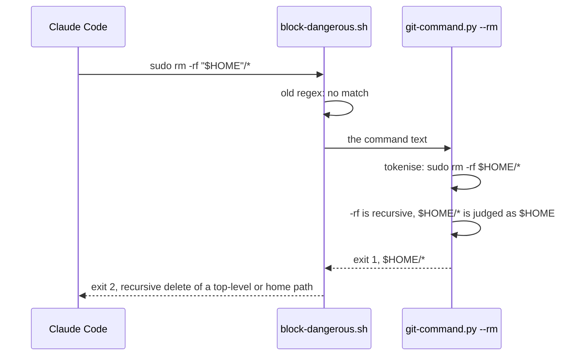

# rm forms

**Version:** v1 · **Status:** Built · **Type:** Bug · **Project type:** CLI/Library

**Shape doc:** docs/specs/guard-leads/shape.md
**Depends on:** None

The rm guard in `block-dangerous.sh` blocks each recursive delete of `/`, a
path one level under `/`, or a home dir, in every spelling that bash and rm
read. This closes leads v2.6.0 N10 and v2.7.0 N9 (D141).

## Problem

The guard is one regex on the raw command text,
`block-dangerous.sh:82`. It needs `r` and `f` in one word, a target right
after that word, and a target with no quote, `$`, glob or second level. I ran
these inputs against the real hook on 2026-11-13, with `cwd` `/tmp`:

| Input | Exit |
| --- | --- |
| `rm -rf /`, `rm -rf ~`, `rm -rf ~/`, `rm -rf ~/*`, `rm -rf /usr`, `rm -rf /root`, `rm -fr ..` | 2 |
| `rm -rf /*`, `rm -rf /u*`, `rm -rf //`, `rm -rf "/"`, `rm -rf -- /` | 0 |
| `rm -r -f /`, `rm --recursive --force /`, `rm -r /`, `rm -R /usr` | 0 |
| `rm -rf $HOME`, `rm -rf "$HOME"`, `rm -rf ${HOME}` | 0 |
| `rm -rf /usr/`, `rm -rf /usr/*`, `rm -rf /home/*` | 0 |
| `rm -rf /home/user`, `rm -rf /Users/jane`, `rm -rf /c/Users/jane` | 0 |
| `sudo rm -rf /usr/`, `/bin/rm -rf /usr/`, `bash -c "rm -rf /usr/"` | 0 |

Facts this slice rests on, each run on 2026-11-13:

- GNU rm 8.32 reads options after a path: `rm d -r` deletes the dir `d`.
- GNU rm takes a shortened long option: `rm --recu d` deletes `d`.
- `git-command.py` `tokenise` gives `sudo rm -rf "$HOME"` as the words
  `sudo rm -rf $HOME`, and reads the string of `bash -c` as a command.
- `invocations(tokens, "rm")` finds each `rm` word, also `/bin/rm`, but drops
  the options before the first path. The rm check needs every word.

## Slice test

| Check                         | Result                                                                     |
| ----------------------------- | -------------------------------------------------------------------------- |
| Cuts every layer it needs     | Yes. The guard, the shared parser, and the test that runs the real hook    |
| One e2e test walks it         | Yes. `test-block-dangerous.sh` feeds the real hook a payload for each form |
| Worth shipping alone          | Yes. It closes v2.6.0 N10 and v2.7.0 N9                                    |
| Fits (≤5 scenarios, ≤2 areas) | Yes. 4 scenarios, 1 area (scripts)                                         |

**Path:** light. A bug fix in 3 files, with no new interface, data or
dependency. Pauses 1 and 3 merged, pause 2 skipped.

## Flow



The old regex still runs, so each form that it blocks today stays blocked.
The new check reads each `rm` call that bash runs, and judges each path of a
call that has a recursive flag.

## Acceptance criteria

```gherkin
Scenario: each spelling of a recursive flag counts
  Given a session in /home/jane/projects/shop
  When block-dangerous.sh judges rm -r -f /
  Then it exits 2 with "Blocked: recursive delete of a top-level or home path."
  And rm --recursive --force /, rm -r /, rm -R /usr, rm --recu /usr and rm /usr -rf are blocked the same way
  And rm -rf -- / is blocked the same way

Scenario: root, a top-level path and a home dir are blocked in each spelling
  Given a session in /home/jane/projects/shop
  When block-dangerous.sh judges rm -rf "$HOME"
  Then it exits 2 with "Blocked: recursive delete of a top-level or home path."
  And rm -rf $HOME, rm -rf ${HOME}/, rm -rf ~jane and rm -rf "/" are blocked the same way
  And rm -rf //, rm -rf /usr/, rm -rf /usr/.. and rm -rf /tmp are blocked the same way
  And rm -rf /home/jane, rm -rf /Users/jane, rm -rf /root and rm -rf /c/Users/jane are blocked the same way
  And sudo rm -rf /usr/, /bin/rm -rf /usr/ and bash -c "rm -rf /usr/" are blocked the same way

Scenario: a glob in the last part is judged as its parent
  Given a session in /home/jane/projects/shop
  When block-dangerous.sh judges rm -rf /usr/*
  Then it exits 2 with "Blocked: recursive delete of a top-level or home path."
  And rm -rf /*, rm -rf /u*, rm -rf /home/*, rm -rf ~/* and rm -rf "$HOME"/* are blocked the same way
  And rm -rf /tmp/* is blocked the same way

Scenario: a delete under a protected path still passes
  Given a session in /home/jane/projects/shop
  When block-dangerous.sh judges rm -rf /tmp/zuko-x
  Then it exits 0 and prints nothing
  And rm -rf build, rm -rf "$work", rm -rf "$HOME/projects/shop/dist" and rm -rf /home/jane/projects/shop/node_modules exit 0
  And rm -f /usr, without a recursive flag, exits 0
  And echo "rm -rf /" exits 0, because the delete is text in a quoted argument
```

## Scope

**In:**

- A recursive flag in each form: `-r`, `-R`, in a bundle of short options,
  `--recursive` and each prefix of it from `--r`, before or after a path,
  up to `--` (O1).
- The protected paths: `/`, a path one level under `/`, `/home/NAME`,
  `/Users/NAME`, `/<drive>/Users/NAME`, `~`, `~NAME`, `$HOME` and `${HOME}`.
  A path counts with any quotes, a repeated or trailing `/`, a `.` part or a
  `..` part (O2).
- A glob in the last part of a path is judged as the parent of that part
  (O3), when the part is all glob after its leading dots, as `*` or `.*` is.
  A part with a fixed start, such as `zuko-*`, is judged as a name (O5).
- A `rm` call that bash runs: after `sudo` or another word, as `/bin/rm`, and
  in a `bash -c` or `eval` string. The parser already finds them.

**Out:**

- A relative path. One that starts with `..` stays blocked by the old regex.
  Resolving `.` and `..` against the cwd is not in this idea (O4).
- A path that starts with a variable other than `HOME`, such as
  `rm -rf "$DIR/"*` with `DIR` unset (O4).
- `find / -delete`, `xargs rm` and `find -exec rm`, whose paths the command
  text does not show. They are not pentest leads.
- A shorter rule for `~/proj/build`. The old regex blocks each `~` path, and
  this slice does not change that.

## Technical plan

### Approach

`git-command.py` gets an `--rm` mode. It tokenises the command as it does for
git, finds each `rm` call with the raw words, and exits 1 with the first
protected path on stdout. `block-dangerous.sh` runs that mode after the old
regex, on every command (O6).

Relies on: D52 (a command the parser cannot read is blocked, and
`block-dangerous.sh:36` already does that before this check), D138 (a nested
command is a command), D139 (a path to a program is that program), D141, and
the drafted entries below.





### Changes

| File | Change |
| --- | --- |
| `plugins/zuko/scripts/lib/git-command.py:1045` | `invocations` gets a `walk` argument, default `subcommand_args`. `walk=list` keeps each call's words as they are. |
| `plugins/zuko/scripts/lib/git-command.py` | New `protected_path(word)`. It turns a leading `~` or `~NAME` into a home marker, and so does `$HOME` or `${HOME}`. It drops a glob last part (O5), folds `//` and `.`, and resolves `..` part by part. It is true for `/`, one part under `/`, a home marker alone, and `/home/X`, `/Users/X` or `/<one letter>/Users/X`. |
| `plugins/zuko/scripts/lib/git-command.py` | New `rm_target(tokens)`: for each rm call, a word before `--` that is a short bundle with `r` or `R`, or a prefix of `--recursive` from `--r`, makes the call recursive. Each other word is a path, also after `--`. It returns the first protected path of a recursive call. |
| `plugins/zuko/scripts/lib/git-command.py:1102` | `main` reads `--rm`: print the path and exit 1, or exit 0. A parse failure keeps exit 3, and over 64 KB keeps exit 4. The docstring names the mode. |
| `plugins/zuko/scripts/block-dangerous.sh:82` | After the old regex, run `git-command.py --rm` on every command (O6). Exit 1 denies with the message of today. Any other exit other than 0 denies with the "could not be checked" message of `:36`. |
| `plugins/zuko/scripts/tests/test-block-dangerous.sh` | A loop over every form in the scenarios, through `run_hook`, with `expect_exit` and `expect_match` on the message. |

Reusing: `tokenise`, `strip_heredocs`, `invocations`, `program_word` (it reads
`/bin/rm` and `RM.EXE` as rm), `deny`, and `run_hook`, `expect_exit` and
`expect_match` in the tests.

### Earn-it

- The `--rm` mode: scenarios 2 and 3 need the words with their quotes
  removed and the `bash -c` strings read. Only `tokenise` does both, and a
  second parser would drift from it.
- The `walk` argument: `rm_target` needs the options that `subcommand_args`
  drops, and a copy of the `invocations` loop would drift.

### Non-functionals

- **Load:** one Bash call at a time. Each command starts one more `python3`.
  On 2026-11-13 the hook took 97 ms on `ls -la build` with no second parse,
  and 120 ms on `rm -r build/cache` with it, as the mean of 10 runs each.
- **At 10×:** the 64 KB limit of `tokenise` holds, so a long command still
  exits 4 and is blocked.
- **Security surface:** the main thread's Bash commands. It trusts nothing
  in the command. It reads no secrets and stores nothing. It reads git's
  config in the dirs the command names, as `tokenise` already does for git.
- **Proof in prod:** `Blocked: recursive delete of a top-level or home path.`
  on stderr for each form in the scenarios, and the next release pentest
  lists no rm lead under Needs validation.
- **Rollout:** no flag. Rollback is `git revert` of the fix commit. The old
  regex is still there, so a revert can only go back to the gaps of today.

### Test plan

| Scenario | Test |
| --- | --- |
| 1, 2, 3 | `test-block-dangerous.sh`: each form through `run_hook`, `expect_exit 2` and `expect_match` on the message |
| 4 | the same file: each form with `expect_exit 0` |

**Command:** `bash plugins/zuko/scripts/tests/run.sh`

**E2E:** `test-block-dangerous.sh` runs the real hook script on each payload,
as Claude Code runs it.

**Replay:** a scratch script runs each logged Bash command that holds an `rm`
word through the hook at the base and at the build. It lists each command
whose exit code changes. The script and its output stay in the scratchpad,
because the logs hold private data. A new block of a real command that
deletes a path under a protected path is a bug in the build.

**Result (2026-11-13):** `run.sh block-dangerous` 803 passed, 0 failed. The
same test file against the scripts on `main` fails 52 checks: 26 blocked
forms exit 0. The other 4 blocked forms (`/tmp`, `/root`, `~jane`, `~/*`)
were blocked by the old regex. `run.sh` 4698 passed, 0 failed, 2 skipped.

**Replay result (2026-11-13):** 826 distinct logged commands with an `rm`
word. 0 change their exit code: 35 block at the base and the same 35 block at
the build.

### Chunks

Single chunk.

### Risks

- **A new false block.** A delete of `/tmp/*` or `~jane` now stops. The
  replay lists each one before ship, and the user can run it by hand. That
  is the trade O3 accepted.
- **BSD rm on macOS** does not read options after a path. So `rm /usr -rf`
  is blocked there too, though BSD rm would not recurse. A block that is not
  needed costs a prompt, not data.

### Decisions to record

Recorded as D158, D159.

## Review

2026-11-13 · 1 raw finding, 1 survived, 1 fixed.

- correctness · `plugins/zuko/scripts/block-dangerous.sh:90` · run the parsed rm check on every command, so `r''m`, `"r"m`, `r\m` and a saved rm alias are judged · `c1cbf2a`

## Open items

| ID | What | Type | Raised at | Owner | Status | Answer |
| --- | --- | --- | --- | --- | --- | --- |
| O1 | Which flags count as a recursive delete? Today the guard needs `r` and `f` in one word. | question | spec p1 | user | Resolved | Any recursive flag: `-r`, `-R` or `--recursive`, bundled or split, with or without `-f`. 2026-11-13 |
| O2 | Which targets does the guard block? | question | spec p1 | user | Resolved | `/`, any path one level under `/`, a home dir (`/home/NAME`, `/Users/NAME`, `/root`, `/c/Users/NAME`), and `~`, `~NAME`, `$HOME` and `${HOME}`, in each spelling. 2026-11-13 |
| O3 | How does the guard read a glob such as `rm -rf /usr/*`? | question | spec p1 | user | Resolved | A glob in the last part is judged as its parent, so `rm -rf /tmp/*` is blocked too. 2026-11-13 |
| O4 | Does the guard resolve `.` and `..` against the cwd, or read a path that starts with another variable? | question | spec p1 | user | Resolved | No. A path that starts with `..` stays blocked by the old regex. The rest is not in this idea. 2026-11-13 |
| O5 | O3 said "a glob in the last part is judged as its parent". So `rm -rf /tmp/zuko-*` would be blocked, though `zuko-*` cannot match every name in `/tmp`. | flag | build | user | Decided alone | Chose: judge the parent only when the last part is all glob after its leading dots (`*`, `.*`, `?*`, `[a-z]*`). `/tmp/zuko-*` passes, and `/u*` stays blocked as a path one level under `/`. Other: judge the parent for each glob. Undo: in `protected_path`, test `any(c in "*?[" for c in parts[-1])` in place of the first-character test, and move `rm -rf /tmp/zuko-*` to the blocked list in `test-block-dangerous.sh`. 2026-11-13 |
| O6 | The plan ran the parsed rm check only when the raw text held the word `rm`. The review showed that `r''m -rf /usr/`, `"r"m`, `r\m` and a saved alias `!rm -rf /usr/` hold no such word, and passed. | flag | review | user | Decided alone | Chose: run the check on every Bash command, about 23 ms more on each. Other: widen the text gate, which cannot see an alias that git reads from config. Undo: `git revert` the review fix commit, which brings back the gate and these gaps. 2026-11-13 |

_Never delete this section or its rows. See references/ledger.md._

## Glossary

- **Pentest** — a penetration test: an attack on your own code to find holes before someone else does.
- **E2E** — an end-to-end test: it runs the real hook script as Claude Code runs it.
- **Lead** — a hole that a pentest traced but could not prove. The report lists it under Needs validation, with no severity.
- **Guard** — a zuko hook that reads a Bash command before it runs, and blocks it with exit 2.
- **Glob** — a `*`, `?` or `[` in a path, which bash expands into each name that matches.
- **Tokenise** — split a command into the words that bash gives the program, with quotes removed.
- **Replay** — run each Bash command from the session logs through the old and the new hook, and list each verdict that changes.
- **Light path** — zuko's short route for a small bug fix: one pause in place of three, and one reviewer.
