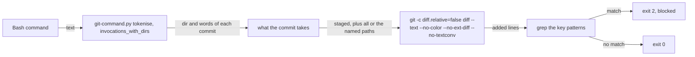
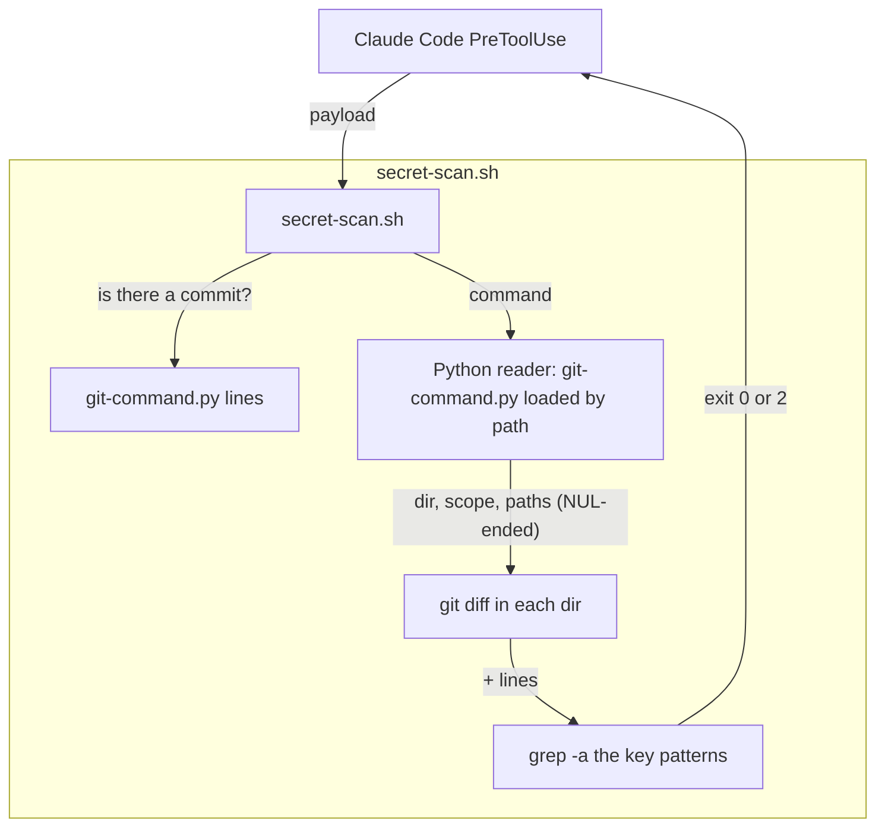
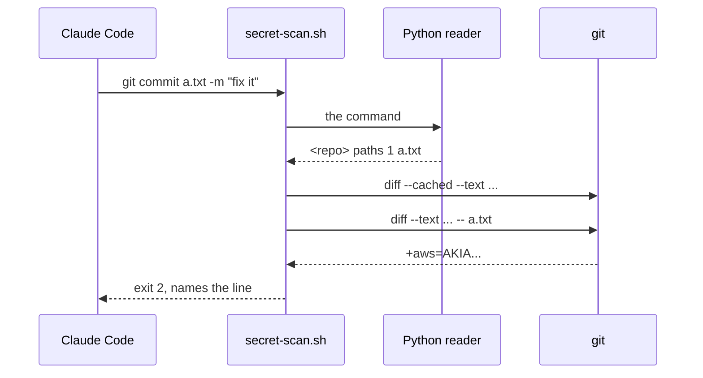

# Secret scan scope

**Version:** v1 · **Status:** Shipped · **Type:** Bug · **Project type:** CLI/Library

**Shape doc:** docs/specs/guard-leads/shape.md
**Depends on:** None

The secret scan reads the text that the commit takes: the work-tree changes for
`-a`, the named paths for `git commit <path>`, and the text of a file whose diff
git hides. Today it reads only the staged diff, so a key in a tracked file goes
into the commit with no prompt (v2.6.0 N11, v2.7.0 N8).

## Problem

`secret-scan.sh` runs `git diff --cached` in the commit's dir and greps the
added lines (`secret-scan.sh:42`). A commit can take more than the staged
diff, and `git diff` can hide text. I ran each input through the real hook on
2026-11-12, in a scratch repo on a feature branch, with `aws=AKIA...` (an
AWS-shaped key) in the file:

| Input | Where the key is | Exit |
| --- | --- | --- |
| `git commit -am x` | `a.txt`, tracked, not staged | 0 |
| `git commit a.txt -m x` | `a.txt`, tracked, not staged | 0 |
| `git commit -m x` | `c.dat`, staged, `.gitattributes` has `*.dat -diff` | 0 |
| `git commit -m x` | `d.txt`, staged, `git config color.ui always` | 0 |
| `git commit -m x` | `d.txt`, staged, a `diff.hide.textconv` driver on `*.txt` | 0 |
| `git commit -m x` | `d.txt`, staged, `git config diff.external true` | 0 |
| `git commit -m x` | `d.txt`, staged | 2 (keep) |

The first three are the shape's probes. The next three are the same hole:
config that changes what `git diff` prints. Each one I found while I ran the
probes.

The parser's printed lines join the words with spaces
(`git-command.py:901`). `git commit -m "add a.txt"` prints `commit -m add a.txt`,
so the lines cannot tell a path from a word of the message.

## Slice test

| Check                         | Result                                                                   |
| ----------------------------- | ------------------------------------------------------------------------ |
| Cuts every layer it needs     | Yes. The hook and the test that runs the real hook                       |
| One e2e test walks it         | Yes. `test-secret-scan.sh` feeds the real hook a payload for each input  |
| Worth shipping alone          | Yes. A key that reaches a push cannot be taken back                      |
| Fits (≤5 scenarios, ≤2 areas) | Yes. 5 scenarios, 1 area (scripts)                                       |

**Path:** light. A bug fix in 2 files, with no new interface, data or
dependency. Pauses 1 and 3 merged, pause 2 skipped.

## Flow



The hook reads the words of each commit, works out what the commit takes, and
greps the added lines of a diff that git prints as plain text.

## Acceptance criteria

```gherkin
Scenario: a commit with -a reads every tracked change
  Given a.txt is tracked and holds "aws=AKIA" and 16 capital letters, not staged
  When the hook judges "git commit -am x", "git commit -a -m x" or "git commit --all -m x"
  Then it exits 2 and names the line
  And "cd <repo> && git commit -am x" from another dir is blocked the same way

Scenario: a commit that names paths reads the text of those paths
  Given a.txt holds the key, not staged, and "my notes.txt" holds the key, not staged
  When the hook judges "git commit a.txt -m x", "git commit -m x -- a.txt", "git commit -i a.txt -m x" or "git commit -m x -- 'my notes.txt'"
  Then it exits 2
  And "git commit b.txt -m 'fix the typo'" exits 0, because b.txt holds no key

Scenario: a file whose diff git hides is read as text
  Given c.dat holds the key and is staged
  When .gitattributes has "*.dat -diff" or "*.dat binary", or git config sets color.ui always, a textconv driver, diff.external or diff.relative
  Then "git commit -m x" exits 2
  And a staged file with NUL bytes next to a staged key does not hide the key

Scenario: a commit with no -a and no path reads the staged diff only
  Given d.txt holds the key and is staged
  When the hook judges "git commit -m x"
  Then it exits 2
  And with the key only in a.txt, not staged, "git commit -m 'add a.txt'" exits 0

Scenario: a command the parser cannot read is judged on all it could take
  Given a.txt holds the key, not staged
  When the hook judges "git commit -m x" with an unclosed quote after it
  Then it exits 2
```

## Scope

**In:** what each commit takes and the diff flags, in `secret-scan.sh`, and
the cases above in `test-secret-scan.sh`.

**Out:**

- A commit that `--git-dir`, `--work-tree`, `GIT_DIR=` or `GIT_WORK_TREE=` points
  at another repo. The parser gives no dir, so the hook scans the start dir and
  the project dir, which may be neither (O4). This was true before this slice.
- Untracked files. `git commit -a` and `git commit <path>` do not take an
  untracked file, and git refuses a path that it does not track.
- The other guard leads. Each one has its own slice in the shape.

## Technical plan

### Approach

The hook loads `git-command.py` by its path, as `block-attribution.sh:36` does,
and calls `tokenise`, `strip_heredocs` and `invocations_with_dirs`. Then it has
the words of each commit, with their quotes gone and their spaces kept. A short
Python reader walks the words of `git commit` and prints, for each commit, its
dir, what it takes and its paths, as NUL-ended fields. bash runs the diffs and
the grep, as before.

Each commit takes the staged diff, as before, and one of these too:

- `all`: `-a`, `--all`, `-p`, `--patch`, `--interactive` or
  `--pathspec-from-file`. The hook adds `git diff`, which is every tracked
  change in the work tree.
- `paths`: each word that is not an option or an option's value. The hook adds
  `git diff -- <paths>`, so git matches the paths as the commit does. A path
  with `$`, a backtick, `{` or a leading `~` is `all`: the shell turns it into a
  path that the text does not show (O6).

Each diff gets `-c diff.relative=false` and `--text --no-color --no-ext-diff
--no-textconv` (O7). bash drops each NUL byte with `tr`, and each grep gets
`-a`, so a NUL byte does not turn the stream into "Binary file matches". When the reader prints nothing, the hook scans the start dir and the
project dir with `all`.

Relies on: D52 (a command the parser cannot read is blocked), D138 (the parser
reads nested commands), D143, D144.





### Changes

| File | What changes | Why |
| --- | --- | --- |
| `plugins/zuko/scripts/secret-scan.sh:25-43` | The Python reader for what each commit takes, then the diffs with the new flags and `grep -a` | Scenarios 1 to 5 |
| `plugins/zuko/scripts/secret-scan.sh:48-53` | `grep -a` on the hits. The message says "the changes this commit takes", and says to leave the file out or take the key out | Scenarios 1 to 3 |
| `plugins/zuko/scripts/tests/test-secret-scan.sh` | A scratch repo for this slice, with a block-case for each input and the allow-cases | Scenarios 1 to 5 |

Reusing: `tokenise`, `strip_heredocs` and `invocations_with_dirs` from
`git-command.py`, unchanged, and the module load from `block-attribution.sh:36`.
The test reuses the `scan` helper.

### Non-functionals

|                      |                                                                                                     |
| -------------------- | --------------------------------------------------------------------------------------------------- |
| **Load**             | One more parse and one more `git diff` for each Bash call that holds a commit                       |
| **Breaks first**     | A large binary file now goes through grep as text. A 100 MB blob adds the time to read 100 MB      |
| **Security surface** | Closes v2.6.0 N11 and v2.7.0 N8. Every old block stays, because the staged diff is still read whole |
| **Proof it works**   | `bash plugins/zuko/scripts/tests/run.sh secret-scan` gives 72 passed after the review. The old hook fails 18 of the first 58 |
| **Rollout**          | No flag. It ships with the next zuko release. Rollback: revert the fix commit                       |

### Test plan

| Scenario | Test | Command |
| --- | --- | --- |
| 1. `-a` reads the work tree | `test-secret-scan.sh`, "the commit takes" section | `bash plugins/zuko/scripts/tests/run.sh secret-scan` |
| 2. Named paths are read | same | same |
| 3. Hidden diffs are read as text | same | same |
| 4. A plain commit reads the staged diff only | same | same |
| 5. An unread command is judged on all | same | same |

**E2E:** `test-secret-scan.sh` runs the real hook script on each payload, as
Claude Code runs it, in a scratch repo on a feature branch.

**Suite:** on 2026-11-12, `run.sh secret-scan` gave 33 passed before this
slice. With the new cases and the old hook, it gave 40 passed and 17 failed,
and then 18 failed with the `$F` case. With the fix it gives 58 passed, 0
failed. The NUL-byte block-case passed before the fix too: it guards the
`--text` change. The other callers of the hook also pass: `block-dangerous`
375, `e2e-hook-import-path` 28, `e2e-guard-paths` 15, `e2e-release` 31,
`shipped-in-pr` 56.

### Chunks

Single chunk.

### Risks

| Risk | Mitigation |
| --- | --- |
| A binary file that holds a key-shaped run of bytes now blocks the commit | The block names the line. The message says to tell the user what matched and let them decide |
| The reader reads a value of an option it does not know as a path | That only adds a path to the diff. A path that does not exist adds nothing |
| A later change to `git-command.py` renames a function that the reader calls | The reader prints nothing, so the hook scans all. The suite then fails on the allow-cases |

### Decisions to record

```markdown
## D143 · 2026-11-12 · The secret scan reads the words of each commit through the parser module, and scans what the commit takes

Why: on 2026-11-12, `git commit -am x` and `git commit a.txt -m x` passed a key in a tracked file that was not staged. The parser's printed lines join words with spaces, so `-m "add a.txt"` reads as a path. The hook loads `git-command.py` by its path, as block-attribution.sh does. It adds `git diff` for `-a`, or `git diff -- <paths>` for named paths, to the staged diff.
Rejected: a new output mode in git-command.py (every guard shares the file, and another slice owns it), the printed lines (a message word reads as a path), scanning the whole work tree for every commit (a clean `git commit -m x` blocks on an unstaged key in another file), scanning only the paths for `git commit <path>` (it drops the old block on a staged key).
Source: specs/secret-scan-scope.md
Status: active

## D144 · 2026-11-12 · The secret scan reads every diff as plain text, whatever the repo's attributes and config say

Why: on 2026-11-12, a staged key passed in a file with a `-diff` attribute, and also with `color.ui always`, a textconv driver or `diff.external` in the repo config. Each diff gets `-c diff.relative=false --text --no-color --no-ext-diff --no-textconv`, and each grep gets `-a`.
Rejected: honouring the attributes (the probe passed a key), reading each blob with `git cat-file` (more code for the same text), skipping a file with NUL bytes (a NUL byte would hide a key).
Source: specs/secret-scan-scope.md
Status: active
```

## Open items

| ID | What | Type | Raised at | Owner | Status | Answer |
| -- | ---- | ---- | --------- | ----- | ------ | ------ |
| O1 | For `git commit <path>`, does the scan read only the named paths, or every unstaged change? | question | spec p1 | user | Resolved | The named paths, plus the whole staged diff as before. A key in another file that the commit does not take does not block. Decided under the user's delegation. 2026-11-12 |
| O2 | The probes found three more inputs of the same kind: `color.ui always`, a textconv driver and `diff.external` in the repo config. Fix them in this slice? | question | spec p1 | user | Resolved | Yes. They hide the same text from the same `git diff`, and four flags close all of them. `diff.relative` is closed too. Decided under the user's delegation. 2026-11-12 |
| O3 | With `--text`, a binary file goes through grep as text. A binary that holds a key-shaped run of bytes now blocks, and a large one takes longer. | flag | spec p3 | user | Accepted risk | A key in a binary file is still a key. The block names the match, and the message tells Claude to let the user decide. Decided under the user's delegation. 2026-11-12 |
| O4 | A commit that `--git-dir`, `--work-tree`, `GIT_DIR=` or `GIT_WORK_TREE=` points at another repo is scanned in the start dir and the project dir, which may be neither. | flag | spec p1 | user | Accepted risk | It is not a pentest lead and it was true before this slice. The parser gives no dir for it, and `git-command.py` is outside this slice. Decided under the user's delegation. 2026-11-12 |
| O5 | The parser's printed lines lose the word breaks. Load `git-command.py` by its path in the hook, or add an output mode to it? | question | spec p3 | user | Resolved | Load it by its path, as `block-attribution.sh` does (D143). Another lane owns `git-command.py`. Decided under the user's delegation. 2026-11-12 |
| O6 | The plan read each word that is not an option as a path. A replay of the logged commits found `$f` and `$s` as paths, which `git diff` reads as text and matches to no file. | flag | build | user | Decided alone | Chose: a path with `$`, a backtick, `{` or a leading `~` makes the commit `all`, with a test for `-- "$F"`. Other: read it as a path, which misses the file that the shell names. Undo: delete the `any(ch in path ...)` check in `takes` in `secret-scan.sh`, and the `$F` test. 2026-11-12 |
| O7 | The plan said `--no-relative`. git added it in 2.28, and an older git would fail every diff, so the scan would read nothing and pass. | flag | build | user | Decided alone | Chose: `git -c diff.relative=false`, which an older git ignores. Other: `--no-relative`. Undo: put `--no-relative` in `diff_text` in place of the `-c` option. 2026-11-12 |
| O8 | The replay ran the 3182 unique logged Bash commands that hold a `git commit` line, from `~/.claude/projects/*/*.jsonl`, through the new reader. It cannot rerun the old repo states, so it counts what each commit takes, not the exit codes. | flag | build | user | Decided alone | Chose: ship. Of 3438 commit calls, 2483 read the staged diff only, as before. 489 also read the work tree (`-qam` 271 times), and 466 read named paths, which only add text to the scan. 4 did not parse, and the hook judged them on all. No commit reads less than before. Other: none needed. Undo: none. 2026-11-12 |
| O9 | Review F1: the reader kept `2`, `>` and `/dev/null` from `git commit a.txt -m x 2>/dev/null` as paths. git refused `/dev/null`, the paths diff printed nothing, and the key passed. The parser's tokens lose whether `2>` was one word. | flag | review | user | Decided alone | Chose: drop each redirection and its target from the words, keep a digit before it as a path (a word in doubt is a path, and `git diff -- 2` adds nothing), and read `all` when git refuses the paths diff. Other: drop the digit too, which misses a file named `2`; or only the fallback, which blocks `git commit b.txt -m x >log` on a key in another file. Undo: delete the `is_redirection` branch in `takes` and the `\|\| text=$(diff_text "$dir")` fallback in `secret-scan.sh`, and the redirect tests. 2026-11-12 |
| O10 | Review F2: `git diff` skips a file with the assume-unchanged bit, and `git commit <path>` still takes its work-tree text. I checked it in a scratch repo: `git commit a.txt` and `git commit -- .` took the key, `git commit -a` did not. With skip-worktree, `git commit --dry-run b.txt` said nothing to commit. | flag | review | user | Decided alone | Chose: for named paths, `assumed_text` diffs the index's copy, written to a `mktemp` file, against the work-tree file with `git diff --no-index`. A failed `mktemp` blocks. `-a` and skip-worktree are not widened, since git does not take them. Other: grep the whole work-tree file, which blocks on a key-shaped line already committed; the `diff` tool, a new dependency; `<(...)` in place of the temp file, which may not reach a native git on Windows (not checked). Undo: delete `assumed_text`, the `mktemp` and `trap` lines and its call in the `paths` case, and the assume-unchanged tests. 2026-11-12 |
| O11 | Review F3: `grep -av '^+++'` dropped an added line whose text starts with `++`, so `++aws=AKIA...` passed. The base hook dropped it from the staged diff too. | flag | review | user | Decided alone | Chose: an `awk` filter that reads `+` lines only outside a file header, which runs from `diff --git` to the first `@@`. Other: `--output-indicator-new`, which git added in 2.26, so an older git fails every diff and the scan reads nothing; `grep -v '^+++ [ab/]'`, which still drops an added `++ b/...` line. Undo: put back `grep -a '^+' \| grep -av '^+++' \|\| true` in `diff_text`, and the `++` tests. 2026-11-12 |

_Never delete this section or its rows. See references/ledger.md._

## Review

2026-11-12 · 3 raw findings, 3 survived, 3 fixed.

- A10 Mishandling of Exceptional Conditions · `plugins/zuko/scripts/secret-scan.sh:60` · drop a redirect and its target from the named paths, and read the whole work tree when git refuses the paths diff · `f5d734b`
- A06 Insecure Design · `plugins/zuko/scripts/secret-scan.sh:122` · diff the index's copy against the work tree for a named path with the assume-unchanged bit · `f5d734b`
- correctness · `plugins/zuko/scripts/secret-scan.sh:115` · tell the file header from an added line that starts with `++` by where it sits · `f5d734b`

## Glossary

- **Staged diff** — the changes in git's index, which `git add` puts there and a plain `git commit` takes
- **Work tree** — the files on disk. `git commit -a` also takes their changes to tracked files
- **Pathspec** — a path or pattern on the git command line that limits which files git acts on
- **`-diff` attribute** — a `.gitattributes` setting that makes `git diff` show a file as binary, with no text
- **Textconv driver** — a program in git config that turns a file into the text that `git diff` shows
- **NUL byte** — a zero byte. grep treats input that holds one as binary and prints no lines from it
- **Pentest** — the attack that `/release` runs on the code it ships, to prove each hole with a harmless input
- **e2e** — end-to-end: one test that walks the whole slice as a user would
- **Redirect** — `>`, `2>` or `<` in a shell command: it points the program's output or input at a file, and the program never sees it
- **Assume-unchanged bit** — a flag in git's index, set by `git update-index --assume-unchanged`, that tells git not to look at a file's work-tree text
