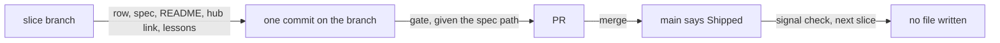
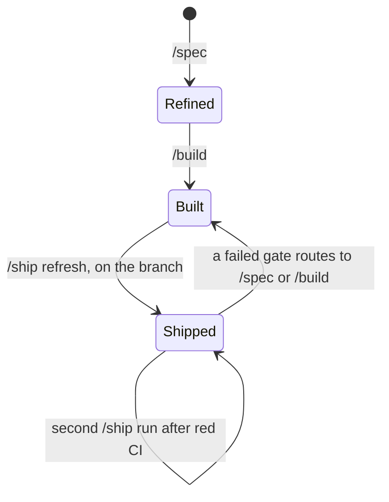
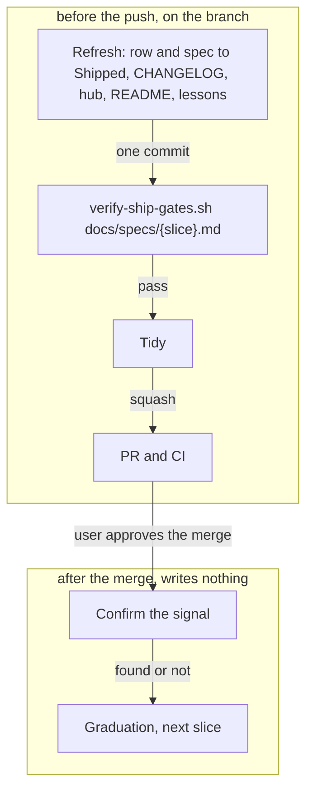
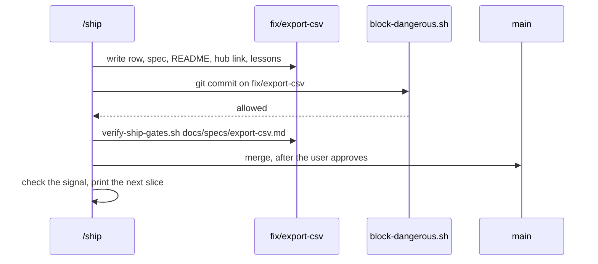

# Shipped in the PR

**Version:** v1 · **Status:** Built · **Type:** Bug · **Project type:** CLI/Library

**Depends on:** None. This fixes GitHub issue #46.

/ship writes every file before the push, so the `Shipped` status, the README
block, the hub link and the lessons go in the slice's own PR. After the merge,
/ship writes nothing, and no slice needs a second PR.

## Problem

/ship marks a slice `Shipped` in its close-out, after the merge
(`plugins/zuko/skills/ship/SKILL.md:219`). At that time the slice branch is
merged, and `block-dangerous.sh` blocks a commit on `main`. So each slice gets
a second PR that only changes a status word.

This repo shows it:

- 31 of the 96 merged PRs are status-only, from a `docs/*-shipped` branch. #59,
  #97 and #101 are three of them.
- `docs/specs/stop-hook-scope.md` still says `Built` on `main`, but its
  `OVERVIEW.md` row says `Shipped`. Its close-out ran only half.

Another project that uses zuko got more than ten status-only PRs, as #46 says.

## Slice test

| Check                         | Result                                                                 |
| ----------------------------- | ---------------------------------------------------------------------- |
| Cuts every layer it needs     | yes — the ship skill text, the hub rule, and one test; no script moves |
| One e2e test walks it         | yes — `test-shipped-in-pr.sh` walks a fixture slice from refresh to merge |
| Worth shipping alone          | yes — the next slice ships with one PR, not two                        |
| Fits (≤5 scenarios, ≤2 areas) | yes — 4 scenarios, one area: /ship                                     |

**Path:** light — a bug fix in three files (`ship/SKILL.md`, `visual-page.md`
and one new test), with no new interface, data or dependency.

## Flow



Every write happens on the slice branch, so the merge carries `Shipped` to
`main`, and nothing after the merge needs a commit.

## States



## Acceptance criteria

```gherkin
Scenario: The slice's own PR carries the Shipped status
  Given the branch "fix/export-csv" with "docs/specs/export-csv.md" at "Built"
  When /ship runs its refresh step
  Then one commit "docs(overview): mark export-csv shipped" sets the spec and its OVERVIEW.md row to "Shipped"
  And the same commit has the README block with "Export the ledger as one CSV" under Features
  And block-dangerous.sh lets that commit through on "fix/export-csv"
  And "verify-ship-gates.sh docs/specs/export-csv.md" passes on the branch

Scenario: Nothing is left to commit after the merge
  Given the PR for "fix/export-csv" is merged into "main"
  When /ship runs its close-out
  Then "main" already shows "export-csv" as "Shipped" in the spec, the OVERVIEW.md row and the README
  And the close-out makes no commit and no branch
  And it prints the next slice from the shape doc

Scenario: A second /ship run after red CI
  Given the spec is at "Shipped" on "fix/export-csv", and CI failed on the PR
  When /ship runs again after the fix
  Then the gate, given "docs/specs/export-csv.md", finds the spec and runs every check
  And a second README render changes nothing

Scenario: The signal is missing after the merge
  Given the PR is merged, and the log line "export-csv: wrote 412 rows" does not appear
  When /ship checks the signal
  Then it says that the signal is missing, and what that can mean
  And it sends the user to /debug, with any fix on a "fix/" branch
  And the spec stays at "Shipped"
```

## Scope

**In:**

- the order of /ship's steps: each write moves before the push
- /ship gives the gate the spec path
- the hub rule in `references/visual-page.md`
- one test file

**Out:**

- a gate check that fails a spec or a row that is not `Shipped` — rejected
  at O3; no slice picks it up
- `docs/specs/stop-hook-scope.md` at `Built` on `main` — a one-word fix, for
  the user to decide; no slice picks it up

## Technical plan

### Approach

The close-out's writes move into the refresh step, so they go in the branch
commit before the gate. The refresh sets the spec and its row to `Shipped`,
not `Built`. /ship gives the gate the spec path, because the gate with no
argument finds only a `Built` spec. After the merge, /ship checks the signal,
offers graduation and prints the next slice. It writes no file.

Relies on: D47 (the ship gate reads the spec's review), D60 and D61 (drafted
here).





### Changes

| File                                                             | What changes                                                                                                                                                      | Why            |
| ---------------------------------------------------------------- | ----------------------------------------------------------------------------------------------------------------------------------------------------------------- | -------------- |
| `plugins/zuko/skills/ship/SKILL.md:34` Refresh the overview      | Set the row and the spec Status to `Shipped`. Republish the hub page, and put a first link on the `## More` line. Capture lessons. Commit as `docs(overview): mark {slice} shipped` | scenario 1     |
| `plugins/zuko/skills/ship/SKILL.md:75` The gates                 | Run the gate as `verify-ship-gates.sh docs/specs/{slice}.md`                                                                                                     | scenario 3     |
| `plugins/zuko/skills/ship/SKILL.md:206` Confirm it works         | A missing signal goes to `/debug`, a fix goes on a `fix/` branch, and the spec stays `Shipped`                                                                    | scenario 4     |
| `plugins/zuko/skills/ship/SKILL.md:219` Close out                | Keep graduation and the next slice. Remove the row flip, the render, the hub, the spec status, the commit and the lessons                                         | scenario 2     |
| `plugins/zuko/references/visual-page.md:68`                      | The hub is built by /ship before the push, not at close-out                                                                                                       | scenario 1     |
| `plugins/zuko/scripts/tests/test-shipped-in-pr.sh`               | New. Text checks on `ship/SKILL.md`, then the e2e walk                                                                                                            | scenarios 1–4  |

Reusing: `render-readme-block.sh --write`, `verify-ship-gates.sh` and
`block-dangerous.sh` as they are; the `section()` helper from
`test-decision-pr.sh`; the fixture repo from `test-e2e-readme.sh`.

### Non-functionals

|                      |                                                                                                                       |
| -------------------- | --------------------------------------------------------------------------------------------------------------------- |
| **Load**             | One /ship run for each slice, about one each day in this repo.                                                        |
| **Breaks first**     | Nothing at 10×. The change is prompt text and one test.                                                               |
| **Security surface** | No new input. The status commit still goes through `block-dangerous.sh` and `secret-scan.sh`, on the slice branch.    |
| **Proof it works**   | The next slice merged after this one has its `docs(overview): mark {slice} shipped` commit inside its own PR, and no `docs/*-shipped` PR follows it. |
| **Rollout**          | No flag. The text ships with the next release. Rollback: revert the merge commit.                                     |

### Test plan

| Scenario | Test                                                                                     | Command                                                  |
| -------- | ---------------------------------------------------------------------------------------- | -------------------------------------------------------- |
| 1        | Refresh text sets `Shipped`; the fixture's status commit passes `block-dangerous.sh` and the gate | `bash plugins/zuko/scripts/tests/run.sh shipped-in-pr`   |
| 2        | Close out text has no commit; after the fixture merge, `main` shows `Shipped`            | `bash plugins/zuko/scripts/tests/run.sh shipped-in-pr`   |
| 3        | The gates text gives the spec path; the gate passes a `Shipped` spec; a second render is a no-op | `bash plugins/zuko/scripts/tests/run.sh shipped-in-pr`   |
| 4        | Confirm it works text sends a missing signal to `/debug`                                 | `bash plugins/zuko/scripts/tests/run.sh shipped-in-pr`   |
| all      | The full suite stays green                                                               | `bash plugins/zuko/scripts/tests/run.sh`                 |

**E2E:** `test-shipped-in-pr.sh` walks a fixture slice from the refresh commit
to the merge. It gives each git step to `block-dangerous.sh` in the state the
step runs in.

### Chunks

Single chunk.

### Risks

| Risk                                                                       | Mitigation                                                                                     |
| -------------------------------------------------------------------------- | ---------------------------------------------------------------------------------------------- |
| An install older than this release still runs the old close-out.            | Update the install after the release, as `installed-plugin-lags-the-repo.md` says.             |
| A PR closed without a merge leaves the hub page with the slice at `Shipped`. | The next /ship or /release builds the hub again from `main`. Accepted at O1.                   |
| A lesson found after the merge has no open branch.                          | The skill puts it in the next branch's refresh commit.                                         |

### Decisions to record

Recorded as D60, D61.

## Review

2026-10-13 · 3 raw findings, 2 survived, 2 fixed.

- correctness · `plugins/zuko/skills/ship/SKILL.md:41` · put the spec and its row back to Built before a failed gate routes to /spec · `cca830d`
- correctness · `plugins/zuko/skills/ship/SKILL.md:71` · take the base branch before the hub page is published · `aedb860`

## Open items

| ID  | What                                                                                                                                                         | Type     | Raised at | Owner | Status | Answer |
| --- | ------------------------------------------------------------------------------------------------------------------------------------------------------------ | -------- | --------- | ----- | ------ | ------ |
| O1  | When does /ship republish the hub page? Before the push, the hub can show a slice as Shipped while its PR is still open.                                      | question | spec p1   | user  | Resolved   | Before the push, with the other writes. A first publish puts its link in the same commit. Other: only at /release. 2026-10-13      |
| O2  | `Shipped` on `main` changes meaning: from "merged, and the signal seen" to "merged with every gate green". The signal check still runs, but does not gate the word. | flag     | spec p1   | user  | Accepted risk   | Accepted: the signal check still runs after the merge, and a missing signal goes to /debug. A second PR for each slice costs more. 2026-10-13      |
| O3  | Does the ship gate also fail a spec, or its `OVERVIEW.md` row, that is not `Shipped`? That changes seven test fixtures and takes the slice off the light path. | question | spec p1   | user  | Resolved   | No. The flip sits in the refresh step, which already sets the row each time. Other: a gate check that changes seven fixtures. 2026-10-13      |
| O4  | The States diagram had no way back from `Shipped`. A gate that fails after the refresh, and routes to /spec, met a `Shipped` spec, and /spec starts a new version of one. | flag     | review    | user  | Decided alone | Chose: a failed gate that routes to /spec or /build first sets the spec and its row back to `Built`, renders the README again and commits (`cca830d`). Other: set the spec to `Shipped` only after the gate passes, with a second commit and a second gate run. Undo: `git revert cca830d`, then move the flip after the gate. 2026-10-13 |

_Never delete this section or its rows. See references/ledger.md._

## Glossary

- **e2e** — end-to-end: one test that walks the whole slice as a user would
- **Close-out** — the last step of /ship, after the merge
- **Refresh step** — the /ship step before the gate that updates `OVERVIEW.md`,
  `CHANGELOG.md` and the README block, and commits them on the branch
- **Hub page** — the one published page for the whole project, built from
  `OVERVIEW.md`
- **Signal** — the log line or metric that the spec names to prove the slice
  works in production
