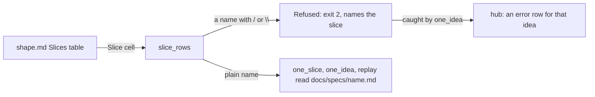
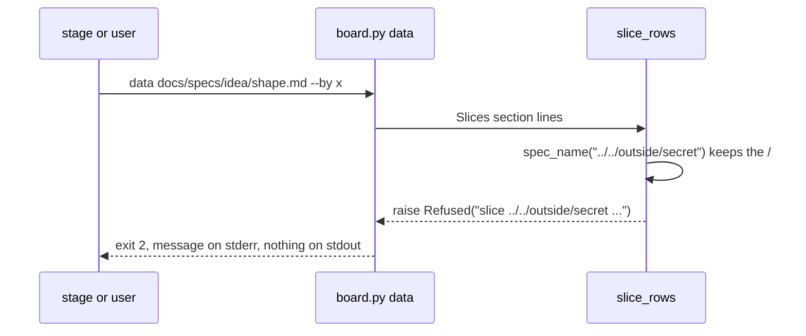

# Slice name path

**Version:** v1 · **Status:** Shipped · **Type:** Bug · **Project type:** CLI/Library

**Depends on:** None

`board.py` refuses a shape whose Slices table names a slice with a `/` or a
`\`. Such a name no longer reads a `.md` file outside `docs/specs` into a
published board. Found by the v2.5.0 pentest (P1).

## Problem

`board.py` builds each slice's spec path from the Slice cell of the shape's
Slices table: `docs/specs/` plus the name plus `.md`. `spec_name()` (`board.py:115`) only
lowercases the cell and removes a leading `/`, so `../` stays in the name.
`one_slice()` (`board.py:533`) then opens the file that the path names, and
puts its first paragraph into the board's JSON. The board is published to
claude.ai.

The v2.5.0 pentest proved it on 2026-10-27, on a scratch copy of `ed8d207`:

| Slices row                              | What `board.py data` printed                                                        |
| --------------------------------------- | ----------------------------------------------------------------------------------- |
| `\| 1 \| ../../../outside/secret \| … \|` | `"text": "Secret notes MARKER-OUTSIDE-SPECS …"`, the first paragraph of `outside/secret.md` |

`one_idea()` (`board.py:750`, the hub's Ideas section) and `replay()` use the
same names. `one_idea()` leaks only the stage of the outside file.

```
shape.md Slices row "../../outside/secret"
        |  read the table
        v
slice_rows -> spec_name        keeps "../"
        |  passes the name to
        +--> one_slice   board.py:533  opens the file outside docs/specs
        +--> one_idea    board.py:750  same path, for the hub
        +--> replay      reads git history for the same names
```

## Slice test

| Check                         | Result                                                                  |
| ----------------------------- | ----------------------------------------------------------------------- |
| Cuts every layer it needs     | Yes. The one function every reader goes through, and its test           |
| One e2e test walks it         | Yes. `test-board.sh` runs `board.py data` on a fixture project          |
| Worth shipping alone          | Yes. It closes pentest P1                                               |
| Fits (≤5 scenarios, ≤2 areas) | Yes. 3 scenarios, 1 area (scripts)                                      |

**Path:** light. A bug fix in 2 files, with no new interface, data or
dependency. Pauses 1 and 3 merged, pause 2 skipped.

The fix is already on `fix/slice-name-path` as `a90569c`, made by `/debug`
before this spec. `/build` checks it against this spec.

## Flow



## Acceptance criteria

```gherkin
Scenario: a slice name that walks out of docs/specs is refused
  Given docs/specs/idea/shape.md has a Slices row "| 1 | ../../outside/secret | b |"
  And outside/secret.md holds "Text from outside docs/specs."
  When board.py data docs/specs/idea/shape.md --by x runs
  Then it exits 2
  And stderr names the slice ../../outside/secret
  And stdout does not hold "Text from outside docs/specs."

Scenario: the hub shows the refused idea as an error row
  Given the same shape in a project with two other shapes
  When board.py library . runs
  Then it exits 0
  And the idea's row shows the refusal, and the other two ideas render as before

Scenario: every real shape still renders
  Given the 4 shapes under docs/specs in this repo
  When board.py data runs on each, and board.py library . runs
  Then each exits 0
```

## Scope

**In:** the check in `slice_rows()`, the `board.py` docstring line that says
so, and the test.

**Out:**

- The CDN script with no integrity hash (pentest P2). Its verifier rejected it
  as a hardening gap, not a vulnerability.
- Names in subfolders such as `archive/old-slice`. No shape uses one. They are
  refused too, and a later slice can allow them if one is needed.

## Technical plan

### Approach

`slice_rows()` raises `Refused` for a name with `/` or `\`. Every reader gets
its names from `slice_rows()`, so one check covers `one_slice`, `one_idea`
and `replay`. `data` and `render` already turn a `Refused` into exit 2 with
the message on stderr (`board.py:900`). `one_idea` already turns it into an
error row on the hub (`board.py:759`).

Relies on: D62 (a script renders the idea board), and D77 drafted below.



### Changes

| File                                          | What changes                                                                                           | Why            |
| --------------------------------------------- | ------------------------------------------------------------------------------------------------------ | -------------- |
| `plugins/zuko/scripts/lib/board.py:137`       | `slice_rows()` raises `Refused` for a name with `/` or `\`. The module docstring says so               | Scenarios 1, 2 |
| `plugins/zuko/scripts/tests/test-board.sh`    | A refusal case: a fixture shape with `../../outside/secret` and a file outside `docs/specs`            | Scenario 1     |

Reusing: `Refused` and its handlers at `board.py:759` and `board.py:900`;
the test file's `run`, `same` and `expect_*` helpers.

### Non-functionals

|                      |                                                                                                      |
| -------------------- | ---------------------------------------------------------------------------------------------------- |
| **Load**             | Unchanged. Two substring checks per slice row                                                        |
| **Breaks first**     | Nothing at 10×. A shape with a subfolder slice name now refuses, and no shape has one                |
| **Security surface** | Closes pentest P1: a Slice cell can no longer name a file outside `docs/specs`                       |
| **Proof it works**   | `bash plugins/zuko/scripts/tests/run.sh board` passes, with the refusal case                         |
| **Rollout**          | No flag. It ships with the next zuko release. Rollback: revert the fix commit                        |

### Test plan

| Scenario                      | Test                                                     | Command                                         |
| ----------------------------- | -------------------------------------------------------- | ----------------------------------------------- |
| 1. A name with `/` is refused | The refusal case in `test-board.sh`                      | `bash plugins/zuko/scripts/tests/run.sh board`  |
| 2. The hub shows an error row | A library case in `test-board.sh`                        | `bash plugins/zuko/scripts/tests/run.sh board`  |
| 3. Real shapes still render   | `board.py data` on each repo shape, and `library .`      | `bash plugins/zuko/scripts/tests/run.sh`        |

**E2E:** the scenario 1 case in `test-board.sh` runs the real `board.py data`
on a fixture project, as a stage runs it.

### Chunks

Single chunk.

### Risks

| Risk                                                         | Mitigation                                                          |
| ------------------------------------------------------------ | ------------------------------------------------------------------- |
| A stage that renders the board now stops on a bad shape      | The message names the slice, so the fix is one edit to the shape    |

### Decisions to record

Recorded as D77.

## Review

2026-10-27 · 0 raw findings, 0 survived. Clean.

## Open items

| ID  | What                                                                                          | Type     | Raised at | Owner | Status | Answer |
| --- | --------------------------------------------------------------------------------------------- | -------- | --------- | ----- | ------ | ------ |
| O1  | A bad slice name: refuse the whole shape (exit 2, hub error row), or skip the row and render the rest? | question | spec p1   | user  | Resolved | Refuse the shape: exit 2 naming the slice, and an error row on the hub (2026-10-27) |

_Never delete this section or its rows. See references/ledger.md._

## Glossary

- **e2e** — end-to-end: one test that walks the whole slice as a user would.
- **Pentest** — the security test `/release` runs on the code it ships; its findings are numbered P1, P2, …
- **Path traversal** — a `../` in a file name that walks out of the folder the code meant to read from.
