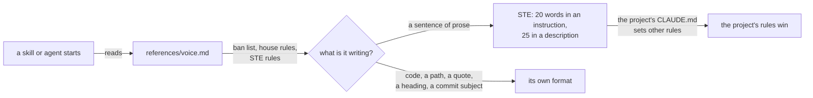
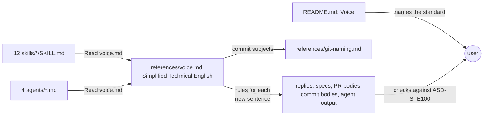

# STE voice

**Version:** v1 · **Status:** Draft · **Type:** Enhancement · **Project type:** CLI/Library

**Shape doc:** docs/specs/ask-up-front/shape.md
**Depends on:** None

zuko writes to the writing rules of ASD-STE100, a published standard that the
user can check against. Slices 3 to 5 write the pause questions and the PR body,
so the rules must be in place before them.

## Problem

zuko's writing follows `references/voice.md`: a ban list and ten house rules.
The rules have no numbers. "Short sentences" does not say how short. The user
cannot check a draft against a standard. In the five newest zuko docs, 14 of 209
prose sentences are longer than 25 words, and the longest has 43 words. A rough
sentence splitter made this count.

The shape says that every stage reads `voice.md` already. Eleven of the twelve
skills read it. `/status` does not read it, and no agent reads it. The agents
are chunk-builder, reviewer, finding-verifier and pentester.

## Slice test

| Check | Result |
| --- | --- |
| Cuts every layer it needs | yes. The rules in `voice.md`, the read line in each skill and agent that lacks it, the README's Voice section, and a contract test. |
| One e2e test walks it | partly. A contract test proves the text. The behaviour shows in the next real stage stop (O1). |
| Worth shipping alone | yes. Every stage writes to a standard that the user can check, and slices 3 to 5 use it from the start. |
| Fits (≤5 scenarios, ≤2 areas) | yes. 5 scenarios. Two areas: zuko's prompt text and the README. |

**Path:** full. It changes 8 files, which is more than the light path allows.
It adds no new interface, data or dependency. Pause 2 is the exact wording of
the rules.

## User story

As the person who reads zuko's specs and replies, I want them written to a
published standard, so I can check a draft against rules that I can look up.

## Flow



Each skill and agent reads `voice.md` when it starts. A sentence of prose
follows the STE rules, unless the project's own rules say otherwise. Code,
paths, quotes, headings and commit subjects keep their own format.

## Acceptance criteria

```gherkin
Scenario: voice.md holds the STE rules
  Given voice.md on main has the ban list and ten house rules, and no STE rules
  When ste-voice ships
  Then voice.md has a section that names ASD-STE100 Issue 9, January 2025
  And the section states each rule in the "Rules adopted" list under Scope
  And it says that zuko does not use the STE dictionary
  And the ban list does not change
  And README.md's Voice section says that the stages write to the ASD-STE100 rules

Scenario: every skill and agent reads voice.md
  Given skills/status/SKILL.md and agents/chunk-builder.md, reviewer.md,
    finding-verifier.md and pentester.md do not name voice.md
  When ste-voice ships
  Then every plugins/zuko/skills/*/SKILL.md names references/voice.md
  And every plugins/zuko/agents/*.md names references/voice.md

Scenario: text that is not prose keeps its own format
  Given /ship writes the commit subject "docs(spec): mark stop-hook-scope shipped"
  And the PR body quotes the command bash plugins/zuko/scripts/tests/run.sh stop-scope
  When /ship applies voice.md
  Then the subject follows git-naming.md, with no article added
  And the command is copied as it is, and counts as one word in its sentence

Scenario: the project's own writing rules win
  Given the repo audit-portal has a CLAUDE.md that says
    "Write audit findings in the passive voice, as our report template does"
  When /review writes a finding in audit-portal
  Then the finding uses the passive voice
  And voice.md says that the project's own writing rules override the STE rules

Scenario: the next real stage stop follows the rules
  Given zuko is installed from the release that has ste-voice
  When /spec stops at pause 1 in a real session
  Then no prose sentence in the stop message has more than 25 words
  And no instruction in it has more than 20 words
```

The contract test proves scenarios 1 to 4 from the text of the files. Scenario
5 is checked by hand at the next real stop (O1).

## Scope

**In:**

- A new section in `voice.md`, next to the ban list. The ban list and the house
  rules stay. House rule 2, "Short sentences", points to the STE limits.
- **Rules adopted.** These rules need no dictionary, and a public source
  confirms each one (O5):
  - An instruction has 20 words or fewer. A description has 25 words or fewer.
  - One instruction in each sentence. Put a condition before the instruction.
  - Write an instruction as a command.
  - Use the active voice. In a description, use the passive only when the
    doer is not known.
  - A noun cluster has no more than three words.
  - One topic in each paragraph, and six sentences or fewer.
  - Use an "-ing" form only as a technical noun, or in one.
  - Do not leave out the verb, the subject or the article to make a sentence
    shorter.
  - Use a vertical list for complex text.
- **Which text.** Every new sentence that zuko writes: terminal replies, specs,
  shapes, PR bodies, commit bodies, CHANGELOG lines, reports, and agent output.
- **Not prose (O6).** Code, commands, paths, quoted text, headings, table
  labels, diagram labels and other fragments keep their own format. Quoted text
  includes the user's words, ticket text and tool output. Commit subjects follow
  `git-naming.md`. Code comments match the comments in the file around them.
- **Full sentences.** A full sentence follows the rules, also in a table cell
  or a Gherkin step. A command, path, number or name in backticks counts as one
  word.
- **Clash.** When the project's CLAUDE.md sets its own writing rules, those
  rules win. STE fills the gaps (O4).
- The read line goes into `skills/status/SKILL.md` and the four agent files (O2).
- One sentence in README.md's Voice section.
- A contract test, `tests/test-ste-voice.sh`.

**Out:**

- The STE dictionary of about 900 approved words. Shape O1 rejected it, and no
  slice picks it up.
- The STE rules that depend on the dictionary, and the rules for safety
  warnings. zuko writes no aerospace-style warnings. No slice picks them up.
- Rule numbers. The repo has no copy of Issue 9 (O3).
- Rewriting old specs, skills and references into STE. Shape "Not doing": new
  text only.
- A script or gate that measures sentence length (O1). No slice picks it up.
- The wording of the pause questions and the PR body. pause-questions and
  decision-pr write those, in this voice.

## Interface

The interface is the text that Claude reads. This section gives the exact
wording that `/build` puts into each file.



Each skill and agent reads `voice.md`. Its new section sets the rules for each
new sentence. The README tells the user which standard to check against.

### The new section in voice.md

It goes after "Banned outright" and before "Rules".

```markdown
## Simplified Technical English

zuko writes to the writing rules of ASD-STE100, Issue 9 (January 2025).
ASD-STE100 is Simplified Technical English, a standard from ASD, the European
aerospace and defence association. zuko uses the writing rules only. It does
not use the STE dictionary of approved words.

The rules apply to each new sentence that zuko writes. This includes terminal
replies, specs, shapes, PR bodies, commit bodies, CHANGELOG lines, reports and
agent output. Old text stays as it is.

An instruction tells the reader to do something. A description tells the
reader what is true.

1. An instruction has 20 words or fewer. A description has 25 words or fewer.
2. Write one instruction in each sentence. Put a condition before the
   instruction.
3. Write an instruction as a command.
4. Use the active voice. In a description, use the passive voice only when the
   doer is not known.
5. Do not make a noun cluster of more than three words.
6. Write about one topic in each paragraph. A paragraph has six sentences or
   fewer.
7. Use an "-ing" form only as a technical noun, or as part of one.
8. Do not leave out a verb, a subject or an article to make a sentence shorter.
9. Use a vertical list for complex text.

A command, path, number or name in backticks counts as one word.

**Not prose.** These keep their own format:

- code, commands and paths
- quoted text: the user's words, ticket text and tool output, copied as it is
- headings, table labels, diagram labels and other fragments
- commit subjects, which follow `git-naming.md`
- code comments, which match the comments in the file around them

A full sentence follows the rules, also in a table cell or a Gherkin step.

**The project's rules win.** When the project's CLAUDE.md sets its own writing
rules, follow those rules. The STE rules fill the gaps.
```

### House rule 2 in voice.md

Before:

```markdown
2. **Short sentences.** If a sentence has two ideas, make it two sentences.
```

After:

```markdown
2. **Short sentences.** If a sentence has two ideas, make it two sentences.
   The word limits are in "Simplified Technical English", above.
```

### README.md, Voice section

One paragraph goes after the current paragraph:

```markdown
The sentence rules come from ASD-STE100, Simplified Technical English. An
instruction has 20 words or fewer, and a description has 25 or fewer.
```

### The read line

`/status` and the four agents get this line. The agents already name
`owasp.md` with `${CLAUDE_PLUGIN_ROOT}`, so `voice.md` uses the same form.

```markdown
Read `${CLAUDE_PLUGIN_ROOT}/references/voice.md` before you write anything.
```

## Open items

| ID | What | Type | Raised at | Owner | Status | Answer |
| --- | --- | --- | --- | --- | --- | --- |
| O1 | How do we prove that zuko writes to the STE rules? | question | spec p1 | user | Resolved | A contract test proves the text. The next real `/spec` stop shows the behaviour. No check script, no headless spike. 2026-10-12 |
| O2 | `/status` and the four agents do not read `voice.md`. Which of them should? | question | spec p1 | user | Resolved | All of them. Every skill and agent names `voice.md`. 2026-10-12 |
| O3 | Does the user have a copy of ASD-STE100 Issue 9, so `voice.md` can cite rule numbers? | question | spec p1 | user | Resolved | No. `voice.md` states each rule in its own words, with no numbers. 2026-10-12 |
| O4 | When the project's CLAUDE.md sets other writing rules, which wins? | question | spec p1 | user | Resolved | The project's rules. STE fills the gaps. 2026-10-12 |
| O5 | Assuming the adopted rules are the ones that public sources confirm: the shape's list and the Wikipedia summary of Issue 9. Rules not checked against a source are left out. | assumption | spec p1 | user | Resolved | Accepted as written. A missing rule costs one line in `voice.md` later. 2026-10-12 |
| O6 | Assuming code, commands, paths, quotes, headings, table labels, diagram labels and commit subjects are not prose, and a name in backticks counts as one word. | assumption | spec p1 | user | Resolved | Accepted with two changes. Code comments match the file. A full sentence follows STE, also in a table cell or a Gherkin step. 2026-10-12 |

_Never delete this section or its rows. See references/ledger.md._

## Glossary

- **ASD-STE100** — Simplified Technical English. A writing standard from ASD,
  the European aerospace and defence association. It has 53 writing rules and a
  dictionary of approved words. ASD owns the text.
- **Noun cluster** — nouns stacked in a row, such as "spec gate check failure
  message".
- **Contract test** — a test that checks the text of a prompt or reference file,
  not what Claude does with it.
- **Headless run** — running Claude Code with `claude -p`, with no terminal UI,
  so a script can check what it did.
- **e2e** — end-to-end: one test that walks the whole slice as a user would.
